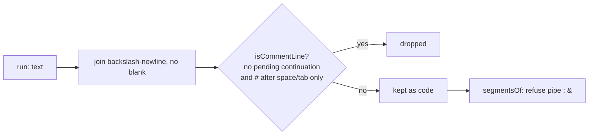

# PR Summary — Issue #5304

## Summary

`codeOf` in `worker/deno/lib/aws_emulator_workflow_check.ts` dropped two kinds
of `run:` line as comments, although bash runs them as commands: a line whose
`#` follows a non-ASCII blank, and a `#` line that a trailing backslash
continues into. Each could hide a `|| exit 0` or `|| true` from
`checkAwsEmulatorWorkflow` (the test step) and
`checkContainerBuildRunsAwsEmulator` (the agent-run step), so a step could end
green without running `infra/cloudformation/test-aws-emulator.sh`. `codeOf` and
`codeLines` now share one helper, `isCommentLine`, and `codeOf` joins backslash
continuations as bash does. Closes #5304.

## Spec

### Intent and Rationale

- The issue describes the non-ASCII-blank trigger, and its comment describes the
  continuation trigger. Both trace to one rule, "which physical lines are
  comments", so the fix is one shared helper and not two patches
- `isCommentLine` holds the rule `codeLines` already applied: a line is a
  comment only when no continuation is pending into it and its first character
  after spaces and tabs (bash's only blanks) is `#`

### Essential Design Decisions

- `codeOf` removes backslash-newline with no blank inserted, as bash does.
  Keeping the continued `#` line alone is not enough: `shellCommands` replaces a
  backslash-newline with a space, which would read `script.sh\` + `#` as
  `script.sh #` (a comment) where bash runs the different file `script.sh#`.
  `lib/shell_command_words.ts` is unchanged, and so is its other caller,
  `aws_emulator_in_ci_check.ts`
- The fix treats only space and tab as blanks, the first remedy the issue names.
  It does not refuse all non-ASCII text in `codeOf`. A kept line such as
  `# || exit 0` still carries its `|`, so `segmentsOf` refuses it
- `codeLines` behaves exactly as before. Only its comment test moved into the
  helper

### Undiscoverable Facts

- Observed with real bash:
  `printf 'set -e\n\xc2\xa0# || exit 0\necho RAN\n' | bash` printed
  `bash: line 2:  #: command not found` and exited 0, and nothing after that
  line ran. `printf 'set -e\n./no-such\\\n# || true\necho after\n' | bash`
  printed `./no-such#: No such file or directory`, then `after`, and exited 0

## Evidence

Backend-only change; the tests below verify it.

- Callers of `codeOf` that this change touches:
  - `segmentsOf`, and through it `stepInvokes`, `stepInstallsRunner`,
    `stepIsOnlyScript`, `stepIsAgentRun` and the build-step search
  - `stepMayRetagImage`
  - the `GITHUB_ENV`/`GITHUB_PATH` writer check

  A kept line can only add `|`, `;` or `&`, so it refuses more. The no-blank
  join is not one-way. It joins a word Bash joins, so it can add text these see
  (`docker \` + `build` now matches the retag regex), and it can also make a
  caller accept a command `shellCommands` used to split: a script path, or
  `docker`, split mid-word by a real continuation is now read as the one word
  Bash runs, and accepted. A line joins the next only on a real continuation
  (an odd run of trailing backslashes) outside a comment. A line ending in an
  escaped backslash (an even run) ends its command, as in Bash, so `FOO=\\`
  followed by `true <script>` still runs `true`, and is refused. A `#` line
  that a continuation reaches after a blank is a comment, which ends at its
  newline whatever it ends in, so `set -euo pipefail \` / `# note \` /
  `exit 0` before the script runs `exit 0` as its own command, and is refused.
  Both real workflows still pass.
- Docs: `docs/EC2-LINUX-VERIFICATION.md` names both validators, but nothing in
  it describes comment handling, so it is unchanged. Updated in this diff: the
  module header bullet (a), the `codeOf` doc comment, and the
  `stepRunsGateScript` doc comment. That comment said reading the gate step with
  `segmentsOf` would drop a continued `# || true` line, which is no longer true.
- Issue numbers this diff cites: #5304 (aws_emulator_workflow_check: `codeOf`
  drops lines as comments that bash runs as commands) and #5110 (CI: migrate
  VibeCoder's AWS tests to AWS Emulator and record real coverage gaps; it was
  already cited and is kept).

## Test Plan

- Added to `worker/deno/tests/issue_5110_aws_emulator_workflow_test.ts`. No
  existing test was edited.
  - Refused by `checkAwsEmulatorWorkflow` with `[test-step] no step runs`:
    - a non-breaking space before `# || exit 0`
    - an ideographic space before `# || exit 0`
    - the script line continued onto `# || true`
    - the script line continued onto a bare `#`, which bash runs as `script.sh#`
  - Accepted (`[]`) by the same check, as look-alikes:
    - an ASCII-space comment line
    - a tab-indented comment line
    - `script.sh \` followed by `# trailing note`, which bash reads as a
      trailing comment
  - Refused by `checkContainerBuildRunsAwsEmulator`, as two new cases in the
    existing agent-run refusal loop:
    - a non-breaking space before `# || exit 0` above the docker line
    - the docker line continued onto `# || true`
  - Accepted by the same check: an ASCII comment line above the docker line.
  - Escaped backslash at the end of a line (review of `c00fe13`), each refused:
    `FOO=\\` then `true <script>` and `FOO=\\` then `: <script>`
    (`[test-step] no step runs`); the same shape before `true bash
    container/toolchains/aws-cli.sh` (`[pinned-cli] no step runs`); and before
    `true docker build` in `container-build.yml` (one `[container-agent-run]`
    finding). Accepted, as its look-alike: a real continuation, `FOO=\` then
    `true <script>`, which Bash runs as `FOO=true <script>`.
- Red on base: with `lib/aws_emulator_workflow_check.ts` restored from
  `origin/main`, the test file gave `FAILED | 197 passed | 6 failed`. The six
  failures are the six refusal cases above, and the look-alikes passed. With the
  fix, `issue_5110_aws_emulator_workflow_test.ts` together with
  `aws_emulator_in_ci_check_test.ts` gave `ok | 365 passed | 0 failed`.
- Corpus: the two files these validators police,
  `.github/workflows/aws-emulator.yml` and
  `.github/workflows/container-build.yml`, give `[]` at head, through the
  existing "real … passes" tests (0 false positives). The cases above are the
  false-negative set: all 6 are refused at head, and 0 were refused on base. The
  gate-script tests for continued `#` lines still pass unchanged.
- `./quality.sh < /dev/null` on head `f57b2fa1d`:
  `Result: PASSED (with skipped
  checks)` (config integration and checkov
  skipped). The first attempt was killed by my 900-second `timeout` with no
  output. Re-run under a longer bound, it passed.
- Escaped backslash, after the fix: the test file gives
  `ok | 208 passed | 0 failed`. With the library from `c00fe13` it gave
  `FAILED | 204 passed | 4 failed` (the four escaped-backslash refusals), and
  with the library from `origin/main` `FAILED | 201 passed | 7 failed` (the six
  comment-line refusals and the real-continuation accept case, which main
  split into `FOO=` and `true <script>`). Bash itself was checked:
  `FOO=\\` then `echo $FOO` prints `\`, and `FOO=\` then `echo` runs
  `FOO=echo`.
- Comment reached by a continuation (review of `38003c5`): `set -euo pipefail \`
  continued onto `# note \`, `#\` or an indented `  # note \`, then `exit 0`
  (or `exec true`), before the script, gives the `[test-step] … must run only`
  finding; the same three lines before the agent `docker run` give one
  `[container-agent-run]` finding. The accept case `script.sh \` then
  `# trailing note` still passes. The test file gives `ok | 213 passed |
  0 failed`; with the library from `38003c5` it gave `FAILED | 208 passed |
  5 failed` (these five). Bash was checked: that step prints nothing after
  `exit 0` and exits 0.
- Not done or not checked: the same-line shape, `set -euo pipefail # note \`
  then `exit 0`, is still read as one continued line (main accepts it too; it
  is recorded on #5304). A non-ASCII character elsewhere on a kept line is
  not refused on its own. A backslash inside quotes is still counted as if
  unquoted when deciding whether a line continues.

🤖 Generated with [Claude Code](https://claude.com/claude-code)
