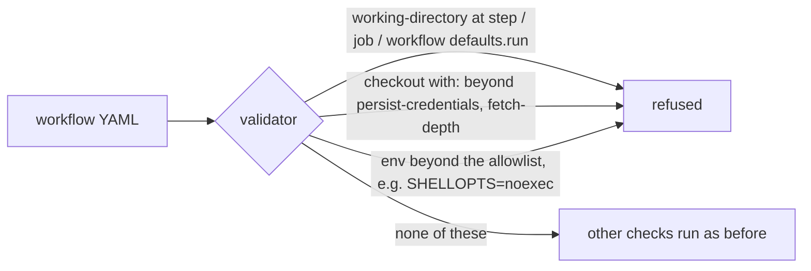

# PR Summary — Issue #5305

## Summary

The workflow validators in `worker/deno/lib/aws_emulator_workflow_check.ts` did
not read the keys that decide which script a step runs, or whether bash runs the
step body at all. With one of these keys added, each validator returned `[]` for
its real workflow, while the step could end green without running its script.
This change makes all three validators refuse them:

- `checkContainerBuildRunsAwsEmulator`: a `working-directory` reaching the
  `changes` filter step, and a checkout `with:` input other than
  `persist-credentials` and `fetch-depth`. Job `container`'s env now refuses
  `SHELLOPTS` too.
- `checkQualityCallsAwsEmulator`: the same rules for the `gate` job, the issue's
  first comment. The gate step's env may set only `NEEDS_JSON`, and there may be
  no `gate` job `env:` or `container:` and no workflow `env:`.
- `checkAwsEmulatorWorkflow`: an `env:` on the test step, its job or the
  workflow, the issue's second comment.

Closes #5305.

## Spec

### Intent and Rationale

- The issue names the `changes` job keys, and its two comments name the same
  defect class in the quality.yml `gate` job and in `env:` keys (for example
  `SHELLOPTS=noexec`). All three are fixed here, because they are one class in
  one module.
- The rules are allowlists, so an input nobody thought of fails closed:
  - checkout `with:` keys are limited to `persist-credentials` and `fetch-depth`
  - the gate step's env may set only `NEEDS_JSON`
  - no env at all on the test step, its job or the workflow
  - any `working-directory`, at step, job `defaults.run` or workflow
    `defaults.run` level, is refused

### Essential Design Decisions

- `stepIsPlainCheckout` is shared by the `changes` and `gate` checks, so the
  `with:` allowlist lives there once (`CHECKOUT_WITH_KEYS`). A `with:` that is
  not an object (an expression) is not plain.
- The new `setsWorkingDirectory` fails closed: a `defaults` or `defaults.run`
  that is defined but not an object counts as setting a working directory.
- Job `container`'s env stays a denylist (`INHERITED_ENV_REFUSED`), with
  `SHELLOPTS` added. The real job sets `IMAGE` and `IMAGE_CHANGED`, and turning
  that list into an allowlist was not asked for.
- The `gate` and test-step env rules are separate findings with their own
  messages. For the test step, one `[test-step]` finding covers all three
  levels.

### Undiscoverable Facts

- Observed with real bash 5:
  `env SHELLOPTS=noexec bash --noprofile --norc -eo pipefail s.sh` (where `s.sh`
  echoes `RAN` and exits 1) printed nothing and exited 0. The same run without
  the variable printed `RAN` and exited 1. `env SHELLOPTS=noexec sh -e s.sh` ran
  the body, because dash ignores the variable. That is why the rule names bash's
  variable.

## Evidence

Backend-only change. The tests below verify it.

- Docs updated: `docs/EC2-LINUX-VERIFICATION.md`. I read three paragraphs
  through: the aws-emulator.yml wiring paragraph, the
  `checkQualityCallsAwsEmulator` paragraph and the
  `checkContainerBuildRunsAwsEmulator` paragraph. Each now names the new rule.
- Doc comments updated in the module header and on these definitions:
  - `checkContainerBuildRunsAwsEmulator`
  - `checkQualityCallsAwsEmulator`
  - `gateJudgesNeeds`
  - `stepIsPlainCheckout`
  - `INHERITED_ENV_REFUSED`
- Issue numbers this diff cites: #5305 (container-build validator does not read
  the keys that decide which detect script the filter step runs). The existing
  `PR #5276 review` citation is unchanged.

## Test Plan

- Added to `worker/deno/tests/issue_5110_aws_emulator_workflow_test.ts`. These
  are new cases or new entries in existing case lists; no existing test or
  assertion was edited. Each refusal asserts exactly one finding, its tag and
  the new rule's message.
  - Refused by `checkContainerBuildRunsAwsEmulator`:
    - `working-directory` on the filter step
    - `defaults.run.working-directory` on job `changes`
    - `defaults.run.working-directory` on the workflow
    - job `changes` `defaults` given as an expression
    - the `changes` checkout gaining `ref`
    - the `changes` checkout gaining `repository`
    - the `changes` checkout gaining `path`
    - job `container` env `SHELLOPTS`
  - Refused by `checkQualityCallsAwsEmulator` (`[gate-script]`):
    - the gate step env gaining `SHELLOPTS`
    - job `gate` env
    - workflow env
    - job `gate` `container:`
    - the step's `working-directory`
    - job `gate` `defaults.run.working-directory`
    - workflow `defaults.run.working-directory`
    - the gate checkout gaining `ref`
    - the gate checkout gaining `repository`
  - Refused by `checkAwsEmulatorWorkflow` (`[test-step]`): `SHELLOPTS` in the
    env of the test step, of job `cloudformation`, and of the workflow.
  - Accepted (`[]`), as look-alike controls:
    - job `changes` `defaults.run.shell: bash`
    - the gate checkout gaining `fetch-depth: 0`
    - job `gate` `defaults.run.shell: bash`
- Red on base: the new cases against the unfixed lib gave 196 passed and 20
  failed. The 20 failures are exactly the 20 refusal cases above, and the 3
  controls passed. After the fix:
  - `issue_5110_aws_emulator_workflow_test.ts` gave 216 passed, 0 failed.
  - `aws_emulator_in_ci_check_test.ts` together with
    `quality_gate_script_5110_test.ts` gave 172 passed, 0 failed.
- Corpus: the three files these validators police, `aws-emulator.yml`,
  `quality.yml` and `container-build.yml`, still give `[]` at head through the
  existing "real … passes" tests (0 false positives). That holds because each
  real checkout sets only `persist-credentials` (and `fetch-depth` in
  `changes`), and none of the three sets a `working-directory`. The false
  negatives are the 20 refusal cases: all 20 are refused at head, and none was
  refused on base.
- Existing tests that the new checks run before: the gate test with no env still
  gets exactly its one `NEEDS_JSON` finding, and the existing `changes` and
  `gate` "no step but" refusals still match their messages.
- `./quality.sh < /dev/null` on head `dc7c2a535`:
  `Result: PASSED (with skipped
  checks)`. The skipped checks were config
  integration and checkov.
- Not done or not checked:
  - The aws-emulator.yml test step does not refuse a `working-directory`. The
    issue and its comments do not ask for that.
  - Job `container`'s env is still a denylist.
  - Variables that bash does not read but the scripts might, such as `GIT_*` in
    job `container`, are not in scope.

🤖 Generated with [Claude Code](https://claude.com/claude-code)
