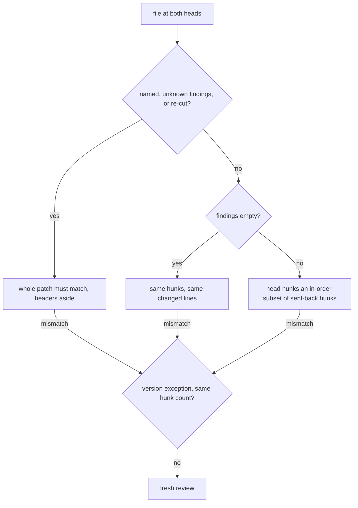

## Summary

`ownDiffUnchanged` in the review-fleet-prs gate re-reviewed a sent-back PR when
a base merge absorbed a hunk of a file the PR still changes, because the
comparison for a file no finding names required the same hunk count at both
heads (VibeCoder#5294: `docs/CALLBACKS.md` went from 2 hunks to 1). That file
may now lose hunks: every hunk at the new head must appear in the sent-back
patch, in the same order, with identical changed lines. This applies only when
the findings for the exact sent-back head are known, number at least one, and
none names the file. Closes #5307.

## Spec

### Intent and Rationale

- A hunk the base gained is the same kind of absorption as the #4542 file drop,
  so it uses the same guard rather than a new one.
- An in-order subsequence match (one advancing index, linear in hunk count)
  keeps "a hunk only the head has" and "a changed remaining hunk" as fresh
  reviews.

### Essential Design Decisions

- Empty findings (`[]`) keep the old `sameChangedLines` same-hunk-count check;
  unknown findings, a named file (qualified path or earlier-finding gap), a
  Dependabot re-cut and a held PR keep the strict whole-patch path, because
  `findingNamesFile` treats them as named.
- The version exception (`onlyVersionHunkDiffers`) still needs the same hunk
  count; an absorbed hunk and a version re-bump in one file get a fresh review.
- Assumption: any number of hunks may be absorbed, not just one; the guard is
  per file, as for the file drop. A head patch with zero hunks therefore
  matches, which is no wider than the #4542 drop that already allows the whole
  file to go.

### Undiscoverable Facts

- The issue's reproduction (live `gh` output for #5294, `4fc97083c` →
  `4ec8ca2e6`) showed the absorbed `docs/CALLBACKS.md` hunk alone made
  `ownDiffUnchanged` return false; the test fixture models that case.

## Evidence

Backend/CLI change only (`gate.ts` and skill docs). Tests in
`worker/deno/tests/review_fleet_prs_gate_2675_test.ts`:

- `ownDiffUnchanged: a base merge that absorbed one hunk of a file the PR still changes is awaiting-fix (Issue #5307)`
  — red on the unfixed `gate.ts` (`Actual false / Expected true`), green after;
  also asserts `skipReason` gives `awaiting-fix`.
- `ownDiffUnchanged: a finding naming the file, qualified or through an earlier gap, is a fresh review (Issue #5307)`
- `ownDiffUnchanged: unknown or empty findings keep the hunk count check (Issue #5307)`
- `ownDiffUnchanged: a head hunk missing from the sent-back patch, or out of order, is a fresh review (Issue #5307)`
- `ownDiffUnchanged: a remaining hunk whose changed lines differ is a fresh review (Issue #5307)`

Each negative test carries an allowed control (findings naming only `a.ts`,
identical remaining hunk) so only the probed difference refuses it.

Docs updated: rule 8 in `.claude/skills/review-fleet-prs/SKILL.md` and the
"Version-only re-bumps" section of
`.claude/skills/review-fleet-prs/references/edge-cases.md`, including the
sentences "same hunks, same order" and "Files present at both heads are compared
as before", which the change made false. The doc comment above
`ownDiffUnchanged` is updated; the held-PR comment at the caller still holds
(findings undefined → strict path). No other copy of this rule was found.

Issue numbers cited: #5307: review-fleet-prs re-reviews a sent-back PR when a
base merge absorbs one hunk of a file the PR still changes.

## Test Plan

- `deno task test:unit tests/review_fleet_prs_gate_2675_test.ts` (from
  `worker/deno`): 70 passed, 0 failed, including the five new tests. No existing
  test was edited; the #4476 "extra hunk at head" and #4516 "hunk counts differ"
  cases (head-only hunks) still return a fresh review.
- `./quality.sh < /dev/null`: PASSED (config integration and checkov skipped by
  the gate).

Not done or not checked: no live `gh` re-run against #5294; the zero-hunk head
patch case is accepted by design (see Essential Design Decisions) and has no
dedicated test.
