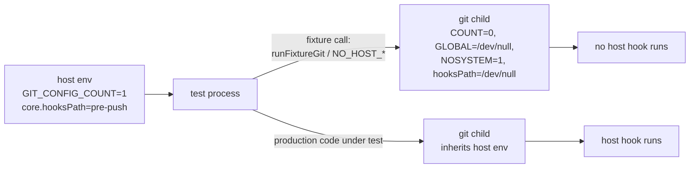

## Summary

Test fixtures' own git calls no longer run under the host's injected git config
and hooks. The isolation Issue #5254 added to `pre_push_gate_test.ts` is now one
shared helper, `worker/deno/tests/support/no_host_git_config.ts`. It exports:

- `NO_HOST_GIT_CONFIG`: `GIT_CONFIG_COUNT=0`, `GIT_CONFIG_GLOBAL=/dev/null` and
  `GIT_CONFIG_NOSYSTEM=1`.
- `NO_HOST_HOOKS_ARGS`: `-c core.hooksPath=/dev/null`.
- `runFixtureGit`: a `runGitCommand` wrapper that applies both.

The fixture git calls in 167 test files and shared fixtures now go through it.
That covers `git_branch_sync_test.ts`, `git_pull_conflict_test.ts`,
`branch_cleanup_test.ts`, the shared fixtures (`git_repo_fixture.ts`,
`git_fixture.ts`, `markdown_docs.ts`, `drift_check_fixture.ts`,
`babysitter_tree_fixture.ts`, `push_recovery_repos.ts`,
`babysitter_container_fakes_4770.ts`), `git_branch_test.ts` (`runGit`, its local
`runFixtureGit` and `laneContentionFixture`), the inline closures in
`fleet_pr_babysitter_test.ts`, and fixtures that spawn git in other forms:
`new Deno.Command(cmd, …)` in `security_fix_discrimination_test.ts` and
`git_guard_shim_test.ts`, `runWithTimeout("git", …)` in
`worktree_progress_test.ts` and `progress_extension_runtime_test.ts`, and
`run(["git", …])` in `first_run_script_test.ts`. The five local copies of
`NO_HOST_GIT_CONFIG` (including the one in `pr_round_repo_formatters_test.ts`)
and the per-file wrappers now import the helper. Closes #5309.

## Spec

### Intent and Rationale

- The fleet container injects its `pre-push` hook through
  `GIT_CONFIG_COUNT`/`GIT_CONFIG_KEY_0=core.hooksPath`. Command-scope config
  outranks repository config, so a fixture can only escape it through its own
  git child's env or a `-c` flag. The helper sets both, as #5254 did.
- The audit was run, not read from the source. Each batch of converted files ran
  with a refusing `pre-commit`/`commit-msg`/`pre-push` hook injected the host's
  way, and again without it.

### Essential Design Decisions

- `runFixtureGit` spreads the shield after the caller's `env`, so a caller
  cannot re-inject host config. The per-file wrappers it replaced did not agree
  on the spread order.
- Only fixture calls changed. Some calls are left alone: calls made by the
  production code under test, fake or recorded runners, and source text a
  checker scans (`git_ref_argv_check_test.ts`,
  `git_spawn_chokepoint_check_test.ts`, `gh_spawn_chokepoint_check_test.ts`,
  `spawn_timeout_check_test.ts`). So is the deliberately unshielded positive
  control in `fleet_pr_babysitter_git_hardening_test.ts`.
- Some tests rely on their own hooks or config. A test that installs its own
  hooks keeps them running: `hooks_pre_commit_test.ts` gets only the env shield,
  and `pre_push_gate_retry_test.ts` keeps its own `core.hooksPath`. In
  `milestone_rollback_test.ts` (`GIT_CONFIG_COUNT=2` maintenance entries) and
  `pr_ci_processor_test.ts` (a `clearEnv` call with its own
  `GIT_CONFIG_GLOBAL`), the test's own `GIT_CONFIG_*` entries are spread after
  the shield, so they still apply.
- No production code under `worker/deno/lib/` changed. The fake AWS key in
  `secrets_history_scan_test.ts`'s trufflehog-parser test gained `nosemgrep`
  lines: shielding that file put it in semgrep's changed-file scan.

### Undiscoverable Facts

- Git calls made by the production code a test exercises still inherit the test
  process's environment. Examples are
  `pushUnpushedCommits`/`commitAndPushPending` (`lib/git_push.ts`),
  `syncMilestoneBranchWithDefault` and `pushFeatureBranch` (`lib/git_pull.ts`),
  and `claimMilestoneSync`. A test helper cannot reach them. With a refusing
  `pre-push` hook injected, 125 tests in the files that push still fail through
  those calls. The issue asks for fixture calls, so isolating them would need a
  production seam.
- `shellcheck_publication_test.ts` has two `pre-push CLI` tests that fail with
  no hook injected as well. They fail on the base branch too and are not touched
  here.

## Evidence

Backend/test change only; no UI files.



Observed with real git: `-c core.hooksPath=/dev/null` alone and
`GIT_CONFIG_COUNT=0` alone each let a push through an env-injected refusing
hook. Without either, the push prints `HOSTILE_PRE_PUSH_HOOK_RAN` and exits 1.

The command used to inject the hook, run from `worker/deno`:

```text
GIT_CONFIG_COUNT=1 GIT_CONFIG_KEY_0=core.hooksPath GIT_CONFIG_VALUE_0=$H \
  deno task test:unit <files> < /dev/null
```

`$H` holds `pre-push`, `pre-commit` and `commit-msg` scripts that print a marker
and exit 1. Results:

- **Files that push fixtures** (earlier commits): the base branch gave
  `FAILED | 2690 passed | 308 failed` over 64 files. After conversion,
  `FAILED | 3140 passed | 125 failed`. The 125 are the production-code pushes
  and base-branch tests listed above.
- **The 97 non-push files converted last**, run in five batches together with
  the importers of the shared fixtures. All batches passed both with and without
  the injection, and the marker was never printed:
  - `ok | 998 passed | 0 failed`
  - `ok | 602 + 7 passed | 0 failed`
  - `ok | 427 + 61 passed | 0 failed`, plus the two integration suites run
    directly: `ok | 41 passed | 0 failed`
  - `ok | 561 + 16 passed | 0 failed`
  - `ok | 87 passed | 0 failed`
- **Last sweep** (the files the pre-PR verifier named, plus
  `no_host_git_config_test.ts`): `ok | 255 passed | 0 failed` both with and
  without the injection, marker never printed. The 22 untouched files that name
  git in another spawn form, run with the injection: `488 passed | 1 failed`.
  The one failure was the `git_guard_shim_test.ts` commit, now shielded:
  `ok | 19 passed | 0 failed` both ways. The others use fake runners or scan
  source text.
- **Control**: a plain `git commit` with the same injected env printed the
  marker and exited 1.

Issues cited as provenance:

- #5254: pre_push_gate_test.ts fixtures run `git push` under the host's git
  hooks and config.
- #5309: Other test files run fixture `git push` under the host's git hooks and
  config (same leak as #5254).

## Test Plan

- Added `worker/deno/tests/no_host_git_config_test.ts`. It runs real git against
  a refusing `pre-push` hook injected through the child's env, with no change to
  the process env:
  - `control: an injected hooksPath runs the hook and refuses the push`
  - `helper: NO_HOST_GIT_CONFIG overlaid on the injected hooksPath lets the push through`
  - `helper: NO_HOST_HOOKS_ARGS alone lets the push through without the env`
  - `global config: a hostile GIT_CONFIG_GLOBAL runs the hook; the helper shuts it out`
  - `system config: a hostile GIT_CONFIG_SYSTEM runs the hook; the helper shuts it out`

  Each helper case has a control showing that the same injection refuses the
  push.
- The existing test files changed only how their fixture git calls are spawned:
  an args prefix and env, a local wrapper switched to `runFixtureGit`, and in a
  few fixtures an explicit `init -b main` or identity. These replace defaults
  the global config used to supply. No assertion or expected value was removed
  or changed. The `secrets_history_scan_test.ts` edit adds comments only.
- `runFixtureGit` tests in the same file push through it with a caller env
  carrying the injected hooksPath, and with a hostile `GIT_CONFIG_GLOBAL`:
  - `runFixtureGit: a caller env carrying the injected hooksPath cannot run the hook`
  - `runFixtureGit: a hostile GIT_CONFIG_GLOBAL in the caller env cannot run the hook`

  Red check: with the body changed to `return runGitCommand(args, options);`,
  the file gives `FAILED | 5 passed | 2 failed`. The change was reverted.
- `./quality.sh < /dev/null` on commit `01d25e647`:
  `Result: PASSED (with
  skipped checks)`, exit 0. Semgrep passed over the 162
  changed files, and `deno tests`, lint, type check and fmt passed. Config
  integration and checkov were skipped.
