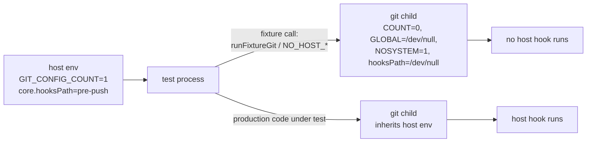

## Summary

Fixture git calls no longer run under the host's injected git config and hooks
in the test files that push fixtures through real git. The
isolation Issue #5254 added to `pre_push_gate_test.ts` is now one shared
helper, `worker/deno/tests/support/no_host_git_config.ts`. It exports
`NO_HOST_GIT_CONFIG` (`GIT_CONFIG_COUNT=0`, `GIT_CONFIG_GLOBAL=/dev/null`,
`GIT_CONFIG_NOSYSTEM=1`), `NO_HOST_HOOKS_ARGS` (`-c core.hooksPath=/dev/null`)
and `runFixtureGit`, a `runGitCommand` wrapper that applies both. The four
local copies of `NO_HOST_GIT_CONFIG` and the per-file wrappers now import it.
`git_branch_sync_test.ts`, `git_pull_conflict_test.ts`,
`branch_cleanup_test.ts` and the two shared fixtures (`git_repo_fixture.ts`,
`git_fixture.ts`) are among the files converted.

The issue also asks for "every fixture git call in the test suite". About 100
test files that spawn real git but never push a fixture are not converted yet,
so this is Part of #5309.

## Spec

### Intent and Rationale

- The fleet container injects its `pre-push` hook through
  `GIT_CONFIG_COUNT`/`GIT_CONFIG_KEY_0=core.hooksPath`. Command-scope config
  outranks repository config, so a fixture can only escape it through its own
  git child's env or `-c` flag. The helper sets both, as #5254 did.
- The audit was run, not read from the source. Every test file that passes
  `"push"` to git, plus every importer of the shared fixtures, was run with a
  refusing `pre-push` hook injected the host's way. The fix was then confirmed
  the same way.

### Essential Design Decisions

- `runFixtureGit` spreads the shield after the caller's `env`, so a caller
  cannot re-inject host config. The per-file wrappers it replaced did not agree
  on the spread order.
- Only fixture calls changed. Calls of the production code under test, fakes,
  and calls where a test deliberately sets hooks or `GIT_CONFIG_*` (for example
  `pre_push_hook_test.ts`, `claude_runner_pre_push_3394_test.ts`, the
  `pre-receive` hook in `milestone_route_restore_test.ts`) are unchanged.
- No production code under `worker/deno/lib/` changed.

### Undiscoverable Facts

- Injecting the hook, as the host does, still refuses 125 tests in 36 files.
  Each was traced to a push the production code under test makes itself:
  `pushUnpushedCommits`/`commitAndPushPending` (`lib/git_push.ts`),
  `pushSyncedMilestoneBranch`/`syncMilestoneBranchWithDefault` and
  `updatePrBranch`/`pushFeatureBranch` (`lib/git_pull.ts`),
  `claimMilestoneSync`, `healStaleBranchLineage`, `pushUnpushedBranches`,
  `pushLearnings` and the conflict-takeover resolvers. A test helper cannot
  reach those calls, because they inherit the test process's environment.
- `shellcheck_publication_test.ts` has two `pre-push CLI` tests that also fail
  with no hook injected (`GIT_CONFIG_COUNT=0`). They fail on the base branch
  too, so they are not part of this change.

## Evidence

Backend/test change only; no UI files.



Observed with real git: `-c core.hooksPath=/dev/null` alone and
`GIT_CONFIG_COUNT=0` alone each let a push through an env-injected refusing
hook (`HOSTILE_PRE_PUSH_HOOK_RAN`, exit 1, without either).

Audit command, run from `worker/deno` against the test files that pass `"push"`
to git and the importers of the shared fixtures:

```text
GIT_CONFIG_COUNT=1 GIT_CONFIG_KEY_0=core.hooksPath GIT_CONFIG_VALUE_0=$H/hooks \
  deno test --frozen --lock=deno.lock --allow-read --allow-env --allow-run \
  --allow-write --allow-sys=hostname --allow-net --parallel <files> < /dev/null
```

`$H/hooks/pre-push` prints `HOSTILE_PRE_PUSH_HOOK_RAN` and exits 1.

- Base branch, the 124 push files: `FAILED | 2690 passed | 308 failed`, in 64
  files. The same files with `GIT_CONFIG_COUNT=0`:
  `FAILED | 2996 passed | 2 failed`, the two base-branch `shellcheck_publication`
  tests.
- Head, the push files plus the fixture importers:
  `FAILED | 3140 passed | 125 failed`. All 125 are production pushes or the two
  base-branch tests, as listed above.

Issues cited as provenance: #5254: pre_push_gate_test.ts fixtures run `git push`
under the host's git hooks and config. #5309: Other test files run fixture
`git push` under the host's git hooks and config (same leak as #5254).

## Acceptance Criteria

- **missing** — Use it for every fixture git call in the test suite — reason:
  only the files that push fixtures through real git (and the importers of the
  shared fixtures) are converted; about 100 test files that spawn real git but
  never push a fixture still read the host's config, and the run's budget did
  not cover converting them and re-running the gate.

## Test Plan

- Added `worker/deno/tests/no_host_git_config_test.ts`. It runs real git
  against a refusing `pre-push` hook injected through child env, with no
  process-env mutation:
  - `control: an injected hooksPath runs the hook and refuses the push`
  - `helper: NO_HOST_GIT_CONFIG overlaid on the injected hooksPath lets the push through`
  - `helper: NO_HOST_HOOKS_ARGS alone lets the push through without the env`
  - `global config: a hostile GIT_CONFIG_GLOBAL runs the hook; the helper shuts it out`
  - `system config: a hostile GIT_CONFIG_SYSTEM runs the hook; the helper shuts it out`

  Each helper case has a control showing that the same injection refuses the
  push.
- The 61 edited existing test files change only how their fixture git calls are
  spawned (args prefix and env), plus a local wrapper switched to
  `runFixtureGit`. No assertion or expected value was removed or changed.
- `GIT_CONFIG_COUNT=0` runs: every changed file passed in its executor group,
  except the two base-branch `shellcheck_publication` tests. The consolidated
  wrapper set passed `ok | 145 passed | 0 failed`.
- `./quality.sh < /dev/null` on commit `34993367e`: `Result: PASSED (with skipped
  checks)`, exit 0 (config integration and checkov skipped).

Not done: about 100 test files whose fixtures only commit or inspect, and the
production-code pushes listed under Undiscoverable Facts, still inherit the
host's git config. The second of these needs a production seam, not a test
helper. `runFixtureGit` has no test of its own: it is exercised through the
converted files, for example `git_branch_sync_test.ts`, which passes under the
injected hook.
