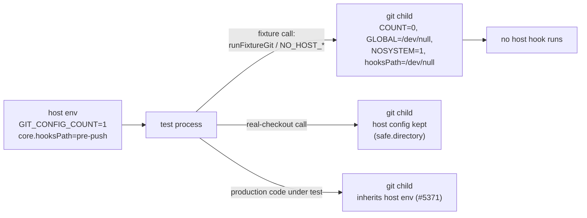

## Summary

Test fixtures' own git calls no longer run under the host's injected git config
and hooks. The isolation Issue #5254 added to `pre_push_gate_test.ts` is now one
shared helper, `worker/deno/tests/support/no_host_git_config.ts`. It exports:

- `NO_HOST_GIT_CONFIG`: `GIT_CONFIG_COUNT=0`, `GIT_CONFIG_GLOBAL=/dev/null` and
  `GIT_CONFIG_NOSYSTEM=1`.
- `NO_HOST_HOOKS_ARGS`: `-c core.hooksPath=/dev/null`.
- `runFixtureGit`: a `runGitCommand` wrapper that applies both, with the env
  shield spread after the caller's env.

The fixture git calls in 166 test files and shared fixtures now use it. That
covers `git_branch_sync_test.ts`, `git_pull_conflict_test.ts`,
`branch_cleanup_test.ts` and the shared fixtures (`git_repo_fixture.ts`,
`git_fixture.ts`, `drift_check_fixture.ts`, `babysitter_tree_fixture.ts`,
`push_recovery_repos.ts`, `babysitter_container_fakes_4770.ts`). The five local
copies of `NO_HOST_GIT_CONFIG` and the per-file wrappers now import the helper.
Closes #5309.

This redoes the abandoned PR #5364 and carries its conversion, with the four
blocking review findings fixed:

- The three calls that run git on the real checkout are back to their
  base-branch form, so a `safe.directory` entry in the host's global config still
  applies to them. They are `runGit` in `tests/support/markdown_docs.ts`,
  `trackedPaths` in `token_economizer_trial_docs_test.ts` and the
  `check-ignore` call in `next_release_tag_test.ts`.
- The system-config control now pins the global scope.
- `runFixtureGit` has tests that fail when either of its two layers regresses on
  its own.
- The evidence below comes from a command that actually delivers the injected
  env.

## Spec

### Intent and Rationale

- The fleet container injects its `pre-push` hook through
  `GIT_CONFIG_COUNT`/`GIT_CONFIG_KEY_0=core.hooksPath`. Command-scope config
  outranks repository config, so a fixture can only escape it through its own
  git child's env or a `-c` flag. The helper sets both, as #5254 did.
- Each layer covers a case the other misses. The env shield shuts out every
  non-hook host setting (identity, `init.defaultBranch`, `commit.gpgsign`).
  The `-c` flag also overrides a repository-local `core.hooksPath`, which the
  env cannot reach.

### Essential Design Decisions

- Only calls on fixture repositories changed. These were left alone: calls on
  the real checkout (listed in Summary), calls made by the production code under
  test, and fake or recorded runners. So was source text that a checker scans
  (`git_ref_argv_check_test.ts`, `git_spawn_chokepoint_check_test.ts`,
  `gh_spawn_chokepoint_check_test.ts`, `spawn_timeout_check_test.ts`), and the
  deliberately unshielded positive control in
  `fleet_pr_babysitter_git_hardening_test.ts`.
- Tests that rely on their own hooks or config keep them. `hooks_pre_commit_test.ts`
  gets only the env shield, and `pre_push_gate_retry_test.ts` keeps its own
  `core.hooksPath`. In `milestone_rollback_test.ts` and `pr_ci_processor_test.ts`,
  the test's own `GIT_CONFIG_*` entries are spread after the shield.
- Fixtures that relied on the global config now set what they need explicitly,
  such as `init -b main` or an identity. No production code under
  `worker/deno/lib/` changed. The fake AWS key in `secrets_history_scan_test.ts`
  gained `nosemgrep` comments, because shielding that file put it in semgrep's
  changed-file scan.

### Undiscoverable Facts

- Production code that a test calls still pushes with the test process's
  environment. Examples are `pushUnpushedCommits`/`commitAndPushPending`
  (`lib/git_push.ts`), `syncMilestoneBranchWithDefault` and `pushFeatureBranch`.
  Some of these already accept `options.env`: `PushLineageOptions` extends
  `GitCommandOptions`, and `git_push_preflight_test.ts` passes
  `NO_HOST_GIT_CONFIG` through it. The issue asks for fixture calls, so those
  tests are tracked by #5371 and not converted here.
- `deno task test:unit` cannot show the leak. Its passes run with
  `clearEnv: true` and an allowlist that has no `GIT_CONFIG_*` name, so an
  injected hook never reaches them. The evidence below uses plain `deno test`,
  which inherits the environment.

## Evidence

Backend/test change only; no UI files.



Observed with real git: `-c core.hooksPath=/dev/null` on its own, and
`GIT_CONFIG_COUNT=0` on its own, each let a push through an env-injected
refusing hook. With neither, the push prints `HOSTILE_PRE_PUSH_HOOK_RAN` and
exits 1.

The injection run uses plain `deno test`, which inherits the environment. Run
from `worker/deno`, where `$H` holds `pre-push`, `pre-commit` and `commit-msg`
scripts that print `HOSTILE_HOST_HOOK_RAN` and exit 1:

```text
GIT_CONFIG_COUNT=1 GIT_CONFIG_KEY_0=core.hooksPath GIT_CONFIG_VALUE_0=$H \
  deno test --allow-all <file> < /dev/null
```

- **Base copy of `git_branch_sync_test.ts`** (from `origin/main`), injected:
  `FAILED | 0 passed | 8 failed`. Each failure is the fixture's own commit:
  `git commit -m Initial commit failed (1): HOSTILE_HOST_HOOK_RAN`.
- **Head, injected:**
  - `branch_cleanup_test.ts`: `ok | 63 passed | 0 failed`.
  - `no_host_git_config_test.ts`: `ok | 11 passed | 0 failed`.
  - `git_branch_sync_test.ts`: `FAILED | 7 passed | 1 failed`.
  - `git_pull_conflict_test.ts`: `FAILED | 6 passed | 5 failed`.

  Each of the six remaining failures is a merge or push made by the production
  code under test (`syncFeatureBranchWithDefault`, `updatePrBranch`,
  `syncMilestoneBranchWithDefault`), not by a fixture. #5371 tracks those
  failures.
- **Head, no injection:** `git_branch_sync_test.ts` gives
  `ok | 8 passed | 0 failed`.

Issues cited as provenance:

- #5254: pre_push_gate_test.ts fixtures run `git push` under the host's git
  hooks and config.
- #5309: Other test files run fixture `git push` under the host's git hooks and
  config (same leak as #5254).
- #5371: Tests that push through production code still run `git push` under
  the host's git hooks and config.

## Test Plan

- `worker/deno/tests/no_host_git_config_test.ts` runs real git against hostile
  config passed through the child's env, leaving the process env unchanged:
  - `control: an injected hooksPath runs the hook and refuses the push`
  - `helper: NO_HOST_GIT_CONFIG overlaid on the injected hooksPath lets the push through`
  - `helper: NO_HOST_HOOKS_ARGS alone lets the push through without the env`
  - `global config: a hostile GIT_CONFIG_GLOBAL runs the hook; the helper shuts it out`
  - `system config: a hostile GIT_CONFIG_SYSTEM runs the hook; the helper shuts it out`.
    Its control now pins `GIT_CONFIG_GLOBAL=/dev/null` and
    `GIT_CONFIG_NOSYSTEM=0`, so a host's global config cannot hide the system
    file.
  - `runFixtureGit: a caller env carrying the injected hooksPath cannot run the hook`
  - `runFixtureGit: a hostile GIT_CONFIG_GLOBAL in the caller env cannot run the hook`
  - `runFixtureGit: the env layer alone shuts out a caller's injected GIT_CONFIG_COUNT entry`,
    plus the same for `GIT_CONFIG_GLOBAL` and `GIT_CONFIG_SYSTEM` files. Each
    reads `init.defaultBranch`. A plain-git control reads the hostile value,
    and `runFixtureGit` with the same caller env gets exit 1 and no output.
  - `runFixtureGit: the args layer alone shuts out a repo-local core.hooksPath`.
    The hooks path set in the repository's own config runs the hook under
    plain git, even with `NO_HOST_GIT_CONFIG`. `runFixtureGit` still pushes
    cleanly.
- Mutation checks on the helper, each reverted afterwards (the helper is
  unchanged by this round):
  - `env: options.env`: `FAILED | 8 passed | 3 failed`.
  - Reversed spread `{ ...NO_HOST_GIT_CONFIG, ...options.env }`:
    `FAILED | 8 passed | 3 failed`.
  - Hooks args dropped: `FAILED | 10 passed | 1 failed`. The failure is the
    args-layer test, with `HOSTILE_PRE_PUSH_HOOK_RAN`.
- `deno task test:unit tests/no_host_git_config_test.ts`: `ok | 11 passed |
  0 failed`. Plain `deno test --allow-all` with a refusing `pre-push` hook
  injected through `GIT_CONFIG_COUNT=1`: `ok | 11 passed | 0 failed`.
- The three restored real-checkout calls:
  - `deno task test:unit tests/token_economizer_trial_docs_test.ts`:
    `ok | 31 passed | 0 failed`.
  - `deno test --allow-all tests/next_release_tag_test.ts`, an integration
    suite that `test:unit` skips: `ok | 29 passed | 0 failed`.
  - `deno task test:unit tests/drift_pins_on_base_3193_test.ts
    tests/drift_pins_on_base_3238_test.ts` (the callers of `pinsAlreadyOnBase`,
    which uses `runGit`): `ok | 17 passed | 0 failed`.
- The existing test files only changed how their fixture git calls are spawned:
  an args prefix and env, a local wrapper switched to `runFixtureGit`, or, in a
  few fixtures, an explicit `init -b main` or identity. No assertion or expected
  value was removed or changed.

QUALITY_RESULT
