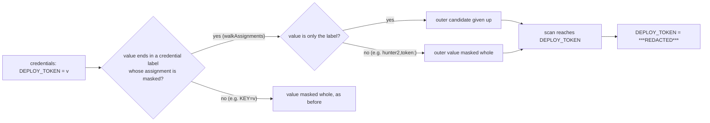

# PR Summary — Issue #5310

## Summary

The `secret-assignment` rule in `worker/deno/lib/secret_redaction.ts` took a
second credential label as the first label's value. For
`Rotate these credentials: DEPLOY_TOKEN = <value>`, on one line or across two,
it masked `DEPLOY_TOKEN`, resumed the scan after it, and published `<value>`
unchanged. The same leak hit `The secret: api_key: <value>`, a YAML child such
as `secrets:` then `API_TOKEN: <value>`, and
`credentials: DEPLOY_TOKEN="<value>"`.

The pattern is unchanged from the base. The decision is made where the value is
judged:

- A new walker, `walkAssignments`, is the one scan that both the replacement
  pass (`redactAssignments`) and `containsSecret`'s detection use.
- When the outer value ends in a credential label, the outer candidate may be
  given up. `trailingLabel` finds it: a key-shaped run of at most 128 characters
  holding a credential keyword, followed by at most a closing quote or the
  `=`/`:` the value swallowed. A single-quoted inner value holding a space
  (`DEPLOY_TOKEN='a b'`) is also covered: the label may sit just before one of
  the value's last two `'`. The label's own assignment must run past the value
  and be masked. The walk then resumes at the inner label, and that label's own
  match masks its value. This covers hyphenated, dotted and quoted inner labels
  (`DEPLOY-TOKEN`, `app.DEPLOY_TOKEN`, `"DEPLOY_TOKEN"`).
- The outer value is given up unmasked only when it is nothing but that label:
  an optional `"` or `'`, then label characters (`[A-Za-z0-9_.-]`). When other
  text sits before the label (`password: hunter2,token: <value>`,
  `TOKEN=abc123;SECRET='d9 e8'`, `password: ab#c1TOKEN = <value>`), the outer
  value is still masked whole, as on base, and the walk still continues at the
  inner label. The inner key and separator then sit inside the outer mask, so
  only the part of the inner value past it is masked again:
  `password: ***REDACTED*** ***REDACTED***`.
- Otherwise the outer value is masked exactly as on base. A value that merely
  contains a credential word keeps its mask. That holds for
  `password: abcTOKENxyz =`, and also for `password: TOKENab#c1 = <ghp_ token>`,
  where a signature rule has already masked the token.
- A label whose value already reads `***REDACTED***` also gives the outer value
  up. The check uses the same label and the pattern's separator shape, so it
  covers `api_key: ***REDACTED***`, `DEPLOY_TOKEN="***REDACTED***"` and the
  cross-line form. A second pass changes nothing.

The rule interface gained a whole-text form: a rule supplies either a `pattern`
and `replace`, or an `apply` and `detect` pair. The `secret-assignment` rule
uses `apply: redactAssignments` and `detect: detectsSecretAssignment`, so its
old per-match `replace` callback, which nothing could reach any more, is gone,
along with both checks on the rule's pattern identity.

`SECURITY.md` has one new bullet describing the rule. `.github/gitleaks.toml`
exempts two exact historical mentions of the new test's synthetic fixture (see
Test Plan).

Closes #5310.

## Spec

### Intent and Rationale

- The leak came from the outer match consuming the inner label. Giving up that
  candidate puts the existing rule back in charge of the inner assignment, with
  all its value judgements (switch words, `${{ … }}`, JSON scalars, the
  cross-line checks from Issue #1727).
- The issue suggested refusing any label followed by `=` or `:`. That would
  split a password such as `MySecret:2024x` and publish its `MySecret:` prefix,
  because the inner match would mask only `2024x`. The walker gives the outer
  value up only when the inner assignment is itself masked and runs past the
  outer value, so `KEY=v` and `Secret:abc` are still masked whole.

### Essential Design Decisions

- Only the label that ends the value is tried, or the one just before one of the
  value's last two `'`. An inner assignment can only start there and run past
  the value, because the value's run stops where the inner separator's
  whitespace or quote begins. A single-quoted inner value holding a space is the
  one shape where the value takes the inner `='a` with it. The label is found by
  walking back at most 128 characters (`INNER_LABEL_MAX`). The pattern is run on
  it only when a separator follows. The pattern's key group is quadratic on a
  long run of keywords, so a longer run is never re-scanned as a key. It keeps
  the base mask (Issue #3942 linearity rule).
- The search past the value is cut to 256 characters (`INNER_ASSIGNMENT_SPAN`).
  An inner separator or value further out than that falls back to the base
  behaviour.
- `CREDENTIAL_KEYWORD` copies the key group's keyword list. It is used only to
  decide whether a trailing run is a label. A keyword added to one must be added
  to the other.
- `detectsSecretAssignment` uses the same walk as the replacement pass. So the
  decode-then-rescan pass (Issue #188) now flags a base64 blob whose decoded
  text holds a label-as-value credential. On base that blob was published.

### Undiscoverable Facts

- The base code also leaked a credential under a credential-labelled YAML child
  key (`secrets:` then `API_TOKEN: <value>`). The outer match swallowed
  `API_TOKEN:` as a mapping key and never scanned its value. This change fixes
  that too. I observed it with a scratch script before writing the test.

## Evidence

Backend only; no UI file is touched.

- Fix: in `worker/deno/lib/secret_redaction.ts`, `walkAssignments`,
  `isLabelOnly`, `pastFloor`, `trailingLabel`, `innerAssignment` and
  `redactAssignments`, plus the comment above the `secret-assignment` entry in
  `RULES`. `RedactionRule` is a union of the per-match and whole-text forms;
  `redactSecrets` and `matchesSignatureRule` call `apply` and `detect` where a
  rule has them. The `MAPPING_KEY_VALUE` doc comment notes that a
  credential-labelled child key whose value is masked no longer reaches that
  test.
- Docs: `SECURITY.md`, section "An assignment's value is judged, not only its
  label", has a new bullet. It describes the label shape and says a credential
  word elsewhere in a value keeps the mask. The rest of the file is unchanged
  from `main`. I read the whole section. `docs/THREAT-MODEL.md` and `README.md`
  do not describe this rule.
- Corpus run on the final commit: base (`origin/main` at `5dde2633c`), the
  previous head (`d6c9a377`) and this head's `redactSecrets` over 4,626 tracked
  files (`*.md`, `docs/`, `prompts/`, `.github/workflows/*.yml`,
  `worker/deno/tests/*.ts`). A second pass over each output changed nothing in
  any file. Base and head output differs in 4 files:
  - Three are this PR's own text: `SECURITY.md`'s new bullet, this summary and
    the new test. In each, head masks the inner value instead of the label.
  - The fourth is ``const secret = `PASSWORD: ${SECRET}`;`` in
    `worker/deno/tests/secret_redaction_markdown_1727_test.ts`. Base masked
    `` `PASSWORD: `` as the value of `secret` and published the value after it.
    A backtick is not an opening quote here, so the outer value is not only a
    label: head masks it whole and also masks the value after `PASSWORD:`. The
    previous head kept `` `PASSWORD: `` visible.
  - Comparing placeholders line by line, head has fewer than base on two lines
    only, both the new test's chain fixture
    `credentials: secret: DEPLOY_TOKEN
    = <value>`: base masked the label
    `secret:`, head keeps it and masks the value. No line publishes text that
    base masked except such a label.
  - The corpus holds none of the review's text-before-label shapes, so the new
    tests carry that evidence (see Test Plan).
- Timing, on the verifier's fixture (`credentials:` + `TOKEN`×N + `!`): 100, 200
  and 400 KB took 67, 133 and 267 ms at this head. The previous head took 1,070,
  4,127 and 16,463 ms. The verifier measured 68, 136 and 270 ms on base.
- Issue numbers cited:
  - #5310: secret-assignment rule publishes a credential when its label is
    consumed as the value of an earlier credential label.
  - #1727, #3942, #4705 and #5083 are cited as they were already cited in the
    files this PR touches.

## Test Plan

- **Added `worker/deno/tests/secret_redaction_label_as_value_5310_test.ts`, 75
  tests**, all through `redactSecrets` and `containsSecret`:
  - **Leak cases** must mask the inner value and keep both labels:
    - `DEPLOY_TOKEN = <40-char value>` on the same line and the next line;
    - `api_key: <value>` on the same line and the next line, each with the short
      value `pw42` and a 40-char value;
    - a YAML child `API_TOKEN: <value>` under `secrets:`;
    - a double-quoted inner value, and a chain of three labels;
    - a label 60 characters long;
    - hyphenated, dotted, double-quoted and single-quoted inner labels, and a
      hyphenated next-line form;
    - a single-quoted inner value holding a space,
      `credentials: DEPLOY_TOKEN='<a b>'`.
  - **Text before an inner label stays masked** (PR review): seven inputs, each
    with its exact output and a check that no value appears in it —
    `password: hunter2,token: <ghp_ token>`,
    `db_password: Winter2026!;gh_token: <ghp_ token>`,
    `password: hunter2,token: ***REDACTED***`,
    `user: bob,password: hunter2,token: abc123`, `TOKEN=abc123;SECRET='d9 e8'`,
    `password: ab#c1TOKEN = <ghp_ token>` and the chain
    `a_password: x1,b_token: y2,c_secret: z3`. `containsSecret` is true on each.
  - **Idempotence:** for each of the 22 leak inputs,
    `redactSecrets(redactSecrets(x)) === redactSecrets(x)` and
    `containsSecret(redactSecrets(x)) === false`.
  - **Decode-then-rescan:** the base64 of the YAML-child form and of the
    next-line `api_key:` form is masked whole, and `containsSecret` is true.
  - **Controls** keep base output:
    - `password=MySecret:2024x` is masked whole;
    - `credentials: DEPLOY_TOKEN=<value>` is masked as one run;
    - `GH_TOKEN: ${{ secrets.GH_TOKEN }}` and a bare `deploy:` child are
      unchanged, with `containsSecret` false;
    - a standalone `DEPLOY_TOKEN = <value>` is masked;
    - `password: abcTOKENxyz` keeps its mask with seven different tails, among
      them a dangling `=` or `:`, end of text, and a cross-line prose value;
    - a keyword mid-value before a `ghp_` token keeps both masks:
      `password: TOKENab#c1 = <token>`, the `:` form
      `password: abc-TOKEN.x9 : <token>` and the quoted form
      `password: "a TOKEN b" = "<token>"`.
  - **Hostile inputs**, each asserting its exact output:
    - a 200,000-character run before `_TOKEN` and 40 spaces;
    - 20,000 repeats of `TOKEN` followed by `!`;
    - `credentials:` + 100,000 repeats of `TOKEN` (500 KB) with four tails: `!`,
      nothing, `: x` and `= x`. As in `secret_redaction_redos_test.ts` there is
      no stopwatch; the size is the detector.
- **Red runs, observed:**
  - With `worker/deno/lib/secret_redaction.ts` restored from `origin/main`, the
    new file gave `36 passed | 18 failed`. The 15 leak cases, the 60-character
    label case and the two base64 cases failed.
  - With the library from the previous head commit (`2396849b7`), it gave
    `44 passed | 10 failed` in 2m34s. The three keyword-before-token controls
    failed, as did five idempotence cases and the `: x` and `= x` hostile tails.
    The idempotence failures were both `api_key:` same-line forms,
    `DEPLOY_TOKEN="…"`, `DEPLOY_TOKEN='…'` and the hyphenated next-line form.
    The `!` and empty tails passed, but only after about 30 s each.
  - With this head but `detectsSecretAssignment` restored to the base loop, it
    gave `52 passed | 2 failed`: the two base64 cases.
  - With the library from the previous head commit (`d6c9a377`), it gave
    `61 passed | 14 failed`: each of the seven text-before-label inputs failed
    both its output check and its no-value check.
  - With the library from the previous head commit (before the
    masked-placeholder tail check),
    `credentials: TOKEN='<token>';db_pass=Winter2026` published
    `;db_pass=Winter2026`; the two new tail cases (a masked token and a literal
    placeholder, each followed by more of the same value) cover it.
  - At head it gives `81 passed | 0 failed`.
- **Existing tests:** none edited. Every test file that mentions
  `redactSecrets`, `containsSecret` or `secret_redaction` passes at head: 54
  files, 1,242 passed, 0 failed. This run used a scratch import map in place of
  the `jsr:@std/*` imports, since jsr.io was unreachable from the host; CI runs
  the suites as written. That includes `secret_redaction_test.ts`, its
  `_markdown_1727_`, `_redos_`, `_bounds_`, `_boolean_setting_`,
  `_json_structure_` and `_prose_heading_5253_` siblings,
  `fleet_telemetry_redaction_test.ts` and `run_stats_redaction_test.ts`.
- **Full gate:** `./quality.sh < /dev/null` passed on an earlier head
  (`be3317ae0`) with `Result: PASSED (with skipped checks)`. The gate itself
  skipped `config integration` (no `.config.json`) and `checkov` (no checkov on
  PATH). `deno task test:unit` over every unit test file also passed on that
  head (parallel and serial passes, 0 failed). The review fix was not run
  through the full gate locally; CI runs it. `deno fmt`, `deno lint` and
  `deno check` on the two changed files are clean.
- **Gitleaks exemption:**
  - The first commit carrying the literal YAML fixture was already pushed. CI
    scans every commit in the PR range, so `.github/gitleaks.toml` exempts that
    exact line, and the backtick-quoted mention of it that an earlier commit of
    this summary carried. This follows the file's existing exact-line entries
    (Issues #4705, #5083) rather than rewriting the pushed branch.
  - `gitleaks git --config .github/gitleaks.toml --log-opts="origin/main..770765920"`
    reported 1 leak before the edit and none after it.
  - In a temp directory, a higher-entropy value on the same line shape is still
    reported under the edited config, so the exemption is exact.
  - `gitleaks_template_conformance_test.ts` and `gitleaks_check_test.ts`: 42
    passed.
  - The new `ghp_` fixture is built by concatenation. `gitleaks dir` with the
    repo config over the changed test and library found no leaks.

## Merge verification

- CI on this head: pending.

## Not done or not checked

- Base behaviour applies, and the inner value is published as on base, in three
  cases:
  - The inner label's separator or value sits more than 256 characters past the
    outer value. For example, `credentials: DEPLOY_TOKEN` + 300 spaces +
    `= <value>` still leaks.
  - The inner label is longer than 128 characters. The `= x` hostile test pins
    `credentials: <500 KB of TOKEN> = x` as `credentials: ***REDACTED*** = x`.
  - The inner label sits neither at the end of the outer value nor just before
    one of its last two `'`. That happens when the first word of a single-quoted
    inner value itself holds two `'`:
    `credentials: DEPLOY_TOKEN='a'b'c <value>'` publishes `<value>'`, as on base
    (run at head). The earlier head tried any label inside the value. No test
    covers this shape.
- An inner label opened by a backtick (`` `PASSWORD: <value>` ``) counts as text
  before the label, so the outer value, label included, is masked whole with the
  inner value. Nothing is published, but the label is not kept.
- No reviewer sub-agents ran, because the issue has no acceptance-criteria list.
