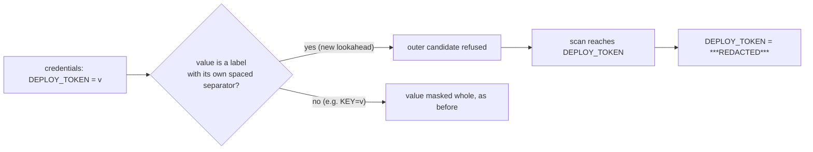

# PR Summary — Issue #5310

## Summary

The `secret-assignment` rule in `worker/deno/lib/secret_redaction.ts` took a
second credential label as the first label's value. For
`Rotate these credentials: DEPLOY_TOKEN = <value>`, on one line or across two,
it masked `DEPLOY_TOKEN`, resumed the scan after it, and published `<value>`
unchanged. The same leak hit `The secret: api_key: <value>`, a YAML child such
as `secrets:` then `API_TOKEN: <value>`, and
`credentials: DEPLOY_TOKEN="<value>"`.

`SECRET_ASSIGNMENT_PATTERN` now has one bounded negative lookahead directly
after its separator. It refuses a value that is itself a credential label whose
own separator has whitespace or a double quote around it. Those are the only
shapes where the bare-value run (`[^\s"]+`) stops before the inner value. The
scan then reaches the inner label, and that label's own match masks its value.
`redactSecrets` and `containsSecret` share the pattern, so both change together.
`SECURITY.md` records the rule. `.github/gitleaks.toml` exempts two exact
historical mentions of the new test's synthetic fixture (see Test Plan).

Closes #5310.

## Spec

### Intent and Rationale

- The leak came from the outer match consuming the inner label. Refusing that
  candidate puts the existing rule back in charge of the inner assignment, with
  all its value judgements (switch words, `${{ … }}`, JSON scalars, the
  cross-line checks from Issue #1727). No new masking logic is added.
- The issue suggested refusing any label followed by `=` or `:`. That would
  split a password such as `MySecret:2024x` and publish its `MySecret:` prefix,
  because the inner match would mask only `2024x`. The narrower lookahead
  refuses only the shapes that actually leak, so `KEY=v` and `Secret:abc` are
  still masked whole, exactly as before.

### Essential Design Decisions

- Every quantifier in the lookahead is bounded (Issue #3942 linearity rule): at
  most 64 word characters either side of the keyword, and at most 32 whitespace
  characters before the separator. Past those bounds the rule behaves as it did
  before this change. That is the accepted cost; no realistic label is that
  long.
- The keyword list in the lookahead is a copy of the key group's list in the
  same literal. A keyword added to one must be added to the other.
  `secret-cli-flag` uses its own lower-case list and is unchanged.

### Undiscoverable Facts

- The base code also leaked a credential under a credential-labelled YAML child
  key (`secrets:` then `API_TOKEN: <value>`): the outer match swallowed
  `API_TOKEN:` as a mapping key and never scanned its value. This change fixes
  that too. I observed it with a scratch script before writing the test.

## Evidence

Backend only; no UI file is touched.

- Fix: `SECRET_ASSIGNMENT_PATTERN` and the comment above the `secret-assignment`
  entry in `RULES`, in `worker/deno/lib/secret_redaction.ts`. The
  `MAPPING_KEY_VALUE` doc comment notes that a credential-labelled child key no
  longer reaches that test.
- Docs: `SECURITY.md`, section "An assignment's value is judged, not only its
  label", has a new bullet. I read the whole section. `docs/THREAT-MODEL.md` and
  `README.md` do not describe this rule.
- Corpus run: base and head `redactSecrets` over 4,335 tracked files (`*.md`,
  `docs/`, `docs/archive/pr-summaries/`, `prompts/`, `.github/workflows/*.yml`,
  `worker/deno/tests/*.ts`). The output differs in 2 files, both this PR's own
  new text (`SECURITY.md`'s new bullet and the new test), where the head masks
  the inner value instead of the label. No other file's redaction output
  changed: 0 false positives, 0 new misses.
- Issue numbers cited:
  - #5310: secret-assignment rule publishes a credential when its label is
    consumed as the value of an earlier credential label.
  - #1727 and #3942 are cited as they were already cited in the file.

## Test Plan

- **Added `worker/deno/tests/secret_redaction_label_as_value_5310_test.ts`, 18
  tests**, all through `redactSecrets` and `containsSecret`:
  - Leak cases that must mask the inner value and keep both labels: same line
    and next line `DEPLOY_TOKEN = <40-char value>`; `api_key: <value>` on the
    same line and the next line, each with the short value `pw42` and a 40-char
    value; a YAML child `API_TOKEN: <value>` under `secrets:`; a double-quoted
    inner value; a chain of three labels; and a label 60 characters long, inside
    the bound.
  - Controls that keep today's output: `password=MySecret:2024x` is masked
    whole; `credentials: DEPLOY_TOKEN=<value>` is masked as one run;
    `GH_TOKEN: ${{ secrets.GH_TOKEN }}` and a bare `deploy:` child are unchanged
    with `containsSecret` false; a standalone `DEPLOY_TOKEN = <value>` is
    masked.
  - An idempotence check, and two hostile inputs that run past the bounds (a
    200,000-character run before `_TOKEN` and 40 spaces, and 20,000 repeats of
    `TOKEN` followed by `!`). Each asserts its exact output, and neither
    publishes a value.
- **Red run, observed:** with `lib/secret_redaction.ts` restored from the base,
  the new file gave `7 passed | 11 failed`. Every leak case and the idempotence
  check failed; the controls and hostile cases passed. At head it gives
  `18 passed | 0 failed`.
- **Existing tests:** none edited. The existing redaction suites
  (`secret_redaction_test.ts`, `_markdown_1727_`, `_redos_`, `_bounds_`,
  `_boolean_setting_`, `_json_structure_`, `fleet_telemetry_redaction_test.ts`,
  `run_stats_redaction_test.ts`) all pass. That includes the Issue #1727
  Markdown and YAML mapping cases.
- **Full gate:** `./quality.sh < /dev/null` on the final commit gave
  `Result: PASSED (with skipped checks)`. The gate itself skipped
  `config integration` (no `.config.json`) and `checkov` (no checkov on PATH).
  The run before it failed only on gitleaks (`generic-api-key`), for the literal
  YAML fixture `abcdefgh12345` in the new test. That fixture now uses the file's
  interpolated synthetic value. The first commit carrying the literal was
  already pushed, and CI scans every commit in the PR range, so
  `.github/gitleaks.toml` exempts that exact line. It also exempts the
  backtick-quoted mention of the value that an earlier commit of this summary
  carried, also already pushed. This follows the file's existing exact-line
  entries (Issues #4705, #5083) rather than rewriting the pushed branch.
- **Gitleaks exemption:**
  - `gitleaks git --config .github/gitleaks.toml --log-opts="origin/main..770765920"`
    reported 1 leak before the edit and none after it.
  - In a temp directory, a higher-entropy value on the same line shape is still
    reported under the edited config, so the exemption is exact.
  - `gitleaks_template_conformance_test.ts` and `gitleaks_check_test.ts`: 42
    passed.

## Not done or not checked

- Past 64 characters either side of the keyword, or 32 whitespace characters
  before the separator, an inner label still leaks as it did before.
- No reviewer sub-agents ran: the issue has no acceptance-criteria list.
- CI on this head has not run yet.
