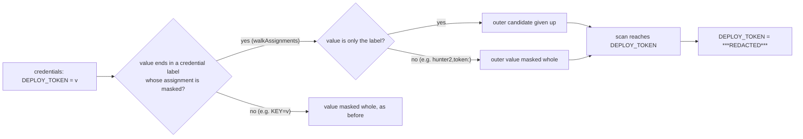

# PR Summary — Issue #5310

## Summary

The `secret-assignment` rule in `worker/deno/lib/secret_redaction.ts` took a
second credential label as the first label's value. For
`Rotate these credentials: DEPLOY_TOKEN = <value>`, on one line or across two,
it masked `DEPLOY_TOKEN`, resumed the scan after it, and published `<value>`
unchanged. The same leak hit `The secret: api_key: <value>`, a YAML child such
as `secrets:` then `API_TOKEN: <value>`, and
`credentials: DEPLOY_TOKEN="<value>"`.

The pattern is unchanged from the base. The decision is made where the value is
judged:

- A new walker, `walkAssignments`, is the one scan that both the replacement
  pass (`redactAssignments`) and `containsSecret`'s detection use.
- When the outer value ends in a credential label, the outer candidate may be
  given up. `trailingLabel` finds it: a key-shaped run of at most 128 characters
  holding a credential keyword, followed by at most a closing quote or the
  `=`/`:` the value swallowed, or by a separator with whitespace in it and the
  value's closing quote (`'API_TOKEN = '`). The run may hold the one `-` of the
  pattern's hyphenated keywords, so `api-key`, `access-key` and `private-key`
  are labels, and the label starts where the pattern's key would (`api` in
  `x-api-key`). A single-quoted inner value holding a space
  (`DEPLOY_TOKEN='a b'`) is also covered: the label may sit just before one of
  the value's last three `'`. The label's own assignment must run past the value
  and be masked. The walk then resumes at the inner label, and that label's own
  match masks its value. This covers hyphenated, dotted and quoted inner labels
  (`DEPLOY-TOKEN`, `app.DEPLOY_TOKEN`, `"DEPLOY_TOKEN"`).
- The outer value is given up unmasked only when it is nothing but that label:
  an optional `"` or `'`, then label characters (`[A-Za-z0-9_.-]`). When other
  text sits before the label (`password: hunter2,token: <value>`,
  `TOKEN=abc123;SECRET='d9 e8'`, `password: ab#c1TOKEN = <value>`), the outer
  value is still masked whole, as on base, and the walk still continues at the
  inner label. The inner key and separator then sit inside the outer mask, so
  only the part of the inner value past it is masked again:
  `password: ***REDACTED*** ***REDACTED***`.
- Otherwise the outer value is masked exactly as on base. A value that merely
  contains a credential word keeps its mask. That holds for
  `password: abcTOKENxyz =`, and also for `password: TOKENab#c1 = <ghp_ token>`,
  where a signature rule has already masked the token.
- A label whose value already reads `***REDACTED***` also gives the outer value
  up. The check uses the same label and the pattern's separator shape, so it
  covers `api_key: ***REDACTED***`, `DEPLOY_TOKEN="***REDACTED***"` and the
  cross-line form. A second pass changes nothing. This holds only when the
  placeholder, bar a closing quote, ends the outer value: in
  `credentials: TOKEN='***REDACTED***';db_pass=…` the text after it belongs to
  the outer value, which is masked whole. The already-masked check reads
  `INNER_ASSIGNMENT_SPAN` plus an opening quote and the placeholder's length
  past the outer value, so it sees the whole placeholder wherever the first pass
  can write one, including a value starting at the span's edge.
- A single-quoted inner value holding a space that runs straight into more text,
  as in `credentials: DEPLOY_TOKEN='a b'.`, keeps the outer mask too
  (`credentials: ***REDACTED******REDACTED***.`). Masking the inner value
  removes its space, so a second pass would read the label, placeholder and tail
  as one outer value and mask it whole; masking it on the first pass keeps
  redaction idempotent.
- A double-quoted inner value matches only with its closing quote, which a long
  value puts past the 256-character window. When the value opens inside the
  window and closes within 4,096 characters (`closesWithinReach`), the full-text
  match decides, so `DEPLOY_TOKEN = "<300 characters>"` after a lead-in label is
  masked with its label kept. The search for the closing quote is capped, so
  each candidate's extra work stays bounded.
- The walk decides every shape where a mask would change how the next walk reads
  the text around it, so its output is final:
  - A closed quoted outer value that the text runs straight on from
    (`credentials: 'DEPLOY_TOKEN='<value>`) keeps its mask (`quotedRunOn`);
    masking only the inner value would join the run and the placeholder into one
    bare outer value. This holds however often the shape repeats.
  - Text before the inner label that opens with `-`, or holds `--` anywhere, is
    not label text, so a CLI flag (`credentials: --token = <value>`,
    `credentials: x--token = <value>`) keeps the outer mask. Given up, it left
    `--token = ***REDACTED***` for the later `secret-cli-flag` rule to rewrite,
    and the next call masked `--token`.
  - `trailingLabel` tries the label before one of the value's last three `'`,
    not two, so a second pass over `token'='***REDACTED***'` finds the label the
    first pass found in `token'='d9 e8'`.
- `redactAssignments` then walks its own output again, at most four walks in all
  (`MAX_ASSIGNMENT_PASSES`), until a walk changes nothing. That is a bounded
  backstop, not the guarantee: with it capped at one walk, the exhaustive check
  below still finds no input whose output changes on a second call.

The rule interface gained a whole-text form: a rule supplies either a `pattern`
and `replace`, or an `apply` and `detect` pair. The `secret-assignment` rule
uses `apply: redactAssignments` and `detect: detectsSecretAssignment`, so its
old per-match `replace` callback, which nothing could reach any more, is gone,
along with both checks on the rule's pattern identity.

`SECURITY.md` has two new bullets: the rule, and the limits past which the base
behaviour applies (a 256-character search span, a 4,096-character double-quoted
inner value, a 128-character label, and the embedded-quote case).
`.github/gitleaks.toml` exempts two exact historical mentions of the new test's
synthetic fixture and the new test file by path (see Test Plan).

Closes #5310.

## Spec

### Intent and Rationale

- The leak came from the outer match consuming the inner label. Giving up that
  candidate puts the existing rule back in charge of the inner assignment, with
  all its value judgements (switch words, `${{ … }}`, JSON scalars, the
  cross-line checks from Issue #1727).
- The issue suggested refusing any label followed by `=` or `:`. That would
  split a password such as `MySecret:2024x` and publish its `MySecret:` prefix,
  because the inner match would mask only `2024x`. The walker gives the outer
  value up only when the inner assignment is itself masked and runs past the
  outer value, so `KEY=v` and `Secret:abc` are still masked whole.

### Essential Design Decisions

- Only the label that ends the value is tried, or the one just before one of the
  value's last three `'`. An inner assignment can only start there and run past
  the value, because the value's run stops where the inner separator's
  whitespace or quote begins. A single-quoted inner value holding a space is the
  one shape where the value takes the inner `='a` with it. The label is found by
  walking back at most 128 characters (`INNER_LABEL_MAX`). The pattern is run on
  it only when a separator follows. The pattern's key group is quadratic on a
  long run of keywords, so a longer run is never re-scanned as a key. It keeps
  the base mask (Issue #3942 linearity rule).
- The search past the value is cut to 256 characters (`INNER_ASSIGNMENT_SPAN`).
  An inner separator or value further out than that falls back to the base
  behaviour.
- `CREDENTIAL_KEYWORD` copies the key group's keyword list. It is used only to
  decide whether a trailing run is a label. A keyword added to one must be added
  to the other.
- `detectsSecretAssignment` uses the same walk as the replacement pass. So the
  decode-then-rescan pass (Issue #188) now flags a base64 blob whose decoded
  text holds a label-as-value credential. On base that blob was published.

### Undiscoverable Facts

- The base code also leaked a credential under a credential-labelled YAML child
  key (`secrets:` then `API_TOKEN: <value>`). The outer match swallowed
  `API_TOKEN:` as a mapping key and never scanned its value. This change fixes
  that too. I observed it with a scratch script before writing the test.

## Evidence

Backend only; no UI file is touched.

- Fix: in `worker/deno/lib/secret_redaction.ts`, `walkAssignments`,
  `isLabelOnly`, `pastFloor`, `trailingLabel`, `innerAssignment`,
  `closesWithinReach`, `redactAssignments` and `redactAssignmentsOnce`, plus the
  comment above the `secret-assignment` entry in `RULES`. `RedactionRule` is a
  union of the per-match and whole-text forms; `redactSecrets` and
  `matchesSignatureRule` call `apply` and `detect` where a rule has them. The
  `MAPPING_KEY_VALUE` doc comment notes that a credential-labelled child key
  whose value is masked no longer reaches that test.
- Docs: `SECURITY.md`, section "An assignment's value is judged, not only its
  label", has two new bullets. The first describes the label shape, when the
  outer value stays masked, and that a credential word elsewhere in a value
  keeps the mask; it no longer says a label is "never" taken as a value. The
  second states the limits past which base behaviour applies, each checked at
  head: an inner `=` 260 spaces away, a 4,097-character double-quoted value, a
  140-character label and `DEPLOY_TOKEN='a'b'c <value>'` each still publish the
  value. The rest of the file is unchanged from `main`. I read the whole
  section. `docs/THREAT-MODEL.md` and `README.md` do not describe this rule.
- Corpus run on the final commit: base (`origin/main` at `5dde2633c`), the
  previous head (`d6c9a377`) and this head's `redactSecrets` over 4,627 tracked
  files (`*.md`, `docs/`, `prompts/`, `.github/workflows/*.yml`,
  `worker/deno/tests/*.ts`). A second pass over each output changed nothing in
  any file. Base and head output differs in 4 files:
  - Three are this PR's own text: `SECURITY.md`'s new bullet, this summary and
    the new test. In each, head masks the inner value instead of the label.
  - The fourth is ``const secret = `PASSWORD: ${SECRET}`;`` in
    `worker/deno/tests/secret_redaction_markdown_1727_test.ts`. Base masked
    `` `PASSWORD: `` as the value of `secret` and published the value after it.
    A backtick is not an opening quote here, so the outer value is not only a
    label: head masks it whole and also masks the value after `PASSWORD:`. The
    previous head kept `` `PASSWORD: `` visible.
  - Comparing placeholders line by line, head has fewer than base on three lines
    only: the new test's chain fixture, twice, and its mention in this summary,
    `credentials: secret: DEPLOY_TOKEN
    = <value>`: base masked the label
    `secret:`, head keeps it and masks the value. No line publishes text that
    base masked except such a label.
  - The corpus holds none of the review's text-before-label shapes, so the new
    tests carry that evidence (see Test Plan).
- Exhaustive idempotence and leak check, on this head's library:
  - Every input built from up to two label segments (an optional `'` or `"`; an
    optional `x,` or `--` prefix; one of `credentials`, `token`,
    `app.DEPLOY-TOKEN`, `--api-token`; one of `=`, `:`, `'=`, `:\n`, `=`; an
    optional quote), then one of four values (`hunter2`, `d9 e8`, the
    placeholder, a 40-character token) and one of five tails: 5,842,800 inputs.
  - Plus 21,504 repeated-unit inputs: four lead-ins, 56 units (an optional `'`,
    one of four labels including `--token`, one of seven separators) repeated 1
    to 8 times, then a value and a tail.
  - On none did a second `redactSecrets` change the output or `containsSecret`
    report a secret in it, and none published a value that base masked. That
    holds with `MAX_ASSIGNMENT_PASSES` set to 1, so the walk itself decides
    every one; before `trailingLabel` tried a third quote, the one-walk run
    found 417 (all `<label>'='d9 e8'`).
  - On an earlier, two-label version of the grammar (937,440 inputs), the
    previous head `3338d345` changed on a second pass for 5,364 inputs.
- Timing, on the verifier's fixture (`credentials:` + `TOKEN`×N + `!`): 100, 200
  and 400 KB took 67, 133 and 267 ms at this head. The previous head took 1,070,
  4,127 and 16,463 ms. The verifier measured 68, 136 and 270 ms on base.
- Issue numbers cited:
  - #5310: secret-assignment rule publishes a credential when its label is
    consumed as the value of an earlier credential label.
  - #1727, #3942, #4705 and #5083 are cited as they were already cited in the
    files this PR touches.

## Test Plan

- **Added `worker/deno/tests/secret_redaction_label_as_value_5310_test.ts`, 324
  tests at this head**, all through `redactSecrets` and `containsSecret`:
  - **Leak cases** must mask the inner value and keep both labels:
    - `DEPLOY_TOKEN = <40-char value>` on the same line and the next line;
    - `api_key: <value>` on the same line and the next line, each with the short
      value `pw42` and a 40-char value;
    - a YAML child `API_TOKEN: <value>` under `secrets:`;
    - a double-quoted inner value, and a chain of three labels;
    - a label 66 characters long;
    - hyphenated, dotted, double-quoted and single-quoted inner labels, and a
      hyphenated next-line form;
    - a single-quoted inner value holding a space,
      `credentials: DEPLOY_TOKEN='<a b>'`.
  - **Text before an inner label stays masked** (PR review): nine inputs, each
    with its exact output and a check that no value appears in it —
    `password: hunter2,token: <ghp_ token>`,
    `db_password: Winter2026!;gh_token: <ghp_ token>`,
    `password: hunter2,token: ***REDACTED***`,
    `user: bob,password: hunter2,token: abc123`, `TOKEN=abc123;SECRET='d9 e8'`,
    `password: ab#c1TOKEN = <ghp_ token>`, the chain
    `a_password: x1,b_token: y2,c_secret: z3`, and two tails after an inner
    value already masked: `credentials: TOKEN='<ghp_ token>';db_pass=…` and
    `credentials: TOKEN='***REDACTED***';db_pass=…`, each masked whole.
    `containsSecret` is true on each.
  - **Run-on single-quoted inner value:** `credentials: DEPLOY_TOKEN='a b'.` and
    `credentials: DEPLOY_TOKEN='a b';x=1` keep the outer mask
    (`credentials: ***REDACTED******REDACTED***.`), so a second pass changes
    nothing.
  - **The 256-character span edge:** for every gap from 0 to 300 in three shapes
    (spaces before `=`, spaces after `=`, newlines after
    `The secret: api_key:`), a second pass changes nothing and `containsSecret`
    is false on the output. An inner `=` 253 spaces away is masked with the
    label kept; one 254 spaces away keeps the base behaviour (label masked,
    value published), pinning the documented limit.
  - **Long double-quoted inner values:** 252, 300 and 4,096 characters in four
    forms (same line, next line, next-line `api_key:`, YAML child), each with
    its exact output (label kept, value masked), an unchanged second pass and
    `containsSecret` false on the output. A 4,097-character value pins the
    documented base behaviour.
  - **Quoted outer value ending in a separator:**
    `credentials: 'DEPLOY_TOKEN='<token>`,
    `export CREDENTIALS='password='hunter2`, `DB_SECRET_ARGS='--token='<token>`
    and `secrets: 'Password:'hunter2` keep the outer mask with its quotes
    (`credentials: '***REDACTED***'***REDACTED***`); `secrets: TOKEN'='d9 e8'`
    keeps its label (`secrets: TOKEN'='***REDACTED***'`). Each has its exact
    output, an unchanged second pass, `containsSecret` false on the output and
    no value published.
  - **Repeats past the backstop cap:** 4, 5 and 8 repeats of `'DEPLOY_TOKEN=`,
    `'T_TOKEN=`, `'T_TOKEN:`, `T_TOKEN='` and `T_TOKEN:'` before a token, each
    with the same four checks.
  - **CLI-flag outer value:** `credentials: --token = <token>`,
    `Rotate these credentials: --api-token = <token>`,
    `Use this password: --password : <token>`,
    `The secret: --client-secret\n  = <token>` and a double-quoted value, each
    masked as `credentials: ***REDACTED*** = ***REDACTED***` and so on, with the
    same four checks.
  - **Hyphenated keyword labels** (review round 6), each with its exact output
    (label kept, value masked), an unchanged second pass, `containsSecret` false
    on the output and no value published:
    `Rotate these credentials: api-key = <token>` on the same line and the next,
    `The secret:\napi-key: <token>`, `secrets:\n  access-key: <token>`,
    `The secret: api-key: pw42`, `credentials: private-key = hunter2` and
    `credentials: x-api-key: <token>`.
  - **Quoted inner value ending in a spaced label** (review round 6):
    `credentials: DEPLOY_TOKEN = 'API_TOKEN = '<token>'`, its double-quoted
    form, `'API_TOKEN ='<token>`, `'API_TOKEN= '<token>`,
    `DEPLOY_TOKEN: 'API_TOKEN: '<token>`, and the next-line and YAML-child
    forms. Each gives `DEPLOY_TOKEN = '***REDACTED***'***REDACTED***` (the value
    after the closing quote masked), with the same four checks. Main masked
    `DEPLOY_TOKEN` and then the value; the previous head published the value.
  - **A flag after label text** (review round 6):
    `credentials: x--token =
    <token>`,
    `password:\n  DEPLOY_TOKEN--token = abc`,
    `credentials: my-tool--token = "<token>"` and `secret: a.--token = hunter2`
    keep the outer mask (`credentials: ***REDACTED*** = ***REDACTED***`), with
    the same four checks.
  - **Idempotence:** for each of the 26 leak inputs,
    `redactSecrets(redactSecrets(x)) === redactSecrets(x)` and
    `containsSecret(redactSecrets(x)) === false`.
  - **Decode-then-rescan:** the base64 of the YAML-child form and of the
    next-line `api_key:` form is masked whole, and `containsSecret` is true.
  - **Controls** keep base output:
    - `password=MySecret:2024x` is masked whole;
    - `credentials: DEPLOY_TOKEN=<value>` is masked as one run;
    - `GH_TOKEN: ${{ secrets.GH_TOKEN }}` and a bare `deploy:` child are
      unchanged, with `containsSecret` false;
    - a standalone `DEPLOY_TOKEN = <value>` is masked;
    - `password: abcTOKENxyz` keeps its mask with seven different tails, among
      them a dangling `=` or `:`, end of text, and a cross-line prose value;
    - a keyword mid-value before a `ghp_` token keeps both masks:
      `password: TOKENab#c1 = <token>`, the `:` form
      `password: abc-TOKEN.x9 : <token>` and the quoted form
      `password: "a TOKEN b" = "<token>"`.
  - **Hostile inputs**, each asserting its exact output:
    - a 200,000-character run before `_TOKEN` and 40 spaces;
    - 20,000 repeats of `TOKEN` followed by `!`;
    - `credentials:` + 100,000 repeats of `TOKEN` (500 KB) with four tails: `!`,
      nothing, `: x` and `= x`. As in `secret_redaction_redos_test.ts` there is
      no stopwatch; the size is the detector.
- **Review round 17** — a second non-final shape, found by the round-16 review:
  - **A glued run the decode pass masks.** A credential label with a dotted
    prefix glued to a run that decodes to a credential
    (`credentials:app.password<base64 of password=…>: secret:`,
    `password: app.password<base64> = x`, with `hunter2.` for `app.`) gave
    `app.***REDACTED***` on the first call: the walk gave the outer value up for
    the label and masked the inner value, and the decode pass then masked the
    label's run. A second call read `app.***REDACTED***` as a plain value of the
    outer label and masked it whole. Main is final on these inputs
    (`password: ***REDACTED*** = x`) and the head was not, which also made
    `gh api --input` refuse such a body (`maskedJsonBody` masks again and throws
    when the text changes). `redactSecrets` now walks the assignments once more
    after the decode pass (`redactAssignments`, itself bounded by
    `MAX_ASSIGNMENT_PASSES`), and decodes again only when that walk changed the
    text. The first call now gives `password: ***REDACTED*** = ***REDACTED***`,
    and a second call changes nothing. The post-decode walk is the same
    `secret-assignment` walk a second call runs, so on this shape the first call
    now equals the earlier second call. `SECURITY.md` and the
    `redactAssignments` and `redactSecrets` comments say so; the one shape still
    not final is unchanged.
  - **Tests.** 6 more tests (318 → 324): the four inputs through `assertFinal`
    (first-call output, second-call output, `containsSecret` false on the output
    and true on the input, no value published), a control
    (`password: app.hunter2value = x` keeps its output), and `redactGhBodyArgs`
    with `api … --input` posting the masked body. 5 of the 6 fail with the walk
    removed (the four `assertFinal` inputs and the `--input` one); the control
    passes either way.
  - **Sweep.** 400,000 random inputs of 2-6 pieces (labels, separators,
    `app.`/`hunter2.` prefixes, base64 and reversed credential runs, newlines)
    behind five lead-ins: 229 changed on a second call before the walk, none
    after.
- **Review round 16** — two items, and the round-15 test and docs asks:
  - **A run that never returned.** The wrapped-run loop stepped the shared
    `WRAPPED_RUN_G` and called the decode pass, which walks the decoded text and
    reaches the same check, resetting `lastIndex`, so the loop found the same
    run without end. That loop and both `CREDENTIAL_KEYWORD_ALL` loops now use
    `matchAll`, which steps a private copy. The 105-byte input (the round-14
    fixture, base64-encoded, broken after 24 characters, after
    `credentials: DEPLOY_TOKEN =`) gives
    `credentials: DEPLOY_TOKEN =
    ***REDACTED***\n***REDACTED***`. A base64
    run decoding to a label-as-value shape gives
    `credentials: ***REDACTED*** = ***REDACTED***`.
  - **A later rule masks the next line.** The run is also cut at the first value
    `secret-cli-flag` or `hex32-credential` masks after the inner value, since
    main's decode pass runs after them. `<value>\nmd5=<32 hex>`, the lead-in on
    its own line with `trace_id=<32 hex>` (LF and CRLF),
    `api_key: <value>\nsession=<32 hex> (expires soon)`, the short value
    `pw42x9z`, `<value>\n--password\nUSER=bob` and the YAML child
    `secrets:\n  api_key: <value>\ntrace_id=<32 hex>` mask the value on the
    first call, and the output is final. The cut counts only text after the
    inner value: a first sweep showed that a 32-hex value inside the inner
    value, which the assignment rule has already masked, must not end the run.
  - **Round-15 asks.** The 8-key limit on that cut is stated in `SECURITY.md`
    and below, with a test pinning base behaviour at eight and masking at seven.
    The round-15 inputs with the lead-in on its own line (LF and CRLF) are
    tested. The three round-15 timing units are pinned at 64,000 repeats with
    exact outputs (each flag's double-quoted value takes the next unit, so two
    input units give one output unit). They equal main's output and run in about
    1 s here, against about 0.25 s for main.
  - 19 more tests (299 → 318): 8 fail at `7dedc381`, and the re-entry test does
    not return there. The other 10 pin what that head already did: the round-15
    inputs with the lead-in on its own line, the three controls, the 8-key base
    case, the hostile sizes and the decoded label-as-value case. Every test file
    importing `secret_redaction.ts`: `1359 passed | 0
    failed`.
  - **Sweep, head against main.** 2,059,345 distinct inputs, nine seeds over
    three generators (general; lead-in led; flag led), with 32-hex values,
    `md5=`, `trace_id=`, `session=`, a flag on its own line, `USER=bob`, CRLF
    and the broken base64 fixture added. At the round-16 head the sweep found no
    published value that main masks, no `containsSecret` disagreement and no
    input over 200 ms. Its second-call check did not hold for every shape: round
    17 found glued-run inputs where main's output is final and the round-16
    head's first call was not (the post-decode walk fixes them). The previous
    head was left out because it does not return on some of these inputs.
- **Review round 15** — two items:
  - **A masked assignment on the line after the inner value.** The wrapped-run
    check read `<value>\nAPI_KEY=<other value>` from the unmasked text and kept
    main's result, but main runs the decode pass after the assignment rule, so
    it sees `<value>\nAPI_KEY=` and masks nothing. The run is now cut at the
    first value the walk masks after the inner value (`maskedValueStart`), so
    the inner label is read. `credentials: DEPLOY_TOKEN = <value>` followed by
    `\nAPI_KEY=…`, `\r\nAPI_KEY=…`, `\nDB_PASSWORD=…`, `\ntoken=… and more`,
    `\nprivate-key=…`, `\nPASSWORD_FILE=…`, with a short value (`pw42x9z`) and
    the `The secret: api_key: <value>\npassword=…` form, all mask the inner
    value. A next line the rule leaves unmasked (`API_KEY=`, `API_KEY=true`,
    `USER=bob`, a blank line, a same-line key, a colon key) and the bare
    `DEPLOY_TOKEN = API_TOKEN=` then `hunter2zzzz` keep their output. Other
    paths checked: the same run read for a run that starts before the inner
    label uses the same cut (only keys after the inner value count); matrix of 6
    lead-ins × 7 inner shapes × 2 values × 21 next-line texts (1,764 inputs) and
    14 more next-line shapes (`ghp_`, `AKIA`, `sk-`, `--password=`, `export`,
    three stacked keys, quoted keys): the value is published at head by none, a
    second call changes none and `containsSecret` is false on every output;
    before this round 648 of the 1,764 published the value.
  - **Quadratic time on chained flags.** `quotedValueFlagEnd` was run twice per
    candidate and its `flagsThrough` walked every later `--` whose flag reached
    past the last, so a text of repeated `"DEPLOY_TOKEN = secrets:'x --token`
    took 29, 91, 336 and 1,303 ms at 500, 1,000, 2,000 and 4,000 repeats at the
    previous head (shared host, indicative), against 6, 6, 9 and 18 ms at
    `0de6b1f81`. The call is now made once per candidate, and both loops read at
    most 64 `--` runs, past which main's result stands (`TOO_MANY_FLAGS`;
    `SECURITY.md` states it). After the fix the same inputs take 9, 11, 18 and
    34 ms. A random search of 1,000 repeated units drawn from 13 fragments found
    no case growing faster than linearly. Other regexes in the module checked
    for the shared-quantifier shape: `CLI_FLAG_AT`, `CLI_FLAG_RULE_G`,
    `WRAPPED_RUN_AT` and `WRAPPED_RUN_G` (each bounded by `{0,63}` classes or
    disjoint classes); none changed.
  - 16 more tests (283 → 299); the 8 next-line leak tests fail at `61d60fdd9`
    and the hostile test (100,001 repeats, 3.4 MB) did not return in 100 s
    there; it passes in about 1 s at this head. The controls pass at both. Every
    test file naming `redactSecrets`, `containsSecret` or `secret_redaction` (53
    files by that grep): `1466 passed | 0 failed`.
- **Review round 14** — two items:
  - **The issue's leak after a closed flag value.** The flag-quote look-back now
    counts the quote before the outer value only where the `secret-cli-flag`
    rule, reading the text from the start, opens a flag's value there (one pass
    of the rule's pattern per walk), so the quote that closes
    `--token 'x --password '` no longer blocks the inner label. Only quotes the
    walk's mask removes count: a closed quoted inner value keeps both quotes
    unless it is masked through a flag.
    `deploy --token 'x
    --password ' then` before
    `Rotate these credentials:\nDEPLOY_TOKEN =
    '<value>'`,
    `The secret: api_key: '<value>'`, the YAML-child form (single- and
    double-quoted) and 44,000 characters of filler between them all mask the
    value on the first call again.
    `deploy --token 'x credentials:
    DEPLOY_TOKEN = '<value>'` gives
    `deploy --token ***REDACTED******REDACTED***'` again, and
    `run --password 'a --token ' secrets:\n  credentials: 'abc` is final.
  - **Text after the flag's placeholder.** The second-call search accepts a flag
    whose value starts with the placeholder, so
    `'deploy --token
    '$API_TOKEN';`, `'$API_TOKEN'/v1`,
    `'my-secret-value',`, `'my_password_1';`, `'token'api_key` and the
    `Rotate these credentials:` form keep main's output on a second call, and
    main's own output with text after the placeholder is unchanged.
  - 14 more tests (269 → 283); 13 fail at `06ddcdae`. Every test file importing
    `secret_redaction.ts`: `1324 passed | 0 failed`.
  - **Sweeps, head against `06ddcdae` on the same inputs.** Flag-led (597,829
    distinct, the reviewer's `then`, `$API_TOKEN`, `/v1` and `;` fragments
    added): no published value at either; 1 second-pass change here against 12.
    Unclosed-quote-weighted (597,287): no published value at either; 8
    against 9. General (590,593): none of either. Each of the 9 remaining
    second-pass changes gives the same first output at `06ddcdae` and changes
    there too. All 9 are a single-quoted value of glued labels that the walk
    reads as the next chain link (`'app.token=password:`, `'token=API_TOKEN:`,
    `'my-secret-valueapp.token=`), whose closing quote a later flag takes, and
    none publishes a value. This is not done: `SECURITY.md` and the
    `redactAssignments` comment now say so. The round-13 entry's sweep claim (6
    flag-led, none in general inputs) did not cover the unclosed-quote shape the
    reviewer found (`'deploy --token '$API_TOKEN';`), which this round fixes.
- **Review round 13** — two items:
  - **A flag before the lead-in.** A credential flag whose quoted value opens
    before the outer value and would close at a quote in the outer or inner
    value (`deploy --token 'alpha <value> credentials: DEPLOY_TOKEN = 'tail`,
    the next-line, YAML-child and `The secret: api_key:` forms, `ab'cd`, and a
    quote inside the outer value such as `DEPLOY_TOKEN':`) now gets main's
    result, so the flag rule masks the whole quoted run again. Quotes an earlier
    mask took are skipped when finding where the flag's value opens. The quotes
    come from a per-walk index, so the look-back has no length bound.
  - **Unclosed quote after a masked assignment.** A flag inside a quoted inner
    value whose value takes the closing quote is now masked with the inner value
    on the first call (`secrets:\n  DEPLOY_TOKEN: ***REDACTED***`), so the
    output holds no unclosed quote. This masks more than main, which left
    `'deploy` visible. It applies only when nothing else keeps main's result and
    no credential keyword sits in the flag's value past the quote. The mask also
    takes any flag value it would cut, and the walk reads on inside it, so a
    match main masks there is still masked past it. The second-call search for
    main's own output now reads past an earlier placeholder and has no
    256-character bound; it skips an inner value that is itself the chain's next
    label. 27 existing tests that pinned main's output for this shape now expect
    the single mask. Each new output is final, publishes no test value, and
    gives `containsSecret` false.
  - 30 more tests (239 → 269); 23 of them fail at `8c1224ea`. The other 7 guard
    the new mask's neighbours and bounds. Every test file importing
    `secret_redaction.ts`: `1310 passed | 0 failed`. Hostile sizes (64,000 lines
    of each new shape, 1 MiB runs) assert exact outputs, and doubling the size
    doubles the time.
  - **Sweep claim corrected.** The round-12 claim (no head-only change on a
    second pass, no published value main masked) was wrong for flag-led inputs.
    On the same 1,586,149 distinct flag-led inputs (four seeds), `8c1224ea`
    published a value main masks for 110 and changed on a second pass for 114,
    where main did not. This head publishes none and changes on a second pass
    for 6, all also changing at `8c1224ea` and none publishing a value. All 6
    are a single-quoted YAML-child value holding glued labels
    (`'app.token=password:`, `'token=token=`), where main's result stands and a
    flag then takes the closing quote. On 778,633 distinct general inputs (two
    seeds), neither head shows either. Values glued to a key-shaped run are not
    counted, as before.
- **Review round 12** — three items:
  - **The memo belongs to one walk.** The decode-then-rescan check runs a nested
    walk on a joined run; that walk now saves and restores the outer walk's memo
    instead of clearing it. A chain of 18 or 30 labels gives the same output
    with and without an earlier wrapped run (new test), and
    `secrets:\n  DEPLOY_TOKEN: 'a --token` repeated takes the same time with
    that prefix as without (about 1 s at 1.1 MB here).
  - **Unclosed quote.** The second-pass flag search stops only at a closing
    quote of the same kind or an earlier placeholder, so `=`, `:`, `*`, a URL or
    the other quote before the flag (`'deploy --env=prod --token`,
    `'curl https://example.test --token`, `'deploy "x" --token`) stays final.
  - **Tests** for the remaining label-`=`-line-break inputs
    (`The secret:\napi_key=`, `secrets:\n  API_TOKEN=`,
    `credentials: DEPLOY_TOKEN\n=`, `credentials=\nDEPLOY_TOKEN =`, and the 15-
    and 16-character joined values).
  - 14 more tests (225 → 239). Every test file importing `secret_redaction.ts`:
    `1280 passed | 0 failed`. Sweeps of 450,000 general and 450,000
    quote-and-flag-weighted inputs (the latter now with `k=v`, `a:b`, `*.txt`
    and a URL) found no head-only change on a second pass, no head-only
    `containsSecret` and no published value main masked, other than values
    joined to a label by `.` or `-`, which `SECURITY.md` documents. The round-11
    sweep claim missed the `=`/`:`/`*` shapes.
- **Review round 11** — the four partial items:
  - **The #5310 leak across `=` and a line break.** A run covering the inner
    label counts only when the inner value stays visible (a chained label);
    otherwise runs start no earlier than the end of the outer value main masked.
    `credentials: DEPLOY_TOKEN=` then `<token>` gives
    `credentials: DEPLOY_TOKEN=` then `***REDACTED***` again, and
    `The secret: app.token=` then `DEPLOY_TOKEN = hunter2` stays final.
  - **Unclosed quote, flag later.** The second-pass check reads every `--`
    within 256 characters after the inner value, up to the first quote,
    separator or earlier placeholder, so `'deploy now --token`,
    `'deploy -v --token`, `'deploy x--token`, `'a b c --token` and `'deploy` +
    line break + `--token` are final.
  - **Chains.** A `secret-assignment` match inside the inner value that runs
    past it counts whether or not it is masked, so the three line-break chain
    inputs give main's result; the `DB_PASSWORD=` line-break form has a test
    now.
  - **SECURITY.md** states the round-9 `"`-inside-a-quoted-value outcome.
  - **Linearity.** A per-walk memo of the inner-label answer stops a long
    chain's look-ahead from being repeated per link:
    `secrets:\n  DEPLOY_TOKEN: 'a --token` repeated (1.1 MB) takes about 1.1 s
    here, where the previous head took 5.4 s.
  - 11 more tests (214 → 225); one round-10 expectation reverts to its round-9
    output (`api-key: ,***REDACTED*** = ***REDACTED***`, which masks more than
    main and is final). Every test file importing `secret_redaction.ts`:
    `1266 passed | 0 failed`. Sweeps of 900,000 general and 900,000
    quote-and-flag-weighted inputs found no head-only change on a second pass,
    no head-only `containsSecret` and no published value main masked.
- **Review round 10** — two more shapes, both now main's result:
  - **Where the decode pass's run starts.** The wrapped-run test now reads runs
    as the decode-then-rescan pass reads them on main: from where a run through
    the inner label can start, walked back up to 1,024 candidate characters and
    line breaks, so a run beginning at the separator's `=`
    (`DEPLOY_TOKEN =istoken=` then `hunter2`) or on the label's own line
    (`token=` then a two-line value) counts, and so does one that covers the
    inner label (`app.token=` then `DEPLOY_TOKEN = hunter2`). Run starts are
    found in that window and the inner value alone, and a run longer than 4,096
    characters keeps main's result, so the check stays linear.
  - **A flag after an unclosed quote on a second pass.** When the inner value
    opens with a quote it never closes and a credential flag follows it
    (`'deploy --token ***REDACTED***`, the first pass's own output), main's
    result is kept, so the first pass is final.
  - 11 more tests (203 → 214): the reviewer's ten inputs with the four checks,
    and a 1 MB wrapped run asserting main's exact output. One round-9
    expectation changed to main's output:
    `Rotate these credentials:\napi-key: ,tokenhunter2=\nsecret = token` now
    keeps `= token` visible, as main does. Every test file importing
    `secret_redaction.ts`: `1255 passed | 0 failed`. A sweep of 900,000 inputs
    from 30 fragments weighted to wraps, `=` separators, quotes and flags found
    no head-only change on a second pass, no head-only `containsSecret` and no
    published value main masked. The round-9 sweep above missed both shapes; it
    is corrected by this one.
- **Review round 9** — the round-8 check is made bounded and closes three more
  shapes:
  - **Linear again.** Round 8's flag search ran to the end of the text and its
    assignment search re-ran from every match, so two inputs were quadratic. Now
    keys are found by their credential keyword inside the inner value and
    matched from where they start (at most 8, past which main's result stands),
    flags by their `--` inside the inner value, and the wrapped-run test reads
    only the run that ends the inner value. Two hostile-size tests assert exact
    output: 64,000 lines of `credentials: DEPLOY_TOKEN = abcdefgh12345678` (2.8
    MB, about 1.2 s here) and `credentials: DEPLOY_TOKEN =` + 65,536 `TOKEN=x,`
    (512 KB, about 20 ms).
  - **Chains.** The label ending the inner value is exempt only when the walk's
    next step reads it as an inner label (looked ahead up to 16 links), so
    `credentials: DEPLOY_TOKEN = API_TOKEN: hunter2,--token x` gives main's
    `credentials: ***REDACTED*** = API_TOKEN: ***REDACTED*** x`.
  - **A `"` inside a quoted inner value.** When the outer bare value stopped at
    a `"` inside the inner quoted value, the outer mask is kept, so
    `credentials: DEPLOY_TOKEN='"abc"'--token <token>` gives
    `credentials: ***REDACTED******REDACTED***--token ***REDACTED***`.
  - **Second pass.** An inner value already holding the placeholder after other
    text (`,***REDACTED***`) keeps main's result, so
    `secrets:\n  DEPLOY_TOKEN: ,API_TOKEN=\nhunter2` is final.
  - **Several flags.** Every `--` inside the inner value is tested, so
    `'--token a --password '<token>` masks the value.
  - 21 more tests (182 → 203 in the file); every test file importing
    `secret_redaction.ts`: `1244 passed | 0 failed`. A random sweep of 900,000
    inputs from 29 fragments, compared with main, found no output that changed
    on a second pass, reported a secret, or published a value where main's did
    not, other than a value glued onto key characters.
- **Review round 8** — one general check replaces the round-7 flag test: before
  an inner label is read, `mainReadsPastInnerValue` asks whether main's own
  scan, resuming after the inner label as main did, would mask text past the
  inner value: a masked `secret-assignment` match or a credential flag (the
  `secret-cli-flag` shape, placeholder allowed so a second pass reads the same)
  that starts inside the inner value and ends past it, other than the label that
  ends the inner value (the walk's next step in a chain), or a run the
  decode-then-rescan pass would join across a line break and mask. If so, no
  inner label is read and main's result stands. It has no whitespace or length
  bound, so the flag shape with 256 spaces or a line break, and the spaced
  separator past 256 spaces, now give main's result. 20 more tests, each with
  the four checks: the reviewer's ten label-or-flag-inside-a-quoted-value
  inputs, the two `API_TOKEN=` then `hunter2` forms, the flag at 255 and 256
  spaces and across a line break, and the spaced separator at 256 and 257 spaces
  (both sides, double quotes, 300 spaces, YAML child).
  - Red runs on this head's 182-test file: `origin/main` (`e1d1190c1`)
    `96 passed | 86 failed`; the previous head (`adc68366`)
    `164 passed | 18 failed`; this head `182 passed | 0 failed`. Every test file
    importing `secret_redaction.ts` (47 files): `1223 passed |
    0 failed`;
    `secret_redaction_redos_test.ts`: `14 passed`.
  - A random sweep of 900,000 inputs from 27 fragments (lead-ins, labels,
    `--token`, `--password`, `=\n`, quotes, `'token:x'`, values, a 40-space
    run), compared with main: no output changed on a second pass where main's
    did not, none reported a secret where main's did not, and none published a
    value main masked other than a value glued onto key characters, which is
    read as part of a label as `SECURITY.md` states.
- **Review round 7** — 16 more tests, each with the four checks:
  - **A flag as the inner label's value:**
    `Rotate these credentials: DEPLOY_TOKEN = --token <token>` (same line and
    next line), `secrets:\n  DEPLOY_TOKEN: --token <token>`,
    `secrets:\n  token: --password hunter2`,
    `credentials: api_key: --api-key <token>`, the hyphenated
    `credentials: api-key: --api-key <token>`,
    `The secret: credentials: --token <token>` and a double-quoted flag value.
    Each gives main's output, for example
    `Rotate these credentials: ***REDACTED*** = --token ***REDACTED***`: when
    the inner value ends in a credential flag followed by whitespace and a
    value, no inner label is read, so the `secret-cli-flag` rule still sees the
    flag.
  - **A line break, CRLF or more than 32 spaces in the separator before the
    closing quote:** `'API_TOKEN =\n'`, `'API_TOKEN:\n  '` and its double-quoted
    form, `'API_TOKEN\n= '`, the YAML child, `=\r\n`, and 33 spaces before or
    after `=`. Each gives `DEPLOY_TOKEN = '***REDACTED***'***REDACTED***`. The
    separator's whitespace is now `\s`, walked back by hand up to 256 characters
    either side (the walk's own span bound), never by a regular-expression scan.
  - Red runs on this head's 162-test file: `origin/main` (`0e9de4ad2`)
    `78 passed | 84 failed`; the previous head (`8b009936`)
    `146 passed | 16 failed`, the 16 above; this head `162 passed | 0 failed`.
    Every test file importing `secret_redaction.ts` (47 files):
    `1203 passed | 0 failed`.
  - A random sweep of 1,200,000 inputs from 29 fragments, now including
    `--token`, `--password`, `=\n`, `:\n`, CRLF and a 33-space run: no output
    changed on a second pass and none reported a secret. 4 published a value
    main masked, all a value glued straight onto a credential keyword
    (`hunter2API_TOKEN…`, `<token>credentials:`), which is read as part of the
    label as it was at the previous head; `SECURITY.md` states it. Before the
    flag fix was widened to a value ending in a flag, the same sweep also found
    `credentials:token =\n=--password <token>`; it now gives main's output.
- **Red runs for review round 6** — this head's 146-test file against an older
  `worker/deno/lib/secret_redaction.ts`:
  - From `origin/main` (`26af9a4cb`): `70 passed | 76 failed`.
  - From the previous head (`ef2daa59`): `128 passed | 18 failed`, the 18 new
    inputs above.
  - At head: `146 passed | 0 failed`. Every test file that imports
    `secret_redaction.ts` (47 files): `1187 passed | 0 failed`.
  - A random sweep of 1,100,000 inputs built from 29 fragments (lead-ins, labels
    including the hyphenated and `--` forms, separators, quotes and values): no
    output changed on a second pass, none reported a secret, and 4 published
    `hunter2` where main masked it. All 4 are label characters before a
    hyphenated inner label, such as
    `credentials:hunter2private-keyaccess-key= …`: the run before `access-key`
    is read as part of the label, as `credentials: hunter2-DEPLOY_TOKEN = …`
    already was at the previous head. `SECURITY.md` now states this.
- **Red runs, observed** — each runs the 128-test file of the previous head
  against an older `worker/deno/lib/secret_redaction.ts`:
  - From `origin/main` (`5dde2633c`): `70 passed | 58 failed`.
  - From the first fix (`2396849b7`): `69 passed | 59 failed`, in 5m7s; that
    library is quadratic on the long `TOKEN` runs.
  - From the head before the first review fix (`d6c9a377`):
    `75 passed | 53 failed`.
  - From `bc9dbbc6`, before the run-on fix: `91 passed | 37 failed`. That
    library turned `credentials: DEPLOY_TOKEN='a b'.` into
    `credentials: DEPLOY_TOKEN='***REDACTED***'.`, which a second pass turned
    into `credentials: ***REDACTED***`.
  - From `75e171d4`, before the span-edge fix: `95 passed | 33 failed`. Swept by
    hand, that library was not idempotent for 241-253 spaces before or after `=`
    and 243-255 newlines after `api_key:` (39 inputs); this head and base are
    idempotent on all 903.
  - From `3338d345`, before the long-quote fix: `99 passed | 29 failed`.
  - From `4d002e04`, before the walk-level decisions: `109 passed | 19 failed`.
    The five flag-shaped inputs and the nine repeats of a `'`-led unit failed
    because a second call changed the output. The five quoted-outer inputs
    failed on exact output only: that library's walk loop already reached a
    final `credentials: ***REDACTED***`, where this head keeps the quotes.
  - At head: `128 passed | 0 failed`.
  - On an earlier, 54-test version of the file, this PR's library with
    `detectsSecretAssignment` restored to the base loop failed only the two
    base64 cases (`52 passed | 2 failed`); that mutation was not re-run on the
    current file.
- **Existing tests:** none edited. In the new file, the control titled for a
  64-character bound is renamed for what it checks, a 66-character label within
  the 128-character bound. Every test file that mentions `redactSecrets`,
  `containsSecret` or `secret_redaction` passes at head: 53 files, 1,491 passed,
  0 failed (the review round 17 result: 1,447 in the parallel pass, 44 in the
  serial one). This run used a scratch import map in place of the `jsr:@std/*`
  imports, since jsr.io was unreachable from the host; CI runs the suites as
  written. That includes `secret_redaction_test.ts`, its `_markdown_1727_`,
  `_redos_`, `_bounds_`, `_boolean_setting_`, `_json_structure_` and
  `_prose_heading_5253_` siblings, `fleet_telemetry_redaction_test.ts` and
  `run_stats_redaction_test.ts`.
- **Full gate:** `./quality.sh < /dev/null` passed on an earlier head
  (`be3317ae0`) with `Result: PASSED (with skipped checks)`. The gate itself
  skipped `config integration` (no `.config.json`) and `checkov` (no checkov on
  PATH). `deno task test:unit` over every unit test file also passed on that
  head (parallel and serial passes, 0 failed). The review fix was not run
  through the full gate locally; CI runs it. `deno fmt`, `deno lint` and
  `deno check` on the two changed files are clean.
- **Gitleaks exemption:**
  - The first commit carrying the literal YAML fixture was already pushed. CI
    scans every commit in the PR range, so `.github/gitleaks.toml` exempts that
    exact line, and the backtick-quoted mention of it that an earlier commit of
    this summary carried. This follows the file's existing exact-line entries
    (Issues #4705, #5083) rather than rewriting the pushed branch.
  - `gitleaks git --config .github/gitleaks.toml --log-opts="origin/main..770765920"`
    reported 1 leak before the edit and none after it.
  - The test file's many synthetic `API_KEY=`/`ADMIN_TOKEN=` placeholder lines
    tripped `generic-api-key` in the range scan, so the test file is allowlisted
    by path, as the other redaction fixtures are. The same placeholder in
    `SECURITY.md` and this summary is now written as `<other value>`.
  - In a temp directory, a higher-entropy value on the same line shape is still
    reported under the edited config, so the exemption is exact.
  - `gitleaks_template_conformance_test.ts` and `gitleaks_check_test.ts`: 42
    passed.
  - The new `ghp_` fixture is built by concatenation. `gitleaks dir` with the
    repo config over the changed test and library found no leaks.

## Merge verification

- CI on this head: pending.

## Not done or not checked

- Base behaviour applies, and the inner value is published as on base, in the
  four cases below, and in a fifth, the 64 `--` run case after them:
  - The inner label's separator or value sits more than 256 characters past the
    outer value. For example, `credentials: DEPLOY_TOKEN` + 300 spaces +
    `= <value>` still leaks.
  - A double-quoted inner value closes more than 4,096 characters after its
    opening quote. A test pins a 4,097-character value.
  - The inner label is longer than 128 characters. The `= x` hostile test pins
    `credentials: <500 KB of TOKEN> = x` as `credentials: ***REDACTED*** = x`.
  - The inner label sits neither at the end of the outer value nor just before
    one of its last three `'`. That happens when the first word of a
    single-quoted inner value itself holds two `'`:
    `credentials: DEPLOY_TOKEN='a'b'c <value>'` publishes `<value>'`, as on base
    (run at head). The earlier head tried any label inside the value. No test
    covers this shape.
- When more than 8 credential keys sit between the inner value and the first
  value masked after it (eight lines such as `GITHUB_TOKEN`, `NPM_TOKEN`, ...
  with no separator, then `ADMIN_TOKEN=<other value>`), the wrapped run is read
  whole and keeps the base result, so the inner value is published as on base. A
  test pins that output, and seven such lines mask the value.
- One label-as-value shape is still not final, and publishes nothing: a
  single-quoted value of glued labels that the walk reads as the next chain link
  (`'app.token=password:`), whose closing quote a later flag takes. A second
  call masks the value too (see the round-14 entry).
- A quoted inner value read through more than 64 `--` runs (a chain of flags
  each reaching past the last) also keeps the base result, so its inner value is
  published as on base. A test pins a 3.4 MB chain's exact output.
- An inner label opened by a backtick (`` `PASSWORD: <value>` ``) counts as text
  before the label, so the outer value, label included, is masked whole with the
  inner value. Nothing is published, but the label is not kept.
- No reviewer sub-agents ran, because the issue has no acceptance-criteria list.
