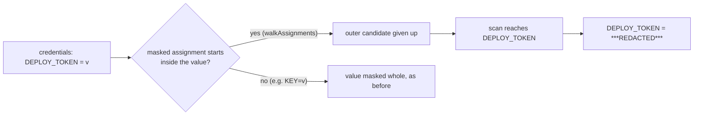

# PR Summary — Issue #5310

## Summary

The `secret-assignment` rule in `worker/deno/lib/secret_redaction.ts` took a
second credential label as the first label's value. For
`Rotate these credentials: DEPLOY_TOKEN = <value>`, on one line or across two,
it masked `DEPLOY_TOKEN`, resumed the scan after it, and published `<value>`
unchanged. The same leak hit `The secret: api_key: <value>`, a YAML child such
as `secrets:` then `API_TOKEN: <value>`, and
`credentials: DEPLOY_TOKEN="<value>"`.

The pattern is unchanged from the base. The decision is made where the value is
judged:

- A new walker, `walkAssignments`, is the one scan that both the replacement
  pass (`redactAssignments`) and `containsSecret`'s detection use.
- When an assignment starts inside the outer value, runs past its end and is
  itself masked, the outer candidate is given up. The walk resumes at the inner
  label, and that label's own match masks its value. This covers hyphenated,
  dotted and quoted inner labels (`DEPLOY-TOKEN`, `app.DEPLOY_TOKEN`,
  `"DEPLOY_TOKEN"`).
- Otherwise the outer value is masked exactly as on base. A value that merely
  contains a credential word (`password: abcTOKENxyz =`) keeps its mask.
- An inner value that already reads `***REDACTED***` also gives the outer value
  up, so a second pass changes nothing.

`SECURITY.md` has one new bullet describing the rule. `.github/gitleaks.toml`
exempts two exact historical mentions of the new test's synthetic fixture (see
Test Plan).

Closes #5310.

## Spec

### Intent and Rationale

- The leak came from the outer match consuming the inner label. Giving up that
  candidate puts the existing rule back in charge of the inner assignment, with
  all its value judgements (switch words, `${{ … }}`, JSON scalars, the
  cross-line checks from Issue #1727).
- The issue suggested refusing any label followed by `=` or `:`. That would
  split a password such as `MySecret:2024x` and publish its `MySecret:` prefix,
  because the inner match would mask only `2024x`. The walker gives the outer
  value up only when the inner assignment is itself masked and runs past the
  outer value, so `KEY=v` and `Secret:abc` are still masked whole.

### Essential Design Decisions

- The inner search reads the outer value plus 256 characters
  (`INNER_ASSIGNMENT_SPAN`), so each candidate costs bounded extra work (Issue
  #3942 linearity rule). An inner separator or value further out than that
  falls back to the base behaviour.
- `CREDENTIAL_KEYWORD` copies the key group's keyword list and is used only by
  the already-masked check. A keyword added to one must be added to the other.

### Undiscoverable Facts

- The base code also leaked a credential under a credential-labelled YAML child
  key (`secrets:` then `API_TOKEN: <value>`). The outer match swallowed
  `API_TOKEN:` as a mapping key and never scanned its value. This change fixes
  that too. I observed it with a scratch script before writing the test.

## Evidence

Backend only; no UI file is touched.

- Fix: in `worker/deno/lib/secret_redaction.ts`, `walkAssignments`,
  `innerAssignment`, `innerValueAlreadyMasked` and `redactAssignments`, plus
  the comment above the `secret-assignment` entry in `RULES`. The
  `MAPPING_KEY_VALUE` doc comment notes that a credential-labelled child key
  whose value is masked no longer reaches that test.
- Docs: `SECURITY.md`, section "An assignment's value is judged, not only its
  label", has a new bullet; the rest of the file is unchanged from `main`. I
  read the whole section. `docs/THREAT-MODEL.md` and `README.md` do not describe
  this rule.
- Corpus run: base (`origin/main`) and head `redactSecrets` over 4,296 tracked
  files (`*.md`, `docs/`, `docs/archive/pr-summaries/`, `prompts/`,
  `.github/workflows/*.yml`, `worker/deno/tests/*.ts`). The output differs in 4
  files:
  - Three are this PR's own text: `SECURITY.md`'s new bullet, this summary and
    the new test. In each, head masks the inner value instead of the label.
  - The fourth is the fixture line ``const secret = `PASSWORD: ${SECRET}`;`` in
    `worker/deno/tests/secret_redaction_markdown_1727_test.ts`. Base masked
    `` `PASSWORD: `` as the value of `secret`; head masks the value after
    `PASSWORD:`. That is this bug's own shape, not a false positive.
  - So there are 0 false positives, and no file is masked less than on base.
- Issue numbers cited:
  - #5310: secret-assignment rule publishes a credential when its label is
    consumed as the value of an earlier credential label.
  - #1727, #3942, #4705 and #5083 are cited as they were already cited in the
    files this PR touches.

## Test Plan

- **Added `worker/deno/tests/secret_redaction_label_as_value_5310_test.ts`, 30
  tests**, all through `redactSecrets` and `containsSecret`:
  - **Leak cases** must mask the inner value and keep both labels:
    - `DEPLOY_TOKEN = <40-char value>` on the same line and the next line;
    - `api_key: <value>` on the same line and the next line, each with the
      short value `pw42` and a 40-char value;
    - a YAML child `API_TOKEN: <value>` under `secrets:`;
    - a double-quoted inner value, and a chain of three labels;
    - a label 60 characters long;
    - hyphenated, dotted, double-quoted and single-quoted inner labels, and a
      hyphenated next-line form.
  - **Controls** keep base output:
    - `password=MySecret:2024x` is masked whole;
    - `credentials: DEPLOY_TOKEN=<value>` is masked as one run;
    - `GH_TOKEN: ${{ secrets.GH_TOKEN }}` and a bare `deploy:` child are
      unchanged, with `containsSecret` false;
    - a standalone `DEPLOY_TOKEN = <value>` is masked;
    - `password: abcTOKENxyz` keeps its mask with seven different tails, among
      them a dangling `=` or `:`, end of text, and a cross-line prose value.
  - **Other checks:** an idempotence check, and two hostile inputs:
    - a 200,000-character run before `_TOKEN` and 40 spaces;
    - 20,000 repeats of `TOKEN` followed by `!`.

    Each asserts its exact output, and neither publishes a value.
- **Red run, observed:** with `worker/deno/lib/secret_redaction.ts` restored
  from `origin/main`, the new file gave `14 passed | 16 failed`. The leak cases
  and the idempotence check failed; the controls and hostile cases passed. At
  head it gives `30 passed | 0 failed`.
- **Existing tests:** none edited. Ten redaction suites pass together at head
  (175 passed, 0 failed): the new file, `secret_redaction_test.ts` and its
  `_markdown_1727_`, `_redos_`, `_bounds_`, `_boolean_setting_`,
  `_json_structure_` and `_prose_heading_5253_` siblings,
  `fleet_telemetry_redaction_test.ts` and `run_stats_redaction_test.ts`. That
  includes the Issue #1727 Markdown and YAML mapping cases.
- **Full gate:** `./quality.sh < /dev/null` result is recorded in the commit
  that follows this summary's last edit; see Merge verification.
- **Gitleaks exemption:**
  - The first commit carrying the literal YAML fixture was already pushed. CI
    scans every commit in the PR range, so `.github/gitleaks.toml` exempts that
    exact line, and the backtick-quoted mention of it that an earlier commit of
    this summary carried. This follows the file's existing exact-line entries
    (Issues #4705, #5083) rather than rewriting the pushed branch.
  - `gitleaks git --config .github/gitleaks.toml --log-opts="origin/main..770765920"`
    reported 1 leak before the edit and none after it.
  - In a temp directory, a higher-entropy value on the same line shape is still
    reported under the edited config, so the exemption is exact.
  - `gitleaks_template_conformance_test.ts` and `gitleaks_check_test.ts`: 42
    passed.

## Merge verification

- CI on this head: pending.

## Not done or not checked

- When the inner label's separator or value sits more than 256 characters past
  the outer value, base behaviour applies, and the value is published. For
  example, `credentials: DEPLOY_TOKEN` + 300 spaces + `= <value>` still leaks.
- No reviewer sub-agents ran, because the issue has no acceptance-criteria list.
