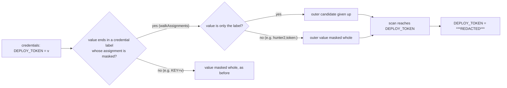

# PR Summary — Issue #5310

## Summary

The `secret-assignment` rule in `worker/deno/lib/secret_redaction.ts` took a
second credential label as the first label's value. For
`Rotate these credentials: DEPLOY_TOKEN = <value>`, on one line or across two,
it masked `DEPLOY_TOKEN`, resumed the scan after it, and published `<value>`
unchanged. The same leak hit `The secret: api_key: <value>`, a YAML child such
as `secrets:` then `API_TOKEN: <value>`, and
`credentials: DEPLOY_TOKEN="<value>"`.

The pattern is unchanged from the base. The decision is made where the value is
judged:

- A new walker, `walkAssignments`, is the one scan that both the replacement
  pass (`redactAssignments`) and `containsSecret`'s detection use.
- When the outer value ends in a credential label, the outer candidate may be
  given up. `trailingLabel` finds it: a key-shaped run of at most 128 characters
  holding a credential keyword, followed by at most a closing quote or the
  `=`/`:` the value swallowed. A single-quoted inner value holding a space
  (`DEPLOY_TOKEN='a b'`) is also covered: the label may sit just before one of
  the value's last three `'`. The label's own assignment must run past the value
  and be masked. The walk then resumes at the inner label, and that label's own
  match masks its value. This covers hyphenated, dotted and quoted inner labels
  (`DEPLOY-TOKEN`, `app.DEPLOY_TOKEN`, `"DEPLOY_TOKEN"`).
- The outer value is given up unmasked only when it is nothing but that label:
  an optional `"` or `'`, then label characters (`[A-Za-z0-9_.-]`). When other
  text sits before the label (`password: hunter2,token: <value>`,
  `TOKEN=abc123;SECRET='d9 e8'`, `password: ab#c1TOKEN = <value>`), the outer
  value is still masked whole, as on base, and the walk still continues at the
  inner label. The inner key and separator then sit inside the outer mask, so
  only the part of the inner value past it is masked again:
  `password: ***REDACTED*** ***REDACTED***`.
- Otherwise the outer value is masked exactly as on base. A value that merely
  contains a credential word keeps its mask. That holds for
  `password: abcTOKENxyz =`, and also for `password: TOKENab#c1 = <ghp_ token>`,
  where a signature rule has already masked the token.
- A label whose value already reads `***REDACTED***` also gives the outer value
  up. The check uses the same label and the pattern's separator shape, so it
  covers `api_key: ***REDACTED***`, `DEPLOY_TOKEN="***REDACTED***"` and the
  cross-line form. A second pass changes nothing. This holds only when the
  placeholder, bar a closing quote, ends the outer value: in
  `credentials: TOKEN='***REDACTED***';db_pass=…` the text after it belongs to
  the outer value, which is masked whole. The already-masked check reads
  `INNER_ASSIGNMENT_SPAN` plus an opening quote and the placeholder's length
  past the outer value, so it sees the whole placeholder wherever the first pass
  can write one, including a value starting at the span's edge.
- A single-quoted inner value holding a space that runs straight into more text,
  as in `credentials: DEPLOY_TOKEN='a b'.`, keeps the outer mask too
  (`credentials: ***REDACTED******REDACTED***.`). Masking the inner value
  removes its space, so a second pass would read the label, placeholder and tail
  as one outer value and mask it whole; masking it on the first pass keeps
  redaction idempotent.
- A double-quoted inner value matches only with its closing quote, which a long
  value puts past the 256-character window. When the value opens inside the
  window and closes within 4,096 characters (`closesWithinReach`), the full-text
  match decides, so `DEPLOY_TOKEN = "<300 characters>"` after a lead-in label is
  masked with its label kept. The search for the closing quote is capped, so
  each candidate's extra work stays bounded.
- The walk decides every shape where a mask would change how the next walk reads
  the text around it, so its output is final:
  - A closed quoted outer value that the text runs straight on from
    (`credentials: 'DEPLOY_TOKEN='<value>`) keeps its mask (`quotedRunOn`);
    masking only the inner value would join the run and the placeholder into one
    bare outer value. This holds however often the shape repeats.
  - Text before the inner label that opens with `-` is not label text, so a CLI
    flag (`credentials: --token = <value>`) keeps the outer mask. Given up, it
    left `--token = ***REDACTED***` for the later `secret-cli-flag` rule to
    rewrite, and the next call masked `--token`.
  - `trailingLabel` tries the label before one of the value's last three `'`,
    not two, so a second pass over `token'='***REDACTED***'` finds the label the
    first pass found in `token'='d9 e8'`.
- `redactAssignments` then walks its own output again, at most four walks in all
  (`MAX_ASSIGNMENT_PASSES`), until a walk changes nothing. That is a bounded
  backstop, not the guarantee: with it capped at one walk, the exhaustive check
  below still finds no input whose output changes on a second call.

The rule interface gained a whole-text form: a rule supplies either a `pattern`
and `replace`, or an `apply` and `detect` pair. The `secret-assignment` rule
uses `apply: redactAssignments` and `detect: detectsSecretAssignment`, so its
old per-match `replace` callback, which nothing could reach any more, is gone,
along with both checks on the rule's pattern identity.

`SECURITY.md` has two new bullets: the rule, and the limits past which the base
behaviour applies (a 256-character search span, a 4,096-character double-quoted
inner value, a 128-character label, and the embedded-quote case).
`.github/gitleaks.toml` exempts two exact historical mentions of the new test's
synthetic fixture (see Test Plan).

Closes #5310.

## Spec

### Intent and Rationale

- The leak came from the outer match consuming the inner label. Giving up that
  candidate puts the existing rule back in charge of the inner assignment, with
  all its value judgements (switch words, `${{ … }}`, JSON scalars, the
  cross-line checks from Issue #1727).
- The issue suggested refusing any label followed by `=` or `:`. That would
  split a password such as `MySecret:2024x` and publish its `MySecret:` prefix,
  because the inner match would mask only `2024x`. The walker gives the outer
  value up only when the inner assignment is itself masked and runs past the
  outer value, so `KEY=v` and `Secret:abc` are still masked whole.

### Essential Design Decisions

- Only the label that ends the value is tried, or the one just before one of the
  value's last three `'`. An inner assignment can only start there and run past
  the value, because the value's run stops where the inner separator's
  whitespace or quote begins. A single-quoted inner value holding a space is the
  one shape where the value takes the inner `='a` with it. The label is found by
  walking back at most 128 characters (`INNER_LABEL_MAX`). The pattern is run on
  it only when a separator follows. The pattern's key group is quadratic on a
  long run of keywords, so a longer run is never re-scanned as a key. It keeps
  the base mask (Issue #3942 linearity rule).
- The search past the value is cut to 256 characters (`INNER_ASSIGNMENT_SPAN`).
  An inner separator or value further out than that falls back to the base
  behaviour.
- `CREDENTIAL_KEYWORD` copies the key group's keyword list. It is used only to
  decide whether a trailing run is a label. A keyword added to one must be added
  to the other.
- `detectsSecretAssignment` uses the same walk as the replacement pass. So the
  decode-then-rescan pass (Issue #188) now flags a base64 blob whose decoded
  text holds a label-as-value credential. On base that blob was published.

### Undiscoverable Facts

- The base code also leaked a credential under a credential-labelled YAML child
  key (`secrets:` then `API_TOKEN: <value>`). The outer match swallowed
  `API_TOKEN:` as a mapping key and never scanned its value. This change fixes
  that too. I observed it with a scratch script before writing the test.

## Evidence

Backend only; no UI file is touched.

- Fix: in `worker/deno/lib/secret_redaction.ts`, `walkAssignments`,
  `isLabelOnly`, `pastFloor`, `trailingLabel`, `innerAssignment`,
  `closesWithinReach`, `redactAssignments` and `redactAssignmentsOnce`, plus the
  comment above the `secret-assignment` entry in `RULES`. `RedactionRule` is a
  union of the per-match and whole-text forms; `redactSecrets` and
  `matchesSignatureRule` call `apply` and `detect` where a rule has them. The
  `MAPPING_KEY_VALUE` doc comment notes that a credential-labelled child key
  whose value is masked no longer reaches that test.
- Docs: `SECURITY.md`, section "An assignment's value is judged, not only its
  label", has two new bullets. The first describes the label shape, when the
  outer value stays masked, and that a credential word elsewhere in a value
  keeps the mask; it no longer says a label is "never" taken as a value. The
  second states the limits past which base behaviour applies, each checked at
  head: an inner `=` 260 spaces away, a 4,097-character double-quoted value, a
  140-character label and `DEPLOY_TOKEN='a'b'c <value>'` each still publish the
  value. The rest of the file is unchanged from `main`. I read the whole
  section. `docs/THREAT-MODEL.md` and `README.md` do not describe this rule.
- Corpus run on the final commit: base (`origin/main` at `5dde2633c`), the
  previous head (`d6c9a377`) and this head's `redactSecrets` over 4,627 tracked
  files (`*.md`, `docs/`, `prompts/`, `.github/workflows/*.yml`,
  `worker/deno/tests/*.ts`). A second pass over each output changed nothing in
  any file. Base and head output differs in 4 files:
  - Three are this PR's own text: `SECURITY.md`'s new bullet, this summary and
    the new test. In each, head masks the inner value instead of the label.
  - The fourth is ``const secret = `PASSWORD: ${SECRET}`;`` in
    `worker/deno/tests/secret_redaction_markdown_1727_test.ts`. Base masked
    `` `PASSWORD: `` as the value of `secret` and published the value after it.
    A backtick is not an opening quote here, so the outer value is not only a
    label: head masks it whole and also masks the value after `PASSWORD:`. The
    previous head kept `` `PASSWORD: `` visible.
  - Comparing placeholders line by line, head has fewer than base on three lines
    only: the new test's chain fixture, twice, and its mention in this summary,
    `credentials: secret: DEPLOY_TOKEN
    = <value>`: base masked the label
    `secret:`, head keeps it and masks the value. No line publishes text that
    base masked except such a label.
  - The corpus holds none of the review's text-before-label shapes, so the new
    tests carry that evidence (see Test Plan).
- Exhaustive idempotence and leak check, on this head's library:
  - Every input built from up to two label segments (an optional `'` or `"`; an
    optional `x,` or `--` prefix; one of `credentials`, `token`,
    `app.DEPLOY-TOKEN`, `--api-token`; one of `=`, `:`, `'=`, `:\n`, `=`; an
    optional quote), then one of four values (`hunter2`, `d9 e8`, the
    placeholder, a 40-character token) and one of five tails: 5,842,800 inputs.
  - Plus 21,504 repeated-unit inputs: four lead-ins, 56 units (an optional `'`,
    one of four labels including `--token`, one of seven separators) repeated 1
    to 8 times, then a value and a tail.
  - On none did a second `redactSecrets` change the output or `containsSecret`
    report a secret in it, and none published a value that base masked. That
    holds with `MAX_ASSIGNMENT_PASSES` set to 1, so the walk itself decides
    every one; before `trailingLabel` tried a third quote, the one-walk run
    found 417 (all `<label>'='d9 e8'`).
  - On an earlier, two-label version of the grammar (937,440 inputs), the
    previous head `3338d345` changed on a second pass for 5,364 inputs.
- Timing, on the verifier's fixture (`credentials:` + `TOKEN`×N + `!`): 100, 200
  and 400 KB took 67, 133 and 267 ms at this head. The previous head took 1,070,
  4,127 and 16,463 ms. The verifier measured 68, 136 and 270 ms on base.
- Issue numbers cited:
  - #5310: secret-assignment rule publishes a credential when its label is
    consumed as the value of an earlier credential label.
  - #1727, #3942, #4705 and #5083 are cited as they were already cited in the
    files this PR touches.

## Test Plan

- **Added `worker/deno/tests/secret_redaction_label_as_value_5310_test.ts`, 128
  tests**, all through `redactSecrets` and `containsSecret`:
  - **Leak cases** must mask the inner value and keep both labels:
    - `DEPLOY_TOKEN = <40-char value>` on the same line and the next line;
    - `api_key: <value>` on the same line and the next line, each with the short
      value `pw42` and a 40-char value;
    - a YAML child `API_TOKEN: <value>` under `secrets:`;
    - a double-quoted inner value, and a chain of three labels;
    - a label 66 characters long;
    - hyphenated, dotted, double-quoted and single-quoted inner labels, and a
      hyphenated next-line form;
    - a single-quoted inner value holding a space,
      `credentials: DEPLOY_TOKEN='<a b>'`.
  - **Text before an inner label stays masked** (PR review): nine inputs, each
    with its exact output and a check that no value appears in it —
    `password: hunter2,token: <ghp_ token>`,
    `db_password: Winter2026!;gh_token: <ghp_ token>`,
    `password: hunter2,token: ***REDACTED***`,
    `user: bob,password: hunter2,token: abc123`, `TOKEN=abc123;SECRET='d9 e8'`,
    `password: ab#c1TOKEN = <ghp_ token>`, the chain
    `a_password: x1,b_token: y2,c_secret: z3`, and two tails after an inner
    value already masked: `credentials: TOKEN='<ghp_ token>';db_pass=…` and
    `credentials: TOKEN='***REDACTED***';db_pass=…`, each masked whole.
    `containsSecret` is true on each.
  - **Run-on single-quoted inner value:** `credentials: DEPLOY_TOKEN='a b'.` and
    `credentials: DEPLOY_TOKEN='a b';x=1` keep the outer mask
    (`credentials: ***REDACTED******REDACTED***.`), so a second pass changes
    nothing.
  - **The 256-character span edge:** for every gap from 0 to 300 in three shapes
    (spaces before `=`, spaces after `=`, newlines after
    `The secret: api_key:`), a second pass changes nothing and `containsSecret`
    is false on the output. An inner `=` 253 spaces away is masked with the
    label kept; one 254 spaces away keeps the base behaviour (label masked,
    value published), pinning the documented limit.
  - **Long double-quoted inner values:** 252, 300 and 4,096 characters in four
    forms (same line, next line, next-line `api_key:`, YAML child), each with
    its exact output (label kept, value masked), an unchanged second pass and
    `containsSecret` false on the output. A 4,097-character value pins the
    documented base behaviour.
  - **Quoted outer value ending in a separator:**
    `credentials: 'DEPLOY_TOKEN='<token>`,
    `export CREDENTIALS='password='hunter2`, `DB_SECRET_ARGS='--token='<token>`
    and `secrets: 'Password:'hunter2` keep the outer mask with its quotes
    (`credentials: '***REDACTED***'***REDACTED***`); `secrets: TOKEN'='d9 e8'`
    keeps its label (`secrets: TOKEN'='***REDACTED***'`). Each has its exact
    output, an unchanged second pass, `containsSecret` false on the output and
    no value published.
  - **Repeats past the backstop cap:** 4, 5 and 8 repeats of `'DEPLOY_TOKEN=`,
    `'T_TOKEN=`, `'T_TOKEN:`, `T_TOKEN='` and `T_TOKEN:'` before a token, each
    with the same four checks.
  - **CLI-flag outer value:** `credentials: --token = <token>`,
    `Rotate these credentials: --api-token = <token>`,
    `Use this password: --password : <token>`,
    `The secret: --client-secret\n  = <token>` and a double-quoted value, each
    masked as `credentials: ***REDACTED*** = ***REDACTED***` and so on, with the
    same four checks.
  - **Idempotence:** for each of the 26 leak inputs,
    `redactSecrets(redactSecrets(x)) === redactSecrets(x)` and
    `containsSecret(redactSecrets(x)) === false`.
  - **Decode-then-rescan:** the base64 of the YAML-child form and of the
    next-line `api_key:` form is masked whole, and `containsSecret` is true.
  - **Controls** keep base output:
    - `password=MySecret:2024x` is masked whole;
    - `credentials: DEPLOY_TOKEN=<value>` is masked as one run;
    - `GH_TOKEN: ${{ secrets.GH_TOKEN }}` and a bare `deploy:` child are
      unchanged, with `containsSecret` false;
    - a standalone `DEPLOY_TOKEN = <value>` is masked;
    - `password: abcTOKENxyz` keeps its mask with seven different tails, among
      them a dangling `=` or `:`, end of text, and a cross-line prose value;
    - a keyword mid-value before a `ghp_` token keeps both masks:
      `password: TOKENab#c1 = <token>`, the `:` form
      `password: abc-TOKEN.x9 : <token>` and the quoted form
      `password: "a TOKEN b" = "<token>"`.
  - **Hostile inputs**, each asserting its exact output:
    - a 200,000-character run before `_TOKEN` and 40 spaces;
    - 20,000 repeats of `TOKEN` followed by `!`;
    - `credentials:` + 100,000 repeats of `TOKEN` (500 KB) with four tails: `!`,
      nothing, `: x` and `= x`. As in `secret_redaction_redos_test.ts` there is
      no stopwatch; the size is the detector.
- **Red runs, observed** — each runs this head's 128-test file against an older
  `worker/deno/lib/secret_redaction.ts`:
  - From `origin/main` (`5dde2633c`): `70 passed | 58 failed`.
  - From the first fix (`2396849b7`): `69 passed | 59 failed`, in 5m7s; that
    library is quadratic on the long `TOKEN` runs.
  - From the head before the first review fix (`d6c9a377`):
    `75 passed | 53 failed`.
  - From `bc9dbbc6`, before the run-on fix: `91 passed | 37 failed`. That
    library turned `credentials: DEPLOY_TOKEN='a b'.` into
    `credentials: DEPLOY_TOKEN='***REDACTED***'.`, which a second pass turned
    into `credentials: ***REDACTED***`.
  - From `75e171d4`, before the span-edge fix: `95 passed | 33 failed`. Swept by
    hand, that library was not idempotent for 241-253 spaces before or after `=`
    and 243-255 newlines after `api_key:` (39 inputs); this head and base are
    idempotent on all 903.
  - From `3338d345`, before the long-quote fix: `99 passed | 29 failed`.
  - From `4d002e04`, before the walk-level decisions: `109 passed | 19 failed`.
    The five flag-shaped inputs and the nine repeats of a `'`-led unit failed
    because a second call changed the output. The five quoted-outer inputs
    failed on exact output only: that library's walk loop already reached a
    final `credentials: ***REDACTED***`, where this head keeps the quotes.
  - At head: `128 passed | 0 failed`.
  - On an earlier, 54-test version of the file, this PR's library with
    `detectsSecretAssignment` restored to the base loop failed only the two
    base64 cases (`52 passed | 2 failed`); that mutation was not re-run on the
    current file.
- **Existing tests:** none edited. In the new file, the control titled for a
  64-character bound is renamed for what it checks, a 66-character label within
  the 128-character bound. Every test file that mentions `redactSecrets`,
  `containsSecret` or `secret_redaction` passes at head: 54 files, 1,295 passed,
  0 failed. This run used a scratch import map in place of the `jsr:@std/*`
  imports, since jsr.io was unreachable from the host; CI runs the suites as
  written. That includes `secret_redaction_test.ts`, its `_markdown_1727_`,
  `_redos_`, `_bounds_`, `_boolean_setting_`, `_json_structure_` and
  `_prose_heading_5253_` siblings, `fleet_telemetry_redaction_test.ts` and
  `run_stats_redaction_test.ts`.
- **Full gate:** `./quality.sh < /dev/null` passed on an earlier head
  (`be3317ae0`) with `Result: PASSED (with skipped checks)`. The gate itself
  skipped `config integration` (no `.config.json`) and `checkov` (no checkov on
  PATH). `deno task test:unit` over every unit test file also passed on that
  head (parallel and serial passes, 0 failed). The review fix was not run
  through the full gate locally; CI runs it. `deno fmt`, `deno lint` and
  `deno check` on the two changed files are clean.
- **Gitleaks exemption:**
  - The first commit carrying the literal YAML fixture was already pushed. CI
    scans every commit in the PR range, so `.github/gitleaks.toml` exempts that
    exact line, and the backtick-quoted mention of it that an earlier commit of
    this summary carried. This follows the file's existing exact-line entries
    (Issues #4705, #5083) rather than rewriting the pushed branch.
  - `gitleaks git --config .github/gitleaks.toml --log-opts="origin/main..770765920"`
    reported 1 leak before the edit and none after it.
  - In a temp directory, a higher-entropy value on the same line shape is still
    reported under the edited config, so the exemption is exact.
  - `gitleaks_template_conformance_test.ts` and `gitleaks_check_test.ts`: 42
    passed.
  - The new `ghp_` fixture is built by concatenation. `gitleaks dir` with the
    repo config over the changed test and library found no leaks.

## Merge verification

- CI on this head: pending.

## Not done or not checked

- Base behaviour applies, and the inner value is published as on base, in four
  cases:
  - The inner label's separator or value sits more than 256 characters past the
    outer value. For example, `credentials: DEPLOY_TOKEN` + 300 spaces +
    `= <value>` still leaks.
  - A double-quoted inner value closes more than 4,096 characters after its
    opening quote. A test pins a 4,097-character value.
  - The inner label is longer than 128 characters. The `= x` hostile test pins
    `credentials: <500 KB of TOKEN> = x` as `credentials: ***REDACTED*** = x`.
  - The inner label sits neither at the end of the outer value nor just before
    one of its last three `'`. That happens when the first word of a
    single-quoted inner value itself holds two `'`:
    `credentials: DEPLOY_TOKEN='a'b'c <value>'` publishes `<value>'`, as on base
    (run at head). The earlier head tried any label inside the value. No test
    covers this shape.
- An inner label opened by a backtick (`` `PASSWORD: <value>` ``) counts as text
  before the label, so the outer value, label included, is masked whole with the
  inner value. Nothing is published, but the label is not kept.
- No reviewer sub-agents ran, because the issue has no acceptance-criteria list.
