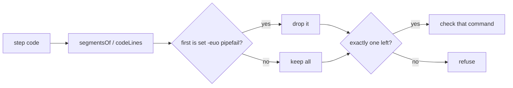

# PR Summary — Issue #5316

## Summary

`stepIsOnlyScript` (the `aws-emulator.yml` test step) and `stepIsAgentRun`
(the `container-build.yml` agent run) dropped every `set -euo pipefail`
segment wherever it sat, then required one remaining command. Under an
allowed shell with no errexit (`shell: bash {0}`) a step's exit status is its
last command's, so a `set` line after the command turned a failed emulator
test or agent run into a green job. Both checks, and the gate step's
`stepRunsGateScript`, now share one helper, `soleCommandAfterStrictMode`:
the preamble counts only as the first command, and the checked command must be
the only one left, so it is the last. Closes #5316.

## Spec

### Intent and Rationale

- The three validators held the same rule in two different shapes. One helper
  gives them a single source of truth, as the issue asks, and copies the
  leading-only form `stepRunsGateScript` already had.

### Essential Design Decisions

- The helper is generic over the command type, because the agent and test
  checks compare word segments (`segmentsOf`) and the gate check compares
  exact lines (`codeLines`). Each check keeps its own tokenisation.
- A second, repeated `set -euo pipefail` now counts as a command, so the step is
  refused. Two existing `(a)` tests that put a preamble in front of the real
  step's preamble now replace the whole preamble-plus-call block
  (`TEST_STEP_BLOCK`), so they still test what they were written for.

### Undiscoverable Facts

- Observed under plain bash: a script holding `false` then `set -euo pipefail`
  exits 0, and `set -euo pipefail` then `false` exits 1.

## Evidence

Backend and validator only; no UI file changed.

## Test Plan

- Added `worker/deno/tests/issue_5110_aws_emulator_workflow_test.ts`:
  - `(a) refuses a trailing set -euo pipefail under shell: bash {0} (Issue #5316)`,
    with control `(a) accepts a leading set -euo pipefail under shell: bash {0} (Issue #5316 control)`
  - `(container-agent-run) refuses a trailing set -euo pipefail under shell: bash {0} (Issue #5316)`,
    with control `(container-agent-run) accepts a leading set -euo pipefail under shell: bash {0} (Issue #5316 control)`
  - The gate validator already has `(gate-script) refuses a trailing set that masks the gate result …`.
    It still passes now that the check goes through the shared helper.
- Red against the base: I restored the milestone branch's
  `worker/deno/lib/aws_emulator_workflow_check.ts`, kept the new tests and ran
  `deno test -A tests/issue_5110_aws_emulator_workflow_test.ts --filter 5316`.
  Both refusal tests FAILED and both controls passed. On head, all 240 tests in
  that file pass.
- Edited existing tests: `(a) refuses <negated call>` and
  `(a) accepts the normal call after set -euo pipefail (control …)` now anchor on
  `TEST_STEP_BLOCK` rather than `TEST_STEP_ANCHOR`. They assert the same
  findings as before. With the old anchor the mutation would leave two
  preambles, and the new rule refuses that for a different reason. No
  assertion was removed.
- `./quality.sh < /dev/null` ran on the final code: `Result: PASSED (with
  skipped checks)`. The skipped checks are config integration and checkov, both
  skipped by the environment.
- Docs: the module doc's test-step clause and the `[test-step]` message now say
  "optional leading `set -euo pipefail`". I grepped `README.md` and `docs/`
  (excluding the archive) for the old wording and the function names: no hits.
- Twinned rule: the issue names three copies (`stepIsOnlyScript`,
  `stepIsAgentRun`, `stepRunsGateScript`). All three now call the shared
  helper. No other copy was found.
