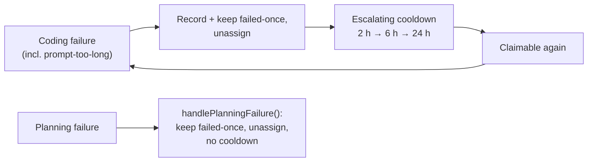

# PR Summary — Issue #5318

## Summary

The operator manuals still described a two-step failure ladder (`failed-once`,
then `failed`). That ladder was removed by Issue #4158. Every failure is now
recorded under `failed-once` and the worker never applies `failed`. On the
coding path the issue stays claimable once the escalating cooldown ends; the
planning path records no cooldown. The stale passages now describe this.
Docs only.

Closes #5318.

## Spec

### Intent and Rationale

- `worker/deno/lib/label_failure.ts` (header, lines 9-12) and
  `worker/deno/lib/coding_failure_ladder.ts` (header) state that the worker
  never applies `failed`. The manual contradicted both, and its own line 781.
- The issue's suggested grep covered "then failed" and "Replace with `failed`".
  The same stale claim also appears as `failed-once` → `failed`, so that
  spelling was swept too.

### Essential Design Decisions

- `docs/workflows/planning-and-questions.md` is included because
  `handlePlanningFailure()` in `worker/deno/lib/planning_processor.ts` calls
  `deps.github.handleIssueFailure`, the same never-terminal handler. The
  planning route records and checks no cooldown, so its passage states only
  `failed-once` kept, unassign, never `failed`.
- Historical prose is left as written. `docs/INTERNALS.md` around line 5856
  ("Until #2220 it was … six went on to `failed`") describes what happened
  before #2220, so it is still true. The dated audit record
  `docs/audits/security-sweep-2682-prompt-too-long.md` is also left alone.
- The "2 h, rising to 24 h" wording copies the failure record in
  `label_failure.ts`. It matches `ESCALATING_COOLDOWN_LADDER_SECONDS` in
  `worker/deno/lib/cooldown_state.ts`: 2 h, then 6 h, then 24 h.

### Undiscoverable Facts

- None.

## Evidence

Documentation-only change, so there is no runtime behaviour to test. Behaviour
claims were checked against the code:

- `worker/deno/lib/label_failure.ts:9-12` and `:420-421`: a repeat failure keeps
  `failed-once` and stays claimable. Pinned by
  `worker/deno/tests/prompt_too_long_2682_test.ts` ("a repeat refusal after
  failed-once is recorded again, never parked (Issue #4158)") and
  `worker/deno/tests/never_park_4158_test.ts`.
- `worker/deno/lib/planning_processor.ts:3185-3244`: `handlePlanningFailure`
  routes through `handleIssueFailure`, then `releaseClaim`. Neither records a
  cooldown (no cooldown reference in `planning_processor.ts`).

Passages rewritten:

| File                                       | Passage                                                                                                                                                                                  |
| ------------------------------------------ | ---------------------------------------------------------------------------------------------------------------------------------------------------------------------------------------- |
| `docs/workflows/issue-processing.md`       | Implementation-failure decision-point bullet; "retried within the normal `failed-once` → `failed` budget" in the analysis-only bullet; prompt-too-long bullet; its Mermaid `Ladder` node |
| `docs/INTERNALS.md`                        | #2220 Mermaid `F` node; `coding_failure_ladder.ts` table row                                                                                                                             |
| `docs/workflows/planning-and-questions.md` | Loud-failure paragraph and its Mermaid `C` node                                                                                                                                          |
| `docs/workflows/label-flows.md`            | `failed-once` and `failed` rows of the state table; the `failed-once` / `failed` short card                                                                                              |
| `docs/TROUBLESHOOTING.md`                  | Pickup flowchart's "Has the failed label?" decision and its "Remove failed label" node                                                                                                  |

Issue numbers cited: #4158: Never park an assigned issue: drop the terminal
`failed` label and the repeated-failure needs-human hand-off. #1949: Ordinary
coding-run failures never reach the failed-once/failed ladder (this one was
already cited in the table row).

## Test Plan

- No tests added or edited (docs only).
- `grep -rnE "then \`?failed\`?\b|Replace with \`failed\`|failed-once\`?
  (→|->|then) \`?failed|Second failure — skipped until|two fresh attempts|First failure — will retry" README.md docs
  --include=*.md`,
  ignoring`docs/archive/`, on the final head: the remaining hits are the
  historical #2220 paragraph (`docs/INTERNALS.md:5856`), the dated audit record`docs/audits/security-sweep-2682-prompt-too-long.md:34`,
  and unrelated uses of "then failed".
- `markdownlint-cli2` on the five edited manuals (the three first rewritten plus `label-flows.md` and `TROUBLESHOOTING.md`) and this summary: `Summary: 0 issues in 0 files`.
- `./quality.sh` on the final docs head: `Result: PASSED (with skipped checks)`.
  Config integration was skipped (no `.config.json`) and checkov was skipped
  (not installed). Mermaid, markdownlint, deno tests, lint, type check and fmt
  all passed. The first attempt hit its own 900 s bound and was re-run with 1700
  s.
- Not done: the doc comment on `ESCALATING_COOLDOWN_LADDER_SECONDS` in
  `worker/deno/lib/cooldown_state.ts` still says the third failure "also
  escalates to a human". That is a source doc comment outside this issue's docs
  scope, so it is left unchanged.
