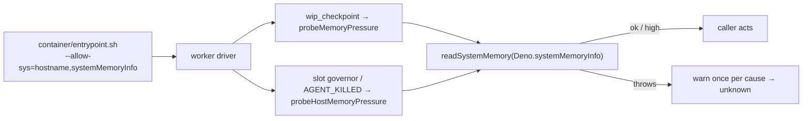

# PR Summary — Issue #5319

## Summary

On Linux, the worker's memory-pressure probes now read `Deno.systemMemoryInfo()`
instead of `/proc/meminfo`. Deno refuses `/proc/meminfo` to any process short of
`--allow-all`, so every probe in the container driver read `unknown`. The
container driver is now granted `--allow-sys=hostname,systemMemoryInfo`. A
refused or failed read no longer disappears into a bare `unknown`: it is logged
once per distinct cause through `console.warn`, with the cause named. Closes
#5319.

## Spec

### Intent and Rationale

- `probeMemoryPressure` (the WIP pre-OOM checkpoint, Issue #4301) and
  `probeHostMemoryPressure` (the slot governor and the AGENT_KILLED memory
  fields) both took the `/proc/meminfo` path, so on Linux none of them ever saw
  `high`.
- `Deno.systemMemoryInfo()` needs only `--allow-sys=systemMemoryInfo`. PR #5308
  already used it in `probeHostMemoryPressureFromSystem`, so the validation and
  classification now live in one private `readSystemMemory` helper that both
  paths call.

### Essential Design Decisions

- `probeMemoryPressure` still never throws. A refused read reads `unknown`, as
  before, so callers keep treating the probe as telemetry. The difference is a
  warning naming the cause, for example
  `NotCapable: Requires sys access
  to "systemMemoryInfo", …`.
- "Once" means once per distinct cause per process, using a module-level set. A
  probe on a one-minute tick cannot flood the log, a new cause is still
  reported, and no test-only reset hook is needed.
- The message carries no `WARNING:` prefix: `log_level_prefix_lint_test.ts`
  (Issue #4176) requires the level to come from the sink. The default sink is
  `console.warn`.
- `parseMemInfo` and the `readMemInfo` option were removed, because nothing in
  production reads `/proc/meminfo` through them any more.
  `probeHostMemoryPressureFromSystem` keeps its throwing contract.

### Undiscoverable Facts

- Observed with Deno 2.9.8 under the driver's old flags
  (`--allow-env --allow-read --allow-write --allow-run --allow-net --allow-sys=hostname`):
  - `Deno.readTextFile("/proc/meminfo")` fails with
    `NotCapable: Requires all access to "/proc/meminfo", run again with the --allow-all flag`.
  - `Deno.systemMemoryInfo()` fails with
    `NotCapable: Requires sys access to "systemMemoryInfo", run again with the --allow-sys flag`.
- With `--allow-sys=hostname,systemMemoryInfo`, `systemMemoryInfo()` returns
  `{"total":59017863168,…,"available":57112711168,…}`, but `/proc/meminfo` is
  still refused.

## Evidence

This is a backend and launcher change; there is no UI.

- Issue numbers this diff adds as provenance: #5319: Linux memory-pressure
  probes always read `unknown`: Deno refuses /proc/meminfo without --allow-all.
- Doc sections read and updated:
  - `docs/CONTAINER.md`, the memory/swap paragraph above "Least privilege and
    lifecycle", which said the loop "probes `/proc/meminfo`".
  - The driver comment in `container/entrypoint.sh`.
  - The doc comment on `WipCheckpointOptions.probeMemory` in
    `worker/deno/lib/wip_checkpoint.ts`.
  - The module and function doc comments in
    `worker/deno/lib/memory_pressure.ts`.
- `docs/INTERNALS.md:920`, which mentions `/proc/meminfo`, describes the bash
  crash-context collector, which this change does not touch.
- Callers of `worker/deno/lib/wip_checkpoint.ts`: the only line this diff
  changes there is the doc comment on `WipCheckpointOptions.probeMemory` (line
  240). No function body or signature in that file changes.
  - `buildDeclaredHandoffWipCommitMessage` at
    `worker/deno/lib/phases/declared_handoff.ts:104` — **unchanged**. The
    function (`wip_checkpoint.ts:187`) is untouched by this diff; its output is
    still pinned by `tests/wip_commit_marker_test.ts` and
    `tests/wip_checkpoint_test.ts`.

## Test Plan

- `worker/deno/tests/container_entrypoint_test.ts` — this is the real-subprocess
  test the issue asks for.
  - New test, "entrypoint - the driver's permission set lets the memory-pressure
    probe read memory (Issue #5319)". It runs the real `entrypoint.sh` with a
    stub `deno` to capture the driver's actual `--allow-*` flags. It then runs
    `probeMemoryPressure` in a real `deno run` subprocess under exactly those
    flags, and asserts a level of `ok` or `high`, `totalBytes > 0` and no
    warning.
  - Its negative control re-runs the probe under the old `--allow-sys=hostname`
    grant and asserts `unknown` plus a warning containing
    `NotCapable: Requires sys access to "systemMemoryInfo"`.
  - The test is ignored off Linux, where the probe reads `unknown` by design.
  - Observed red against the unfixed base: with `container/entrypoint.sh` and
    `worker/deno/lib/memory_pressure.ts` restored from `origin/main`, it fails
    with `AssertionError: unexpected level unknown`. On the head it passes.
  - Edited test, "execs the Deno driver with the worker permission set": its
    expected flag changes from `--allow-sys=hostname` to
    `--allow-sys=hostname,systemMemoryInfo`, as the issue requires. Every other
    assertion is kept.
  - The suite is in the integration set, so `test:unit` skips it. CI runs it in
    the image step of `.github/workflows/container-build.yml`. Locally:
    `deno test --frozen --lock=deno.lock --allow-env --allow-read --allow-write --allow-run tests/container_entrypoint_test.ts`
    gave 45 passed, 0 failed.
- `worker/deno/tests/memory_pressure_test.ts`:
  - New test, "probeMemoryPressure - a refused read warns once with its cause
    and reads unknown". The same `NotCapable` cause twice gives one warning
    containing the cause. A second cause (`total=0`) gives a second warning.
  - New test for the non-Linux path: even with a reader that would report high
    pressure, it reads `unknown` and does not warn.
  - The injected-reader test now injects `systemMemoryInfo` instead of
    `readMemInfo` and keeps its high / ok (threshold 0.01) / unknown cases with
    the same byte counts.
  - The first test keeps every `classifyPressure` assertion. The `parseMemInfo`
    assertions were removed along with `parseMemInfo` itself, which no longer
    has a caller (`git grep -n -w parseMemInfo` is empty). The `total=0` case
    covers the implausible reading that `parseMemInfo("garbage")` used to cover.
- `worker/deno/tests/slot_governor_test.ts`: the Linux host-probe case injects
  `systemMemoryInfo` (50 KiB of 1000 KiB available) and still expects `high`.
- Unit tests on the unfixed code: 4 failed. The new and rewritten
  memory-pressure tests and the slot-governor Linux case read `unknown`.
- `deno task test:unit tests/memory_pressure_test.ts tests/slot_governor_test.ts tests/claude_runner_killed_test.ts tests/wip_checkpoint_test.ts tests/log_level_prefix_lint_test.ts`
  passed on the head.
- `./quality.sh < /dev/null` on the head reported
  `Result: PASSED (with skipped checks)`. Two checks were skipped for
  environment reasons: config integration (no `.config.json`) and checkov (not
  installed).

## Not done

- `worker/deno/lib/liveness_guard.ts` still reads `/proc/meminfo` for the
  `mem_available_mib` field of the liveness line (Issue #4225). Under the same
  driver flags that read is refused too, so the field reads `unavailable`. It is
  a separate reader with its own output contract, outside this issue's probes,
  so this PR leaves it unchanged.
- The probe has not been watched in a live worker run. The production flag set
  is proven by the real-subprocess test above.
