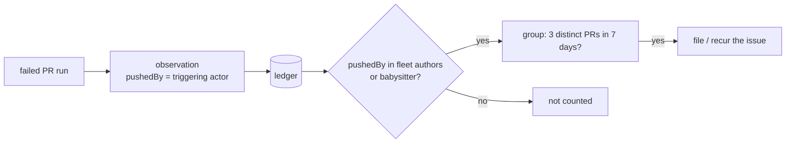

# PR Summary — Issue #5320

## Summary

The shift-left detector (Issue #4610) filed #5320 after counting `deno check`
and `deno test` failures on fleet-authored PRs. But since the last #5169 fix
merged (PR #5267, 2026-11-18T23:00Z), every cited failure was on a head pushed
by the owner's account (`nleck`), not by a fleet account. Some were the owner's
own commits (#5251, #5266), and some were GitHub "Update branch" merges the
owner triggered (#5312). The fleet's local gate never saw those heads, so they
are not evidence that the fleet skipped it.

`runShiftLeftScan` now groups only observations whose failing head a fleet
account pushed. The run's triggering actor must be a fleet author or the
babysitter, matched case-insensitively. Observations are still recorded as
before, so entries already in a host's ledger are filtered too.

One fleet path the issue describes is still only partly covered: the fleet's own
GitHub update-branch base refresh. On a strict base it waits for the required
checks on GitHub's test merge, but never runs `deno check` or `deno test`
itself, and on a non-strict base it checks nothing (see the `partial` entry
below). Part of #5320.

## Spec

### Intent and Rationale

- The issue says the fleet "raised or pushed these PRs without a passing local
  gate". Its evidence included pushes the fleet never made. Each such push
  re-filed or recurred the issue with nothing in the fleet to fix.
- The filter sits at grouping, not observation, so no persisted ledger shape
  changes, and old entries with an owner `pushedBy` stop counting at once.

### Essential Design Decisions

- A fleet push means the lower-cased `pushedBy` is in `fleetAuthors` ∪
  `babysitterLogins`, the same lists the scan already uses for PR authorship and
  babysitter routing. An empty `pushedBy` is not a fleet push.
- `repeatedFailures` and `observeRepo` are unchanged. Only the production entry
  point, `runShiftLeftScan`, applies the filter.
- The issue has no acceptance-criteria heading. The completion checks named one
  criterion, for the update-branch refresh. A Spec reviewer sub-agent judged it
  over this diff and the refresh code. Its verdict is recorded below.

### Undiscoverable Facts

- Classification of each cited failing head. The commit is the head the failed
  Quality run ran on; the triggering actor comes from the run:

  | PR    | Failing head | Triggering actor         | Commit                                                                  |
  | ----- | ------------ | ------------------------ | ----------------------------------------------------------------------- |
  | #5139 | `bed8fd2e7`  | VibeCoderST              | fleet commit, 2026-11-14                                                |
  | #5143 | `e880558cb`  | fleet-pr-babysitter[bot] | fleet commit, 2026-11-14                                                |
  | #5159 | `c0ab3f5a6`  | VibeCoderST              | GitHub update-branch merge, 2026-11-15                                  |
  | #5173 | `09708dd44`  | fleet-pr-babysitter[bot] | babysitter commit, 2026-11-15                                           |
  | #5232 | `576028085`  | VibeCoderST              | fleet commit, 2026-11-17                                                |
  | #5130 | `1a5a24e91`  | nleck                    | GitHub update-branch merge                                              |
  | #5210 | `80cabf40b`  | nleck                    | owner merge commit                                                      |
  | #5251 | `544581270`  | nleck                    | owner commit                                                            |
  | #5266 | `5a0cea0e6`  | nleck                    | owner commit                                                            |
  | #5312 | `395dca0cf`  | nleck                    | GitHub update-branch merge after #5308 changed `EvidenceSeams` (TS2739) |

  #5267's fleet-pushed failing head (`e5113dbbd`) failed
  `PR summary freshness and gates`, not a Deno step; its other failing head
  (`a93b11848`) was the owner's commit.
- The fleet-pushed Deno failures (#5139, #5143, #5173, #5232) all predate the
  #5169 PRs that closed the pre-push gate bypasses. #5159's failure is the
  remaining fleet path: GitHub builds an update-branch merge on the server, so
  no local tree exists to gate.
- If an operator lists their own login in `fleet_pr_authors` or
  `service_accounts`, their pushes still count as fleet pushes.

## Evidence

Backend-only change: no UI files are touched.

- Commands behind the classification:
  `gh run list --branch <head> --workflow
  Quality`,
  `gh run view <id> --json jobs` for the failing step,
  `gh api
  repos/stSoftwareAU/VibeCoder/actions/runs/<id> --jq .triggering_actor.login`,
  and `gh api repos/stSoftwareAU/VibeCoder/commits/<sha>` for committer and
  parents. For example, run 44867726906 on `395dca0cf` reports
  `actor=nleck triggering=nleck`, its commit has `committer=GitHub parents=2`,
  and the job log reads
  `TS2739 [ERROR]: ... is missing the following
  properties from type 'EvidenceSeams': diskReading, memoryReading`.
- The fixture's `triggering_actor.login` mirrors the field `observeRepo` already
  reads from the GitHub runs API (`.triggering_actor.login`).
- Issue numbers cited: #4610 (the detector), #5169 (Fix local quality-check
  bypasses before fleet publication), #5230 (the earlier shift-left issue,
  closed as a duplicate of #5169), #5320 (this issue).

## Acceptance Criteria

<!-- vibe-spec-review inputs="diff+issue-body" -->

- **partial** — "Make the fleet run `deno check, deno test` the way CI does, and
  require it to pass, before a PR is raised or a fix is pushed" for the fleet's
  GitHub update-branch base refresh — evidence:
  `worker/deno/lib/required_branch_checks_4613.ts` — reviewer: partial — reason:
  on a strict base the PUT goes out only after the base's required checks pass
  on GitHub's test merge, but the fleet never runs `deno check`/`deno test`
  itself, and on a non-strict base `requestBranchUpdate` (in
  `merge_block_escalation.ts`) sends the PUT with no check, which this diff does
  not change. Closing it means a local merge, gate and push in each base-refresh
  caller (`required_branch_checks_4613.ts`, `auto_merge_sweep.ts`,
  `merge_block_escalation.ts`, review-fleet-prs), which this run did not start.

## Test Plan

Added to `worker/deno/tests/shift_left_failures_test.ts`. The `fakeGh` fixture
gains an optional index-aligned `pushers` list for each run's triggering actor:

- `scan: failures whose heads the owner pushed file nothing (Issue #5320)`: no
  issue created or commented on.
- `scan: one owner-pushed head leaves two fleet-pushed PRs below the threshold
  (Issue #5320)`:
  no issue created.
- `scan: heads the babysitter pushed still count (Issue #5320)`: one issue filed
  in `owner/VibeCoder`.
- `scan: owner-pushed observations already in the ledger do not count
  (Issue #5320)`:
  no issue created from seeded owner-pushed entries.
- `scan: pusher matching is case-insensitive (Issue #5320)`: one issue filed.
- The existing test
  `scan: a clippy failure on three fleet PRs that the local
  gate runs files one VibeCoder issue`
  is the unchanged positive control. No existing assertion was edited or
  removed.

Results:

- Red before the fix: with the production file unchanged,
  `deno task test:unit tests/shift_left_failures_test.ts` gave 26 passed and 3
  failed. The three failures were the owner-pushed, below-threshold and
  seeded-ledger tests, each seeing 1 issue created where 0 was expected. The
  babysitter and case-insensitive tests passed on base, as expected.
- After the fix: `deno task test:unit tests/shift_left_failures_test.ts` gave 29
  passed and 0 failed. `deno task test:unit tests/fleet_pr_babysitter_test.ts`
  gave 122 passed and 0 failed. `deno check`, `deno lint` and `deno fmt` on both
  TypeScript files are clean.
- Docs: updated the "Shift-left detection" section of
  `docs/workflows/fleet-pr-babysitter.md`, the module doc in
  `worker/deno/lib/shift_left_failures.ts`, and the `SHIFT_LEFT_THRESHOLD` doc
  comment.
