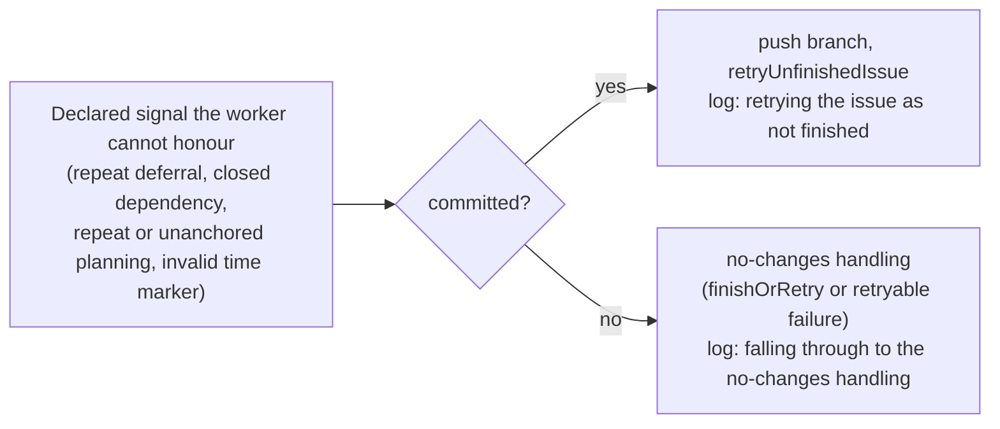

## Summary

The log lines and comments in `worker/deno/lib/phases/declared_handoff.ts` no
longer promise a human hand-off on paths where the worker in fact retries the
approved issue. Since Issue #4227 no `needs-human` is applied on any of them.
The same stale promise is corrected in three other places:

- the doc comments of the loop-guard helpers that file calls
  (`worker/deno/lib/blocked_deferral.ts`, `worker/deno/lib/planning_handoff.ts`);
- the `CODING-STANDARDS.md` sentence the issue names;
- its twin in `prompts/coding_guidelines/prompt.md`.

No behaviour change. Closes #5321.

## Spec

### Intent and Rationale

- Since #4227, a signal the worker cannot honour is not handed to a human. On a
  committed run, `workOnIssueDeclaredHandoff`
  (`worker/deno/lib/phases/declared_handoff_phase.ts`) pushes the branch and
  calls `retryUnfinishedIssue`. On a no-changes run, `workOnIssueHandleNoChanges`
  (`worker/deno/lib/phases/handle_no_changes_phase.ts`) runs its usual
  handling. That handling ends in `finishOrRetry` (a retry, or closing an
  analysis-only issue) or another retryable failure.
- A warn-level line saying "handing off to a human" sends an operator looking
  for a label that never arrives. This breaks the rule in `CODING-STANDARDS.md`
  "Log Levels Are a Promise About What the Reader Must Do".

### Essential Design Decisions

- Messages logged on both paths (repeat deferral, repeat planning request,
  planning without its anchor label) name the path's real outcome through one
  local `fallThrough` phrase:
  - "retrying the issue as not finished" when `committed`;
  - "falling through to the no-changes handling" otherwise.

  On the no-changes path the caller can still close an analysis-only issue, so
  the message does not claim a retry there.
- The no-changes self-filed dependency line now says only "not deferring onto
  it". The caller already logs its own retry ("retrying the approved issue
  (Issue #4227)").
- Log levels, fields and control flow are unchanged.

### Undiscoverable Facts

- `prompts/coding_guidelines/prompt.md` and `CODING-STANDARDS.md` are a declared
  twinned pair. The guidelines copy carried the same "hands the issue to a human
  and raises no PR" sentence, so both were changed.

## Evidence

Backend log text, comments and docs only; no UI files.

Issues cited as provenance:

- #4227: An approved issue is never handed back: a run that delivers nothing is
  retried, not labelled needs-human as 'analysis-only'
- #3088: Escape hatch and planning hand-off are silently ignored once the branch
  has commits; the worker raises a PR that closes the issue

Sweep on the head:

- `grep -n "human" worker/deno/lib/phases/declared_handoff.ts` leaves no line
  promising a hand-off. What remains is "human-only decision", "a human
  decision", "never `needs-human`", the human `work-on` anchor, and the new
  comment saying the fall-through is "never a human hand-off".
- `grep -rn "hands off to a human\|handing off to a human"` over
  `worker/deno/lib`, `CODING-STANDARDS.md` and `prompts/` returns no hit on
  these paths.
- `prompts/coding_guidelines/prompt.md` still says, for a negative-result run,
  that the worker hands the labelled issue to a human. That is true (Issue
  #4911) and is unchanged.

## Test Plan

- No test was added or edited. The change is wording only, and no existing test
  asserts these log strings (`grep` for "not deferring", "deferred once",
  "present but invalid" and "Planning requested" in `worker/deno/tests` finds
  none).
- The behaviour is still covered by the existing tests, which pass unchanged:
  - `worker/deno/tests/declared_handoff_phase_3088_test.ts`;
  - `worker/deno/tests/handle_no_changes_phase_test.ts`;
  - the `blocked_deferral`, `time_deferral` and `planning_handoff` test files.

  Run with `deno task test:unit`: `ok | 156 passed | 0 failed`.
- The docs tests that read `CODING-STANDARDS.md` or
  `prompts/coding_guidelines/prompt.md`, including
  `worker/deno/tests/coding_guidelines_twin_drift_test.ts`, pass: `ok | 1103
  passed | 0 failed` (parallel) and `ok | 141 passed | 0 failed` (serial).
- `./quality.sh < /dev/null` on commit `214287a1e`: `Result: PASSED (with
  skipped checks)`, exit 0. Deno tests, semgrep, lint, type check and fmt
  passed. Config integration (no `.config.json`) and checkov (not installed)
  were skipped.
