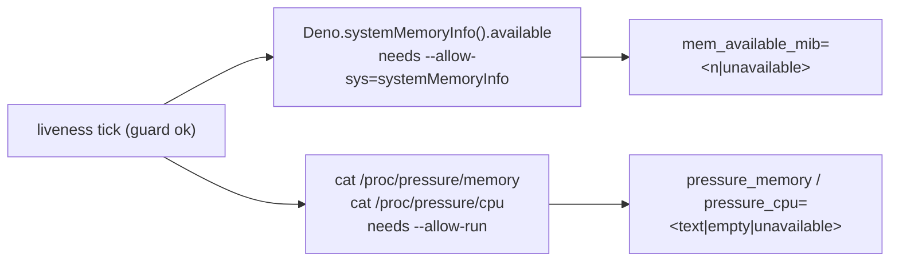

## Summary

The `[liveness] tick=` line now reports a real `mem_available_mib` in the
container. `readLivenessTickPressure` (`worker/deno/lib/liveness_guard.ts`)
takes the figure from `Deno.systemMemoryInfo().available`, which the driver's
`--allow-sys=hostname,systemMemoryInfo` grant allows, instead of
`Deno.readTextFile("/proc/meminfo")`, which Deno refuses without `--allow-all`.
The two PSI files (`/proc/pressure/memory`, `/proc/pressure/cpu`) are refused
the same way, so they are now read through `cat` (`readProcFileWithCat`); the
driver already holds `--allow-run`. Each `cat` runs through
`commandOutputWithTimeout` with a 5 s bound, so a stuck read becomes
`unavailable` instead of holding the tick. The function's doc comment, the
`LivenessTickPressure` doc and `docs/CALLBACKS.md` now say how each field is
read. Closes #5324.

## Spec

### Intent and Rationale

- Deno refuses every `/proc` path short of `--allow-all`, not just
  `/proc/meminfo`, and the refusal was swallowed into `unavailable`, so on every
  tick in the container the memory figure was lost and nothing failed loudly.
- `Deno.systemMemoryInfo()` is the reader PR #5323 moved the memory-pressure
  probes to (Issue #5319); it needs only `--allow-sys=systemMemoryInfo`.
- Deno has no API for PSI. Reading it through `cat` keeps the PSI fields
  working under the existing grant, so the driver does not need `--allow-all`.
  `captureHardKillEvidence` (`worker/deno/lib/hard_kill_evidence.ts`) already
  reads the same files with `cat`, through `container exec`.

### Essential Design Decisions

- The output contract is unchanged: three fields, always present, integer MiB
  or `unavailable`, never `0` for a failed read, and the function never throws.
- `readLivenessTickPressure` now takes an options object
  (`systemMemoryInfo`, `readPressureFile`) instead of one `readFile`. The only
  production caller (`run_core_production_deps.ts`) passes nothing, so it gets
  both production readers.
- `memAvailableMibFromProcMeminfo` and its regex are removed: no production
  code reads `/proc/meminfo` text any more. `memAvailableMibFromBytes` replaces
  it (bytes ÷ 1 MiB, rounded; a non-finite or negative figure is `unavailable`).
- Assumption: there is no platform gate. On macOS, where `/proc` does not
  exist, the line used to read `unavailable`; it now carries Deno's own
  `available` figure. The PSI fields stay `unavailable` there, because `cat`
  exits 1.

### Undiscoverable Facts

- Observed with Deno 2.9.8 on Linux under the driver's flags
  (`--allow-env --allow-read --allow-write --allow-run --allow-net
  --allow-sys=hostname,systemMemoryInfo`): `Deno.readTextFile` on
  `/proc/meminfo`, `/proc/loadavg`, `/proc/stat` and `/proc/self/status` each
  fail with `NotCapable: Requires all access to "<path>", run again with the
  --allow-all flag`. `new Deno.Command("cat", { args: ["/proc/loadavg"] })`
  exits 0 with the file's text, and `Deno.systemMemoryInfo()` returns
  `available` in bytes.
- This host has no `/proc/pressure` directory, so a real PSI reading was not
  observed here; `cat` of a missing file exits 1 with
  `cat: /proc/pressure/memory: No such file or directory`.

## Evidence

Backend only; no UI files.

Reproduction against the base branch: the base copy of `liveness_guard.ts`,
run under the driver's flags with
`formatLivenessPressureFields(await readLivenessTickPressure())`, printed
`mem_available_mib=unavailable pressure_memory=unavailable pressure_cpu=unavailable`.
At the head, the same flag set gives a numeric `mem_available_mib` (asserted by
the new entrypoint test below).

Issues cited as provenance:

- #4225: Worker container locks up during agent cargo/deno test builds:
  guest-wide stall, no OOM, reaped only by the 11400s watchdog (8× in 32h on
  GRQ-3)
- #5319: Linux memory-pressure probes always read `unknown`: Deno refuses
  /proc/meminfo without --allow-all
- #5324: this issue

Docs read and updated: the "per-cycle liveness line" bullet in
`docs/CALLBACKS.md`, the doc comments on `LivenessTickPressure`,
`memAvailableMibFromBytes`, `readProcFileWithCat`, `readLivenessTickPressure`
and the PSI path constants. The comment at the call site in
`run_core_production_deps.ts` ("MemAvailable and the two PSI files … A file
that cannot be read is `unavailable`") is still true and is unchanged.
`git grep` for `memAvailableMibFromProcMeminfo` and `LIVENESS_MEMINFO_PATH`
outside `docs/archive/` returns nothing at the head.

## Test Plan

- New: `worker/deno/tests/container_entrypoint_test.ts::entrypoint - the
  driver's permission set lets the liveness tick read MemAvailable and PSI
  (Issue #5324)` (Linux only, like the #5319 test beside it). It records the
  real entrypoint's `--allow-*` flags and runs a probe in a real Deno
  subprocess under them. It asserts:
  - the tick line matches `mem_available_mib=\d+` and is not `unavailable`;
  - each PSI token is `unavailable` or a `some,…` reading;
  - `readProcFileWithCat("/proc/loadavg")` returns text, while
    `Deno.readTextFile("/proc/loadavg")` under the same flags fails with
    `NotCapable` (the control that shows the `cat` route is what reads `/proc`);
  - `readProcFileWithCat("/proc/vibe-5324-missing")` throws an error naming the
    cause (`exited 1`, `No such file or directory`);
  - negative control: with the pre-#5319 grant (`--allow-sys=hostname`) the
    line starts `mem_available_mib=unavailable`.

  The #5319 test's subprocess runner was moved to a file-level
  `runDenoProbe` helper that both tests call; its assertions are unchanged.
- Edited: `worker/deno/tests/liveness_pressure_4225_test.ts`.
  - The `memAvailableMibFromProcMeminfo` test is replaced by a
    `memAvailableMibFromBytes` test, because that function is gone. The
    behaviours it pinned still hold for the new input: rounding to MiB (2 MiB →
    2, 0.5 MiB → 1), `0` is a real reading, and a bad figure is `unavailable`
    (NaN, -1, Infinity). The "missing `MemAvailable:` line" case no longer has
    an input; its counterpart is a failed `systemMemoryInfo` call, covered by
    the next test.
  - The two `readLivenessTickPressure` tests inject `systemMemoryInfo` and
    `readPressureFile` instead of one `readFile`. Every other assertion is
    kept. The second now throws `NotCapable` from `systemMemoryInfo` and
    asserts that PSI is still read and parsed. Its `seen` list no longer
    contains `/proc/meminfo`, because that file is no longer read.
- Not tested: the 5 s timeout branch of `readProcFileWithCat`. A `cat` of a
  `/proc` file cannot be made to stall portably, and the bound is the shared
  `commandOutputWithTimeout` helper (`worker/deno/lib/subprocess_timeout.ts`),
  which has its own tests. Any throw from the reader is caught by
  `readPressureToken` and becomes `unavailable`, which the injected-reader
  tests above cover.
- `worker/deno/tests/spawn_timeout_check_test.ts::scanDirectoriesForSpawnTimeout
  - this checkout has no untimed spawn` failed on the first gate run against
  the untimed `cat` spawn, and passes after it was moved to
  `commandOutputWithTimeout`.
- Results on the head: `deno test --allow-all
  tests/spawn_timeout_check_test.ts tests/liveness_pressure_4225_test.ts
  tests/container_entrypoint_test.ts` (from `worker/deno`): 62 passed, 0
  failed. `./quality.sh`: `Result: PASSED (with skipped checks)`. Config
  integration was skipped (no `.config.json`) and checkov was skipped (not on
  PATH).
