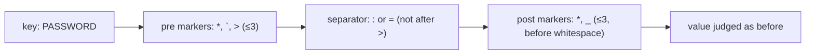

## Summary

The `secret-assignment` rule now masks a value whose credential label is wrapped
in Markdown. The separator group of `SECRET_ASSIGNMENT_PATTERN`
(`worker/deno/lib/secret_redaction.ts`) allows up to three `*`, backtick or `>`
markers between the key and its `:`/`=`, and up to three `*`/`_` emphasis
markers after the separator when whitespace follows. So `**PASSWORD**: v`,
`**PASSWORD:** v`, `*PASSWORD*: v`, `` `PASSWORD`: v ``, `` `API_KEY`=v ``,
`<PASSWORD>: v` and `_PASSWORD:_ v` are masked by `redactSecrets` and reported
by `containsSecret`. Closes #5326.

## Spec

### Intent and Rationale

- Markdown is how issue bodies, comments and PR summaries write a field, and on
  base every marked label form published its generic value (observed on the
  milestone head `9459ae06c` before the fix).
- The fix widens the one shared separator group. Detection and replacement still
  share one pattern, so `containsSecret` and `redactSecrets` cannot disagree.

### Essential Design Decisions

- **Markers after the separator are emphasis only (`*`, `_`), not backticks.** A
  code span that includes the colon (`` `credential:` adopted… ``) is how prose
  names a key. A first cut that allowed backticks there masked the next prose
  word on 23 lines of the PR-summary archive. `` `PASSWORD:` value `` is
  therefore an accepted limit, and a control test pins it.
- **A marker run after the separator must be followed by whitespace.** That
  keeps `PASSWORD=**abc**` masked whole, so the placeholder never leaves part of
  a secret visible.
- **`=` may not follow `>` directly**, so a `max_tokens>=limit` comparison never
  matches. The accepted cost is that `<TOKEN>=value` is not masked. `*=` is
  allowed, so `**API_TOKEN**=v` is masked, and over-masking a rare `x_tokens*=2`
  is cosmetic.
- **The twins read the markers too.** These all read the new separator shape:
  - `SEPARATOR_START`, `MASKED_SEPARATOR` and `OPEN_DOUBLE_QUOTE`, the copies of
    the separator used by the Issue #5310 nested-label walk.
  - `labelEndingAt`, which gains a bounded marker-suffix fallback.
  - `LABEL_PREFIX`, which accepts leading markers.
  - `PROSE_HEADING_SEPARATOR` (Issue #5253).

  So `credentials: **DEPLOY_TOKEN**: v` masks `v` and leaves the label visible.
  Under markers, a key ending in a plural credential noun (`Tokens`, `Secrets`)
  with a plain-word value and more text on the line counts as a heading. This
  keeps the worker's run-stats line `- **Tokens:** input 27 · output …` intact.
  `**Passwords:** sunshine` at the end of its line stays masked.

### Undiscoverable Facts

- The issue's "Depends on #5310" is satisfied: #5310 is closed, and its change
  is on the milestone branch.

## Evidence

Backend-only change (no UI file touched).

Probe of the base code (`9459ae06c`) before the fix: `redactSecrets` returned
the input unchanged and `containsSecret` returned `false` for `**PASSWORD**: v`,
`**PASSWORD:** v`, `*PASSWORD*: v`, `` `PASSWORD`: v ``, `<PASSWORD>: v`,
`**API_TOKEN** = v`, `` `API_KEY`=v ``, `***SECRET***: v` and
`**PASSWORD:**\nv`. `_PASSWORD_: v` was already masked. On base,
`credentials: **DEPLOY_TOKEN**: v` gave `credentials: ***REDACTED*** v`, which
published `v`.

The new test file was run against the unfixed code first: 16 failed (all 15 leak
cases plus one hostile-input expectation that was then corrected to the observed
unchanged output), and it passes on the head.

Corpus run: the base and head `redactSecrets` were compared over each file (via
a scratch script, since deleted):

| Corpus                       | Files | Files whose output changed |
| ---------------------------- | ----- | -------------------------- |
| `docs/archive/pr-summaries/` | 1,521 | 4 (5 lines)                |
| `prompts/`                   | 45    | 0                          |
| `worker/deno/lib/`           | 1,193 | 2                          |

The archive lines:

- Three are a code span around a label followed by a colon and prose
  (`` `CREDENTIAL_USING_ACTIONS`: flagged ``). That is the form the issue asks
  to mask, and base already masks the same text without backticks.
- Two are contrived shapes in `pr-summary-5310.md`.

The `lib/` changes are the new doc-comment examples in `secret_redaction.ts` and
one `` `TOKENECONOMIZER_HOME`: `` comment.



## Test Plan

- Added `worker/deno/tests/secret_redaction_markdown_label_5326_test.ts` (49
  tests):
  - **Masked**, asserting the exact output and `containsSecret === true`:
    - every label form above, plus `**API_TOKEN** = v` and `**API_TOKEN**=v`;
    - a cross-line value;
    - three nested-label (Issue #5310) shapes;
    - `- **GithubToken:** hunter rest of line` (a singular credential key stays
      masked);
    - `**Passwords:** sunshine` at the end of its line;
    - `**Secrets:** hunter2 and more`;
    - `Tokens: input 27`, which has no markers and keeps its base output.
  - **Controls**, unchanged with `containsSecret === false`:
    - `if max_tokens>=limit then`;
    - `**TokenBudget:** run the agreed trial` and
      `**TokenBudget**: run the agreed trial` (Issue #5253);
    - "**Credential:**\n```mermaid" and a bold prose lead-in (Issue #1727);
    - the code-span-with-colon prose line, and the accepted `` `PASSWORD:` v ``
      limit;
    - `- **Tokens:** input 27 · output 11`;
    - `**Passwords:** sunshine and more`.
  - **`PASSWORD=**v**`** still masks the whole value.
  - **Idempotence:** for every leak input, the output redacts to itself and
    `containsSecret` is false on it.
  - **Linearity**, with no stopwatch:
    - 100,000 `*` after a key passes through unchanged;
    - 20,000 repeats of `TOKEN**:` followed by a value give output without the
      value that ends in `TOKEN**: ***REDACTED***`;
    - 100,000 backticks after `API_KEY:` pass through unchanged.
- Edited `worker/deno/tests/secret_redaction_markdown_1727_test.ts`: the header
  comment only, which quoted the old separator literal. No assertion changed.
- I ran the Issue #1727, #5253 and #5310 cases and the other redaction suites on
  the head with
  `deno test -A tests/secret_redaction_test.ts tests/secret_redaction_markdown_1727_test.ts tests/secret_redaction_prose_heading_5253_test.ts tests/secret_redaction_label_as_value_5310_test.ts tests/secret_redaction_redos_test.ts tests/secret_redaction_bounds_test.ts tests/secret_redaction_boolean_setting_test.ts tests/secret_redaction_json_structure_test.ts tests/cache_secret_redaction_1261_test.ts tests/prompt_context_secret_redaction_1424_test.ts tests/security_scan_secret_redaction_3047_test.ts tests/secret_redaction_markdown_label_5326_test.ts tests/run_stats_redaction_test.ts tests/regex_complexity_3942_test.ts tests/regex_dos_3942_test.ts tests/gh_title_redaction_test.ts tests/secret_transform_redaction_test.ts`
  (from `worker/deno`). Result: 573 passed, 0 failed.
- Full `./quality.sh`, first run on the head: every stage passed except two.
  - markdownlint: MD018 on a re-wrapped `SECURITY.md` line. I fixed it.
  - deno tests: one failure in
    `worker/deno/tests/review_fleet_prs_backlog_3225_test.ts` under the parallel
    pass. That file has no redaction code, and it passes alone (17 passed, 0
    failed).
- Full `./quality.sh`, rerun on the head after the markdownlint fix: passed
  (exit 0). Every stage passed, except config integration and checkov, which the
  gate skipped.

## Docs

- I updated the "An assignment's value is judged, not only its label" section of
  `SECURITY.md`: the separator description, the Markdown-marker paragraph with
  both limits, and the Issue #5253 heading paragraph with its accepted costs.
- In `secret_redaction.ts` I updated the doc comments on each changed constant,
  `isCredentialShapedValue`, `isProseHeading` and the `RULES` comment block.
- I grepped the other docs for the old separator literal `["']?\s*[=:]\s*`,
  excluding `docs/archive/`. No hits remain.

## Not done or not checked

- `` `PASSWORD:` value `` (a code span that includes the colon) and
  `<TOKEN>=value` are still not masked. Both are deliberate limits, documented
  in `SECURITY.md`.
- No independent reviewers were dispatched, because the issue states no
  acceptance-criteria list.

🤖 Generated with [Claude Code](https://claude.com/claude-code)
