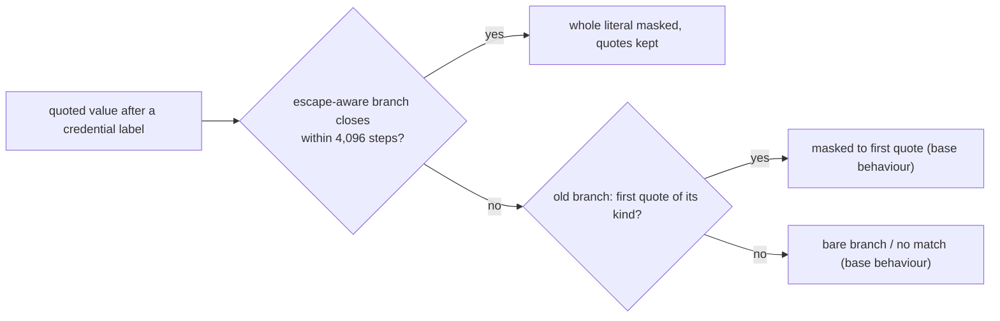

# PR Summary — Issue #5327

## Summary

The quoted-value branches of `SECRET_ASSIGNMENT_PATTERN` in
`worker/deno/lib/secret_redaction.ts` ended at the first quote of their kind.
A credential holding an escaped quote (`"abc\"def"`, `'abc\'def'`, the SQL
`'abc''def'`) was masked only up to that quote, the scan resumed after it, and
the rest of the credential was published. The quoted branches now read through
escaped quotes, so the whole literal is masked, and `QUOTED_VALUE` accepts the
same shapes, so the placeholder keeps its quotes and JSON still parses.
Closes #5327.

## Spec

### Intent and Rationale

- The fix is in the pattern's value group only. The rest of the rule and the
  Issue #5310 walk are unchanged: `SECRET_ASSIGNMENT_AT` is built from the
  pattern's source, so the walk's sticky copy picks up the new branches without
  an edit.
- The old branches `"[^"]+"` and `'[^']+'` stay as fallbacks after the
  escape-aware ones. A value whose escape never closes (`TOKEN="C:\dir\"`, a
  Windows path ending in a backslash) or that runs past the bound still masks
  exactly as on the base branch. Without the fallback, a double-quoted value
  like that would match no branch at all.

### Essential Design Decisions

- The double-quoted branch is `"(?:[^"\\]|\\[^]){1,4096}"`. The single-quoted
  branch is `'(?:[^'\\]|\\[^]|''|'\\''){1,4096}'`. In the double-quoted branch
  the alternatives are disjoint on their first character. In the
  single-quoted branch they are disjoint on their first two characters, so
  each backtrack step is constant work and the scan is linear.
- The bound is 4,096 repetitions, where each repetition is a character or an
  escape. The issue asked for "bounded repetition". The cap limits what a
  candidate whose quote never closes can cost.
- Assumption: the shell `'\''` idiom (close the quote, add an escaped quote,
  reopen) is included in the single-quoted branch. The issue's failure
  scenario names "a shell assignment … written with the usual escape", and for
  a single-quoted shell value that escape is `'\''`. The suggested fix names
  only the backslash and doubled forms.
- A backslash counts as an escape inside single quotes too, although the shell
  treats it as a literal there. A value like `'C:\dir\' … 'x'` can therefore be
  masked past its real end, up to the next quote. That errs towards masking.

### Undiscoverable Facts

- Triage on the issue (23 Nov) narrows milestone **secret-assignment rule
  hardening** to #5327, #5363 and #5330, and moves #5329 (an unclosed double
  quote, a symbol-only opening word) to **secret redaction follow-ups**. Those
  cases are left to #5329, so the `(?=\S{0,63}[A-Za-z0-9])` lookahead is
  unchanged.
- The `secret-cli-flag` rule has the same defect, and it is worse there: the
  `\S+` fallback masks from the opening quote to the first space. On this head,
  `--token "ab\"cdSECRETtail"` becomes `--token ***REDACTED***cdSECRETtail"`.
  The issue names only `SECRET_ASSIGNMENT_PATTERN`, so that rule is not changed
  here. It is tracked as #5435 in **secret redaction follow-ups**, which the
  triage says should reuse this fix.

## Evidence

Backend-only change. No UI file is touched.

Run against the base branch, the leak looks like this (ad-hoc script, inputs
as in the new tests):

```text
{"password":"hun\"ter2xyzSecret","user":"bob"} => {"password":"***REDACTED***"ter2xyzSecret","user":"bob"}   containsSecret: false
PASSWORD='abc\'defSECRETtail'                  => PASSWORD='***REDACTED***'defSECRETtail'                    containsSecret: false
password = 'abc''defSECRETtail';               => password = '***REDACTED***''defSECRETtail';               containsSecret: false
```

After the fix, each of these masks whole: `{"password":"***REDACTED***","user":"bob"}`,
`PASSWORD='***REDACTED***'` and `password = '***REDACTED***';`.

The Issue #5310 nested-label shapes were also checked by hand and are still
masked whole, with an idempotent second pass. One example is
`credentials: DEPLOY_TOKEN = "ab\"cdSECRETtail"` becoming
`credentials: DEPLOY_TOKEN = "***REDACTED***"`.



Docs updated:

- `SECURITY.md`, section "An assignment's value is judged, not only its
  label": a new paragraph covering escaped quotes and their two limits.
- The doc comment on `QUOTED_VALUE`.
- The `RULES` comment above the `secret-assignment` entry.

I grepped `README.md`, `docs/` (excluding the archive) and `SECURITY.md` for
`secret-assignment`. The only other hit is a historical audit record
(`docs/audits/security-sweep-2183-lib-delta-12d-12f.md`), which was left as it
is.

Issue numbers this diff cites:

- #5327: secret-assignment rule masks a quoted value only up to an escaped
  quote and publishes the rest
- #5435: secret-cli-flag rule masks a quoted flag value only up to an escaped
  quote and publishes the rest (cited in this summary only)

The diff's new linearity notes point at the module header's linearity rule,
not at an issue number.

The Spec and Standards reviewer sub-agents were dispatched and both failed
with `Agent terminated early due to an API error: You've reached your Fable
limit. ... (error type rate_limit, HTTP 429)`. The issue has no
acceptance-criteria heading, so this summary carries no review blocks.

## Test Plan

- Added `worker/deno/tests/secret_redaction_escaped_quote_5327_test.ts`, with
  14 tests through `redactSecrets` and `containsSecret`. Each escaped case
  checks four things: the exact output, that `containsSecret` is false on it,
  that a second pass changes nothing, and that the secret's tail is gone.
  - **Escaped shapes:** a JSON backslash escape (the output still parses), a
    shell double-quote escape, a single-quote backslash escape, the SQL doubled
    quote, the shell `'\''` idiom, and text after the escaped quote with no
    whitespace (`TOKEN="abc\"defSECRETtail"rest` → `TOKEN="***REDACTED***"rest`).
  - **Controls, green on base by design:** an escaped backslash before the
    closing quote, a plain quoted value, an unclosed escape falling back to the
    first quote, and `containsSecret` true on every raw input.
  - **Linearity:** four hostile inputs of 131,072 characters, asserted by
    output only, with no stopwatch. They are an unclosed backslash run,
    escaped quotes past the bound (exact fallback output), and long doubled
    `''` and `'\''` runs. An `a` after the opening quote gets each value past
    the rule's alphanumeric lookahead, so the escape branches actually run.
- TDD: run against the base-branch `secret_redaction.ts`, the six escaped-shape
  tests failed and the controls and linearity cases passed (8 passed,
  6 failed). On the head all 14 pass.
- No existing test is edited.
- The existing redaction suites passed on the head through `deno task
  test:unit`: 537 passed, 0 failed. They were `secret_redaction_test`,
  `_redos_`, `_bounds_`, `_json_structure_`, `_label_as_value_5310_`,
  `_markdown_1727_`, `_markdown_label_5326_`, `_prose_heading_5253_`,
  `_boolean_setting_`, `cache_secret_redaction_1261`,
  `prompt_context_secret_redaction_1424` and
  `security_scan_secret_redaction_3047`, plus the new file.
- `./quality.sh < /dev/null` on the final code head, after merging the
  milestone branch: `Result: PASSED (with skipped checks)`. The gate itself
  skipped config integration and checkov. Deno tests, lint, type check, fmt,
  semgrep, gitleaks, markdownlint and mermaid all passed.

## Not done / remaining risk

- The `secret-cli-flag` patterns are unchanged. They are filed as #5435.
- #5329's cases are unchanged: a quoted value with no alphanumeric in its first
  run, and an unclosed double quote. They are left to that issue.
- A value with more than 4,096 characters or escapes, or a shell `'\''` run
  longer than that, is still masked only up to the bound and its fallback,
  which is the base behaviour.

🤖 Generated with [Claude Code](https://claude.com/claude-code)
