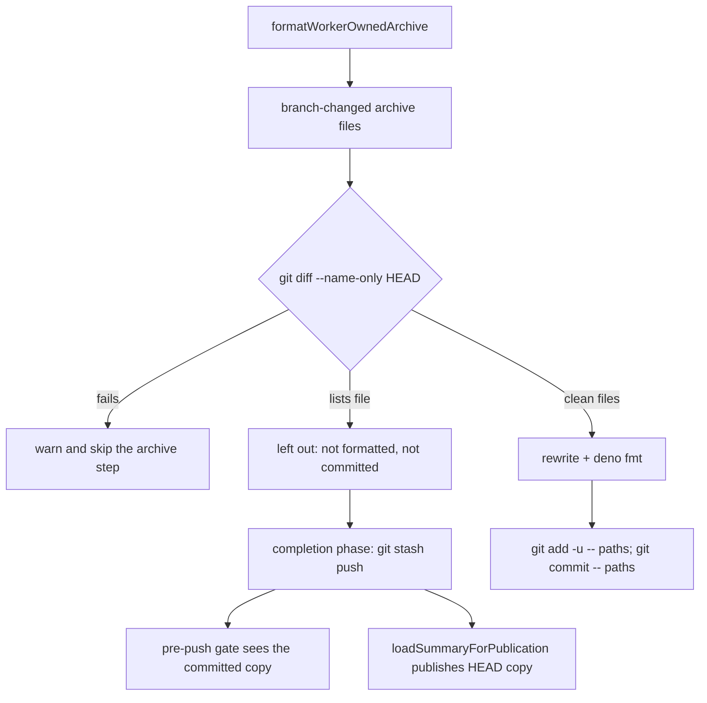

# PR Summary — Issue #5328

## Summary

The worker's archive formatter no longer commits an edit nobody committed.
`formatWorkerOwnedArchive` now asks git which branch-changed files under
`docs/archive/pr-summaries/` and `docs/archive/handover/` already differ from
HEAD (staged or unstaged) and leaves those out of the rewrite, `deno fmt` and
the commit. An interrupted recovery turn's rewrite of the PR summary therefore
stays uncommitted, and `loadSummaryForPublication` publishes the copy committed
at HEAD, as #4764 intended. The completion phase's own call also stashes that
edit before its pre-push gate, because that gate runs `deno fmt --check` on the
working-tree copy of every branch-changed archive file: left in place, an
unformatted edit would block the gate on content that is not in the push, and
the one pre-push recovery turn would commit it. The formatters' shared commit
helper also names its paths (`git commit -- <paths>`), so a file someone else
staged stays out of the `style: apply repository formatters` commit.

Closes #5328.

## Spec

### Intent and Rationale

- The archive formatter ran `git add -u -- <archive paths>` and committed
  whatever those files held, so an interrupted turn's unfinished summary rewrite
  was published under a formatting message. Checking the files against HEAD
  before formatting is the smallest change that keeps the formatter's commit to
  what the formatter changed.
- `git commit` with no pathspec commits the whole index, so a staged summary
  edit would still have gone in whenever another archive file needed formatting.
  Passing the same pathspecs to the commit closes that gap for both callers of
  `commitTrackedPaths`.

### Essential Design Decisions

- The check fails closed: if `git diff --name-only -z HEAD` fails, the archive
  step logs `worker-owned archive skipped: …` with git's stderr and formats and
  commits nothing, rather than risk committing an edit it could not see.
- `runRepoFormatters` keeps formatting and committing an uncommitted edit in a
  formatted code file (the issue allowed either, if the comment says why). The
  quality-gate loop leaves the fix agent's code edits uncommitted for
  `./quality.sh` to judge, so formatting them puts on the branch the same code
  the gate checks. An archive summary describes the branch, so it is left out of
  the formatter's commit. The pre-push gate does judge the working tree, so the
  completion phase sets the edit aside (next point); the doc comment now says
  this.
- `formatBeforeGate` takes `{ setAsideUncommittedArchive: true }` from the
  completion phase's `gateBeforePush` only: its gate judges the working tree
  while its push (`pushUnpushedCommits`) carries commits only and the PR body is
  read from HEAD for a dirty summary. The edit goes into
  `git stash push --
  <paths>` (recoverable with `git stash list`), so the gate
  sees the committed copy and the recovery turn has no edit to commit. A failed
  stash is logged and the gate reports what it finds. A stashed file holds
  exactly its committed copy, so it stays in the set that is rewritten,
  `deno fmt`-ed and committed (`stashUncommittedArchive` returns whether the
  stash worked); only a file whose stash failed, or one no set-aside was asked
  for, is left out. This keeps a committed summary that is not fmt-clean from
  reaching the gate and spending the recovery turn. The other callers (the
  quality-gate loop and the `commitAndPushPending` hook) do not set it, so they
  only leave the edit out of the formatting and the commit.
- A left-out archive file is logged with a warning naming it, so the uncommitted
  edit is visible in the run log.

### Undiscoverable Facts

- Observed with real git 2.47.3: `git diff --name-only -z HEAD -- <paths>` lists
  both staged and unstaged changes, and `git commit -m x -- ':(literal)a.md'`
  commits only `a.md` while a staged `b.md` stays staged. `git commit -- <path>`
  with an unknown path fails with `pathspec … did not match`, as `git add -u`
  already did, so no new failure mode was added.

## Evidence

Backend-only change; no UI files touched.

Issue numbers cited: #4764: Issue-run completion builds and publishes the PR
body from the working-tree summary, so uncommitted recovery edits can reach an
existing PR. #4129: Format the worker's own docs/archive Markdown/JSON before
the pre-push gate; handover note fmt-clean as written.

## Test Plan

New tests in `worker/deno/tests/repo_formatters_4129_test.ts`, all observed
failing against the unfixed `worker/deno/lib/repo_formatters.ts` and passing
after the fix:

- `formatBeforeGate leaves an archive summary with an uncommitted edit
  uncommitted and unformatted (Issue #5328)`
  — real git and `deno fmt`; the issue's scenario. Before the fix the HEAD
  subject was `style: apply repository formatters`; now it stays `seed`, `HEAD:`
  holds the seed text and the working-tree edit is byte-for-byte unchanged.
- `formatBeforeGate commits a clean archive file and leaves a summary staged
  outside the commit (Issue #5328)`
  — a staged summary edit plus a handover file that needs formatting: the commit
  holds only the handover. Red on base (the commit also held the summary) and
  red with only the dirty check (the commit took the whole index).
- `formatBeforeGate skips the archive step when the uncommitted-changes check
  fails (Issue #5328)`
  — fake git answers the HEAD diff with exit 128: no `deno fmt`, no
  `add`/`commit`, the JSON is not rewritten, and the warning quotes
  `bad revision`. It also asserts the HEAD diff ran.
- `formatBranchChanges commit leaves a file staged outside the formatted paths
  staged and out of the formatter commit (Issue #5328)`
  — the `runRepoFormatters` caller of the changed commit helper, through real
  git: `bad.ts` is formatted and committed, a staged `notes.md` stays staged.
  Red with the commit pathspec reverted.

Edited test double: `fakeGit` answers the new HEAD diff with an empty list by
default, so the existing fake-git tests (for example
`formatBeforeGate passes
only worker-owned archive paths to deno fmt (Issue #4129)`)
still reach formatting and keep every assertion. The repo-initialisation code
shared by `formatSeededSummary` and `formatSeededFiles` was moved into one
`initRepo` helper with no behaviour change. No existing assertion was removed.

Review round (PR #5387): the reviewer read that the pre-push gate blocks on a
left-out file. Reproduced: with `{ setAsideUncommittedArchive: false }` in
`gateBeforePush`, the new completion test failed with
`[PRE_PUSH_BLOCKED] ...
deno fmt --check ... pr-summary-10.md`. New tests:

- `worker/deno/tests/completion_phase_repo_formatters_test.ts` —
  `completion - an archive summary with an uncommitted unformatted edit is set
  aside: the gate passes and the committed copy stays (Issue #5328)`:
  real `workOnIssueCompletion`, real gate, `deno.json` at the repository root; a
  bare-gate positive control fails on the edit, the run then pushes once, HEAD
  is unchanged, the working copy equals HEAD's, and the stash holds the edit.
- `worker/deno/tests/repo_formatters_4129_test.ts` —
  `formatBeforeGate stashes an uncommitted archive summary when asked, and still
  formats and commits the clean files (Issue #5328)`
  and
  `formatBeforeGate logs a stash that fails and leaves the uncommitted summary
  in place (Issue #5328)`.

Second review round (verifier): the stash left a committed, not fmt-clean
summary unformatted, so the first gate blocked and used the recovery turn. New
test
`completion - a committed archive summary that is not fmt-clean is still
formatted and committed when it also carries an uncommitted edit (Issue #5328)`
in `worker/deno/tests/completion_phase_repo_formatters_test.ts`: real completion
and gate; a bare-gate positive control fails on the committed copy, then the
run's order is exactly `["format", "gate"]`, one push, HEAD holds the formatted
copy without the edit, and the stash holds the edit. Observed red with
`stashed ||` removed from the `cleanFiles` filter (order assertion failed),
green with it.

Results on the final head:

- `deno test -A tests/repo_formatters_4129_test.ts
  tests/completion_phase_repo_formatters_test.ts`
  (from `worker/deno`) — 34 passed, 0 failed.
- `deno lint`, `deno check` on the changed library files and `deno fmt` on the
  changed TypeScript — clean. Full `./quality.sh` was not re-run after the
  review round.

Docs updated: `docs/CONFIGURATION.md` (the "Before each of those
completion-phase gate runs" paragraph) and `docs/INTERNALS.md` (the "Before each
gate attempt in an issue run" paragraph). The doc comments of
`commitTrackedPaths`, `formatWorkerOwnedArchive`, `runRepoFormatters` and the
module header in `worker/deno/lib/repo_formatters.ts` now match the code.

Not done or not checked: the pre-push recovery turn itself (an agent run) was
not exercised; the completion test shows the gate no longer blocks, so that turn
does not start. The full `./quality.sh` was not re-run after the review round.

🤖 Generated with [Claude Code](https://claude.com/claude-code)
