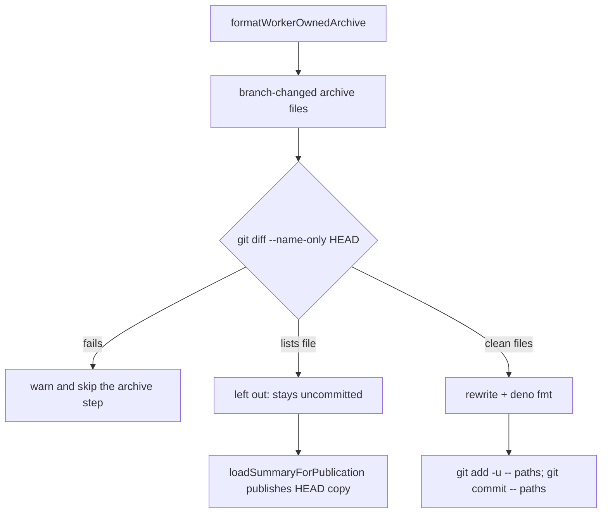

# PR Summary — Issue #5328

## Summary

The worker's archive formatter no longer commits an edit nobody committed.
`formatWorkerOwnedArchive` now asks git which branch-changed files under
`docs/archive/pr-summaries/` and `docs/archive/handover/` already differ from
HEAD (staged or unstaged) and leaves those out of the rewrite, `deno fmt` and
the commit. An interrupted recovery turn's rewrite of the PR summary therefore
stays uncommitted, and `loadSummaryForPublication` publishes the copy committed
at HEAD, as #4764 intended. The formatters' shared commit helper also names its
paths (`git commit -- <paths>`), so a file someone else staged stays out of the
`style: apply repository formatters` commit.

Closes #5328.

## Spec

### Intent and Rationale

- The archive formatter ran `git add -u -- <archive paths>` and committed
  whatever those files held, so an interrupted turn's unfinished summary rewrite
  was published under a formatting message. Checking the files against HEAD
  before formatting is the smallest change that keeps the formatter's commit to
  what the formatter changed.
- `git commit` with no pathspec commits the whole index, so a staged summary
  edit would still have gone in whenever another archive file needed formatting.
  Passing the same pathspecs to the commit closes that gap for both callers of
  `commitTrackedPaths`.

### Essential Design Decisions

- The check fails closed: if `git diff --name-only -z HEAD` fails, the archive
  step logs `worker-owned archive skipped: …` with git's stderr and formats and
  commits nothing, rather than risk committing an edit it could not see.
- `runRepoFormatters` keeps formatting and committing an uncommitted edit in a
  formatted code file (the issue allowed either, if the comment says why). The
  quality-gate loop leaves the fix agent's code edits uncommitted for
  `./quality.sh` to judge, so formatting them puts on the branch the same code
  the gate checks. An archive summary describes the branch and no gate judges
  it, so it is left out. Its doc comment now says this.
- A left-out archive file is logged with a warning naming it, so the uncommitted
  edit is visible in the run log.

### Undiscoverable Facts

- Observed with real git 2.47.3: `git diff --name-only -z HEAD -- <paths>` lists
  both staged and unstaged changes, and `git commit -m x -- ':(literal)a.md'`
  commits only `a.md` while a staged `b.md` stays staged. `git commit -- <path>`
  with an unknown path fails with `pathspec … did not match`, as `git add -u`
  already did, so no new failure mode was added.

## Evidence

Backend-only change; no UI files touched.

Issue numbers cited: #4764: Issue-run completion builds and publishes the PR
body from the working-tree summary, so uncommitted recovery edits can reach an
existing PR. #4129: Format the worker's own docs/archive Markdown/JSON before
the pre-push gate; handover note fmt-clean as written.

## Test Plan

New tests in `worker/deno/tests/repo_formatters_4129_test.ts`, all observed
failing against the unfixed `worker/deno/lib/repo_formatters.ts` and passing
after the fix:

- `formatBeforeGate leaves an archive summary with an uncommitted edit
  uncommitted and unformatted (Issue #5328)`
  — real git and `deno fmt`; the issue's scenario. Before the fix the HEAD
  subject was `style: apply repository formatters`; now it stays `seed`, `HEAD:`
  holds the seed text and the working-tree edit is byte-for-byte unchanged.
- `formatBeforeGate commits a clean archive file and leaves a summary staged
  outside the commit (Issue #5328)`
  — a staged summary edit plus a handover file that needs formatting: the commit
  holds only the handover. Red on base (the commit also held the summary) and
  red with only the dirty check (the commit took the whole index).
- `formatBeforeGate skips the archive step when the uncommitted-changes check
  fails (Issue #5328)`
  — fake git answers the HEAD diff with exit 128: no `deno fmt`, no
  `add`/`commit`, the JSON is not rewritten, and the warning quotes
  `bad revision`. It also asserts the HEAD diff ran.
- `formatBranchChanges commit leaves a file staged outside the formatted paths
  staged and out of the formatter commit (Issue #5328)`
  — the `runRepoFormatters` caller of the changed commit helper, through real
  git: `bad.ts` is formatted and committed, a staged `notes.md` stays staged.
  Red with the commit pathspec reverted.

Edited test double: `fakeGit` answers the new HEAD diff with an empty list by
default, so the existing fake-git tests (for example
`formatBeforeGate passes
only worker-owned archive paths to deno fmt (Issue #4129)`)
still reach formatting and keep every assertion. The repo-initialisation code
shared by `formatSeededSummary` and `formatSeededFiles` was moved into one
`initRepo` helper with no behaviour change. No existing assertion was removed.

Results on the final head:

- `deno task test:unit tests/completion_phase_repo_formatters_test.ts
  tests/pr_round_repo_formatters_test.ts tests/repo_formatters_test.ts
  tests/repo_formatters_4129_test.ts`
  — 59 passed, 0 failed.
- `./quality.sh` — PASSED (config integration and checkov skipped by the gate
  itself).

Docs updated: `docs/CONFIGURATION.md` (the "Before each of those
completion-phase gate runs" paragraph) and `docs/INTERNALS.md` (the "Before each
gate attempt in an issue run" paragraph). The doc comments of
`commitTrackedPaths`, `formatWorkerOwnedArchive`, `runRepoFormatters` and the
module header in `worker/deno/lib/repo_formatters.ts` now match the code.

Not done or not checked: the completion phase was not run end to end with an
interrupted recovery turn; the fix is proved at the formatter, which is the step
that made the commit. None else.

🤖 Generated with [Claude Code](https://claude.com/claude-code)
