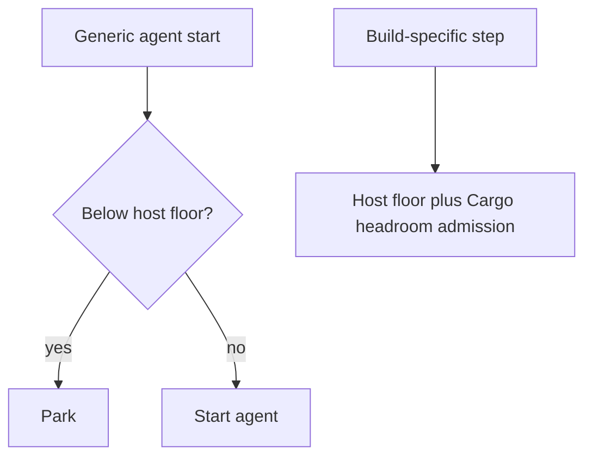

## Summary

Fixed the setup refusal reported by stSoftwareAU/GRQ#5328. Generic agent startup
now requires the host disk floor, while explicit build steps retain Cargo
headroom admission. The fix is in Vibe Coder because its runner owns the check.
Closes stSoftwareAU/GRQ#5328.

## Spec

### Intent and Rationale

- The 50.7 GB reading is above the 46 GB host floor but below the floor plus 25
  GB Cargo headroom. The manager launch itself does not start a repository
  build, so applying build headroom there prevented unrelated work from
  starting.

### Essential Design Decisions

- Generic agent startup and active-process polling use the host-floor guard.
- Build-specific maintenance, mutation, remediation and discrimination paths
  keep Cargo headroom admission and its idle-target pruning protections.

### Undiscoverable Facts

- The reported failure on stSoftwareAU/GRQ#5328 happened before GRQ code ran.
  This change updates Vibe Coder's runner, which owns that launch check.

## Evidence

- `worker/deno/tests/heavy_build_gate_in_flight_4413_test.ts` runs the real
  `runClaudeWithTimeout` launch path with a Cargo checkout and an injected 50.7
  GB reading; the stub agent starts successfully after the fix.

## Reproduction

- **symptom** — manager launch fails with `ephemeral cargo root over budget` at
  50.7 GB free, against a 46 GB floor plus 25 GB headroom.
- **status** — `verified` — the launch-path regression test failed before the
  fix and passed after it.
- **regression test** —
  `worker/deno/tests/heavy_build_gate_in_flight_4413_test.ts::agent start - a Cargo checkout starts above the floor without reserving build headroom`

## Test Plan

- Regression test before the fix: failed at 50.7 GB because the manager was
  parked before spawning the test agent; after the fix, 10 passed and 0 failed.
- `worker/deno/tests/heavy_build_gate_3178_test.ts`: 38 passed and 0 failed;
  sufficient space, genuine shortfall, unreadable roots, idle pruning and
  protected targets remain covered.
- `deno check --frozen --lock=deno.lock lib/claude_runner.ts lib/heavy_build_gate.ts tests/heavy_build_gate_in_flight_4413_test.ts`:
  passed.
- `deno fmt --check` and `deno lint` on all three changed TypeScript files:
  passed.
- `./quality.sh < /dev/null`: passed. Config integration and Checkov were
  skipped because `.config.json` and Checkov were unavailable.
- Changed launch call site: restoring `parkInFlightBuild(cwd)` made the new 50.7
  GB regression test fail before agent spawn.
- Deno regression avoided: used the repository's Deno tasks and tools; no Node
  tooling or dependency was added.
- Documentation reviewed: `docs/CONTAINER.md`, section “In-flight builds stop at
  the same floor”; updated to distinguish generic agent startup from
  build-specific admission.
- Not checked: disk usage on the hosts named in the issue comments.
