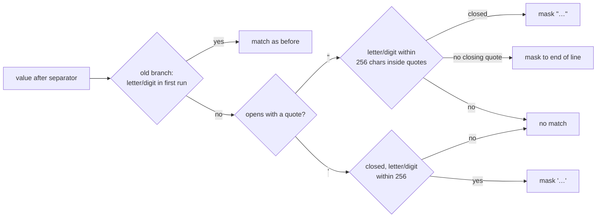

# PR Summary — Issue #5329

## Summary

The `secret-assignment` rule (`SECRET_ASSIGNMENT_PATTERN` in
`worker/deno/lib/secret_redaction.ts`) now masks two value shapes it used to
miss:

- a quoted value whose text after the opening quote starts with a space or a
  symbol-only word (`PASSWORD=" x…"`, `API_KEY='#! x…'`);
- a double-quoted value with no closing quote (`TOKEN="x…`, a truncated line).

`redactSecrets` masks both and `containsSecret` reports them. Closes #5329.

## Spec

### Intent and Rationale

- The old value lookahead `(?=\S{0,63}[A-Za-z0-9])` read the first
  whitespace-free run even for a quoted value. A quoted value that opened with a
  space or symbols failed it, and the bare branch excludes `"`, so an unclosed
  double quote matched nothing.
- The old value alternative is kept byte-for-byte as the first branch. Every
  value masked before is matched by that same branch and masked the same way;
  the two new branches only run when it fails.

### Essential Design Decisions

- Branch 2: `"` followed by a letter or digit within the first 256 characters
  inside the quotes (`(?=[^"]{0,255}[A-Za-z0-9])`). It is either closed
  (`[^"]+"`) or, when no closing quote remains, runs to the end of the line
  (`[^"\n\r\u2028\u2029]+`). The next line is never taken.
- Branch 3: a **closed** single-quoted value with the same bounded check. An
  unterminated single-quoted value is still read by branch 1's bare run, as
  before, so a lone `'` is never masked on its own.
- Assumption: "to the end of the run or line" is taken as "to the end of the
  line", so a truncated passphrase with spaces is masked whole. An unclosed
  value is masked without its opening quote, the same as the existing bare
  `'abc` case.
- The lookaheads are bounded (`{0,255}`). The unbounded runs start at a literal
  quote, like the existing branches, so the rule stays linear (the Issue #3942
  rule in this file). A quoted value whose first letter or digit is more than
  256 characters in is not masked by this rule. That limit is documented.

### Undiscoverable Facts

- Knock-on effect for #5310: when the 256-character window probe in
  `innerAssignmentUncached` cuts a long double-quoted inner value, it now reads
  that value as unterminated. The full-text match then masks the inner value.
  Before this change the value was published once it ran past 4,096 characters.
  The 4,096 limit (`INNER_QUOTED_MAX`) now matters only for an inner value that
  opens with a line break or has no letter or digit inside the window.
- The issue comments moved this issue to milestone **secret redaction
  follow-ups**, after PR #5425 landed on that stream.

## Evidence

Backend-only change (regex and doc comments), with no UI files.

Before the fix, the library left every reported shape unchanged and
`containsSecret` returned `false` (scratch run of
`redactSecrets`/`containsSecret` over `PASSWORD=" hunter2 abc"`,
`PASSWORD="!!! hunter2"`, `API_KEY=' s3cr3t value'`, `TOKEN="hunter2abc`,
`TOKEN=" hunter2`, `{"password":"abc123xyz`).

Issue numbers this diff adds as provenance:

- #5329: secret-assignment rule does not mask a quoted value whose opening word
  holds no letter or digit, or a double-quoted value with no closing quote
- #5310: secret-assignment rule publishes a credential when its label is
  consumed as the value of an earlier credential label

Docs updated: `SECURITY.md`, section "An assignment's value is judged, not only
its label". It gets a new #5329 paragraph, and the #5310 limits bullet now says
which values the 4,096 bound covers. In `worker/deno/lib/secret_redaction.ts`,
the RULES comment (the #4004 paragraph and the #5310 limits) and the JSDoc of
`closesWithinReach` and `INNER_QUOTED_MAX` were updated. No other copy of the
pattern exists: `git grep -F '\S{0,63}[A-Za-z0-9]'` returns only line 53.

## Test Plan

- Added `worker/deno/tests/secret_redaction_quoted_value_5329_test.ts`. Every
  test goes through `redactSecrets` and `containsSecret`:
  - Positive cases: values opening with a space or a symbol-only word, in double
    and single quotes. Unclosed double quotes: no space, with spaces, opening
    with a space, cross-line (the next line is untouched), and a truncated JSON
    string. A value 200 spaces in, inside the 256-character span. Each case also
    asserts idempotence and that `containsSecret` is `false` on the output.
  - Negative controls, unchanged: `"---"`, `" "`, `""`, a lone `"`, `"  -- "`, a
    value whose only letter is 300 characters in, `id-token: write`, and
    `- **Tokens:** input 27` (Issue #4004).
  - Unchanged-behaviour pins: closed JSON `"password":"…"`, and an unterminated
    single quote (`PASSWORD='x abc` → `PASSWORD=***REDACTED*** abc`, the
    base-branch output).
  - Hostile inputs, asserting exact output and no timing: 100,000 spaces inside
    `"` and inside `'`, 100,000 `!` inside an unclosed `"`, 25,000 words in an
    unclosed `"` (masked whole), and 20,000 repeated `PASSWORD=" x"` (each one
    masked).
- TDD: run against the unfixed pattern, the new file gave
  `15 passed | 11 failed`. The failures were every positive fixture; the
  controls passed. After the fix:
  `deno task test:unit tests/secret_redaction_quoted_value_5329_test.ts tests/secret_redaction_label_as_value_5310_test.ts tests/secret_redaction_test.ts tests/secret_redaction_redos_test.ts`
  → `ok | 431 passed | 0 failed`. The wider set of 14 redaction suites
  (including `secret_redaction_json_structure_test.ts`,
  `secret_redaction_markdown_1727_test.ts`,
  `secret_redaction_prose_heading_5253_test.ts`,
  `secret_redaction_bounds_test.ts`, `secret_redaction_boolean_setting_test.ts`,
  `cache_secret_redaction_1261_test.ts`,
  `prompt_context_secret_redaction_1424_test.ts`,
  `security_scan_secret_redaction_3047_test.ts`,
  `fleet_telemetry_redaction_test.ts` and `run_stats_redaction_test.ts`) gave
  `ok | 509 passed | 0 failed` before the last doc-only edits.
- Edited existing test,
  `worker/deno/tests/secret_redaction_label_as_value_5310_test.ts`:
  - The old control "a double-quoted inner value over 4,096 characters keeps the
    base behaviour" asserted that the inner value was published. That is
    intentionally changed: the issue asks for an unclosed double quote to be
    read as a value, and the window probe now sees the cut-off value that way.
    Renamed to "#5310/#5329: a double-quoted inner value over 4,096 characters
    is masked whole". It now expects `DEPLOY_TOKEN = "***REDACTED***"`, plus
    idempotence and `containsSecret` false.
  - The documented limit still holds for a value the probe cannot read. A new
    control, "#5310 control: a line-broken double-quoted inner value over 4,096
    characters keeps the base behaviour", pins the base output for
    `DEPLOY_TOKEN = "\n<4,097 chars>"`. No other assertion in that file changed.
- `deno fmt --check`, `deno lint` and `deno check` pass on the changed `.ts`
  files.
- Full gate: `timeout 900 ./quality.sh < /dev/null` was stopped at the
  900-second bound (exit 143) before it reported a result, and the run budget
  left no room to run it again. It was skipped; the worker re-runs it.

<!-- vibe-quality-gate-skipped reason="./quality.sh exceeded its 900s timeout bound (exit 143) and the remaining run budget could not cover a re-run; targeted redaction suites, fmt, lint and check all pass" -->

## Merge verification

- `./quality.sh` and CI: pending; not observed in this run.

## Not done / not checked

- The full `./quality.sh` gate did not finish (see above).
- No independent Spec or Standards reviewers were dispatched: the issue has no
  acceptance-criteria list.
- Remaining limit, by design: a quoted value whose first letter or digit is more
  than 256 characters in is still not masked by this rule.

🤖 Generated with [Claude Code](https://claude.com/claude-code)
