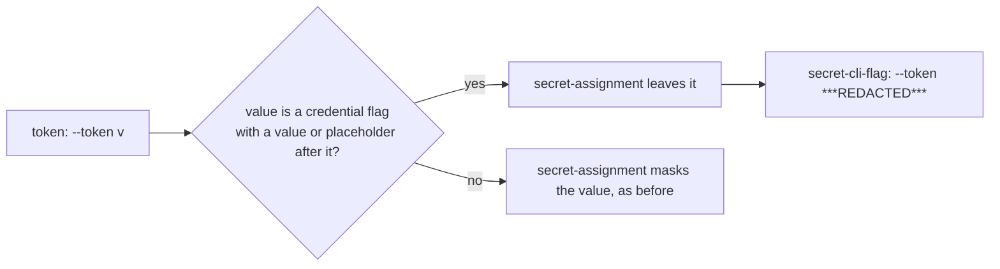

## Summary

The `secret-assignment` rule no longer takes a credential CLI flag as an earlier
label's value. Before this change, `the token: --token <value>` became
`the token: ***REDACTED*** <value>`: the assignment rule masked the flag's name,
`secret-cli-flag` then no longer found the flag, and the value was published. In
`worker/deno/lib/secret_redaction.ts`, `verdictOf` now leaves a candidate
unmasked when its value is a credential flag with whitespace and a value (or the
placeholder) after it (`credentialFlagTakesValueAt`). So `secret-cli-flag` keeps
the flag name and masks the value: `the token: --token
***REDACTED***`, on the
same line or the next. Closes #5330.

## Spec

### Intent and Rationale

- The issue offers two fixes: leave the flag to `secret-cli-flag`, or run that
  rule first. I chose the first. Running `secret-cli-flag` first would turn
  `token: --token v` into `token: ***REDACTED*** ***REDACTED***`, which hides
  the flag name. It would also change the rule order that the Issue #5310 walk
  (`mainReadsPastInnerValue`, `flagValueStartsAt`) is built on.
- The check sits in `verdictOf`, the one verdict every walk path uses, so
  `redactSecrets` and `containsSecret` still cannot disagree.

### Essential Design Decisions

- The check (`CLI_FLAG_WITH_VALUE_AT`) is sticky at the value's start and uses
  the `secret-cli-flag` rule's flag-name runs and `\s+`. It differs from that
  rule after the whitespace in two ways:
  - **The placeholder counts as a value.** So `token: --token ***REDACTED***` is
    stable, and redaction is idempotent. On base, a second pass gave
    `token: ***REDACTED*** ***REDACTED***`.
  - **A bare `=` or `:` after the flag is not a value.** It is an assignment
    separator, so the Issue #5310 shape `credentials: --token = <value>` keeps
    its base output, `credentials: ***REDACTED*** = ***REDACTED***`.
- A flag with nothing after it (`password: --token`), or another flag after it
  (`password: --token --verbose`), is still masked as the label's value, as
  before.
- The flag name must reach whitespace, and a bare value holds none, so a match
  means the whole value is the flag. A quoted value never matches.

### Undiscoverable Facts

- The issue's "Depends on #5310" is satisfied: #5310 is closed, and its change
  is on the milestone branch.

## Evidence

Backend-only change (no UI file touched).

Probe of the base code before the fix (`redactSecrets`):

| Input                                                    | Base output                                              |
| -------------------------------------------------------- | -------------------------------------------------------- |
| `the token: --token hunter2gen`                          | `the token: ***REDACTED*** hunter2gen`                   |
| `Set the token:` + newline + `--github-token hunter2gen` | `Set the token:` + newline + `***REDACTED*** hunter2gen` |
| `export API_TOKEN: --imgbb-api-key 0123abcd`             | `export API_TOKEN: ***REDACTED*** 0123abcd`              |
| `token: --token ***REDACTED***`                          | `token: ***REDACTED*** ***REDACTED***`                   |

`Set the token:` + newline + `--token hunter2gen` was already masked on base: a
7-character value across a line break is below the cross-line length floor.
Longer flag names were not masked.

Corpus run: a scratch script (since deleted) compared base and head
`redactSecrets` output file by file over `docs/archive/pr-summaries/` (1,630
files), each `prompts/*/` directory, `docs/` (top level) and `worker/deno/lib/`.
Two files changed:

- `pr-summary-5310.md`: two lines where base published a value after a flag
  (`token: ***REDACTED*** hunter2`). Head masks it
  (`token: --password
  ***REDACTED***`).
- `secret_redaction.ts`: the new doc-comment examples.

No false positives were found: nothing that base left alone is masked on head.

Issue numbers the diff cites: #5330: secret-assignment rule masks a credential
CLI flag as an earlier label's value and publishes the flag's value; #5310:
secret-assignment rule publishes a credential when its label is consumed as the
value of an earlier credential label.

## Test Plan

- Added `worker/deno/tests/secret_redaction_cli_flag_value_5330_test.ts` (21
  tests):
  - **Masked**, asserting the exact output and `containsSecret === true`:
    - `--token`, `--password` and `--api-key` after a label;
    - the next-line `--github-token` form;
    - tab separators;
    - a quoted flag value;
    - a bold `**Token:**` label;
    - `TOKEN=--token v`;
    - `export API_TOKEN: --imgbb-api-key v`.
  - **Controls**, with exact base output:
    - `password: --verbose`, `password: --token` and
      `password: --token --verbose`;
    - `token: --token=v`;
    - a non-credential flag (`password: --name v`);
    - the bare separator `credentials: --token = v`.
  - **Nested (#5310 shapes)**, with exact output:
    - `credentials: DEPLOY_TOKEN = --token v` gives
      `credentials: ***REDACTED***
      = --token ***REDACTED***`;
    - `credentials: TOKEN: --api-key v` gives
      `credentials: ***REDACTED***
      --api-key ***REDACTED***`.
  - **Idempotence:** every masked output, and `token: --token ***REDACTED***`,
    redact to themselves, and `containsSecret` is false on them.
  - **Linearity**, with no stopwatch:
    - 20,000 repeats of `x token: --token v` give the exact masked repeat;
    - `token: --token`, then 100,000 spaces, then `-`, keeps its base output.
- Red run against the unfixed lib: 9 passed and 11 failed. The failures were all
  9 masked cases, the placeholder idempotence case and the 20,000-repeat case.
  That case failed after 3m2s on base and takes 62ms on head. After the fix, all
  21 pass.
- The redaction suites were run on the head (from `worker/deno`): the #5330 file
  plus the #1727, #5253, #5310, #5326 and #5327 files, `secret_redaction`,
  ReDoS, bounds, boolean-setting, JSON-structure, cache, prompt-context,
  security-scan and transform-redaction tests (20 files). Result: 623 passed, 0
  failed. Five #5310 tests ("idempotent on a flag-shaped outer value") failed on
  a first cut that counted a bare `=` as the flag's value. The bare-separator
  exclusion fixed them; no assertion was changed.
- No existing test was edited.
- Full `./quality.sh` on the head commit `4668d85ce`: passed (exit 0). Every
  stage passed, except config integration and checkov, which the gate skipped.

## Docs

- `SECURITY.md`, "An assignment's value is judged, not only its label": a new
  paragraph covers the flag case and its limits. I read that section's existing
  `secret-cli-flag` passage (`--password` then `USER=bob`); it stays true.
- `secret_redaction.ts`: the `secret-cli-flag` rule's comment in `RULES`, the
  `verdictOf` doc comment, and doc comments on the new constant and helper.

## Not done or not checked

- A short `-p <value>` flag is outside the `secret-cli-flag` rule's shape, so it
  is still masked as the label's value and its value stays visible, as on base.
- No independent reviewers were dispatched, because the issue states no
  acceptance-criteria list.

🤖 Generated with [Claude Code](https://claude.com/claude-code)
