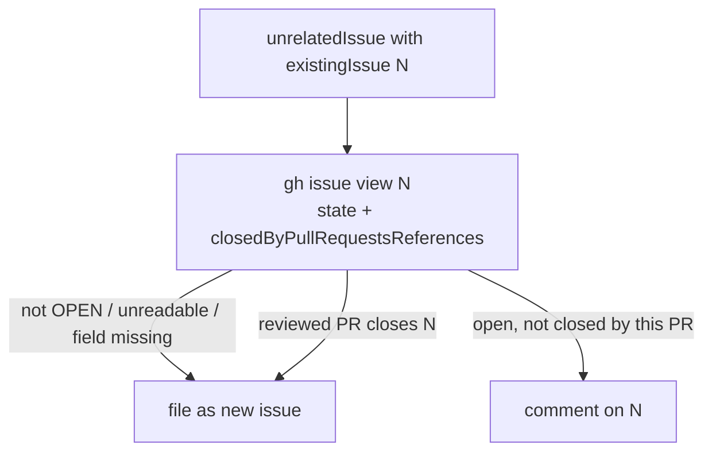

## Summary

When the fleet reviewer named an `existingIssue` for a pre-existing problem,
`post.ts` added the problem to that issue as a comment, even when the PR under
review closes that issue. The merge then closed the issue and took the only
record of the problem with it (#5303 → #5253, #5336 → #5304).

`addToExistingIssue` in `.claude/skills/review-fleet-prs/scripts/post.ts` now
asks for `closedByPullRequestsReferences` in the same `gh issue view` call it
already makes. When the reviewed PR (same number, same `owner/repo`, matched
case-insensitively) is one of the PRs that close the issue, it posts no comment
and returns `null`. The caller then files the problem as a new issue, using the
fallback a closed or unreadable issue already takes. The review brief also tells
the reviewer not to name such an issue. Closes #5338.

## Spec

### Intent and Rationale

- Do the fix in code so it does not rely on the model, as the issue prefers. The
  brief sentence is extra protection, not the fix.
- Read the closing PRs from the issue side, in the `issue view` that already
  checks `state`. That needs no extra `gh` call, and the check runs at the same
  moment as the state check. The PR side (`closingIssuesReferences`) would work
  too but costs a second request.

### Essential Design Decisions

- A view with no `closedByPullRequestsReferences` array is treated as malformed.
  It throws into the existing catch, so the problem is logged and filed as new,
  never commented onto an issue that might close.
- The match needs both the PR number and the repository. PR 7 of another repo,
  or another PR in the same repo, still gets the comment.

### Undiscoverable Facts

- I observed `closedByPullRequestsReferences` with the real `gh`. It lists open
  PRs as well as merged ones:
  `gh issue view 5328 -R stSoftwareAU/VibeCoder
  --json closedByPullRequestsReferences`
  returned the open PR 5387 as
  `{"number":5387,"repository":{"name":"VibeCoder","owner":{"login":"stSoftwareAU"}}}`.
  For the issue's own example, #5304 lists 5336.
- The triage comment on #5338 says the two findings at risk on #5304 were
  already rescued as #5348 and #5353, so this PR does not re-file them.

## Evidence

This change is backend and CLI only. The tests below cover it.

- Issue numbers cited: #3598: review-fleet-prs files one issue per instance of a
  defect class (gh-guard spellings) and duplicates its footer. #5338: this
  issue.

## Test Plan

Four tests were added to
`worker/deno/tests/review_fleet_prs_unrelated_dedupe_3598_test.ts`. All of them
drive `fileUnrelatedIssues` through the injected `gh` stub:

- `an existingIssue the reviewed PR closes is filed as a new issue, with no comment on it (Issue #5338)`:
  failed against the unfixed `post.ts` (`no comment on the umbrella`, actual 1,
  expected 0) and passes after the fix.
- `the closing check matches the repository case-insensitively (Issue #5338)`:
  failed before the fix in the same way and passes after it.
- `an open existingIssue closed only by another PR, or by PR 7 of another repository, still gets the comment (Issue #5338)`:
  the allowed control. It passes both before and after the fix.
- `an issue view without closedByPullRequestsReferences is filed as new rather than commented (Issue #5338)`:
  failed before the fix (`a malformed view is not commented on`) and passes
  after it.

Two existing tests had their fixtures edited. In
`an unrelated issue naming an
open existing issue is added there as a comment, not filed (Issue #3598)`
and in the closed case of
`an existingIssue that is closed, or cannot be read, still
files a new issue (Issue #3598)`,
the view answer now carries `closedByPullRequestsReferences: []`, which is the
shape real `gh` returns for an issue no PR closes. No assertion was removed or
changed. Without the field, the new fail-closed rule would file the issue as
new, so the fixture change keeps the "PR does not close #N → comment added" case
the issue asks to keep.

Runs:

- `deno task test:unit` over that file,
  `tests/pr_review_brief_shared_3395_test.ts`,
  `tests/pre_pr_verifier_3395_test.ts`,
  `tests/coding_guidelines_twin_drift_test.ts` and every
  `tests/*review_fleet_prs*` file: 562 passed, 0 failed.
- `./quality.sh < /dev/null` on the final code:
  `Result: PASSED (with skipped
  checks)`. Config integration and checkov were
  skipped by the gate itself.

Docs:

- I read and updated the `post.ts` comments on `fileUnrelatedIssues` and
  `addToExistingIssue`.
- I updated the `.claude/skills/review-fleet-prs/SKILL.md` post-step bullet ("if
  it is closed, closes when this PR merges, or cannot be read").
- I updated `prompts/pr_review_brief/prompt.md` step 10. The sentence after it
  now says "the issue you name", so it no longer points back at the closing
  issue.
- I grepped `existingIssue` and "filed as new" across the non-archive docs and
  sources. No other prose describes this path.
- Related rules I checked: brief step 10, which is shared with the pre-PR
  verifier. The new sentence is a constraint on that same rule and contradicts
  no other rule.

What I did not do: I did not re-file the #5304 findings, because the triage
comment says they are already rescued.
