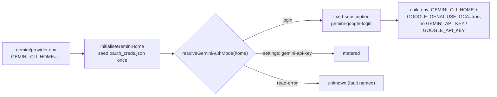

## Summary

A Google-account login persisted under an explicit `GEMINI_CLI_HOME` now proves
a fixed-price Gemini subscription (`gemini-google-login`). The Gemini child is
given only that login (the home plus `GOOGLE_GENAI_USE_GCA=true`) and never
`GEMINI_API_KEY` / `GOOGLE_API_KEY`. `GEMINI_CLI_HOME` is denied by name to the
Claude, Codex and DeepSeek children. With no home selected, the API-key path is
unchanged. Closes #5339.

## Spec

### Intent and Rationale

- This mirrors Codex's `CODEX_HOME` design: `resolveGeminiAuthMode` /
  `initialiseGeminiHome` in `gemini_auth.ts`, `buildIsolatedGeminiChildEnv` in
  `gemini_env.ts`, and `stateEnvVars` / `initialiseState` /
  `resolveStoredBilling` on the Gemini descriptor. The billing proof, the
  preflight and the child isolation all reuse the existing seams.
- The child withholds every API key once a home is selected. An expired login
  therefore fails authentication instead of quietly becoming metered spend.

### Essential Design Decisions

- A login requires `<home>/.gemini/oauth_creds.json` with a non-blank
  `refresh_token`. If `.gemini/settings.json` selects `gemini-api-key` the
  result is `metered`, and any other non-login type is `unknown`. A token-less,
  non-JSON or non-object file, or an unreadable `settings.json`, is
  `read-error`. That classifies `unknown` with the named fault
  (`gemini-login-unreadable (…)`), never `fixed-subscription`.
- Assumption: the child also gets `GOOGLE_GENAI_USE_GCA=true`, which the issue
  did not name. Without it, a home that has no `settings.json` selection makes
  the CLI refuse to run, so the classification would claim a login the run
  cannot use.
- Making `isSubscriptionCapable("gemini")` true, as the issue asks, changes two
  existing callers:
  - `agent_providers: ["claude","gemini"]` with no `agent_provider_mode` now
    defaults to `auto`, even when Gemini is on an API key. Auto cannot pick
    Gemini yet; not yet: #5344 will add its status adapter.
  - An enabled Gemini is now tried before the listed `agent_provider_fallback`
    ids.
  - Both are tested and documented. `agent_provider_mode: "pinned"` keeps the
    old default.
- A Google OAuth login is now a credential the worker handles, so
  `secret_redaction.ts` gains bare `ya29.` access-token and `1//0` refresh-token
  rules.

### Undiscoverable Facts

- These facts were read from the pinned Gemini CLI 0.68.0 bundle. The tarball's
  sha256 `325099dd…a006` matches `container/tools.json`.
  - `homedir()` returns `GEMINI_CLI_HOME` when set.
  - The login is `<home>/.gemini/oauth_creds.json` and is plain JSON unless
    `GEMINI_FORCE_ENCRYPTED_FILE_STORAGE=true`, which is not supported here.
  - In non-interactive mode the auth type is
    `settings.security.auth.selectedType` first, then
    `GOOGLE_GENAI_USE_GCA=true` (`oauth-personal`), then `GEMINI_API_KEY`.
- A free-tier and a paid Google login have the same file shape, so the probe
  does not distinguish them.
- `provider-feasibility` reads only the API-key names from
  `gemini/provider.env`. `GEMINI_CLI_HOME` must be in its environment, as
  `CODEX_HOME` already must be.

## Evidence

This is a backend/CLI change, so there is no UI evidence. The bundle facts above
came from downloading
`https://registry.npmjs.org/@google/gemini-cli/-/gemini-cli-0.68.0.tgz` and
grepping `bundle/chunk-2OHBIZ5H.js`. The code depends on these names found
there: `homedir()`, `OAUTH_FILE`, `getOAuthCredsPath`, `getAuthTypeFromEnv` and
`validateNonInteractiveAuth`.

Issue numbers cited as provenance:

- #5339: Classify a Gemini Google-account login as a fixed-price subscription
  and isolate it in the child environment
- #5344: Report a logged-in Gemini as an `auto` candidate with passive quota
  (open)
- #1923: Provider-agnostic fixed-price subscription routing

## Acceptance Criteria

<!-- vibe-spec-review inputs="diff+issue-body" -->

- **met** — `classifyProviderBilling("gemini", …)` returns `fixed-subscription`
  for a login under an explicit `GEMINI_CLI_HOME`, `metered` for an API key
  alone, and `unknown` for neither. A free-tier and a paid login classify the
  same. A test asserts each result. — evidence:
  `worker/deno/tests/gemini_subscription_auth_test.ts::Gemini login - an explicit home with a refresh token is a fixed-price subscription`,
  `::free-tier and paid logins classify the same`,
  `::an API key alone is metered and nothing is unknown` — reviewer: met
- **met** — `isSubscriptionCapable("gemini")` returns `true`. — evidence:
  `worker/deno/tests/gemini_subscription_auth_test.ts::Gemini login - gemini is subscription capable`
  — reviewer: met
- **met** — With a login selected, the Gemini `buildChildEnv` output contains no
  `GEMINI_API_KEY` or `GOOGLE_API_KEY`. A test asserts their absence. —
  evidence:
  `worker/deno/tests/gemini_subscription_auth_test.ts::Gemini login - a selected home withholds every API key from the child`
  — reviewer: met
- **met** — The Claude, Codex and DeepSeek child envs never contain
  `GEMINI_CLI_HOME`. A test asserts it. — evidence:
  `worker/deno/tests/agent_provider_gemini_test.ts::gemini provider - the Gemini login home is denied by name to the Claude, Codex and DeepSeek children`
  — reviewer: met
- **met** — With no `GEMINI_CLI_HOME`, an API-key Gemini still classifies
  `metered` and still runs when pinned. Existing Gemini tests pass unchanged. —
  evidence:
  `worker/deno/tests/gemini_subscription_auth_test.ts::Gemini login - a selected home withholds every API key from the child`
  (keys pass through with no home or a blank home);
  `worker/deno/tests/provider_billing_test.ts::classifyProviderBilling - DeepSeek and Gemini API keys are metered (Issue #1923)`;
  no existing Gemini assertion was edited, and all pass in `./quality.sh` —
  reviewer: met
- **met** — A `gemini/provider.env` holding only `GEMINI_CLI_HOME` passes the
  credential preflight. A test asserts it. — evidence:
  `worker/deno/tests/gemini_subscription_auth_test.ts::Gemini login - startup seeds a persistent home and preserves a refreshed login`
  — reviewer: met
- **met** — The `provider-feasibility` Gemini row, evaluated with a login, lists
  no `billing-*` blocker and no blocker the matching Codex row lacks. A test
  asserts it. — evidence:
  `worker/deno/tests/provider_feasibility_command_test.ts::gemini with a Google login withholds the metered key and blocks no more than codex's ChatGPT login (Issue #5339)`
  — reviewer: met
- **met** — `container/tools.json` is not modified, so `installedProviders`
  stays `["claude"]`. — evidence: `container/tools.json` is absent from
  `git diff --name-only` — reviewer: met
- **met** — `deno task test:unit` and `./quality.sh` pass. — evidence:
  `./quality.sh < /dev/null` was run on the final code head `87ca7ab2a` and
  printed `Result: PASSED (with skipped checks)`. Deno tests (parallel and
  serial), lint, type check, fmt, semgrep and gitleaks all passed. — reviewer:
  partial — reason: the reviewer is read-only and could not run either command;
  both were run here and passed
- **unrequested** — the child also gets `GOOGLE_GENAI_USE_GCA=true` once a home
  is selected — reviewer: unrequested — reason: the pinned CLI refuses to run
  non-interactively with no auth type selected, so without it the login the
  classification proves would be unusable
- **unrequested** — a `settings.json` selecting `gemini-api-key` classifies
  `metered` (`gemini-settings-api-key`) — reviewer: unrequested — reason: it
  follows from `resolveGeminiAuthMode` returning `api-key` and mirrors Codex's
  `codex-auth-json-api-key`, so a home configured for a key is never reported as
  a subscription
- **unrequested** — documentation edits in `README.md`, `SECURITY.md` and seven
  `docs/` pages — reviewer: unrequested — reason: required by the standard **A
  Code Change Owes a Docs Change**; each edit corrects a sentence the change
  made false

## Standards Review

<!-- vibe-standards-review inputs="diff+CODING-STANDARDS.md" -->

- **violation** — Changing what a shared helper returns changes every caller:
  `isSubscriptionCapable("gemini")` became true with no test through its
  existing callers — evidence: `worker/deno/lib/agent_provider.ts:1054` —
  reason: fixed in this diff
  (`worker/deno/tests/provider_auto_runtime_test.ts::Gemini counts as a subscription for the absent-mode default (Issue #5339)`
  and
  `worker/deno/tests/config_test.ts::config - loadConfig orders a Gemini subscription before pay-per-call fallbacks (Issue #5339)`)
- **violation** — Prose about the PR's own change: "a single-subscription or
  pay-per-call host stays pinned" — evidence: `docs/CONFIGURATION.md:641` —
  reason: fixed in this diff (says capability is per provider, not per proved
  credential)
- **violation** — A Code Change Owes a Docs Change: the fallback row still
  listed "(Claude, Codex)" — evidence: `docs/CONFIGURATION.md:643` — reason:
  fixed in this diff
- **violation** — Every outcome of a branch you add needs a test: the
  `oauth-personal` and non-object branches were unreached — evidence:
  `worker/deno/lib/gemini_auth.ts:253` — reason: fixed in this diff (new cases
  in `worker/deno/tests/gemini_subscription_auth_test.ts`)
- **violation** — Secret Redaction, every outbound sink: a new credential shape
  (Google OAuth tokens) had no rule — evidence:
  `worker/deno/lib/gemini_auth.ts:263` — reason: fixed in this diff
  (`google-oauth-access-token` / `google-oauth-refresh-token` in
  `worker/deno/lib/secret_redaction.ts`, with masking, bounds and hostile-input
  tests)
- **clean** — Review-enforced rules checked: "Check where you insert" and
  documentation-drift tests. Also checked and compliant: Australian spelling,
  fail-loud error handling, test hygiene (private temp dirs, no env mutation),
  no dummy or "how" tests, no test-only members, the twinned denylists, and the
  pinned-bundle citation. Optional notes, addressed: the
  `subscriptionAuthEvidence` comment, the README and parity "subscription
  providers" wording, and the "preflight fails naming both paths" wording, which
  now says worker startup fails.

## Test Plan

- Added `worker/deno/tests/gemini_subscription_auth_test.ts`. It covers billing
  for a login, both tiers, a key alone, neither, an unusable login, a
  settings-selected key, `oauth-personal` settings, non-object files and an
  empty home, where the probe returns `undefined`. It also covers
  `isSubscriptionCapable`, child-env isolation with no home, a blank home and a
  selected home, the preflight seed and refresh-preserving restart, bad seeds
  (missing, token-less, `0644`), the actionable message, and the result never
  containing the refresh token.
- Added tests to existing files:
  - `worker/deno/tests/agent_provider_gemini_test.ts`: `GEMINI_CLI_HOME` is
    denied to the Claude, Codex and DeepSeek children, with and without
    `CODEX_HOME`, and `PATH` survives as a positive control.
  - `worker/deno/tests/provider_feasibility_command_test.ts`: the Gemini and
    Codex feasibility rows.
  - `worker/deno/tests/provider_auto_runtime_test.ts` and
    `worker/deno/tests/config_test.ts`: the two callers of
    `isSubscriptionCapable`.
  - `worker/deno/tests/secret_redaction_test.ts`,
    `worker/deno/tests/secret_redaction_redos_test.ts` and
    `worker/deno/tests/secret_redaction_bounds_test.ts`: masking, short
    look-alikes left alone, one hostile 20 000-unit near-miss run per pattern,
    and bounds.
- Edited existing test: `worker/deno/tests/provider_billing_test.ts` changes a
  comment only ("neither vendor offers a subscription" became "an API key alone
  is metered"). Its assertions are unchanged.
- Red run against base: I restored the base production files (`gemini_auth.ts`,
  `gemini_env.ts`, `agent_provider.ts`, the three `*_env.ts`,
  `provider_billing.ts`) and kept the new tests. The denylist test and the
  feasibility test failed (the two failures in that run).
  `gemini_subscription_auth_test.ts` failed to type-check because
  `initialiseGeminiHome` and `resolveGeminiAuthMode` do not exist on base. The
  new redaction tests failed before the rules existed. All pass at the head.
- Twinned copies checked: the three cross-vendor denylists were all changed.
  `pr_summary_check.ts` was not touched. No second copy of the redaction rule
  table was found; `secret_transform_redaction.ts` re-scans with the same rules.
- A new precondition (`initialiseState`) runs only when `GEMINI_CLI_HOME` is
  set. No existing test sets it, so no fixture changes were needed. I checked
  this by grepping `worker/deno/tests` for `GEMINI_CLI_HOME`.
- Messages re-read for the new state: `geminiAuthActionableMessage` now names
  the login path as well as the keys. It is asserted in the actionable-message
  test in `worker/deno/tests/gemini_subscription_auth_test.ts`.
- `./quality.sh < /dev/null` was run on the final code head and printed
  `Result: PASSED (with skipped checks)`. Config integration was skipped (no
  `.config.json`), and checkov was skipped (not on PATH; CI is authoritative).

Not done:

- `provider-feasibility` still reads only the API-key names from
  `gemini/provider.env`, not `GEMINI_CLI_HOME`, as with Codex. This is
  documented in `docs/PROVIDER-FEASIBILITY.md`.
- Encrypted Gemini credential storage is not probed.
- No end-to-end run against a real Google login was possible here.
