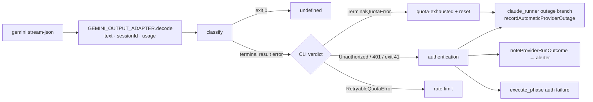

## Summary

The Gemini provider descriptor now has an `AgentOutputAdapter`
(`worker/deno/lib/gemini_output_adapter.ts`, `GEMINI_OUTPUT_ADAPTER`). A Gemini
run now returns:

- its final answer text, its session id and its token usage;
- a typed failure: `quota-exhausted` (with `quota.resetEpochMs` when the CLI
  gives a reset time) or `authentication` for a rejected login. Other failures
  get the categories Codex's adapter uses.

The runner's existing outage branch records a Gemini outage and calls the
provider-outage alerter. No Gemini-specific code was added to the runner.
`execute_phase.ts` now also accepts the runner's structured `authentication`
verdict, so a rejected Gemini login still fails the phase as an authentication
error. Closes #5340.

## Spec

### Intent and Rationale

- Until now Gemini's `stream-json` went through Claude's extractor. That
  extractor found no `result` text and no `assistant` blocks, so it fell back to
  returning the raw event stream (echoed prompt included) as the answer
  (`extractStreamJsonText`, `claude_executor.ts`), and no failure was
  classified.
- The adapter is modelled on `codex_output_adapter.ts` and uses the same shared
  helpers in `agent_output.ts`. It gets usage by calling
  `decodeGeminiTokenUsage()`, so `gemini_token_usage.ts` is unchanged.

### Essential Design Decisions

- **The terminal `result` error is the verdict.** When the stream ends with a
  `result` error, only that error is classified, apart from the out-of-memory
  check:
  - earlier `error` events (retry warnings) and stderr are not classified;
  - a retry warning that quotes quota wording cannot make a run quota-exhausted;
  - a `GEMINI_API_KEY` notice on stderr cannot relabel a 503, a rate limit or a
    quota failure.

  When there is no terminal error, the `error` events and stderr are read, and
  authentication from stderr prose is the last category before task failure.
- **`quota-exhausted` means the CLI's own terminal quota verdict.** That is a
  `TerminalQuotaError`, or the API's quota or balance wording on a terminal
  error that is not a `RetryableQuotaError`. A `RetryableQuotaError` is always
  `rate-limit`. The reset time comes from the stated `reset after 2h30m15s` or
  `retry in Ns`, and a non-finite value is dropped. No default is invented; the
  runner applies its own five-minute recheck.
- **The answer is the final turn.** Assistant deltas are concatenated, and each
  `tool_use` starts a new segment. A completed run's text is its last non-empty
  segment (`"final"`). A run with no `result` line returns all segments
  (`"partial"`). The echoed `user` message is never part of the text.
- **The execute phase reads the structured verdict too.** On an error-only
  Gemini run the adapter leaves the text empty, so the old text-only check in
  `execute_phase.ts` would have missed `UnauthorizedError`.
  `agentFailure.category === "authentication"` now also counts, and the
  structured error lines join the evidence snippet. Two guards are unchanged: a
  non-zero exit is still required, and a branch with commits ahead is still
  treated as a false positive. This applies to every provider with an adapter.

### Undiscoverable Facts

- The event shape was read from the published `@google/gemini-cli@0.68.0`
  tarball, the pinned version in `container/tools.json`. Its sha256 is
  `325099ddcb56937c27d119e7297bfa8a5e29b529bae3c92fdf3b71a36d5fa006`, which
  matches the pin. The CLI is not in the default image and no credential is
  available here, so the four fixtures are **derived** to that shape, not
  recorded. Their README says so.
- The relevant bundle facts:
  - `StreamJsonFormatter` emits `init` (with `session_id`), `message` (assistant
    text as `delta: true`), `tool_use`, `tool_result`, `error`, and a terminal
    `result` with `error: {type, message}`.
  - `handleError` exits with the error's `exitCode`, then `code`, then `status`.
    That gives exit 173 for a 429 `TerminalQuotaError`, 41 for
    `FatalAuthenticationError` and 53 for the turn cap.
  - When auth validation fails before the run, the CLI writes only to stderr and
    exits 41.
- The issue's assumption about the reason is correct: a rejected login seen
  during a run gives `observed-authentication-failure`
  (`provider_auto_runtime.ts`, `resolveAutomaticProviderStatus`), as it does for
  Codex.

## Evidence

Backend only, no UI files.

- **Command observed:** downloading the 0.68.0 tarball and running `sha256sum`
  gave the sha256 above. The code relies on two parts of the bundle:
  - the `JsonStreamEventType` enum (`init`, `message`, `tool_use`,
    `tool_result`, `error`, `result`);
  - the `handleError` result shape in `bundle/gemini-Q2FNZWQG.js`.
- **Issue numbers cited:**
  - #5340: Add a Gemini output adapter that decodes stream-json and classifies
    quota and login failures
  - #1695: Provider parity: normalise CLI events and failure classifications
  - #2613: A provider outage (402 Insufficient Balance) must not be reported as
    unresolved merge conflicts or trigger merge fallbacks
- **Docs I read and updated:**
  - `docs/CONTAINER.md`, section "Normalised CLI events and failures": the
    adapter list, and the paragraph that said Gemini had no adapter.
  - `worker/deno/tests/fixtures/agent_output/README.md`: a new Gemini section.
  - Doc comments on adapter lists: the module doc of
    `worker/deno/lib/agent_output.ts` and the header of
    `worker/deno/commands/babysitter_repair.ts`.
  - The Gemini descriptor comment in `worker/deno/lib/agent_provider.ts`.
- **Twinned rule:** Codex's private `NETWORK_RE` is now the shared
  `NETWORK_PROSE_RE` in `agent_output.ts`, imported by both adapters. No other
  twin was found.

## Acceptance Criteria

<!-- vibe-spec-review inputs="diff+issue-body" -->

- **met** — `agentProviderById("gemini")!.output` is defined, and its `decode`
  returns the final answer text and the session id from a stream-json fixture. —
  evidence:
  `worker/deno/tests/gemini_output_adapter_test.ts::gemini output adapter - the success fixture decodes to the final turn, session, usage and progress (Issue #5340)`
  — reviewer: met
- **met** — `classify` returns `quota-exhausted` with `quota.resetEpochMs` set
  when the fixture states a reset, and without it when it does not. — evidence:
  `worker/deno/tests/gemini_output_adapter_test.ts::gemini output adapter - a TerminalQuotaError with a stated reset is quota-exhausted, not a rate limit (Issue #5340)`
  and
  `::gemini output adapter - a TerminalQuotaError with no stated reset reports no reset (Issue #5340)`
  — reviewer: met
- **met** — `classify` returns `authentication` for a rejected-login fixture,
  and `undefined` for a successful run that quotes quota or login text. —
  evidence:
  `worker/deno/tests/gemini_output_adapter_test.ts::gemini output adapter - an UnauthorizedError is authentication from structured evidence (Issue #5340)`
  and
  `::gemini output adapter - a success that quotes quota and login text is not a failure (Issue #5340)`
  — reviewer: met
- **met** — With automatic routing active, a quota fixture run through the
  runner's existing outage branch records a Gemini outage whose `retryAt` is the
  stated reset, or `observedAt` + the five-minute default when none is stated;
  `resolveAutomaticProviderStatus("gemini", …)` then returns `exhausted`. A test
  asserts both. — evidence:
  `worker/deno/tests/gemini_output_adapter_test.ts::runClaudeWithRetry - a replayed Gemini quota reset is recorded as an outage that reopens at the stated reset (Issue #5340)`
  and
  `::runClaudeWithRetry - a replayed Gemini quota with no stated reset waits the five-minute recheck (Issue #5340)`
  — reviewer: met
- **met** — A rejected-login fixture leaves
  `resolveAutomaticProviderStatus("gemini", …)` returning `unavailable` with
  reason `observed-authentication-failure`, and the provider-outage alerter is
  invoked through `noteProviderRunOutcome`, as for Codex. A test asserts it. —
  evidence:
  `worker/deno/tests/gemini_output_adapter_test.ts::runClaudeWithRetry - a replayed Gemini rejected credential is an authentication outage and one alert (Issue #5340)`
  — reviewer: met
- **met** — `gemini_token_usage.ts` decoding is unchanged and its tests pass. —
  evidence: the diff does not touch `worker/deno/lib/gemini_token_usage.ts`;
  `worker/deno/tests/gemini_token_usage_test.ts` passed in the targeted run and
  in `./quality.sh` — reviewer: met — reason: the reviewer confirmed the code is
  unchanged but could not run tests; they were run here and passed
- **met** — `deno task test:unit` and `./quality.sh` pass. — evidence:
  `./quality.sh` run on head 44a0fb7be, `Result: PASSED (with skipped checks)`,
  including deno tests, lint, type check and fmt — reviewer: missing — reason:
  the reviewer saw only the diff and could not run the gate ("unverified"); it
  was run here and passed. The two skips (config integration, checkov) are
  standing gate skips, not failures
- **unrequested** — `NETWORK_RE` moved from `codex_output_adapter.ts` into
  `agent_output.ts` as `NETWORK_PROSE_RE` — reviewer: unrequested — reason: the
  standards rule "call existing code, never copy it"; the pattern is identical,
  and `worker/deno/tests/codex_output_adapter_1695_test.ts` still passes
- **unrequested** — the failure categories beyond quota and authentication
  (out-of-memory, model-unavailable, turn-limit, network, rate-limit,
  task-failure) and the stderr-only paths — reviewer: unrequested — reason:
  "modelled on `codex_output_adapter.ts`". Without them a 429 or 503 would fall
  into quota or authentication and record a false outage. Each one has a test
- **unrequested** — doc-comment updates in `docs/CONTAINER.md`,
  `worker/deno/lib/agent_output.ts` and
  `worker/deno/commands/babysitter_repair.ts` — reviewer: unrequested — reason:
  each one named only the Claude and Codex adapters, which the new adapter makes
  false
- **unrequested** — `worker/deno/lib/phases/execute_phase.ts` accepts the
  structured `authentication` verdict — reviewer: unrequested — reason: the
  standards review found that the adapter's empty error-run text would otherwise
  stop a rejected Gemini login failing the phase. This keeps the behaviour the
  issue relies on ("in production a rejected login raises …")
- **unrequested** — `container/Containerfile` `SUDO_VERSION` bumped from
  `1.9.16p2-3+deb13u2` to `1.9.16p2-3+deb13u5` — reviewer: unrequested —
  reason: Debian trixie-security dropped the `deb13u2` build, so the exact apt
  pin failed `container-build / container` (`E: Version '1.9.16p2-3+deb13u2' for
  'sudo' was not found`). The pin is kept (the manifest test requires one); the
  failure is on the base branch's Containerfile, not this PR's diff

## Standards Review

<!-- vibe-standards-review inputs="diff+CODING-STANDARDS.md" -->

- **violation** — Changing what a shared helper returns changes every caller:
  Gemini's `output` is now the adapter text, which `execute_phase.ts`'s
  text-only auth check reads — evidence:
  `worker/deno/lib/agent_provider.ts:1083` — reason: fixed in this diff
  (`worker/deno/lib/phases/execute_phase.ts` accepts
  `agentFailure.category === "authentication"`; tests
  `executeClaude - a structured authentication verdict fails the phase with its cause (Issue #5340)`
  and its negative control)
- **violation** — A new branch must be reachable by the input it exists for:
  stderr prose authentication ran before the stderr-only quota, network and
  rate-limit branches — evidence: `worker/deno/lib/gemini_output_adapter.ts:460`
  — reason: fixed in this diff (moved to just before task failure; tests for a
  `GEMINI_API_KEY` advisory with ECONNRESET and with a quota)
- **violation** — Vet every regex on untrusted text, one hostile case per
  pattern — evidence: `worker/deno/lib/gemini_output_adapter.ts:102` — reason:
  fixed in this diff
  (`gemini output adapter - a 50 000-character near miss of each pattern returns task-failure (Issue #5340)`,
  plus the reset, retry and model hostile cases)
- **violation** — First review round: a retry warning or a `RetryableQuotaError`
  with quota wording became quota-exhausted; a module-header order did not match
  the code; untested outcomes; a copied `NETWORK_RE`; adapter lists in other doc
  comments not updated — evidence: `worker/deno/lib/gemini_output_adapter.ts:26`
  — reason: fixed in this diff (the terminal-result verdict, `NETWORK_PROSE_RE`,
  the header rewritten, a test per outcome, `agent_output.ts` and
  `babysitter_repair.ts` updated)
- **clean** — Checked and compliant: no named-but-absent test; the replay stub
  exits with each fixture's code and its contract is named in the fixture
  README; no workflow change. Review-enforced rules checked: the four
  over-engineering departures, dummy and "how" tests, check where you insert,
  and Australian English. Also: no `/tmp` or host-state reliance
  (`Deno.makeTempDir`, `fakeClock`, `envFrom`); malformed lines are counted,
  never dropped; the lib-sweep top-up record is present. Optional and not
  chased: stale `path:line` citations already present in
  `docs/PROVIDER-FEASIBILITY.md`

## Test Plan

- **New `worker/deno/tests/gemini_output_adapter_test.ts`** (43 tests):
  - decode of the success fixture, including the final turn, the session and
    usage, and that the echoed prompt is excluded;
  - every classification outcome, structured and prose: authentication by class,
    by exit 41, by a 401 status and from stderr; quota with and without a reset,
    by retry delay and by 402; and rate limit, network, model-unavailable, turn
    limit, out-of-memory, timeout and task failure;
  - the regressions found in review: a `RetryableQuotaError` quoting an exceeded
    quota; a quota warning before an unrelated terminal error; and a terminal
    503 or a stderr ECONNRESET or quota next to a `GEMINI_API_KEY` advisory;
  - hostile inputs for every pattern;
  - three runner-level tests that replay the fixtures through
    `runClaudeWithRetry` with automatic routing active. They assert `retryAt`,
    `resolveAutomaticProviderStatus("gemini", …)` and exactly one alert.
- **Four fixtures** under `worker/deno/tests/fixtures/agent_output/`
  (`gemini-0.68.0-*.jsonl`), described in that directory's README.
- **`worker/deno/tests/issue_worker_test.ts`:** two new tests,
  `executeClaude - a structured authentication verdict fails the phase with
  its cause (Issue #5340)`
  and its negative control
  `executeClaude - a non-auth
  structured verdict does not fail the phase as an auth error (Issue #5340)`.
  The first uses `isClaudeAuthError: () => false`, so only the new verdict path
  can fire. Its assertions on "authentication" and the cause text fail on the
  base code, which falls through to "interrupted"; I reasoned this from the base
  code and did not run the test against it. No existing test was edited.
- **Results on the final head 44a0fb7be:**
  - `deno task test:unit` over the Gemini, Codex, Claude adapter, token-usage,
    lib-sweep and provider-auto-runtime tests: 175 passed.
  - The same command over `tests/issue_worker_test.ts` and
    `tests/issue_4109_callsite_test.ts`: 146 passed.
  - The Gemini adapter tests after the last fix: 45 passed, counted together
    with `tests/agent_provider_output_adapter_1695_test.ts`.
  - `./quality.sh < /dev/null`: `Result: PASSED (with skipped checks)`.
- **Not checked:** the fixtures are derived, not recorded from a live Gemini
  CLI, because no credential or installed CLI is available in this environment.
  The two gate skips (config integration, checkov) are standing skips.

🤖 Generated with [Claude Code](https://claude.com/claude-code)
