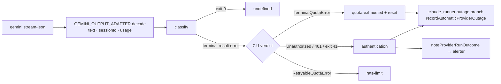

## Summary

The Gemini provider descriptor now has an `AgentOutputAdapter`
(`worker/deno/lib/gemini_output_adapter.ts`, `GEMINI_OUTPUT_ADAPTER`). A Gemini
run now returns its final answer text, its session id and token usage, and a
typed failure: `quota-exhausted` (with `quota.resetEpochMs` when the CLI gives
a reset time) or `authentication` for a rejected login. Other failures get the
categories Codex's adapter uses. The runner's existing outage branch records a
Gemini outage and calls the provider-outage alerter. No Gemini-specific code was
added to the runner. Closes #5340.

## Spec

### Intent and Rationale

- Until now Gemini's `stream-json` went through Claude's extractor. That extractor
  found no `result` text and no `assistant` blocks, so it handed back the raw
  event stream (echoed prompt included) as the answer, and no failure was
  classified.
- The adapter is modelled on `codex_output_adapter.ts`. It uses the same shared
  helpers from `agent_output.ts` and calls `decodeGeminiTokenUsage()` for usage
  rather than decoding usage again, so `gemini_token_usage.ts` is unchanged.

### Essential Design Decisions

- **The terminal `result` error is the verdict.** When the stream ends with a
  `result` error, only that error is classified. Earlier `error` events (retry
  warnings) and stderr are not. So a retry warning that quotes quota wording
  cannot make a run quota-exhausted. A `GEMINI_API_KEY` notice on stderr cannot
  relabel a 503, a rate limit or a quota failure as `authentication`. When no
  terminal error exists, the `error` events and stderr are read instead.
- **`quota-exhausted` means the CLI's own terminal quota verdict.** That is a
  `TerminalQuotaError`, or the API's quota or balance wording on an error that
  is not `RetryableQuotaError`. A `RetryableQuotaError` is always `rate-limit`.
  The reset time is read from the stated `reset after 2h30m15s` or
  `retry in Ns` and is never invented. The runner then applies its own
  five-minute default.
- **The answer is the final turn.** Assistant deltas are concatenated, and each
  `tool_use` starts a new segment. A completed run's text is its last non-empty
  segment (`textSource: "final"`). A run with no `result` line returns all
  segments (`"partial"`). The echoed `user` message is never part of the text.
- `NETWORK_RE` moved from `codex_output_adapter.ts` to `agent_output.ts` as a
  shared export, so both adapters use one copy.

### Undiscoverable Facts

- The event shape was read from the published `@google/gemini-cli@0.68.0`
  tarball, the pinned version in `container/tools.json`. The tarball's sha256
  `325099dd…a006` matches the pin. The CLI is not in the default image and no
  credential is available here, so the four fixtures are **derived** to that
  shape, not recorded. Their README says so.
- The relevant bundle facts are:
  - `StreamJsonFormatter` emits `init` (with `session_id`), `message`
    (assistant text as `delta: true`), `tool_use`, `tool_result`, `error`
    and a terminal `result` with `error: {type, message}`.
  - `handleError` exits with the error's `exitCode`, then `code`, then
    `status`. That gives exit 173 for a 429 `TerminalQuotaError`, 41 for
    `FatalAuthenticationError` and 53 for the turn cap.
  - When auth validation fails before the run, the CLI writes only to stderr
    and exits 41.
- The issue's assumption about the reason is correct: a rejected login seen
  during a run gives `observed-authentication-failure`
  (`provider_auto_runtime.ts`, `resolveAutomaticProviderStatus`), as it does
  for Codex.

## Evidence

Backend only, no UI files. The tests listed below are the evidence.

Commands run: downloading the tarball and checking it with `sha256sum`
printed `325099ddcb56937c27d119e7297bfa8a5e29b529bae3c92fdf3b71a36d5fa006`. The
code relies on the `JsonStreamEventType` enum (`init`, `message`, `tool_use`,
`tool_result`, `error`, `result`) and on the `handleError` result shape in
`bundle/gemini-Q2FNZWQG.js`.

Issue numbers cited: #5340: Add a Gemini output adapter that decodes
stream-json and classifies quota and login failures; #1695: Provider parity:
normalise CLI events and failure classifications; #2613: A provider outage (402
Insufficient Balance) must not be reported as unresolved merge conflicts or
trigger merge fallbacks; #5313: Make Gemini a first-class agent provider, on
par with Claude and Codex.

Docs updated:

- `docs/CONTAINER.md`, section "Normalised CLI events and failures": the
  adapter list, and the paragraph that said Gemini had no adapter.
- `worker/deno/tests/fixtures/agent_output/README.md`: a new Gemini section.
- The module doc in `worker/deno/lib/agent_output.ts` and the doc comment in
  `worker/deno/commands/babysitter_repair.ts`: both lists of adapters.
- The Gemini descriptor's doc comment in `worker/deno/lib/agent_provider.ts`.
