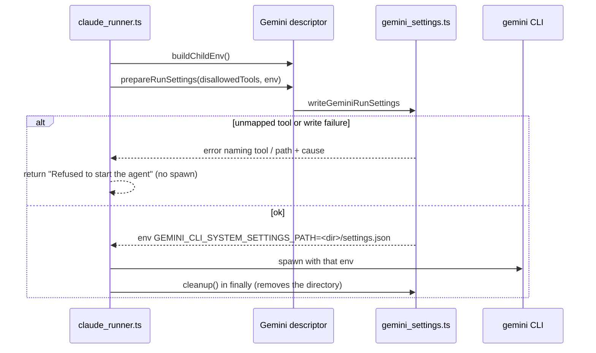

## Summary

Each Gemini run now writes a per-run settings file and names it in
`GEMINI_CLI_SYSTEM_SETTINGS_PATH`. The file enforces the run's denied tools. An
unmapped denied tool, or a settings file that cannot be written, refuses the
spawn. `assertRoleSupported` reads Gemini's enforcement from the descriptor's
settings builder, so Gemini is admitted as `executor`, `spec_reviewer`,
`standards_reviewer` and `explorer`. A Gemini `manager` is still refused with
`cannot compact its stream`. On Gemini, the pre-PR verifier denies `Bash`
outright in place of its `Bash(<pattern>)` entries. That is stricter than the
policy-file denial that a plain `Bash(<prefix>:*)` entry now gets (PR #5524
review). Closes #5341.

## Spec

### Intent and Rationale

- Until now Gemini received its denied tools only as prompt text, so the
  orchestrator refused every Gemini role. Gemini CLI 0.68.0 reads a system
  settings file named by `GEMINI_CLI_SYSTEM_SETTINGS_PATH`, and that file's
  `tools.exclude` and `experimental.enableAgents` turn tools off in the CLI
  itself.
- There is one pure builder, `buildGeminiToolSettings` in
  `worker/deno/lib/gemini_settings.ts`. Both callers use it: the runner seam
  (`prepareRunSettings`) and the role check (`toolDenialSettings`). So what the
  orchestrator admits and what the spawn enforces cannot drift apart.

### Essential Design Decisions

- **Fail closed.** `claude_runner.ts` calls `provider.prepareRunSettings` right
  after `buildChildEnv`. If it fails, the call returns
  `Refused to start the
  agent: …` before anything is spawned. This differs on
  purpose from the MCP config, which logs and continues.
- **Mappings beyond the issue's list.**
  - `EnterPlanMode` and `ExitPlanMode` map to `enter_plan_mode` and
    `exit_plan_mode`. `runClaudeWithTimeout` denies these two by default, and
    the Quorum judge relies on that default, so refusing them would refuse every
    default Gemini run.
  - `WebFetch` and `WebSearch` map to `web_fetch` and `google_web_search`. The
    existing summarise, closure-verdict and drift-check deny lists carry them.
  - A plain `Bash(<prefix>:*)` name is carried as a deny rule in a policy file
    beside the settings file (PR #5524 review).
  - Every other unlisted name, including a `Bash(...)` that is not a plain `:*`
    prefix such as `Bash(git push *)`, is refused as the issue states.
  - So on a Gemini host, the `pr_review` feedback run (`Bash(git push:*)`) and
    the best-practices static scan (`Bash(cargo:*)`, …) are now enforced
    through that policy file. Before this change they ran with those denials as
    prompt text only.
  - The pre-PR verifier keeps a stricter shape. Its deny list carries
    `Bash(gh:*)`, `Bash(git push:*)`, `Bash(curl:*)` and `Bash(wget:*)`. Those
    are plain `:*` prefixes, so the policy file could carry them, but the
    verifier chooses a stricter denial.
    `verifierDisallowedTools` in `worker/deno/lib/pre_pr_verifier.ts`
    swaps those entries for a plain `Bash` denial when the verifier runs on
    Gemini. That maps to `run_shell_command`. The Gemini verifier keeps every
    denial, but it has no shell. Its prompt still asks it to run checks, so it
    reports a check that needs a command as not run. Claude, Codex and the
    read-only verifier (always Claude) get the list unchanged. If the runner
    falls back from Claude to Gemini mid-run, the `Bash(<prefix>:*)` list is
    written as policy deny rules, so the run is enforced, not refused.
- **Where the file goes.** It is written to
  `<TMPDIR>/vibe-gemini-settings-*/settings.json`. `TMPDIR` is read through the
  run's own env lookup (`options.env`), or the system temp directory is used
  when it is unset. The directory is 0700 and the file 0600. The directory is
  removed in the runner's `finally`; a failed removal is logged at warn and does
  not fail the run.
- The denied list is still also composed into the prompt text as before. Codex,
  Claude and DeepSeek behave as before.

### Undiscoverable Facts

- Tool and setting names were checked against the Gemini CLI v0.68.0 source
  (`gh api repos/google-gemini/gemini-cli/contents/<path>?ref=v0.68.0`):
  - `packages/core/src/tools/definitions/base-declarations.ts` defines
    `replace`, `write_file`, `run_shell_command`, `enter_plan_mode`,
    `exit_plan_mode`, `web_fetch` and `google_web_search`.
  - `packages/cli/src/config/settings.ts` reads
    `process.env['GEMINI_CLI_SYSTEM_SETTINGS_PATH']`.
  - In `settingsSchema.ts`, `tools.exclude` is a string array with
    `MergeStrategy.UNION`, and `experimental.enableAgents` defaults to `true`.
- The Gemini CLI is not installed in this container, so no real `gemini` binary
  was run. The runner tests use a stub.

## Evidence

Backend only; no UI files changed.

- Runner seam: `worker/deno/lib/claude_runner.ts:1652`. Role check:
  `worker/deno/lib/orchestration/capabilities.ts:214`. Descriptor hooks:
  `worker/deno/lib/agent_provider.ts:640` and `:1184`.
- Ledger entry: `docs/audits/lib-sweep-coverage/top-up-5341.json`.
- Docs updated (each passage read in full): `SECURITY.md` (provider tool
  restrictions), `docs/THREAT-MODEL.md` (the same paragraph),
  `docs/ROLE-CONFIGURATION.md` (external dispatch), and
  `docs/MANAGER-WORKER-CONTRACT.md` (the External review gate row and the
  external orchestration paragraphs; the `capabilities.ts:130` citations are now
  `:154`, where `assertRoleSupported` starts).
- Doc comments updated: `agent_prompt.ts`, `gemini_executor.ts`,
  `orchestration/orchestrator.ts`, `pre_pr_verifier.ts` (the module boundary
  note, `PRE_PR_VERIFIER_DISALLOWED_TOOLS` and `activeProviderId`), and
  `claude_runner.ts` (the `disallowedTools` and `orchestrationRole` docs).
- Issue numbers cited: #5341 (this issue).

## Acceptance Criteria

<!-- vibe-spec-review inputs="diff+issue-body" -->

- **met** — For the reviewer denied list (`Edit`, `MultiEdit`, `Write`,
  `NotebookEdit`, `Bash`, `Task`, `Agent`), the settings file holds
  `tools.exclude` = `replace`, `write_file`, `run_shell_command` and
  `experimental.enableAgents: false`. A test asserts the exact content. —
  evidence:
  `worker/deno/tests/gemini_settings_5341_test.ts::the reviewer settings file holds the exact literal content and is removed on cleanup (Issue #5341)`
  — reviewer: met
- **met** — For the executor denied list (`Task`, `Agent`), the file holds
  `experimental.enableAgents: false` and no `tools.exclude` entry. A test
  asserts it. — evidence:
  `worker/deno/tests/gemini_settings_5341_test.ts::the executor list denies only sub-agents and writes no tools key (Issue #5341)`
  — reviewer: met
- **met** — An unmapped denied tool returns `missing_tool_support` naming the
  tool. A test asserts it. — evidence:
  `worker/deno/tests/gemini_settings_5341_test.ts::an unmapped denied tool is refused as missing_tool_support naming it (Issue #5341)`
  — reviewer: met
- **met** — `assertRoleSupported` returns no refusal for Gemini as `executor`,
  `spec_reviewer`, `standards_reviewer` and `explorer`, and returns the
  `cannot compact its stream` refusal for `manager`. A test asserts each. —
  evidence:
  `worker/deno/tests/orchestration_3642_contracts_test.ts::gemini carries the reviewer roles through its per-run settings file, but not a manager (Issue #5341)`
  — reviewer: met
- **met** — A Gemini run's child env names the per-run settings file in
  `GEMINI_CLI_SYSTEM_SETTINGS_PATH`; the file is owner-only and removed after
  the run. A runner-level test asserts it. — evidence:
  `worker/deno/tests/gemini_settings_5341_test.ts::runClaudeWithTimeout - a Gemini run reads a per-run settings file that denies the reviewer tools, and removes it after (Issue #5341)`
  — reviewer: met
- **met** — A run whose settings file cannot be written does not spawn, and the
  error names the path and the cause. A test asserts it. — evidence:
  `worker/deno/tests/gemini_settings_5341_test.ts::runClaudeWithTimeout - a Gemini run whose settings directory is missing is refused before the agent starts (Issue #5341)`
  — reviewer: met
- **met** — The Quorum judge invocation still builds and its existing tests
  pass. — evidence: `worker/deno/tests/quorum_orchestrator_test.ts`,
  `worker/deno/tests/quorum_processor_test.ts`, and the default-denial Gemini
  replay in `worker/deno/tests/gemini_output_adapter_test.ts` all pass —
  reviewer: met
- **met** — `deno task test:unit` and `./quality.sh` pass. — evidence:
  `./quality.sh < /dev/null` at head `8ac109d0f`:
  `Result: PASSED (with skipped checks)`, Deno tests parallel and serial passes
  PASSED — reviewer: missing — reason: the reviewer read only the diff and said
  it could not run the gate; the gate was run here after the final code commit
  and passed
- **unrequested** — `EnterPlanMode` and `ExitPlanMode` map to `enter_plan_mode`
  and `exit_plan_mode` — reviewer: unrequested — reason: the runner's default
  denials, which the Quorum judge uses, would otherwise refuse every default
  Gemini run
- **unrequested** — `WebFetch` and `WebSearch` map to `web_fetch` and
  `google_web_search` — reviewer: unrequested — reason: added after both
  reviews, to answer the Standards reviewer's caller finding; the Spec reviewer
  saw the earlier diff and flagged the plan-mode mapping of the same kind;
  without it the summarise, closure-verdict and drift-check runs are refused on
  Gemini
- **unrequested** — a second descriptor hook, `toolDenialSettings`, beside
  `prepareRunSettings` — reviewer: unrequested — reason: this is "the
  descriptor's settings builder" the issue tells `capabilities.ts` to read; it
  keeps the role check pure, with no filesystem writes
- **unrequested** — docs and doc comments outside `capabilities.ts` reworded —
  reviewer: unrequested — reason: they said Gemini gets prompt-text denials or
  is refused, which this change makes false (A Code Change Owes a Docs Change)
- **unrequested** — the orchestrator test that expected a Gemini executor to be
  refused as `missing_tool_support` was rewritten, and a Gemini manager test was
  added — reviewer: unrequested — reason: the issue's admission criterion makes
  the old expectation untrue
- **unrequested** — a failed settings write removes its directory and reports a
  failed removal in the error — reviewer: unrequested — reason: so a refused
  spawn leaves no directory behind and no error is swallowed

## Standards Review

<!-- vibe-standards-review inputs="diff+CODING-STANDARDS.md" -->

- **violation** — Changing what a shared path refuses changes every caller:
  every Gemini spawn now refuses unmapped denials, and the existing deny lists
  were not each decided — evidence: `worker/deno/lib/claude_runner.ts:1652` —
  reason: fixed in this diff: `WebFetch`/`WebSearch` now map, and the summarise
  and closure-verdict lists are asserted by
  `worker/deno/tests/gemini_settings_5341_test.ts::the existing summarise and closure-verdict callers are enforced, not refused (Issue #5341)`;
  plain `Bash(<prefix>:*)` callers are enforced through a policy file (PR #5524
  review), and a `Bash(...)` that is not a plain `:*` prefix is refused as the
  issue requires; the pre-PR verifier still denies `Bash` outright on Gemini
  (added after the reviews, from the pre-PR verifier's finding); both decisions
  are recorded under Essential Design Decisions
- **violation** — A test named for one step must reach that step: the Gemini
  executor billing test was refused by the Claude manager's billing check first
  — evidence: `worker/deno/tests/orchestration_3642_orchestrator_test.ts:470` —
  reason: fixed in this diff: the test now uses the default Claude-subscription
  env and asserts the `metered_billing` message names `gemini`
- **clean** — Areas checked:
  - Review-enforced rules: Australian English, over-engineering,
    `SIMPLE-ON-PURPOSE` marking, nothing exists only for a test to read, check
    where you insert, and stale doc comments outside the diff.
  - Behaviour: fail loud and fail closed, `Result` error paths, and a cleanup
    that is safe to repeat and logs through `redactSecrets`.
  - Tests: literal expected values, refusal tests with positive controls, and a
    write-failure test that asserts the cause text. Each test uses its own temp
    directory, and the stub shell is portable (no `stat -c`).
  - Ledger entry present; no hidden files staged.
  - Optional notes, acted on: the refusal and write-failure messages were
    reworded so each is true.

## Test Plan

- Added `worker/deno/tests/gemini_settings_5341_test.ts`:
  - builder cases: the reviewer, executor and empty lists, the plan-mode
    defaults, an unmapped `Bash(git push *)` refused with an `["Edit"]` positive
    control, and the real `SUMMARISE_DISALLOWED_TOOLS` and
    `CLOSURE_VERDICT_DISALLOWED_TOOLS` lists mapped to literal settings;
  - writer exact-content and cleanup case;
  - three `runClaudeWithTimeout` cases against a stub `gemini` that records
    `GEMINI_CLI_SYSTEM_SETTINGS_PATH`, the file content, and the `ls -ld` modes
    of the file and its directory: the success case (owner-only modes, file
    removed, temp root empty), a missing `TMPDIR` (no spawn; the message names
    the path and `No such file or directory`), and an unmapped tool (no spawn;
    the message names it).
- `worker/deno/tests/pre_pr_verifier_3395_test.ts`: two tests added; existing
  tests unchanged.
  - A unit test checks the literal lists for Gemini, Claude and Codex:
    `worker/deno/tests/pre_pr_verifier_3395_test.ts::verifierDisallowedTools denies Bash outright on Gemini and leaves other providers' lists alone (Issue #5341)`.
  - A runner test runs the verifier with Gemini active. It sends the verifier's
    own denied tools through the real `runClaudeWithTimeout` and a stub
    `gemini`. It checks four things: the runner did not refuse, the result is
    `checked`, the denied list is exact, and the settings file the stub read is
    exact (`enter_plan_mode`, `exit_plan_mode`, `web_fetch`,
    `google_web_search`, `run_shell_command`, `enableAgents: false`):
    `worker/deno/tests/pre_pr_verifier_3395_test.ts::runPrePrVerifier on Gemini spawns with a settings file that denies the shell, and is checked rather than refused (Issue #5341)`.
  - Red-checked before the PR #5524 review change, when a `Bash(<prefix>:*)`
    name was still refused: with `verifierDisallowedTools` returning the list
    unchanged, both tests failed and the runner test's message was
    `Refused to start the agent`, naming `Bash(gh:*)`, `Bash(git push:*)`,
    `Bash(curl:*)` and `Bash(wget:*)`. At the head those four are carried in a
    policy file, so the runner no longer refuses them. With the list unchanged
    the unit test still fails on its literal lists, and the runner test's exact
    settings-file check fails (no `run_shell_command` entry; a policy file is
    named instead).
- Red first: the new module failed to resolve before it existed. The contracts
  test failed on Gemini reviewer admission before `capabilities.ts` changed. The
  summarise and closure test failed with
  `gemini cannot enforce the denied tool(s) WebFetch, WebSearch` before the web
  mapping.
- `worker/deno/tests/orchestration_3642_contracts_test.ts`: added the Gemini
  role test; existing tests unchanged.
  - The admission assertions fail on base.
  - The `manager` and unmapped-tool assertions pass on base too, so they pin
    current behaviour.
- `worker/deno/tests/orchestration_3642_orchestrator_test.ts`: one test edited,
  one added.
  - The edited test was "an executor on a provider that cannot enforce denied
    tools is refused". It expected a Gemini executor to be refused as
    `missing_tool_support`. The issue's line "`assertRoleSupported` returns no
    refusal for Gemini as `executor`" makes that untrue.
  - It now asserts that the Gemini executor passes the role check and is held by
    Gemini's own `metered_billing` refusal, with zero calls.
  - The `missing_tool_support` refusal is still covered by the contracts test
    and the settings tests. The refusal travelling through
    `runExternalOrchestration` is still covered by the new Gemini manager test,
    which passes on base too (it pins current behaviour).
- Not covered by a test, because neither can be staged portably without a
  filesystem fault seam:
  - the branch where the directory is created but the file write fails;
  - the warning when cleanup's removal fails.
- After the verifier fix: `deno test -A` on `tests/pre_pr_verifier_3395_test.ts`
  and `tests/gemini_settings_5341_test.ts` gave 90 passed, 0 failed. `deno fmt`,
  `deno lint` and `deno check` were clean on both changed files. The worker
  re-runs `./quality.sh` on the new head.
- Earlier results at head `8ac109d0f`:
  - `deno task test:unit` on the touched test files: passed.
  - `./quality.sh < /dev/null`: `Result: PASSED (with skipped checks)`. Skipped:
    checkov (not on PATH) and config integration (no `.config.json`).

Not done or not checked: no real Gemini CLI was run, so the CLI's handling of
the file is taken from its v0.68.0 source. The two branches listed above have no
test.

🤖 Generated with [Claude Code](https://claude.com/claude-code)
