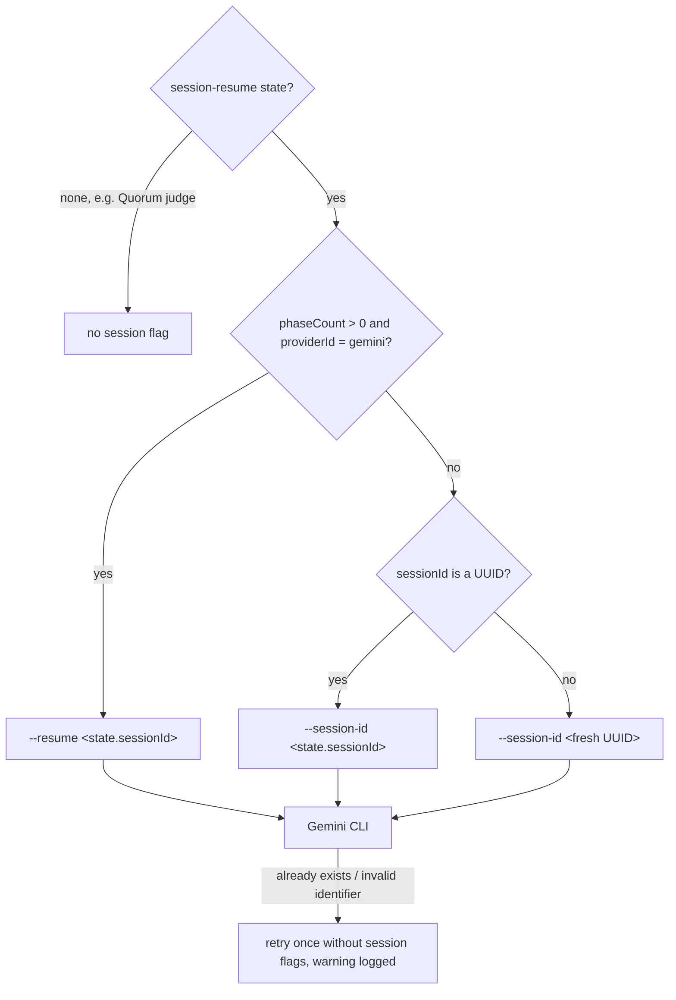

# PR Summary — Issue #5342

## Summary

Gemini now resumes sessions by a worker-generated id instead of
`--resume latest`. The first Gemini phase of an issue opens its session with
`--session-id <state.sessionId>`. A later phase sends `--resume <id>`, but only
when the recorded state names `gemini` as its provider. `buildGeminiArgs` emits
at most one of the two flags and never `latest`. When the CLI refuses the
flags at start-up, the existing retry without session flags now covers
Gemini's refusals too. Closes #5342.

## Spec

### Intent and Rationale

- `--resume latest` resumed whichever Gemini session ran last in the
  container, which could belong to another issue or slot. An id per issue
  makes continuity per issue.
- `geminiSessionFlags` (`worker/deno/lib/session_resume.ts`) is modelled on
  `codexResumeSessionId`. It resumes only an id Gemini itself reported
  (`providerId === "gemini"`, set by `adoptProviderSession` from the output
  adapter's `init.session_id`), and never feeds Gemini another provider's id
  as a resume.

### Essential Design Decisions

- A state recorded by another provider, or by none, starts a fresh Gemini
  session with `--session-id`. Its UUID is reused. An id that is not a UUID,
  such as a Codex thread name, is replaced by `generateSessionId()`, because
  the Gemini option is documented as "Start a new session with a manually
  provided UUID." This uses the existing generator, so no new one is added.
- `buildGeminiArgs` throws when given both ids, or `latest` as the resume id.
  Both are programming errors, and failing loudly beats spawning a CLI that
  exits at start-up.
- Assumption: the session id Gemini reports back is the one it was given. The
  CLI source confirms it: `init` carries `config.getSessionId()`, which
  `resolveSessionId` sets to `--session-id`'s value. `isPersistableSessionId`
  therefore needed no code change, because a Gemini UUID already passes
  `isValidSessionId`. Only its doc comment changed.
- Not asked for, but needed so id-based resume does not regress the old
  fallback. With no session to resume, `--resume latest` only warned and
  started fresh, but `--resume <id>` and a reused `--session-id` exit fatally.
  `INVALID_SESSION_ID_RE` (`worker/deno/lib/claude_executor.ts`) gains Gemini's
  "already exists" refusal, so the provider-agnostic retry in
  `runRetryLadder` drops the flags and retries once. It logs a warning (now
  naming the provider) and a security event. The CLI's "mutually exclusive"
  refusal of both flags together is deliberately not matched, so a regression
  there still fails loudly, as the issue's Failure Detection section says.

### Undiscoverable Facts

- Observed in the published Gemini CLI 0.68.0 bundle
  (`https://registry.npmjs.org/@google/gemini-cli/-/gemini-cli-0.68.0.tgz`,
  `package/bundle/gemini-QXW4BNRT.js`, fetched with `npm pack` and read, not
  run, because the CLI is not installed on this host):
  - yargs `.check`: `The flags --resume, --session-id, and --session-file are mutually exclusive.`
  - `--session-id` coercion: the id must match `^[a-zA-Z0-9-_]+$`.
  - `resolveSessionId`: an existing id exits with
    `Error starting session: Session ID "<id>" already exists. Use --resume to resume it, or provide a different ID.`
  - `resolveSessionId`: a missing `--resume` id exits with
    `Error resuming session: Invalid session identifier "<id>".`
  - `resolveSessionId`: only `latest` falls back to a fresh session.

## Evidence

Backend/CLI change only. No UI files are touched.

- Issue numbers this diff cites as provenance: #5342: Resume Gemini sessions
  by worker-generated id instead of `--resume latest`.
- The stub in `worker/deno/tests/gemini_session_refusal_5342_test.ts` mirrors
  the CLI contract above: a non-zero exit, with the refusal text on stderr.
  The runner matches the text and needs only a non-zero exit, so the stub's
  exit code 52 hides nothing.

## Acceptance Criteria

<!-- vibe-spec-review inputs="diff+issue-body" -->

- **met** — For a phase-0 state, the Gemini argv contains `--session-id <state.sessionId>` and no `--resume`. — evidence: `worker/deno/tests/agent_provider_gemini_test.ts::gemini provider - the first phase starts a session under the worker-generated id`, `worker/deno/tests/session_resume_test.ts::geminiSessionFlags - phase 0 starts a session under the worker id` — reviewer: met
- **met** — For a later phase whose state names `gemini`, the argv contains `--resume <state.sessionId>` and no `--session-id`. — evidence: `worker/deno/tests/agent_provider_gemini_test.ts::gemini provider - a later phase resumes the session Gemini reported` — reviewer: met
- **met** — A later-phase state recorded by another provider yields `--session-id` and no `--resume`. — evidence: `worker/deno/tests/agent_provider_gemini_test.ts::gemini provider - a later phase recorded by another provider starts a session` — reviewer: met
- **met** — No Gemini argv ever contains `latest` after `--resume`, or both flags together. A test sweeps the phase and provider combinations. — evidence: `worker/deno/tests/agent_provider_gemini_test.ts::gemini provider - every state carries exactly one session flag and never resumes latest`, `worker/deno/tests/session_resume_test.ts::buildGeminiArgs - both session ids is refused` — reviewer: met
- **met** — The Quorum judge invocation (no resume state) carries neither flag. — evidence: `worker/deno/tests/agent_provider_gemini_test.ts::gemini provider - a sessionless Quorum judge call carries neither session flag` — reviewer: met
- **met** — `deno task test:unit` and `./quality.sh` pass. — evidence: `./quality.sh < /dev/null` was run on head `fae952e0b` and printed `Result: PASSED (with skipped checks)`. The skipped checks were `config integration` and `checkov`, which is not on PATH. — reviewer: missing — reason: the reviewer said this "cannot be judged from the diff"; the gate, which runs the unit tests, was run here and passed
- **unrequested** — Gemini's start-up refusals of the session flags are retried without them (an `INVALID_SESSION_ID_RE` arm, the provider-named warning in `claude_runner.ts`, `worker/deno/tests/gemini_session_refusal_5342_test.ts`, and the doc sentence) — reviewer: unrequested — reason: without it, a re-claim on a new container (`--resume <id>` naming a missing session) or a retried first phase (`--session-id` naming an existing one) would exit fatally, where `--resume latest` fell back to a fresh session. The both-flags refusal is not matched, so it still fails loudly.
- **unrequested** — a non-UUID foreign id is replaced by a fresh UUID in `geminiSessionFlags` — reviewer: unrequested — reason: the CLI documents `--session-id` as a UUID, and the issue gives no rule for a foreign id that is not one
- **unrequested** — doc updates in `docs/MODEL-AND-CACHING.md` and `docs/PROVIDER-FEASIBILITY.md`, including a whitespace-only re-pad of the "Fixed-price subscription billing" row — reviewer: unrequested — reason: the docs described `--resume latest`, so they owe this change. The re-pad came from re-aligning the edited table.

## Standards Review

<!-- vibe-standards-review inputs="diff+CODING-STANDARDS.md" -->

- **violation** — Observe the real tool before you rely on it: the first review found the CLI behaviour (flags, refusals, the reported id) relied on but not observed — evidence: `worker/deno/lib/gemini_executor.ts:238` — reason: fixed in this diff. The 0.68.0 bundle was read (see Undiscoverable Facts), and the refusal strings in `worker/deno/tests/gemini_session_refusal_5342_test.ts` are copied from it. That review also found that a Gemini refusal took the ordinary failure path, which `worker/deno/lib/claude_executor.ts` now routes to the sessionless retry.
- **clean** — the final-diff re-review found no violations. It checked these review-enforced rules: "Dummy tests and 'how' tests are refused" rules 1–3. It also checked: the hostile-input regex cap, with an 81-character case; look-alike inputs; every outcome of the new branches; nothing test-only; the docs sweep; the shared-helper caller `claude_output_adapter.ts`, whose behaviour is unchanged for Claude's real output; fail-loud throws; Australian English; and temp-dir isolation. The edited existing test still goes red without its code.

## Test Plan

- `worker/deno/tests/agent_provider_gemini_test.ts`: the test "gemini provider - a later phase resumes the previous session" was replaced.
  - It asserted `--resume latest`, and the issue says "`--resume latest` is removed", so that assertion is obsolete.
  - Its phase-0 "no `--resume`" assertion is kept in the first-phase test.
  - New tests cover a phase-0 state, a later Gemini state, and later claude, codex (non-UUID) and legacy states.
  - The sweep covers phases {0, 1, 5} × providers {none, claude, codex, deepseek, gemini} × ids {UUID, non-UUID}, plus a sessionless judge call.
- `worker/deno/tests/session_resume_test.ts`:
  - `geminiSessionFlags` with no state, phase 0, a later Gemini state and a later foreign state.
  - `buildGeminiArgs` refusing both ids ("together with --resume") and refusing `latest`.
  - `isPersistableSessionId` for a Gemini UUID (accepted) and for a non-UUID (refused).
- `worker/deno/tests/gemini_session_refusal_5342_test.ts` (new):
  - Detection of both Gemini refusals.
  - Look-alikes that must not fire, and hostile input (50,000 characters with no closing quote, and 81 characters).
  - Two `runClaudeWithRetry` runs with `agentProvider: "gemini"` and a stub agent that refuses the flagged run. Each asserts the invocation log `[flag, none]` and exit code 0.
- Red against base:
  - With the base production `lib/` restored, the 4 new first-phase, later-phase, foreign-state and sweep tests in `agent_provider_gemini_test.ts` failed.
  - With the base `claude_executor.ts`, the already-exists detector test and the `--session-id` runner test failed.
  - Expected green on base, because they pin existing behaviour: the judge test, the invalid-identifier detector test, the `--resume` runner test (the existing `invalid session id` arm already matched), and the `isPersistableSessionId` test.
- On head, `deno task test:unit` over `session_resume_test.ts`, `agent_provider_gemini_test.ts`, `gemini_phase_routing_test.ts` and `gemini_output_adapter_test.ts` passed (119 passed, 0 failed).
- On head, `deno test -A worker/deno/tests/gemini_session_refusal_5342_test.ts` passed (6 tests).
- `./quality.sh < /dev/null` passed on head `fae952e0b`: `Result: PASSED (with skipped checks)`.
- Twinned copies: none found. `INVALID_SESSION_ID_RE` is the single matcher, and `detectInvalidSessionId` is also read by `claude_output_adapter.ts`, which Claude's real output does not reach with the new phrasing.
- Docs read and updated: the `docs/MODEL-AND-CACHING.md` sections "Session Resume" (with "How It Works"), "Session ID — a UUID (Issue #204)", "3. Session Resume" and both parity tables, and the "Session resume" row of the `docs/PROVIDER-FEASIBILITY.md` capability matrix. A grep for `resume latest`, `RESUME_LATEST` and `resumeSession` outside `docs/archive/` finds nothing on head.

## Not done or not checked

- The Gemini CLI was not run, since it is not installed on this host. Its behaviour comes from reading the 0.68.0 bundle.
- No test asserts the provider name in the runner's warning text.
- Whether Gemini writes the refusal to stderr or stdout was not observed. The runner scans both streams.
