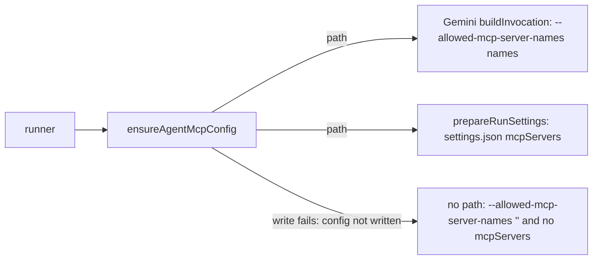

## Summary

Gemini runs now get the run's MCP servers (Playwright, Graft, CodeGraph). The
servers go under `mcpServers` in the per-run settings file
(`GEMINI_CLI_SYSTEM_SETTINGS_PATH`), and `--allowed-mcp-server-names` limits the
run to exactly the requested names. `bindGraftRun` and `prepareCodegraphContext`
no longer leave Gemini out. Codex and Gemini share one MCP config reader
(`worker/deno/lib/mcp_server_entries.ts`), so both skip the same unsafe names.
The argv names and the settings file both come from one reader,
`readGeminiMcpServers`. Closes #5343.

## Spec

### Intent and Rationale

- Parity with Codex. Codex receives the run's MCP JSON as `-c mcp_servers.*`
  overrides. Gemini now receives the same JSON as settings-file entries, with
  the same `command`, `args` and `env`.

### Essential Design Decisions

- `--allowed-mcp-server-names` is always passed, and a run with no servers
  passes `""`. Gemini CLI 0.68.0 treats an empty allow-list as "all servers".
  Its argument parsing, though, turns a lone `""` into `[""]`, which matches no
  server name, so none load. The CLI ignores file-based `admin.mcp.enabled`, so
  that setting cannot do this job. The reasoning is recorded at
  `worker/deno/lib/gemini_executor.ts`, as the issue's assumption asked.
- When the MCP config was written but cannot be read, or holds no usable server,
  Gemini refuses to start, as Codex does. When the config was never written,
  `ensureAgentMcpConfig` logs `config not written`, no path is passed, and the
  run goes ahead with no servers.
- `CodegraphStatus` keeps its `unsupported` member because callbacks publish it.
  No provider produces it now, and the stats line renders it as plain
  `unsupported`.
- The runner's refusal for a failed `prepareRunSettings` now says
  `could not prepare its run settings`. That call can now fail on the MCP config
  as well as on tool denials.

### Undiscoverable Facts

- I read the Gemini CLI v0.68.0 source (the version pinned in
  `container/tools.json`):
  - `packages/cli/src/config/config.ts`: `coerceCommaSeparated` returns `['']`
    for a single `""`, and `allowedMcpServers: argv.allowedMcpServerNames ?? …`.
  - `packages/core/src/tools/mcp-client-manager.ts`: `isBlockedBySettings`
    filters only when `allowedNames.length > 0`.
  - `packages/cli/src/config/settings.ts`: "Any admin settings from files are
    ignored."
- The Gemini CLI is not installed in the container, so the empty-list behaviour
  was read from that source, not observed by running the CLI.

## Evidence

Backend/CLI change only. The evidence is the tests below and the full quality
gate.

## Acceptance Criteria

<!-- vibe-spec-review inputs="diff+issue-body" -->

- **met** — For a browser run, the settings file's `mcpServers` holds the
  Playwright entry with the same command and arguments Codex receives, and the
  argv lists exactly that name after `--allowed-mcp-server-names`. A test
  asserts both. — evidence:
  `worker/deno/tests/agent_provider_gemini_test.ts::gemini MCP servers (Issue #5343) - a browser run names playwright in argv and writes its server to the settings file`
  (compared with `buildCodexMcpConfigArgs`), and the real-runner test
  `worker/deno/tests/mcp_server_entries_test.ts::runClaudeWithTimeout - a Gemini run with a written MCP config carries its servers in the settings file and the allow-list (Issue #5343)`
  — reviewer: met
- **met** — For a Graft-only run, `mcpServers` holds only the Graft entry and
  the argv lists only its name. A test asserts both. — evidence:
  `worker/deno/tests/agent_provider_gemini_test.ts::gemini MCP servers (Issue #5343) - a graft-only run loads only graft and drops alwaysLoad`
  — reviewer: met
- **met** — A run requesting no MCP servers loads no server from the user's
  Gemini settings. A test asserts the argv or settings content that guarantees
  it. — evidence:
  `worker/deno/tests/agent_provider_gemini_test.ts::gemini MCP servers (Issue #5343) - a run with no servers allows none and its settings file has no mcpServers key`
  — reviewer: partial — reason: the reviewer said the CLI's treatment of `""`
  "is unverified" and the source "is not in the repo". The test asserts the argv
  the criterion asks for. The CLI behaviour comes from the v0.68.0 source cited
  under Undiscoverable Facts, and the code records it, as the issue's assumption
  allows.
- **met** — `bindGraftRun` for a Gemini run no longer logs
  `has no MCP transport`, and wires the server. — evidence:
  `worker/deno/tests/graft_run_test.ts::bindGraftRun - a Gemini-routed run is wired like Claude (Issue #5343)`
  — reviewer: met
- **met** — `prepareCodegraphContext` for a Gemini run no longer returns
  `unsupported`. — evidence:
  `worker/deno/tests/codegraph_context_test.ts::prepareCodegraphContext - a Gemini run is not unsupported and reaches the index step (Issue #5343)`
  — reviewer: met
- **met** — When the MCP config cannot be written, a Gemini run logs
  `config not written` and proceeds, as a Codex run does. A test asserts it. —
  evidence:
  `worker/deno/tests/mcp_server_entries_test.ts::runClaudeWithTimeout - a Gemini run whose MCP config cannot be written logs config not written and runs without servers (Issue #5343)`
  (real runner, unwritable work dir) — reviewer: met
- **met** — `deno task test:unit` and `./quality.sh` pass. — evidence: the full
  `./quality.sh < /dev/null` gate ran on the final code head and exited 0
  (`deno tests`, `deno lint`, `deno type check`, `deno fmt`, `semgrep`,
  `gitleaks` and `markdownlint` all PASSED; `config integration` and `checkov`
  SKIPPED) — reviewer: missing — reason: the reviewer "cannot judge from the
  diff"; the gate was run here and passed
- **unrequested** — the shared `mcp_server_entries.ts` reader and the Codex
  refactor onto it — reviewer: unrequested — reason: Codex and Gemini read
  through one function, so they skip the same unsafe names, as the issue asks
- **unrequested** — Gemini refuses to start on an unreadable or empty MCP
  config, in both `buildInvocation` and `prepareRunSettings` — reviewer:
  unrequested — reason: same as Codex, so a requested server is never dropped
  silently
- **unrequested** — the Gemini `env` mapping keeps only string values under a
  safe key — reviewer: unrequested — reason: the same filter Codex's
  `tomlInlineTable` applies, for parity
- **unrequested** — docs (`docs/CALLBACKS.md`, `docs/CONFIGURATION.md`,
  `docs/REPO-CONTEXT-TRIAL.md`) and the audit top-up
  `docs/audits/lib-sweep-coverage/top-up-5343.json` — reviewer: unrequested —
  reason: the docs-change standard requires the docs edits, and the sweep gate
  requires the new lib module to be registered
- **unrequested** — the stats line renders `unsupported` instead of
  `unsupported (gemini)` — reviewer: unrequested — reason: the issue allows this
  when the line "reads wrongly", and naming Gemini now would
- **unrequested** — `GEMINI_PROVIDER_ID` imports dropped from callers that no
  longer use it — reviewer: unrequested — reason: they became unused when the
  Gemini branches were removed

## Standards Review

<!-- vibe-standards-review inputs="diff+CODING-STANDARDS.md" -->

- **violation** — Every changed call site needs a test that goes red without it:
  nothing tested the runner passing `mcpConfigPath` into `prepareRunSettings` —
  evidence: `worker/deno/lib/claude_runner.ts:1659` — reason: fixed in this
  diff. A real-runner test with a written config now asserts that the settings
  file's `mcpServers` and the allow-list both name `playwright`. With that
  spread removed, the test failed (6 passed, 1 failed); restored, it passes.
- **violation** — an absolute claim the code does not back ("wired exactly as
  Claude and Codex are") — evidence: `docs/CONFIGURATION.md:2277` — reason:
  fixed in this diff. The sentence now says Gemini gets the `command`, `args`
  and `env` Codex gets and does not read `alwaysLoad`.
- **violation** — Dummy tests and "how" tests (review-enforced): the test
  asserted the fake's call count and recorded args — evidence:
  `worker/deno/tests/codegraph_context_test.ts:253` — reason: fixed in this
  diff. Those assertions are removed, and the outcome assertions (status `ok`,
  node and relationship counts) remain.
- **violation** — Documentation-drift tests (review-enforced): `unsupported` was
  retyped as a bare literal — evidence:
  `worker/deno/tests/repo_context_trial_docs_test.ts:149` — reason: fixed in
  this diff. It is now `"unsupported" satisfies CodegraphStatus`, and the test
  is renamed so its name stays true.
- **violation** — DRY / twinned rule: the server-name regex was copied (found by
  an earlier review of this branch) — evidence:
  `worker/deno/lib/gemini_settings.ts:137` — reason: fixed in this diff. Codex
  and Gemini import `SAFE_MCP_NAME` from `mcp_server_entries.ts`.
- **violation** — the MCP config was read twice, once for the argv names and
  once for the settings file (found by an earlier review of this branch) —
  evidence: `worker/deno/lib/agent_provider.ts:1153` — reason: fixed in this
  diff. Both now come from `readGeminiMcpServers` in
  `worker/deno/lib/gemini_settings.ts`.
- **clean** — Australian English in added lines (review-enforced). No copied or
  reinvented helper (review-enforced). The other dummy-test rules
  (review-enforced): new tests assert values and refusal causes. Docs-drift
  rules 1 and 4 (review-enforced). Also clean: fail loud, `Result` usage, the
  callback schema stays additive-only, `__proto__` safety, filtering of server
  and env names, temp-dir hygiene, sweep-ledger registration and issue
  citations. Optional, not chased: `providerId` is no longer read by
  `prepareCodegraphContext`.

## Test Plan

- Added:
  - In `worker/deno/tests/agent_provider_gemini_test.ts`: the browser,
    Graft-only, no-server, unsafe-name and unreadable-config tests, plus the
    shared-reader refusal test.
  - `worker/deno/tests/mcp_server_entries_test.ts`, covering the parser, the
    Gemini mapping and two real-runner tests: config not written, and config
    written that reaches both the settings file and the argv.
- Edited:
  - `worker/deno/tests/graft_run_test.ts`: the old Gemini "no tools" test now
    asserts the wiring. The issue drops that branch.
  - `worker/deno/tests/codegraph_context_test.ts`: the old Gemini `unsupported`
    test now asserts that Gemini reaches the index with the same outcome as
    Claude. The issue drops that return.
  - `worker/deno/tests/issue_run_stats_comment_test.ts`: `unsupported (gemini)`
    becomes `unsupported`.
  - `worker/deno/tests/repo_context_trial_docs_test.ts`: the runner no longer
    returns `unsupported`. The test still requires the docs to name `off` and
    `unsupported`, and `unsupported` is now type-checked.
  - `worker/deno/tests/agent_provider_gemini_test.ts`: the exact-argv
    expectations gain the new flag.
  - `worker/deno/tests/issue_4109_callsite_test.ts`: comments only.
  - No behaviour assertion was removed without replacement. The codegraph
    call-args assertions were "how" assertions, and the outcome assertions still
    cover the behaviour.
- Results on the final code head:
  - `deno task test:unit tests/mcp_server_entries_test.ts tests/gemini_settings_5341_test.ts tests/agent_provider_gemini_test.ts`:
    51 passed, 0 failed (re-counted on the head).
  - `deno task test:unit tests/codegraph_context_test.ts tests/repo_context_trial_docs_test.ts`:
    38 passed, 0 failed.
  - `./quality.sh < /dev/null`: exit 0, Result: PASSED (with skipped checks:
    `config integration`, `checkov`).

Not done or not checked: the real Gemini CLI was not run, because it is not
installed in the container. Its `""` allow-list behaviour rests on the v0.68.0
source read above. The defined `spec-reviewer` and `standards-reviewer` agents
failed with `HTTP 429 … You've reached your Fable limit`, so general-purpose
sub-agents ran the same briefs.

Closes #5343

🤖 Generated with [Claude Code](https://claude.com/claude-code)
