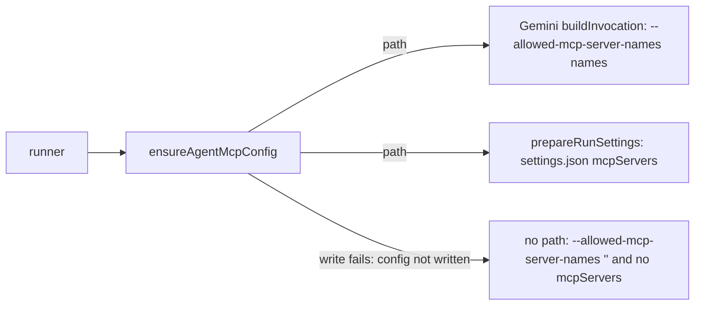

## Summary

Gemini runs now get the run's MCP servers (Playwright, Graft, CodeGraph). The
servers go under `mcpServers` in the per-run settings file
(`GEMINI_CLI_SYSTEM_SETTINGS_PATH`), and `--allowed-mcp-server-names` restricts
the run to exactly the requested names. `bindGraftRun` and
`prepareCodegraphContext` no longer leave Gemini out. Codex and Gemini share one
MCP config reader (`worker/deno/lib/mcp_server_entries.ts`), so both skip the
same unsafe names. The argv names and the settings file come from one reader,
`readGeminiMcpServers`. The full quality gate has not run on the final head, so
this PR is Part of #5343.

## Spec

### Intent and Rationale

- Parity with Codex: Codex receives the same JSON as `-c mcp_servers.*`
  overrides, and Gemini now receives it as settings-file entries with the same
  command and args.

### Essential Design Decisions

- `--allowed-mcp-server-names` is always passed. A run with no servers passes
  `""`. Gemini CLI 0.68.0 treats an empty list as "all servers", but its
  argument parsing turns a lone `""` into `[""]`, which matches no server, so
  none load. File-based `admin.mcp.enabled` is ignored by the CLI, so it cannot
  do this job. The reason is recorded at `worker/deno/lib/gemini_executor.ts`.
- Gemini refuses to start when the config cannot be read or has no usable
  server, as Codex does. A config that was never written (`ensureAgentMcpConfig`
  logs `config not written`) leaves no path, and the run goes ahead with no
  servers.
- `CodegraphStatus` keeps its `unsupported` member because it is a published
  callback value. No provider produces it now, and the stats line renders it as
  plain `unsupported`.

### Undiscoverable Facts

- I read the Gemini CLI v0.68.0 source with
  `gh api repos/google-gemini/gemini-cli/contents/...?ref=v0.68.0`:
  - `packages/cli/src/config/config.ts`: `coerceCommaSeparated` returns `['']`
    for a single `""`, and `allowedMcpServers: argv.allowedMcpServerNames ?? …`.
  - `packages/core/src/tools/mcp-client-manager.ts`: `isBlockedBySettings`
    filters only when `allowedNames.length > 0`.
  - `packages/cli/src/config/settings.ts`: "Any admin settings from files are
    ignored."

## Evidence

Backend/CLI change only. Evidence is the tests below.

## Acceptance Criteria

<!-- vibe-spec-review inputs="diff+issue-body" -->

- **met** — For a browser run, the settings file's `mcpServers` holds the
  Playwright entry with the same command and arguments Codex receives, and the
  argv lists exactly that name after `--allowed-mcp-server-names`. A test
  asserts both. — evidence: `worker/deno/tests/agent_provider_gemini_test.ts`
  (browser run test, compared with `buildCodexMcpConfigArgs`) — reviewer: met
- **met** — For a Graft-only run, `mcpServers` holds only the Graft entry and
  the argv lists only its name. A test asserts both. — evidence:
  `worker/deno/tests/agent_provider_gemini_test.ts` (Graft-only test) —
  reviewer: met
- **met** — A run requesting no MCP servers loads no server from the user's
  Gemini settings. A test asserts the argv or settings content that guarantees
  it. — evidence: `worker/deno/tests/agent_provider_gemini_test.ts` (no-server
  test asserts `--allowed-mcp-server-names ""` and no `mcpServers`) — reviewer:
  partial — reason: the reviewer noted that the CLI's treatment of `""` is not
  proven by a test. It was confirmed by reading the CLI v0.68.0 source (see
  Undiscoverable Facts), and the issue asked for the argv to be asserted, which
  the test does.
- **met** — `bindGraftRun` for a Gemini run no longer logs
  `has no MCP transport`, and wires the server. — evidence:
  `worker/deno/tests/graft_run_test.ts` — reviewer: met
- **met** — `prepareCodegraphContext` for a Gemini run no longer returns
  `unsupported`. — evidence: `worker/deno/tests/codegraph_context_test.ts` —
  reviewer: met
- **met** — When the MCP config cannot be written, a Gemini run logs
  `config not written` and proceeds, as a Codex run does. A test asserts it. —
  evidence: `worker/deno/tests/mcp_server_entries_test.ts` (real runner,
  unwritable work dir) — reviewer: met
- **partial** — `deno task test:unit` and `./quality.sh` pass. — evidence:
  targeted `deno task test:unit` runs pass — reviewer: missing — reason: quality
  gate not yet run on the final head. The first full run failed on two
  registrations (`lib_sweep_coverage_test.ts`,
  `repo_context_trial_docs_test.ts`); both are fixed and now pass in targeted
  runs, and the run budget did not cover a second full run — remaining:
  merge-verification-only
- **unrequested** — the shared `mcp_server_entries.ts` reader and the Codex
  refactor onto it — reviewer: unrequested — reason: lets Codex and Gemini skip
  the same unsafe names from one reader, as the issue asks
- **unrequested** — Gemini refuses to start on an unreadable or empty config —
  reviewer: unrequested — reason: same as Codex, so a requested server is never
  dropped silently
- **unrequested** — docs, callback docs, the stats line, the audit top-up
  `docs/audits/lib-sweep-coverage/top-up-5343.json`, and a trial-docs test now
  read without the Gemini `unsupported` claim — reviewer: unrequested — reason:
  the docs-change standard requires them, and the gate requires the new module
  to be registered

## Standards Review

<!-- vibe-standards-review inputs="diff+CODING-STANDARDS.md" -->

- **violation** — DRY / twinned rule: the env-name regex was copied — evidence:
  `worker/deno/lib/gemini_settings.ts:115` — reason: fixed in this diff. Codex
  and Gemini now import `SAFE_MCP_NAME` from `mcp_server_entries.ts`.
- **violation** — the module doc claimed both providers accept the same servers
  — evidence: `worker/deno/lib/mcp_server_entries.ts:8` — reason: fixed in this
  diff. The doc now says Gemini also skips a server with no `command`.
- **violation** — the MCP config is read twice (argv names and settings file)
  — evidence: `worker/deno/lib/agent_provider.ts:1153` — reason: fixed in this
  diff. The argv names and the settings file's `mcpServers` now both come from
  one reader, `readGeminiMcpServers` in `worker/deno/lib/gemini_settings.ts`. It
  holds the one refusal contract. The re-dispatched Standards reviewer judged
  it `fixed` with no new violation. Test:
  `worker/deno/tests/agent_provider_gemini_test.ts::the argv and the settings file share one reader, so they refuse with the same error`.
- **clean** — fail loud, published schema kept, docs-drift suites, replaced
  tests (no lost protection), `__proto__` safety, filtering of server and env
  names, Australian English

## Test Plan

- Added: browser, Graft-only, no-server, unsafe-name and refusal tests in
  `worker/deno/tests/agent_provider_gemini_test.ts`;
  `worker/deno/tests/mcp_server_entries_test.ts` (the parser, plus the
  real-runner `config not written` case).
- Edited:
  - `worker/deno/tests/graft_run_test.ts`: the old Gemini "no tools" test now
    asserts the wiring instead.
  - `worker/deno/tests/codegraph_context_test.ts`: the old Gemini `unsupported`
    test now asserts that Gemini and Claude give the same result through
    identical seams.
  - `worker/deno/tests/issue_run_stats_comment_test.ts`: `unsupported (gemini)`
    becomes `unsupported`, because the issue drops the Gemini return.
  - `worker/deno/tests/repo_context_trial_docs_test.ts`: drops the runner's
    Gemini `unsupported` and still checks the docs name `off` and `unsupported`.
  - `worker/deno/tests/agent_provider_gemini_test.ts`: the exact-argv
    expectations gain the new flag.
  - `worker/deno/tests/issue_4109_callsite_test.ts`: comments only.
- Results:
  - Targeted `deno task test:unit` runs for every file above pass: 116, 158, 49
    and 62 tests, 0 failed. `deno task check:manifests` passes.
  - The first full `./quality.sh` failed only on the two registrations that were
    later fixed.

<!-- vibe-quality-gate-skipped reason="run budget: the full gate takes about 10 minutes and under 8 remained after the fixes; targeted tests pass" -->

Not done or not checked: no second full gate run on the final head. After the
shared-reader fix, the targeted runs of `agent_provider_gemini_test.ts`,
`gemini_settings_5341_test.ts` and `mcp_server_entries_test.ts` pass: 49
passed, 0 failed.

Part of #5343

🤖 Generated with [Claude Code](https://claude.com/claude-code)
