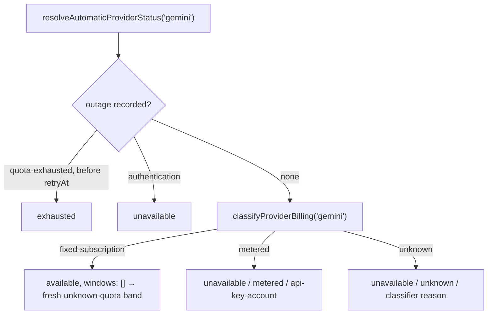

## Summary

`resolveAutomaticProviderStatus("gemini", …)` now returns a real Gemini status through a new `geminiStatus` built on `classifyProviderBilling`. A Google-account login under an explicit `GEMINI_CLI_HOME` is `available` and `fixed-subscription` with no quota windows, so `auto` ranks it in the `fresh-unknown-quota` band, after every provider with fresh known quota. An API key alone is `unavailable`/`metered` (`api-key-account`). With neither credential the status is `unavailable`/`unknown` and carries the classifier's reason. The path makes no network call.

The absent-`agent_provider_mode` default now drops a **non-preferred** provider whose credentials are proved metered. So Claude plus a logged-in Gemini defaults to `auto`, while Claude plus a Gemini on only an API key stays `pinned`. The worker and the babysitter make this decision the same way.

Closes #5344.

## Spec

### Intent and Rationale

- Gemini had a billing classification (#5339) but no status adapter, so `auto` answered `fixed-subscription-status-not-supported` and never picked it. The adapter reads the shared classifier instead of re-testing credential variables, because Gemini exposes no quota to read.
- Gemini makes no quota probe. The existing outage record above the switch already supplies `exhausted` (until `retryAt`) and `unavailable` once a run reports them.

### Essential Design Decisions

- **Default-mode criterion (deviation from the documented #5339 rule).** The issue says "With only a Gemini API key it does not". Before this change the default counted capability per provider id: `docs/CONFIGURATION.md` said Claude plus an API-key Gemini "counts as two and defaults to `auto`". To meet the criterion, `resolveAutomaticProviderConfig` takes an optional `billingContext`. With it, a provider proved `metered` does not count, unless it is the preferred `agent_provider` (else `DEFAULT_AGENT_PROVIDER_ID`). A provider whose billing is `unknown` still counts, so #5089 behaviour holds wherever no credential is visible.
- **The preferred provider always counts.** Pinning a metered preferred provider would spend per token, while `auto` routes away from it. For example, Claude on only `ANTHROPIC_API_KEY` plus a Codex subscription keeps defaulting to `auto`, as before. The rule is generic rather than Gemini-only, so a metered non-preferred Codex also no longer counts. That host was already routed to the preferred provider under `auto`, because a metered candidate is never eligible.
- The rule lives in one place, the resolver. `readModeConfig` and `chooseBabysitterProvider` both pass `billingContext`, so the babysitter does not drift from the worker.
- The Gemini login status uses `confidence: "inferred"` with `observedAt: now`, so it is always fresh. A provider whose known windows have gone stale therefore ranks after Gemini (`bandRank`). The docs say "fresh known quota" for that reason.

### Undiscoverable Facts

- The issue asked the implementer to confirm that a status with no windows maps to `fresh-unknown-quota`. It does: `constrainedRemainingPercent` returns `null` for an empty `windows` array, and `candidateView` maps a null score to `fresh-unknown-quota` (`worker/deno/lib/provider_auto_selection.ts`).

## Evidence

Backend-only change (no UI files). The new tests run through the production entry points `resolveAutomaticProviderStatus`, `refreshAutomaticProviderRouting`, `resolveAutomaticProviderConfig` and `chooseBabysitterProvider`. The Gemini credential fixtures are real temporary `GEMINI_CLI_HOME` directories read by the production `resolveGeminiAuthMode`; there is no billing fake.

Provenance numbers added in the diff: #5344 (this issue: "Report a logged-in Gemini as an `auto` candidate with passive quota"). #5089 and #5339 were already cited by the base branch.

## Acceptance Criteria

<!-- vibe-spec-review inputs="diff+issue-body" -->

- **met** — With a login, the Gemini status is `available`, `fixed-subscription`, with an empty `windows` array. It never returns `fixed-subscription-status-not-supported`. — evidence: `worker/deno/tests/provider_auto_runtime_test.ts::a Google login reports Gemini as a passive-quota candidate (Issue #5344)` — reviewer: met
- **met** — With only an API key, the status is `unavailable`/`metered`, and `auto` never selects it. — evidence: `worker/deno/tests/provider_auto_runtime_test.ts::a Gemini API key is metered and never wins auto (Issue #5344)` — reviewer: met
- **met** — Given a Claude status with a known window and a logged-in Gemini, `auto` ranks Gemini after Claude. A test asserts the order. — evidence: `worker/deno/tests/provider_auto_runtime_test.ts::a logged-in Gemini ranks after a provider with a known window (Issue #5344)` — reviewer: met
- **met** — After a recorded `quota-exhausted` outage, the status is `exhausted` until `retryAt`, then `available` again. — evidence: `worker/deno/tests/provider_auto_runtime_test.ts::a run-reported quota exhaustion makes a logged-in Gemini exhausted until retry (Issue #5344)` — reviewer: met
- **met** — With Claude and a logged-in Gemini enabled, an absent mode defaults to `auto`, as Codex does (#5089). With only a Gemini API key it does not. — evidence: `worker/deno/tests/provider_auto_runtime_test.ts::the default mode ignores providers proved metered (Issue #5344)`, `worker/deno/tests/provider_auto_runtime_test.ts::the preferred provider always counts toward the default (Issue #5344)`, `worker/deno/tests/babysitter_provider_choice_4738_test.ts::a Gemini API key keeps absent-mode config pinned, a Gemini login makes it auto (Issue #5344)` — reviewer: met — reason: the reviewer said the first version was over-broad, because a metered preferred Claude would have been pinned. The rule was then narrowed so the preferred provider always counts.
- **met** — The Gemini status path makes no network request. A test injects a seam that fails if called. — evidence: `worker/deno/tests/provider_auto_runtime_test.ts::Gemini status makes no network call or probe (Issue #5344)` (a `globalThis.fetch` that throws and counts) — reviewer: met
- **met** — `deno task test:unit` and `./quality.sh` pass. — evidence: `./quality.sh < /dev/null` run on the final head: `Result: PASSED (with skipped checks)` (config integration and checkov skipped by the gate itself) — reviewer: missing — reason: the reviewer was read-only and could not run the gate. It was run here after the last code commit and passed, including the `deno tests` stage.
- **unrequested** — The metered exclusion is generic (Claude and Codex too, not only Gemini) — reviewer: unrequested — reason: solving the criterion only for Gemini would special-case one provider id. The narrowed rule (the preferred provider always counts) keeps every previously auto host that could reach a subscription on `auto`.
- **unrequested** — `worker/deno/lib/babysitter_provider_choice.ts` passes `billingContext` — reviewer: unrequested — reason: the babysitter twins the worker's default-mode decision, so leaving it out would let the two disagree. A babysitter test now covers it.

## Standards Review

<!-- vibe-standards-review inputs="diff+CODING-STANDARDS.md" -->

- **violation** — Every changed call site needs a test that goes red without it — evidence: `worker/deno/lib/babysitter_provider_choice.ts:113` — reason: fixed in this diff. The new babysitter test was observed failing with that line removed (`automatic babysitter routing returned no winner without pausing`) and passes with it.
- **violation** — A doc comment the change made false ("without reading files or process state", "pure configuration resolver") — evidence: `worker/deno/lib/provider_auto_runtime.ts:110` — reason: fixed in this diff
- **violation** — An absolute claim ("ranks after every provider with a known window") that the head code does not guarantee, because a stale known window ranks after Gemini — evidence: `docs/PROVIDER-PARITY.md:166` — reason: fixed in this diff. It now reads "fresh known quota" in `docs/PROVIDER-PARITY.md`, `docs/CONFIGURATION.md` and `worker/deno/lib/provider_auto_runtime.ts`.
- **violation** — "How" assertions on the injected resolver's call count — evidence: `worker/deno/tests/provider_auto_runtime_test.ts:806` — reason: fixed in this diff (count assertions removed; the `automatic` outcome assertions stay)
- **violation** — An unedited sentence in an updated doc contradicted the new default — evidence: `docs/PROVIDER-PARITY.md:237` — reason: fixed in this diff
- **clean** — Australian English; fail-closed billing (metered and unknown Gemini are both `unavailable`); log-safe reasons only; insertion points (no item placed between a doc comment and its item); temporary `GEMINI_CLI_HOME` fixtures via `Deno.makeTempDir`, removed afterwards; no member that only a test uses (`billingContext` has two production callers); existing tests unchanged in their expectations. Review-enforced rules checked: Check where you insert; Documentation-drift tests (not applicable).

## Test Plan

- `worker/deno/tests/provider_auto_runtime_test.ts` gains nine tests marked "(Issue #5344)":
  - login status;
  - API key metered and never winning, alone and beside Claude;
  - ranking order `["claude", "gemini"]`, with bands `fresh-known` and `fresh-unknown-quota`;
  - quota-exhaustion outage: `exhausted` at `NOW`, `available` at `retryAt`;
  - default mode, both through the pure resolver and end to end through `refreshAutomaticProviderRouting`: login gives `auto`, an API key alone gives `pinned`;
  - a metered Codex gives `pinned` while an unknown one gives `auto`;
  - the preferred-provider exception: metered preferred Claude plus Codex gives `auto`; preferred API-key Gemini gives `auto`; no preferred provider with an API-key Gemini gives `pinned`;
  - a missing login, and an unreadable login (`gemini-login-unreadable (…)` reason);
  - a throwing `fetch` seam that is never called.

  Each case pairs a metered input with a login or unknown control. Every test exercises behaviour the base branch lacked: on base, Gemini fell through to `fixed-subscription-status-not-supported`, and the resolver had no `billingContext`.
- `worker/deno/tests/babysitter_provider_choice_4738_test.ts` gains one test. With an API-key-only Gemini, absent mode gives `pinned` and the choice is Claude. With a login control it gives `auto` and the choice is Gemini. It was observed red with the babysitter's `billingContext` line removed, and green with it.
- No existing test expectation was edited. The existing "Gemini counts as a subscription for the absent-mode default (Issue #5339)" test passes no `billingContext`, so it still pins the id-only count. The existing absent-mode refresh test carries no metered credential, so it still reaches `default-auto`.
- `deno task test:unit` on `tests/provider_auto_runtime_test.ts`, `tests/babysitter_provider_choice_4738_test.ts`, `tests/provider_auto_selection_test.ts` and `tests/gemini_subscription_auth_test.ts`: 77 passed, 0 failed.
- `./quality.sh < /dev/null` on the final code head: `Result: PASSED (with skipped checks)`.
- Docs read and updated: the `agent_provider_mode` row in `docs/CONFIGURATION.md`; the routing table, the auto paragraph, the line-237 default sentence and the selection and adapter bullets in `docs/PROVIDER-PARITY.md`; the auto-mode paragraph in `README.md`; and the Gemini descriptor comment in `worker/deno/lib/agent_provider.ts`.

Not done or not checked:
- `docs/SUBSCRIPTION-SOAK.md:141` still says the shipped default is `pinned`. That was already stale since #5089 and is outside this change.
- `docs/PROVIDER-FEASIBILITY.md` is a dated report whose Gemini cells were already stale; it was left alone.
- The module header of `worker/deno/lib/provider_auto_selection.ts` still names only Claude and Codex.

🤖 Generated with [Claude Code](https://claude.com/claude-code)
