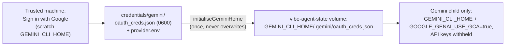

# PR summary — issue #5345

## Summary

Adds `docs/GEMINI-SUBSCRIPTION-AUTH.md`, the owner's one-time Google-account
login and seeding runbook for unattended Gemini runs, and brings the Gemini
rows of `docs/PROVIDER-PARITY.md` and `docs/PROVIDER-FEASIBILITY.md` into line
with the merged milestone code. `README.md` links the new page from its
documentation table, next to **Codex subscription auth**. Docs-only, apart from
one stale code comment. Closes #5345.

## Spec

### Intent and Rationale

- The Gemini first-class worker milestone (#5313) merged the login billing probe, output adapter, session resume, tool-denial settings file, MCP allow-list and passive auto quota. The operator docs still described Gemini as metered-only and carried stale line references.
- The new page follows the section order of `docs/CODEX-SUBSCRIPTION-AUTH.md`, so an operator who knows one page can read the other.

### Essential Design Decisions

- The login runs on a trusted machine against a scratch `GEMINI_CLI_HOME`. Its `oauth_creds.json` is then seeded into the credential directory. `/home/vibe/auto-issue-work-agent-state/gemini` is the in-container mount of the `vibe-agent-state` volume (`docs/CONTAINMENT.md:76`), not a host path, so the doc never tells the operator to log in there.
- The issue asked to refresh only the `agent_provider.ts` line references. The acceptance criterion covers every reference in both docs, so the other stale references in `PROVIDER-FEASIBILITY.md` were refreshed too. Two Codex sentences were also reconciled with the code those refreshed references now point at: the routing and pricing prose, and the #3955 section-6 bullet.
- `agent_provider.ts:1243-1244`: the DeepSeek comment said DeepSeek is metered "the same as Gemini". That is false now that a Gemini login is fixed-price, so it was reworded. The change is comment-only.

### Undiscoverable Facts

- `NO_BROWSER=true` and the "Enter the authorization code:" prompt were read from upstream `gemini-cli` main, not from the 0.68.0 pin. The page says so.
- #3955 is closed (`gh issue view 3955`: CLOSED, "Codex billing probe and child disagree on CODEX_HOME when it is not set explicitly").

## Evidence

Purely documentation. Every `file:line` reference the diff adds or changes was opened at the head and checked against the named code, by me and both reviewers. Key claims and the code that backs them:

- **Seeding:** `worker/deno/lib/gemini_auth.ts:263-294` (`initialiseGeminiHome`) seeds once, never overwrites, and creates the directory `0700` and the file `0600`. It has two refusal messages.
- **Billing:** `worker/deno/lib/agent_provider.ts:1088-1120` handles the login billing probe. `worker/deno/lib/provider_billing.ts:105-116` makes a stored `unknown` fall through to the metered-key check, so a login is `unknown` only when no API key is present.
- **Containment:** `worker/deno/lib/gemini_env.ts:128-150` builds the isolated child env. `GEMINI_CLI_HOME` is denied by name at `claude_env.ts:78`, `codex_env.ts:46` and `deepseek_env.ts:94`.
- **Auto routing:** `resolveAutomaticProviderStatus` and `geminiStatus` in `worker/deno/lib/provider_auto_runtime.ts` cover outage-record exhaustion and passive login status.
- **Orchestration roles:** `worker/deno/lib/orchestration/capabilities.ts:58-66` shows only the manager role needs compaction.
- **Opt-in:** `container/tools.json:111` sets `installedProviders: ["claude"]` and `container/Containerfile:135` sets `AGENT_PROVIDERS`.

Issue numbers cited (provenance):

- #3955: Codex billing probe and child disagree on CODEX_HOME when it is not set explicitly (closed; looked up this run).
- #5340: Add a Gemini output adapter that decodes stream-json and classifies quota and login failures (looked up this run).
- #5344: Report a logged-in Gemini as an `auto` candidate with passive quota (looked up this run).
- #5313, #5339, #5341, #5342 and #5343 come from the issue body and the code comments at the head. `gh issue view` was rate-limited when I tried to recheck them.

## Acceptance Criteria

<!-- vibe-spec-review inputs="diff+issue-body" -->

- **met** — `docs/GEMINI-SUBSCRIPTION-AUTH.md` exists, covers the login, seeding, `provider.env`, billing and containment, and contains no credential values. — evidence: `docs/GEMINI-SUBSCRIPTION-AUTH.md` (sections One-time login, Seeding the login, Billing policy, Containment, A single Gemini account) — reviewer: met
- **met** — Every Gemini statement in `docs/PROVIDER-PARITY.md` and `docs/PROVIDER-FEASIBILITY.md` matches the merged code, and each file:line reference points at the named code. — evidence: `docs/PROVIDER-PARITY.md` (`## Gemini capabilities`, billing table), `docs/PROVIDER-FEASIBILITY.md` (Gemini verdict and capability rows, refreshed references) — reviewer: met — reason: the reviewer checked every Gemini reference and sampled the refreshed non-Gemini ones; I opened each refreshed non-Gemini reference at the head too
- **met** — `README.md` links the new doc from its documentation table. — evidence: `README.md` row **Gemini subscription auth**, directly below **Codex subscription auth** — reviewer: met
- **met** — The markdownlint and Mermaid checks in `./quality.sh` pass. — evidence: full `./quality.sh` run, `mermaid PASSED`, `markdownlint PASSED`, `Result: PASSED (with skipped checks)` — reviewer: met — reason: the reviewer could not run the gate and gave a best estimate; I ran it and it passed
- **unrequested** — comment-only reword in `worker/deno/lib/agent_provider.ts:1243-1244` (DeepSeek "the same as Gemini") — reviewer: unrequested — reason: the merged code made the comment false (a Gemini login is fixed-price); docs-owe-docs rule
- **unrequested** — non-`agent_provider.ts` line references refreshed in `docs/PROVIDER-FEASIBILITY.md` — reviewer: unrequested — reason: the acceptance criterion requires each file:line reference in the file to point at the named code
- **unrequested** — `docs/PROVIDER-FEASIBILITY.md` #3955 row and its section-6 bullet reconciled, Codex pin version corrected to 0.167.2 — reviewer: unrequested — reason: the edited section 2 row and the untouched section 6 bullet contradicted each other; #3955 is closed
- **unrequested** — `docs/PROVIDER-FEASIBILITY.md` section 4 item 3 and section 7 item 5 Codex routing/pricing prose — reviewer: unrequested — reason: the refreshed references now point at `token_usage.ts:464-473`, which contradicted the old sentences
- **unrequested** — extra `PROVIDER-PARITY.md` Gemini capability rows (approvals and sandbox, sub-agents and advisor guard, orchestration roles) — reviewer: unrequested — reason: they complete the Gemini capability picture the issue's rows sit in, and each is checked against the code
- **unrequested** — Restart behaviour, Verification and Upstream reference sections in `docs/GEMINI-SUBSCRIPTION-AUTH.md` — reviewer: unrequested — reason: the issue asks the page to mirror `docs/CODEX-SUBSCRIPTION-AUTH.md`, which has the same sections

## Standards Review

<!-- vibe-standards-review inputs="diff+CODING-STANDARDS.md" -->

- **violation** — the host login command targeted the in-container agent-state path — evidence: `docs/GEMINI-SUBSCRIPTION-AUTH.md:36-49` — reason: fixed in this diff (login on a trusted machine into a scratch home, then seed the file)
- **violation** — absolute "the worker routes none of them" with no line that guarantees it — evidence: `docs/PROVIDER-FEASIBILITY.md:102-106` — reason: fixed in this diff (scoped to the default tiers, with the operator-override reference)
- **violation** — section-6 `CODEX_HOME` bullet contradicted the rewritten #3955 row (first review round) — evidence: `docs/PROVIDER-FEASIBILITY.md:307` — reason: fixed in this diff
- **violation** — Quota-probe row cited `PROVIDER-PARITY.md` lines that no longer hold the claim (first review round) — evidence: `docs/PROVIDER-FEASIBILITY.md:74` — reason: fixed in this diff
- **violation** — "`unknown` and ineligible" dropped the metered-key fallthrough (first review round) — evidence: `docs/GEMINI-SUBSCRIPTION-AUTH.md:57-58` — reason: fixed in this diff (same nuance added in `docs/PROVIDER-PARITY.md`)
- **clean** — the reviewer checked these and found no problems:
  - every line citation the diff adds or changes, against the head code
  - Gemini behaviour claims: seeding, billing precedence, child-env guard, passive quota, and only Claude declaring a `tokenPool`
  - security claims, which agree with `SECURITY.md` and `docs/THREAT-MODEL.md` (neither mentions `GEMINI_CLI_HOME`)
  - Australian English (the American spelling is kept only inside a quoted CLI prompt)
  - the review-enforced rules it checked: *Check where you insert* (the README row, the parity insertions, the new section, the code comment) and *Documentation-drift tests*, which do not apply because no test changed

## Test Plan

No test was added or changed. The change is documentation and one code comment.

- Full gate: `timeout 1500 ./quality.sh < /dev/null` passed (`Result: PASSED (with skipped checks)`). That covers deno tests, lint, type check, fmt, mermaid, markdownlint, semgrep and gitleaks; config integration and checkov were skipped by the gate. It ran on the commit before the last doc-only fix (`Scope Gemini login to a trusted machine and default routing claim`).
- After that fix: `markdownlint-cli2 docs/GEMINI-SUBSCRIPTION-AUTH.md docs/PROVIDER-FEASIBILITY.md docs/PROVIDER-PARITY.md README.md` reported 0 issues.
- Doc-drift tests that read these docs passed (`deno task test:unit`, 78 + 316 passed). They include `worker/deno/tests/provider_parity_conformance_test.ts`, `worker/deno/tests/readme_docs_reachability_test.ts`, `worker/deno/tests/agent_provider_readme_docs_test.ts`, `worker/deno/tests/provider_feasibility_test.ts`, `worker/deno/tests/gemini_subscription_auth_test.ts` and the `worker/deno/tests/*docs*_test.ts` set.
- `deno fmt --check` and `deno lint` on `worker/deno/lib/agent_provider.ts` passed.

Not done or not checked:

- The upstream `NO_BROWSER` / `authWithUserCode` behaviour was not re-checked against the 0.68.0 pin; the page says so.
- `gh issue view` was rate-limited for #5313, #5339, #5341, #5342 and #5343.
- Owner steps stay with the owner: sign in the Google account and seed the persistent `GEMINI_CLI_HOME`, then soak-test Gemini after merge.

🤖 Generated with [Claude Code](https://claude.com/claude-code)
