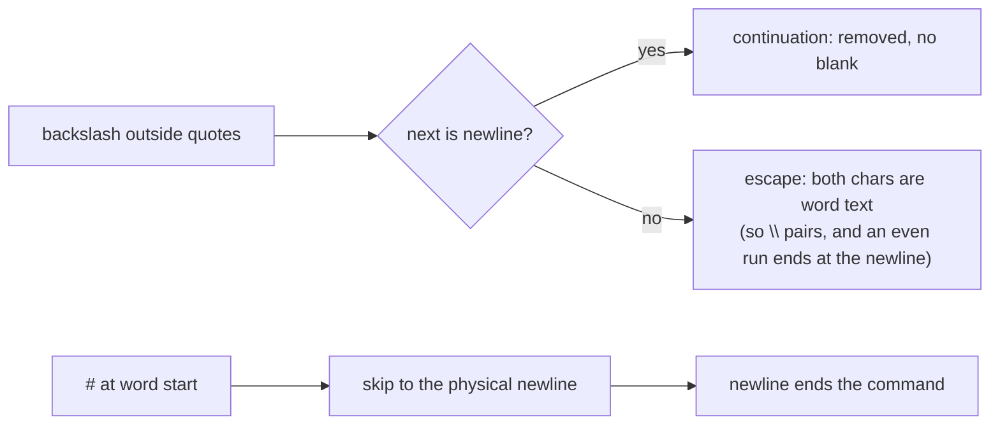

# PR Summary — Issue #5348

## Summary

`shellCommands` in `worker/deno/lib/shell_command_words.ts` used to replace
every backslash-newline with a space before tokenising. Two cases then hid a
line that Bash runs as its own command:

- a line ending in an even run of backslashes (`a \\` then `b`), which is not
  a continuation in Bash;
- a trailing comment ending in a backslash (`a # note \` then `b`), where Bash
  ends the comment at its physical newline (ShellCheck SC1143).

The pre-pass is gone. In the tokeniser a backslash now escapes the next
character. Only an odd run of backslashes before a newline continues the line,
and a `#` comment ends at its physical newline. `codeOf` in
`worker/deno/lib/aws_emulator_workflow_check.ts` no longer joins a line that
ends in a comment. `codeLines` refuses such a line with
`invalid comment continuation`, the marker it already uses for whole-line
comments. Closes #5348.

## Spec

### Intent and Rationale

- On the milestone head, the even-run case on the test step was already refused
  by the exact allowlist from #5350. The defect was still live in two places:
  - `workflowRunsAwsEmulator` (`aws_emulator_in_ci_check.ts`, through
    `reachableCommands`) credited `true \\` / `exit 0` /
    `aws-emulator-run -- ./t.sh` as wiring.
  - The trailing-comment shape passed `checkAwsEmulatorWorkflow` (test step)
    and `checkContainerBuildRunsAwsEmulator` (agent step).
- The issue offered two fixes. This PR takes the first one, Bash's own rule,
  in `shellCommands` and `codeOf`. `codeLines` takes the second (refuse the
  shape), because its callers compare against exact allowlists.

### Essential Design Decisions

- A backslash outside quotes escapes any next character, not only another
  backslash: counting a run of backslashes is the same rule. So `\"` and `\'`
  no longer open a quote, and `\;`, `\|`, `\&` and an escaped space are word
  text, as in Bash. Words still keep their raw text (`\\` stays two
  characters).
- A continuation is now removed with no blank inserted (`ab\` then `cd` is the
  word `abcd`), as Bash does and as `codeOf` already did. Inside double
  quotes, a backslash before a newline continues the line, and a backslash
  before `\`, `"`, `$` or a backtick escapes it. Inside single quotes,
  everything is literal.
- `quoteStateAfter` is renamed `scanLine`. It returns
  `{ open, comment }`, so `codeOf` and `codeLines` use the scan that already
  decides quoting to also find a trailing comment. When quoting is
  `"unknown"`, `codeOf` treats a `#` at the start of the line or after a blank
  or operator as a possible comment and does not join. That fails closed and
  leaves the decision to `shellCommands`.

### Undiscoverable Facts

- Observed with `deno run` on the milestone head (c8499bbab) before the fix:
  - `workflowRunsAwsEmulator` returned `true` for `true \\` / `exit 0` /
    runner and for `true # note \` / `exit 0` / runner, and `false` for plain
    `exit 0` / runner.
  - `checkAwsEmulatorWorkflow` returned `[]` with the test step body
    `set -euo pipefail # note \` / `exit 0` / script.
  - `checkContainerBuildRunsAwsEmulator` returned `[]` with
    `set -euo pipefail # note \` / `exit 0` before the agent `docker run`.

## Evidence

Backend/CLI change only, with no UI files. The tests drive
`shellSegments`, `workflowRunsAwsEmulator`, `checkAwsEmulatorWorkflow`,
`checkContainerBuildRunsAwsEmulator` and `checkQualityCallsAwsEmulator`.
The validator tests run against mutated copies of the real
`.github/workflows/aws-emulator.yml`, `container-build.yml` and `quality.yml`.

Issue numbers cited as provenance:

- #5304: aws_emulator_workflow_check: `codeOf` drops lines as comments that
  bash runs as commands
- #5350: aws-emulator.yml validator does not pin which test script the step
  runs (path suffix, working-directory, checkout inputs)
- #5353: aws_emulator_workflow_check: codeOf drops a # line that sits inside a
  multi-line quoted word
- #5348: this issue

## Test Plan

Every new test name ends in `(Issue #5348)`.

- `worker/deno/tests/aws_emulator_in_ci_check_test.ts`:
  - `shellSegments` cases with exact expected arrays:
    - an even run of backslashes is not a continuation;
    - an odd run continues the line;
    - three backslashes continue after an escaped pair;
    - a comment ends at its physical newline;
    - a CRLF continuation joins with no blank;
    - an escaped backslash at the end of a comment;
    - a double-quoted word spanning a continuation.
  - `workflowRunsAwsEmulator` tests. Each asserts `false` for a hidden
    `exit 0` (behind an escaped backslash, or behind a comment ending in a
    backslash), with a positive control in the same test that is credited.
- `worker/deno/tests/issue_5110_aws_emulator_workflow_test.ts`:
  - Test-step refusals for `# note \` then `exit 0`, `# note \` then
    `exec true`, and a bare `#\` then `exit 0`, each asserting the exact
    `[test-step] … must run only` finding.
  - An accept control: a comment without a backslash gives `[]`.
  - A container-agent refusal: exactly one `[container-agent-run]` finding.
  - A gate-script refusal: `[gate-script] … no gate step runs`.
- Red on base: I ran the two test files with the new tests before the fix.
  Result: `FAILED | 495 passed | 12 failed`. The 12 failures are:
  - six `shellSegments` cases;
  - both `workflowRunsAwsEmulator` tests;
  - the three test-step refusals;
  - the container-agent refusal.

  These pass on base:
  - the odd-run `shellSegments` case, which pins existing behaviour;
  - the accept control;
  - the gate-script case, because the exact gate allowlist already refused the
    joined line. It now reaches the same finding through
    `invalid comment continuation`.
- After the fix: `deno test -A tests/aws_emulator_in_ci_check_test.ts
  tests/issue_5110_aws_emulator_workflow_test.ts
  tests/aws_emulator_cloudformation_5110_test.ts
  tests/quality_gate_script_5110_test.ts` gave
  `ok | 534 passed | 0 failed | 1 ignored`. The ignored test is the
  root-sandbox case that already existed.
- Test files that import the dependent modules (`best_practices_template_test.ts`,
  `capability_coverage_scan_4367_test.ts`,
  `idle_task_scan_dedup_conformance_test.ts`) gave `ok | 173 passed | 0 failed`.
- `deno fmt --check`, `deno lint` and `deno check` on the changed files were
  clean.
- `./quality.sh < /dev/null` on the final code: `Result: PASSED (with skipped
  checks)` (config integration and checkov skipped by the gate itself).
- No existing test was edited or removed. The existing Issue #5304 escaped-
  backslash and comment-continuation tests still pass unchanged.
- Corpus: the real `aws-emulator.yml`, `quality.yml` and `container-build.yml`
  still give no findings (the existing "real … passes" tests).
- Docs: `docs/EC2-LINUX-VERIFICATION.md` (the `changes` filter paragraph) now
  says that a code line ending in a comment is refused when it ends in a
  backslash. The doc comments on `shellCommands`, `scanLine`, `codeOf`,
  `codeLines` and `stepRunsGateScript` are updated.

## What was not checked

- The unknown-quoting `#` fallback in `codeOf` has no test that tells the two
  outcomes apart. Every reader of `codeOf` today either compares against an
  exact allowlist or refuses any `|`, `;` or `&` in the text, so an extra line
  changes no finding. It is defence in depth.
- The install steps accept an extra command such as `exit 0` before the
  toolchain call even without any hiding. That is a separate gap, not
  changed here.
