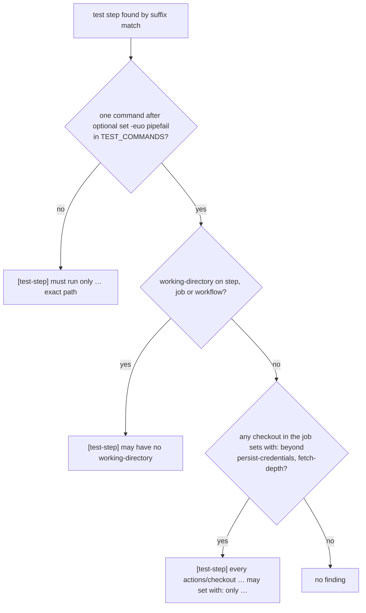

# PR Summary — Issue #5350

## Summary

`checkAwsEmulatorWorkflow` matched the test step by path suffix. It also did
not read the keys that decide which file a relative path names. Both
validators now pin those keys:

- **Exact command.** The test step runs, after an optional leading
  `set -euo pipefail`, exactly one command from `TEST_COMMANDS`: the script by
  its exact path (bare or `./`), alone or after `bash`/`sh`. `TEST_COMMANDS`
  and `GATE_COMMANDS` both come from one new helper, `exactCommands`.
- **No working directory.** `setsWorkingDirectory` now applies to the test step,
  its job and the workflow.
- **Plain checkouts.** Every `actions/checkout` in the test job, and in job
  `container` of `container-build.yml`, may set only `persist-credentials` and
  `fetch-depth` in `with:` (`CHECKOUT_WITH_KEYS`, through the new
  `checkoutWithIsPlain`, which `stepIsPlainCheckout` now also uses).
- **Docs.** `docs/EC2-LINUX-VERIFICATION.md` names these rules.

Closes #5350.

## Spec

### Intent and Rationale

- A suffix match accepted `./x/infra/cloudformation/test-aws-emulator.sh`.
  A working directory, or a checkout `ref`/`repository`/`path`, can also make
  the relative path name a look-alike. Any of these, plus a second artefact,
  could keep the required check green without running the repository's script.
- The gate step already used an exact allowlist, so the test step now uses
  the same builder instead of a second copy.

### Essential Design Decisions

- The test step is still *located* by the suffix match (`stepInvokes`), then
  held to the exact allowlist. A look-alike call therefore yields the precise
  `[test-step] … must run only …` finding rather than "no step runs".
- An inline assignment prefix (`FOO=true ./infra/…`, `BASH_ENV=… bash …`) is no
  longer accepted, because it is not an allowlisted command line. This reverses
  the #5304 acceptance of `FOO=\` continued into `true <script>`. A `bash \`
  continuation keeps that test's check that a real continuation is joined.
- The checkout rule covers every `actions/checkout` step in the job, not only
  the ones before the test step. That is simpler and fails closed.

### Undiscoverable Facts

- Triage on the issue (nleck, 2026-11-22) ordered #5316 first. This change
  builds on its `soleCommandAfterStrictMode` helper, already on the milestone
  branch.

## Evidence

Backend/CLI change only: no UI files.

Issue numbers cited as provenance in the diff:

- #5350: aws-emulator.yml validator does not pin which test script the step
  runs (path suffix, working-directory, checkout inputs)

## Test Plan

Tests added in `worker/deno/tests/issue_5110_aws_emulator_workflow_test.ts`,
all named `(Issue #5350)`. Each refusal asserts exactly one named finding.

- **Working directory.** Refused on the test step, on job `cloudformation`'s
  `defaults.run` and on the workflow's `defaults.run`. Control: a job
  `defaults.run.shell: bash` with no working-directory is accepted.
- **Exact call.** Refused: `./x/infra/…`, `/tmp/infra/…`, `bash ./x/infra/…` and
  `BASH_ENV=/tmp/x bash infra/…`. Controls accepted: `infra/…`, `./infra/…`,
  `bash ./infra/…` and `sh infra/…`.
- **Test job checkout.** Refused: `ref`, `repository` and `path`. Control:
  `fetch-depth: 0` is accepted.
- **Job `container` checkout** (`container-build.yml`). Refused: `ref`,
  `repository` and `path`, each mutating the checkout in job `container`, not
  `changes`. Control: `fetch-depth: 0` is accepted.

One existing test changed. `(a) accepts a real continuation from an assignment
into true <script> (Issue #5304)` is now `(a) refuses …`:

- **What changed.** The fixture `FOO=\` continued into `true <script>` is now a
  refusal. The issue asks to "hold the test step's command to an exact
  allowlist of command lines", and an assignment prefix is not one of those
  lines.
- **What still protects #5304's behaviour.** The new `(a) accepts a real
  continuation from bash into the script path (Issue #5304)` checks that a
  backslash continuation is joined into one command.
- **Unchanged.** The other #5304 refusals in the file keep their expectations.

Results:

- **Red on base.** I restored the base-branch
  `worker/deno/lib/aws_emulator_workflow_check.ts` and kept the new tests. All
  14 new and changed refusals failed and every control passed (247 passed,
  14 failed).
- **Green on head.** With the fixed validator: 261 passed, 0 failed
  (`deno test --allow-read tests/issue_5110_aws_emulator_workflow_test.ts`).
- **Static checks.** `deno fmt`, `deno lint` and `deno check` are clean on both
  changed TypeScript files. markdownlint is clean on the doc.
- **Other callers.** No other test file imports the validator.
- **Twinned rule.** `GATE_COMMANDS` and the new `TEST_COMMANDS` were the twin
  copies. Both are now built by `exactCommands`. I found no other copy.

`./quality.sh` did not finish:

- **First run.** Bounded at 600s, it was killed without printing a verdict.
- **Second run.** Bounded at 300s, every stage it reached passed: the
  chokepoint, hygiene and completeness checks, mermaid, markdownlint, semgrep,
  gitleaks and release-tag ruleset. Config integration and checkov were
  skipped. The run was cut off in the stage after release-tag ruleset (exit
  124).
- **Why not again.** With about 35 minutes left there was no runway for a
  longer run. The worker runs the gate again before the PR is raised.

<!-- vibe-quality-gate-skipped reason="./quality.sh did not finish within 600s or 300s bounds this run; every stage it reached passed; run budget could not cover a longer run" -->

Not checked: no live run of either workflow on GitHub Actions; the full
`./quality.sh` verdict (above).
