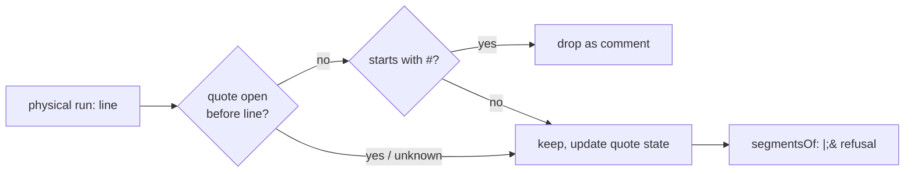

# PR Summary — Issue #5353

## Summary

`codeOf` and `codeLines` in `worker/deno/lib/aws_emulator_workflow_check.ts`
dropped every `run:` line starting with `#` as a comment, even inside a quoted
word opened on an earlier line. Bash reads such a line as part of that word, so
any operator after the closing quote is live. A new shared scanner,
`quoteStateAfter`, tracks quoting across physical lines. `codeOf` keeps a `#`
line while a quote is open, so `segmentsOf`'s `|`/`;`/`&` refusal sees the
operator. `codeLines` refuses any code line that leaves a quote open
(`["invalid open quote"]`). Closes #5353.

## Spec

### Intent and Rationale

- On the milestone head the test step was already refused, but only by the
  exact-command allowlist from #5350 (`must run only …`), not by
  `[test-step] no step runs`. The install steps match with `endsWith` and were
  open: `bash container/toolchains/aws-emulator.sh "` then `# " || true` left
  `[pinned-install]` passing while `|| true` swallowed the install's status.
- The issue offered two fixes. `codeOf` takes the first (track the quote and
  keep the line), because its other readers (`stepMayRetagImage` and the
  `GITHUB_ENV` writer check) match over its text, and keeping more text fails
  closed there. `codeLines` takes the second (fail closed), because its
  allowlists never contain a multi-line quoted word.

### Essential Design Decisions

- The scanner models `'…'`, `"…"`, `$'…'` (where `\'` does not close), backslash
  escapes, and `#` comments that start a word. It ignores quotes inside a
  comment, so an apostrophe in `# don't` opens nothing.
- Quoting it does not model returns the sticky state `"unknown"`, and callers
  treat it as open: a backtick, `$(` inside `"…"`, a `${…}` with nested quotes
  inside `"…"`, or a here-document (`<<` but not `<<<`). This can only
  over-refuse; it never drops a line Bash might read as code.
- `codeLines` keeps its existing checks first (comment skip, non-ASCII refusal,
  mid-line backslash refusal), so the scanner only ever sees ASCII lines that
  start outside quotes.

### Undiscoverable Facts

- Observed with the real Bash (`bash -e step.sh`): a body of `./fail.sh "` /
  `# " || true` / `echo reached` (where `fail.sh` exits 1) prints `reached` and
  exits 0. The `$'a\'` / `# ' || true` variant behaves the same way. So the
  evasion does turn a failing step green.

## Evidence

Backend/CLI change only, with no UI files. The new tests in
`worker/deno/tests/issue_5110_aws_emulator_workflow_test.ts` drive
`checkAwsEmulatorWorkflow` and `checkQualityCallsAwsEmulator` against mutated
copies of the real `.github/workflows/aws-emulator.yml` and `quality.yml`.

Issue numbers cited as provenance:

- #5304: aws_emulator_workflow_check: `codeOf` drops lines as comments that bash
  runs as commands
- #5350: aws-emulator.yml validator does not pin which test script the step runs
  (path suffix, working-directory, checkout inputs)
- #5353: this issue

## Test Plan

New tests in `worker/deno/tests/issue_5110_aws_emulator_workflow_test.ts`, all
suffixed `(Issue #5353)`:

- Refusals (aws-emulator.yml), each asserting the exact findings:
  - test step, with the quoted word in double quotes, single quotes, `$'a\'`, or
    `"a\"` → `[test-step] no step runs`;
  - pinned install → `[pinned-install] no step runs` and
    `[runner-install] no step installs`, because the open quote also swallows
    the runner line in the same step;
  - pinned aws-cli install → `[pinned-cli] no step runs`;
  - runner install → `[pinned-install]` and `[runner-install]`, since it shares
    the pinned install's step.
- Refusal (quality.yml):
  `(gate-script) refuses a gate line whose open quote
  hides a # line` →
  `[gate-script] … no gate step runs`.
- Accept controls (each `[]`): comment lines holding apostrophes before the
  script, an apostrophe in a trailing comment before a comment line, a closed
  `"it's installed"` before a comment line, and a closed
  `"${GITHUB_WORKSPACE}/…"` step followed by a comment line.
- Red on base: I restored the base copy of
  `worker/deno/lib/aws_emulator_workflow_check.ts`, kept the new tests and ran
  `deno test -A tests/issue_5110_aws_emulator_workflow_test.ts`. Result:
  `FAILED | 266 passed | 7 failed`. The 7 are the four test-step cases (they got
  the `must run only` finding instead of `no step runs`), the pinned install
  (only `[runner-install]`), and the pinned aws-cli and runner installs (both
  `[]`). The gate case and the four accept controls pass on base. The gate case
  only pins current behaviour, because the exact gate-script allowlist already
  refused it.
- Edited helper: `mutateText` now calls `text.replace(from, () => to)`. A string
  replacement expands `$'`, which silently turned the `$'a\'` case into other
  text. No existing replacement contains a `$` pattern, so no existing test
  changes meaning. No existing assertion was removed or changed.
- After the fix:
  `deno test -A tests/issue_5110_aws_emulator_workflow_test.ts
  tests/aws_emulator_cloudformation_5110_test.ts`
  gave `ok | 290 passed | 0 failed | 1 ignored`. The ignored test is the
  environment-gated case that already existed.
- `./quality.sh < /dev/null` on the final code:
  `Result: PASSED (with skipped
  checks)` (config integration and checkov
  skipped by the gate itself).
- Docs: `docs/EC2-LINUX-VERIFICATION.md` (the `changes` filter paragraph) now
  says that a quoted word left open at the end of a code line is refused. The
  doc comments on the module header (a), `isCommentLine`, `codeOf`, `codeLines`
  and `stepRunsGateScript` are updated. Corpus: the real `aws-emulator.yml`,
  `quality.yml` and `container-build.yml` still give no findings (the "real …
  passes" tests).

## What was not checked

- `$(` outside double quotes is not modelled specially. Its inner quotes are
  tracked as ordinary quotes, which matches Bash for the shapes tested, but more
  exotic nesting was not exercised.
