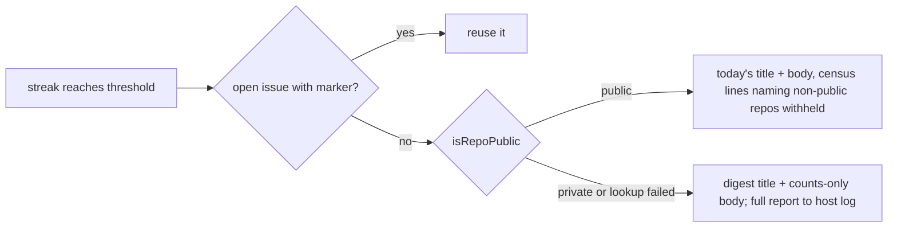

# PR Summary — Issue #5354

## Summary

A private fleet repository is no longer named on the public idle-inversion
issue. When the subject repository is not positively public, the filer now
titles the issue with a stable 12-hex SHA-256 digest and posts a body with only
the counts and generic guidance. The real `owner/repo` stays only in the
unrendered `<!-- VIBE_IDLE_INVERSION:owner/repo -->` dedup marker. A public
subject keeps today's title, but its body now drops any census line that names a
repository not positively public. The idle-starvation escalation body drops
those census lines too. The gate-wedge filer was already private-safe on `main`
(#4780). This PR only moves its digest into the shared `privateRepoDigest`
helper, with the same input and output. Closes #5354.

## Spec

### Intent and Rationale

- VibeCoder is public, so nothing it files may name a private fleet repository.
  Both idle filers now read visibility through `isRepoPublic`
  (`worker/deno/lib/repo_visibility.ts`), the helper #4780 uses. A failed lookup
  counts as private.
- A public subject's census `detail` can list other, private repositories.
  Production builds it as census lines that contain the subject
  (`worker/deno/lib/run_core_production_deps.ts:6888`), and those include
  `ALERT inversion repos=a,b,c`. So the public body runs the detail through the
  same `withholdPrivateCensusLines` filter as the starvation census.

### Essential Design Decisions

- Dedup markers are unchanged. The idle-inversion marker search runs before the
  visibility lookup, so an open issue filed under the old raw title is reused
  rather than filed again.
- The visibility lookup runs only on the path that files a new issue, so a
  healthy cycle, or one with an issue already open, makes no extra `gh api`
  call.
- The withholding filter fails closed: any `/` token that is not exactly
  `owner/name`, or whose lookup fails, withholds its line. The host log keeps
  every original line.
- The issue asks for the real name to stay only in the HTML marker. The marker
  is unrendered but readable through the API. This follows the issue as written:
  the dedup search depends on that marker.

### Undiscoverable Facts

- `gh issue list --state open --search 'in:title "Milestone sync gate cannot verify"'`
  and the same search for `idle-inversion` returned no open diagnostic other
  than #5354 itself (run on 2026-11-22). So no open issue needs reconciling
  under a changed title.
- The gate-wedge filer dedupes by exact title, not by a marker
  (`findFleetAuthoredIssuesTitled` in
  `worker/deno/lib/milestone_gate_wedge.ts`). Its titles are byte-identical
  before and after this PR.
- I checked the other filers that put `${repo}` in a title.
  `run_failure_issue.ts` and `merge_fallback_issue.ts` already gate on
  visibility. `repo_fast_failure_issue.ts` (`resolveRepoFastFailureTarget`
  returns the repo itself) and `milestone_branch_self_heal.ts` (`--repo repo`)
  file in the subject repository, not here.

## Evidence

Backend-only change; no UI file is touched. The tests under Test Plan verify it.

Issue numbers this diff adds as provenance:

- #5354: Gate-wedge and idle-inversion filers put a private repository's name in
  the public issue title
- #4780: Milestone gate-wedge diagnostics publish a private fleet repo's name,
  milestone titles, file paths and tool output in the public VibeCoder repo:
  #4318's visibility check never reached milestone_gate_wedge.ts (#4733, #4761)

Docs updated: `docs/IDLE-TASK-FRAMEWORK.md`, in the idle-inversion escalation
section (the #5354 paragraph, plus the "body names the issues the census
counted" sentence, now scoped to a public subject) and the idle-starvation alert
section (census lines withheld). `docs/audits/lib-sweep-coverage.json` registers
the new module.

## Acceptance Criteria

<!-- vibe-spec-review inputs="diff+issue-body" -->

- **met** — Neither filer puts a private repository's name or milestone branch
  in an issue title or rendered body. — evidence:
  `worker/deno/tests/idle_inversion_streak_test.ts::#5354 - a private subject is filed under an opaque title and body`,
  `worker/deno/tests/milestone_gate_wedge_test.ts::reportGateWedge - a private repository files the opaque title and body, and nothing identifying reaches GitHub (Issue #4780)`
  — reviewer: met
- **met** — Public repositories keep today's titles. — evidence:
  `worker/deno/tests/idle_inversion_streak_test.ts::#459 - the title and body still name a public subject repo`,
  `worker/deno/tests/milestone_gate_wedge_test.ts::reportGateWedge - a public repository keeps the full public form (Issue #4780)`
  — reviewer: met
- **met** — Existing open diagnostics still dedupe through their markers. —
  evidence:
  `worker/deno/tests/idle_inversion_streak_test.ts::#5354 - an open fleet-authored issue for a private subject is reused, not duplicated`
  — reviewer: met
- **met** — `deno task test:unit` and `./quality.sh` pass. — evidence:
  `./quality.sh` run on the final head (see Test Plan) — reviewer: missing —
  reason: the reviewer was read-only and could not run the gate; it was run
  here, and its result is recorded under Test Plan
- **unrequested** — idle-starvation body withholds census lines naming a
  non-public repository (`withholdPrivateCensusLines`) — reviewer: unrequested —
  reason: traceable to the issue's suggestion to grep other filers that format a
  repo into a public body and fix any that leak
- **unrequested** — shared `privateRepoDigest` in
  `worker/deno/lib/private_repo_pseudonym.ts`, with the gate-wedge title moved
  onto it — reviewer: unrequested — reason: both filers need the same digest;
  the output is unchanged and pinned by the existing #4780 digest test
- **unrequested** — idle-inversion body paragraphs extracted into shared
  constants — reviewer: unrequested — reason: the public and private bodies
  share them, so they cannot drift; the public text is unchanged
- **unrequested** — `docs/IDLE-TASK-FRAMEWORK.md` additions — reviewer:
  unrequested — reason: a code change owes a docs change

## Standards Review

<!-- vibe-standards-review inputs="diff+CODING-STANDARDS.md" -->

- **violation** — a public subject's body rendered census `detail` naming other,
  private repositories, against the module's "never named" claim — evidence:
  `worker/deno/lib/idle_inversion_streak.ts` — reason: fixed in this diff; the
  public body now withholds those lines, and the test
  `#5354 - a public subject's body withholds census lines naming a private repo`
  failed before the fix and passes after it
- **violation** — the private body carries the real `owner/repo` in the
  unrendered marker — evidence: `worker/deno/lib/idle_inversion_streak.ts` —
  reason: required by #5354, which asks to "keep the real name only in the HTML
  dedup marker"; dedup depends on it
- **violation** — an unedited doc sentence ("The body now names the issues the
  census counted") was false for a private subject — evidence:
  `docs/IDLE-TASK-FRAMEWORK.md` — reason: fixed in this diff; now scoped to a
  public subject
- **violation** — `formatCensus` doc claimed "the reader sees every public
  repo's line" — evidence: `worker/deno/lib/idle_starvation_escalation.ts` —
  reason: fixed in this diff; reworded to name the failed-lookup, mixed-line and
  40-line-cap cases
- **clean** — no dummy or "how" tests; edited existing tests still go red
  without their code; fail-closed lookups; secret redaction on the host log
  path; regexes linear; DRY digest and body paragraphs; no test-only exports;
  Australian English

## Test Plan

- New tests in `worker/deno/tests/idle_inversion_streak_test.ts`, each driving
  `recordIdleInversion` through a fake `gh` that answers the
  `gh api repos/<repo> --jq .visibility` lookup:
  - private subject gets an opaque title and body;
  - a failed lookup is treated as private;
  - an open marker issue is reused;
  - the digest is stable and distinct per subject;
  - the attestation records the posted opaque title and body;
  - a public subject's body withholds a census line naming a private repo. This
    test failed before the production change and passes after it.
- New `worker/deno/tests/idle_starvation_private_census_5354_test.ts` covers
  `withholdPrivateCensusLines`: a private repo's line is withheld, a failed
  lookup withholds, a line with no repo is kept with no lookup, all-public lines
  are unchanged, no lookup runs below threshold, and a quoted public repo is
  kept (look-alike control).
- Edited existing tests:
  - `#459 - the title and body still name a public subject repo` now routes a
    public visibility answer, keeps every earlier assertion, and adds an exact
    public-title assertion.
  - The fakes in `worker/deno/tests/idle_starvation_escalation_1052_test.ts` and
    `worker/deno/tests/idle_starvation_week_pace_1915_test.ts` now answer the
    visibility lookup with `public`. No assertion was removed; they still assert
    the census line is posted and an issue is filed.
- The gate-wedge private and public titles are covered by the existing #4780
  tests in `worker/deno/tests/milestone_gate_wedge_test.ts`. The digest test
  there pins the `privateRepoDigest` refactor.
- Targeted run on the final head:
  `deno test -A tests/idle_inversion_streak_test.ts tests/idle_starvation_private_census_5354_test.ts tests/idle_starvation_escalation_1052_test.ts tests/idle_starvation_week_pace_1915_test.ts tests/lib_sweep_coverage_test.ts tests/alert_dedup_author_verification_test.ts`
  gave 131 passed, 0 failed. `deno task check:manifests` passed.
- `./quality.sh < /dev/null` on the final code:
  `Result: PASSED (with skipped
  checks)`. Every check passed, including deno
  tests, completeness checks, semgrep and markdownlint. Two were skipped: config
  integration (no `.config.json` here) and checkov (not installed). An earlier
  run failed only because the new module was not registered in a sweep slice
  (`lib_sweep_coverage_test.ts`); that is fixed in this diff.
- `deno task pr-summary-check`: 0 gates blocked, 0 not checked.

Not done or not checked: checkov and config integration (skipped by the gate, as
above). `docs/IDLE-TASK-FRAMEWORK.md` was not reflowed with `deno fmt`;
markdownlint passed on it.
