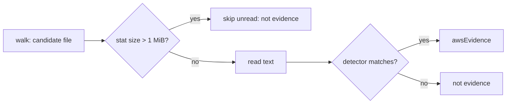

# PR Summary — Issue #5360

## Summary

`checkAwsEmulatorInCI`'s repository walk read every `Cargo.toml`,
`package.json`, `pom.xml`, `requirements*.txt` and `*.yml`/`*.yaml`/`*.json`
file whole, with no size limit. `checkFile` now passes the module's 1 MiB cap
(`MAX_SCRIPT_BYTES`) to `readFileOrSkip` for these reads too, as the `.tf` read
already did. A larger file is skipped unread and is not AWS evidence.
`readFileOrSkip`'s `maxBytes` is now required, since every caller passes one.
Closes #5360.

## Spec

### Intent and Rationale

- A very large tracked data or fixture file could make the read throw (the
  runtime string limit), which failed the best-practices scan for that
  repository on every schedule. Checking the size before reading removes both
  that failure and the memory cost.

### Essential Design Decisions

- The cap is the same 1 MiB already used for scripts and `.tf` files, so there
  is one limit to keep in step. It sits above CloudFormation's own 1 MB
  template maximum, so no deployable template is skipped.
- An oversized candidate is skipped quietly, not reported, as the issue asks
  and as the `.tf` path does. The accepted trade-off: an AWS manifest over
  1 MiB would not trigger the check. No real `package.json`, `Cargo.toml`,
  `pom.xml` or `requirements*.txt` is that large.
- A file of exactly 1 MiB is still read (`size > maxBytes` skips).

### Undiscoverable Facts

None.

## Evidence

Backend-only change: no UI files are touched.

- `worker/deno/tests/aws_emulator_in_ci_check_test.ts::checkAwsEmulatorInCI - a manifest or CloudFormation candidate over the 1 MiB cap is not read, so it is not evidence; one at the cap still is (Issue #5360)`
  covers all six kinds (package.json, Cargo.toml, pom.xml, requirements.txt,
  a CloudFormation `.yaml` and `.json`). Each kind has three files that would
  all count as evidence if read: one at 1 MiB + 1 byte, one at exactly 1 MiB,
  and a small one. The test asserts the exact sizes and that `awsEvidence`
  lists only the at-cap and small files.
- Docs: `docs/BEST-PRACTICES-SCAN.md`, section "AWS emulator in CI
  (`BP-AWS-EMULATOR-MISSING`)", **Trigger.** paragraph (read through), now
  states the 1 MiB per-file cap. The doc comments on `MAX_SCRIPT_BYTES` and
  `readFileOrSkip` are updated to match.

## Test Plan

- Red on base: the new test failed against the unfixed lib. All six oversized
  paths appeared in `awsEvidence`.
- Green after the fix: `deno test -A tests/aws_emulator_in_ci_check_test.ts`
  (from `worker/deno`) passed 259 tests, 0 failed.
- The `.tf` read's existing cap test still passes and still guards that path.
- No existing test was edited.
- Also passed: `best_practices_verbose_gate_test.ts`,
  `best_practices_cost_speed_reliability_test.ts` and
  `markdown_anchors_test.ts` (57 tests), which read the edited doc.
- `./quality.sh` passed on the head. Its config-integration and checkov checks
  were skipped by the gate itself.

## What was not checked

- No test reads a file larger than the runtime's string limit. The fix is the
  size check before the read, and the 1 MiB + 1 byte file exercises it.
- `loadWorkflows` (`worker/deno/lib/linter_in_ci_check.ts`) still reads each
  `.github/workflows/*` file whole for the wiring check, after the walk. That
  read is outside this issue and was not changed.
