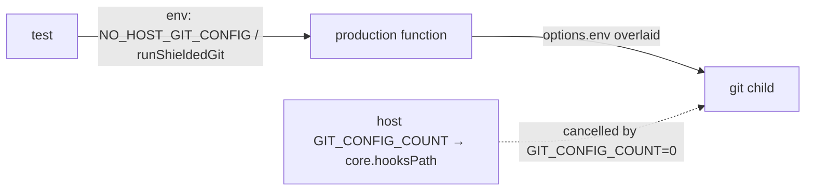

## Summary

Tests that drive production code which runs `git push` or `git commit` now hand that code the shared `NO_HOST_GIT_CONFIG` shield. A host `core.hooksPath` injected through `GIT_CONFIG_COUNT`, and the host's global and system config, no longer reach those pushes and commits. Where a production entry point had no way to take an environment, this PR adds an optional one. Closes #5371.

## Spec

### Intent and Rationale

- `runGitCommand` overlays only `options.env` on the inherited environment, so a test that called production code without an `env` ran the host's hooks. Passing the existing shield through the existing `GitCommandOptions` or `runGit` seam fixes this at each call site and leaves production defaults alone.
- The issue listed `pushUnpushedCommits`, `commitAndPushPending`, `syncMilestoneBranchWithDefault`, `pushFeatureBranch`, `updatePrBranch` and `claimMilestoneSync`. A sweep with a refusing hook injected found ten more test files leaking through other production paths, and they are fixed here too.

### Essential Design Decisions

- Existing seams come first. Only five entry points that had no env path gain one: `IssueRunPresyncArgs.env`, `GitDeps.formatterDeps`, `PullLearningsOptions`/`PushLearningsOptions.gitEnv`, `ResolveTokenEconomizerLaunchOptions.learningsGitEnv` (carried as `learnings.gitEnv`), and the `git-operations` command's `env` argument. Production leaves each unset, so its behaviour is unchanged. They exist because the issue says "Add an `env` option to the production functions that lack one".
- `mod.ts` `parseArgs` JSON-parses flag values, so `--env '{…}'` could reach `git-operations` as an object. That argument therefore accepts only `GIT_CONFIG_COUNT`, `GIT_CONFIG_GLOBAL` and `GIT_CONFIG_NOSYSTEM`, each with a string value. Anything else is refused before any git runs. This is no wider than the existing `--cwd`, which can already point git at a repository with its own config.
- New `runShieldedGit` in `worker/deno/tests/support/no_host_git_config.ts` overlays only the env shield. Tests that inject a production `runGit` seam use it instead of `runFixtureGit`, whose `-c core.hooksPath=/dev/null` prefix would change the argv production builds (for example, `runGitCommand` skips push-audit capture when `args[0]` is `-c`).
- Wrappers spread the shield last over the caller's env (`{ ...options.env, ...NO_HOST_GIT_CONFIG }`), so an injected `GIT_CONFIG_COUNT` cannot win.

### Undiscoverable Facts

- `deno task test:unit` strips `GIT_CONFIG_*` before the tests start, so the leak only shows under plain `deno test` with the variables set (stated in the issue, and the reason every check below uses plain `deno test`).
- Two `shellcheck_publication_test.ts` cases fail in this sandbox under plain `deno test` with or without the hook, because `https://jsr.io/@std/yaml/meta.json` cannot be downloaded. They fail the same way on the base branch and are unrelated to this change.

## Evidence

Backend and test-only change, with no UI files. Verification used a refusing hook: `pre-push` and `pre-commit` scripts that print a marker and `exit 1`, injected with `GIT_CONFIG_COUNT=1 GIT_CONFIG_KEY_0=core.hooksPath GIT_CONFIG_VALUE_0=<dir>` under plain `deno test --allow-read --allow-env --allow-run --allow-write --allow-sys=hostname`.

| Run | Files | Result |
| --- | --- | --- |
| Base branch (`milestone/test-git-isolation`), hook injected | 34 test files that call the issue's named functions | 289 passed, 76 failed (74 from the hook, plus the 2 JSR ones) |
| Earlier head of this branch, hook injected (these files were untouched at that point, so the run matches base) | 93 other test files that build a bare remote or push | 2692 passed, 24 failed. With no hook, the 10 files behind those failures pass 177/177, so all 24 came from the hook |
| Final head, hook injected | all 127 files above | 3085 passed, 2 failed (the 2 JSR ones only). The hook's marker appears 0 times in the output |

Issue numbers this diff cites: #5371 (this issue), #5309 (shield for fixture git calls, already cited in the support module).

## Test Plan

- Added `worker/deno/tests/git_push_test.ts::pushUnpushedCommits - honours the caller's env, so the shield cancels an injected pre-push hook (Issue #5371)`. A host-like env makes the injected hook refuse the push and asserts its marker. The same push with the shield spread last succeeds, and the remote tip matches HEAD.
- Added `worker/deno/tests/milestone_branch_ensure_test.ts::git operations command - ensure-milestone-branch refuses an env that widens the git shield (Issue #5371)` and `::git operations command - ensure-milestone-branch refuses a non-string env value (Issue #5371)`. Each asserts that the refused key is named and that no branch is created on the remote. The existing shielded `ensure-milestone-branch recreates a missing branch` test is the allowed control.
- Edited 40 more existing test files under `worker/deno/tests/`. Each edit adds the shield to the options or seam passed to production code, or wraps an injected dependency with it. No assertion was removed or changed, and each test still covers the behaviour it covered before. The new precondition (no global git config) is met by repo-level identity in every fixture that commits. The final hook-injected run shows no test stopped short.
- `./quality.sh < /dev/null` was run on the final head: PASSED, with config integration and checkov skipped by the gate itself.
