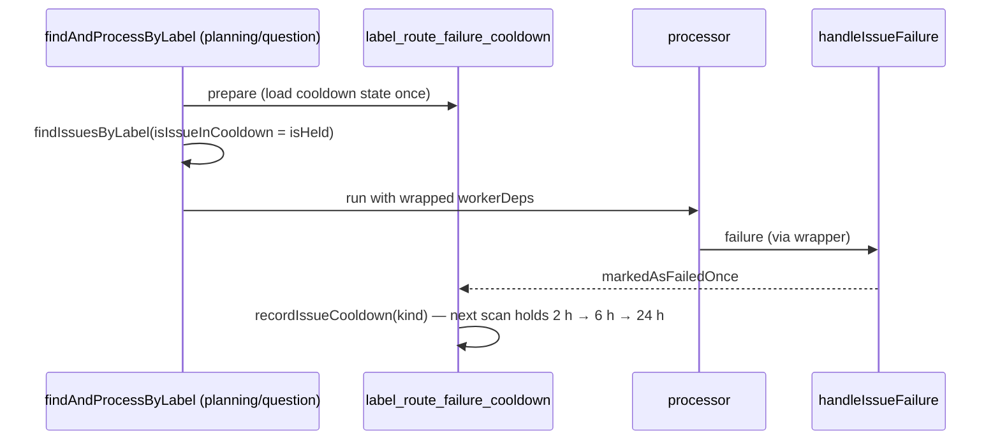

# PR Summary — Issue #5376

## Summary

Planning and question failures now record and honour the escalating re-claim
cooldown (2 h → 6 h → 24 h) that their failure comment already promises.
`findAndProcessByLabel` opts these two routes into a new `failureCooldown` mode.
In that mode `handleIssueFailure` is wrapped so a posted failure record also
records a ladder cooldown entry, and the label scan skips an issue while that
entry holds. Before this change a planning issue that kept failing was re-run
every cycle. The claim scan's run-local hold now holds an issue only for its
entry's own window (the base cooldown for a skip, the ladder for a recorded
failure). It used to hold for as long as any entry existed, which was up to 48 h
for a failure. That hold is shared by the coding claim scan, the gated
custom-label scan and idle detection. The stale `handlePlanningFailure` doc
comment ("failed-once/failed progression") is corrected, and the docs that said
"the planning path records no cooldown" now describe the new behaviour. Closes
#5376.

## Spec

### Intent and Rationale

- The triage decision chose the first option: keep the comment text and make the
  routes match it, because each repeated planning run costs a full agent run on
  an unattended host.
- The cooldown is recorded by wrapping `WorkerDeps.github.handleIssueFailure`
  inside the route, not at `!processed`. Processors return `ok: false` for
  declines too (a lost claim race), and those must not cost a 2 h hold.

### Essential Design Decisions

- A cooldown is recorded only when a failure record was posted
  (`markedAsFailedOnce`), when `handleIssueFailure` fails, or when it throws.
  Non-fault outcomes (scheduled release, token scope, host disk, clone
  corruption, repo config) post no record and record nothing. A timeout records
  kind `timeout`, and anything else records `non_transient`, as the coding
  ladder does. The cooldown is therefore recorded for an infrastructure-category
  planning failure too, because that failure posts the same 2 h comment.
- The label-route hold reads only the escalating (kinded) entries
  (`isHeldByCooldown(..., { escalatingOnly: true })`). A flat 600 s entry left
  by a coding-route skip does not delay a fresh planning hand-off, and nor does
  this process's processed-issue registry.
- The hold uses the same `cooldownConfig` (factory `workDir`) the writer uses.
  `isIssueInCooldown` now delegates to the extracted sync `isHeldByCooldown` and
  behaves exactly as before.
- Only planning and question opt in. Refinement, grill-me and quorum never call
  `handleIssueFailure`, and the gated custom route keeps its own hold.
- `loadRunLocalHolds` now asks the new `isHeldByAnyCooldown`, not "does any
  entry exist". That function holds the latest entry's window, or the ladder
  window of the latest recorded failure when a flat entry landed after it.
  Without this change a planning or question failure that was relabelled (for
  example to `work-on`) would be held off the claim scan for the 48 h history
  window. The coding path's own failures also now get the 2 h → 6 h → 24 h their
  comment states, not 48 h.
- Two test seams on `ProductionDepsOptions`: `labelRouteGhCommandFn` (the label
  scan and `fetchIssueData`) and `labelRouteGitHubClient` (the processors'
  client). Production leaves both unset and keeps `runGhCommand` and
  `createGitHubClient(logger)`.

### Undiscoverable Facts

- `loadState` keeps kinded entries for the 48 h escalation window, and
  `loadRunLocalHolds` used to build its hold from every loaded entry. Any kinded
  entry, including the ones this change makes the label routes write, therefore
  held the issue off the claim scan for up to 48 h. This change fixes that.
- The factory rebinds `workerDeps.crashHandling` to the real heartbeat marker
  path. The wiring test restores the mock's local-only functions after
  construction, so no real `gh` is spawned.

## Evidence

Backend-only change, with no UI files. These tests verify it:

- `worker/deno/tests/label_route_failure_cooldown_wiring_5376_test.ts::production deps - a failed planning run posts the 2 h promise and is not re-run on the next scan (Issue #5376)`
  calls the real `deps.findAndProcessPlanning()` twice, with one `planning`
  issue and a Claude dep that always fails. The first call must post a comment
  containing "once its cooldown ends (2 h, rising to 24 h after repeated
  failures)". The second call must return `processed: false` without running the
  agent again.
- `…::production deps - a failed question run is not re-run on the next scan (Issue #5376)`
  does the same through `deps.findAndProcessQuestion()`.
- Red check, run here: with both opt-in `true` arguments changed to `false`,
  both tests fail with "the second scan re-ran the agent on an issue in its
  cooldown". With the change restored, both pass.
- `…::production deps - a planning failure past its 2 h window no longer holds the claim scan (Issue #5376)`
  seeds a 3 h-old `non_transient` entry and reads the claim scan's run-local
  hold through the production census. It expects `run_local_hold=0` and
  `low_priority=1`. The control test seeds a 1 h-old entry and expects
  `run_local_hold=1`.
- Red check, run here: with `loadRunLocalHolds` changed back to the any-entry
  set, the past-window test fails and the control still passes.

- `worker/deno/tests/label_route_failure_cooldown_test.ts::a failed planning run posts the 2 h record and holds the issue off the next scan`
  drives the real `processIssuePlanning`, with a Claude failure and the real
  `handleIssueFailure` over a fake `gh`. It asserts that the posted comment
  contains "once its cooldown ends (2 h, rising to 24 h after repeated
  failures)". It also asserts that a fresh prepare (the next scan) holds issue
  100 and not issue 101, and that the issue was not held before the run.
- `…::a failed question run holds the issue off the next scan` covers the same
  path through the real `processIssueQuestion`.
- `…::a second failure steps the ladder` checks for two kinded entries.
- `…::a non-fault result records nothing` covers the `scheduled_release` case.
- `…::a timeout records kind timeout; a throw records non_transient and rethrows`
- `…::a failed cooldown write is logged, not thrown`
- `…::a flat entry does not hold the issue on the label route`
- `worker/deno/tests/cooldown_state_test.ts` gains four `isHeldByCooldown`
  tests:
  - a single failure holds for 2 h and not beyond;
  - a second failure moves to the 6 h window;
  - a flat entry holds by default but not when `escalatingOnly` is set;
  - another issue's entry never holds this one.
- `worker/deno/tests/cooldown_state_test.ts` also gains three
  `isHeldByAnyCooldown` tests:
  - a failure past its 2 h window no longer holds, and one inside it does;
  - a later flat entry does not shorten a failure's ladder window;
  - a fresh flat entry holds for the base cooldown only.

Cited issues: #5376 (this issue); #1949: Ordinary coding-run failures never
reach the failed-once/failed ladder: a non-timeout failure gets a flat 10-minute
cooldown and is re-claimed every cycle for ever; #4158: Never park an assigned
issue: drop the terminal `failed` label and the repeated-failure needs-human
hand-off.

Docs updated: `docs/workflows/label-flows.md` (the `failed-once` row and short
card), `docs/workflows/planning-and-questions.md` (the loud-failure paragraph
and diagram, and question timeout item 2), `docs/INTERNALS.md` (a module table
row), and `docs/IDLE-TASK-FRAMEWORK.md` (the run-local hold paragraph now says
each entry holds only for its own window). The doc comments in
`find_issues_by_label.ts`, `planning_processor.ts`, `question_processor.ts` and
`run_core_production_deps.ts` were updated too. The module is registered in
`docs/audits/lib-sweep-coverage/top-up-5376.json`.

## Test Plan

- New: `worker/deno/tests/label_route_failure_cooldown_test.ts`, with 7 tests.
- New: `worker/deno/tests/label_route_failure_cooldown_wiring_5376_test.ts`,
  with 4 tests.
- Extended: `worker/deno/tests/cooldown_state_test.ts`, with 7 tests added and
  no existing assertion changed or removed.
- No existing test was edited.
- On this head, `deno task test:unit` passed in two runs, 0 failed in each:
  - 632 tests: the cooldown, label-route, `find_issues_by_label`, custom-label,
    census, idle-detect, lib-sweep and `run_core_production_deps` test files.
  - 640 tests: every `run_core_*` test file, plus the coding-ladder, idle-task
    end-to-end, issue-worker wiring, circuit-breaker, state-load and
    slot-accounting test files.
- `deno fmt`, `deno lint` and `deno check` pass on the changed files.
- `./quality.sh` passed on the previous head. It was not re-run here, and the
  worker re-runs it on this head.
- Guards on the new path: the cooldown is recorded after the original
  `handleIssueFailure` runs, so every label, comment and non-fault early return
  in it still applies. Claim release and the run-stats comment in the processors
  are unchanged.
- The `createProductionRunCoreDeps` wiring is now driven end to end through the
  `labelRouteGhCommandFn` and `labelRouteGitHubClient` seams (see Evidence).
