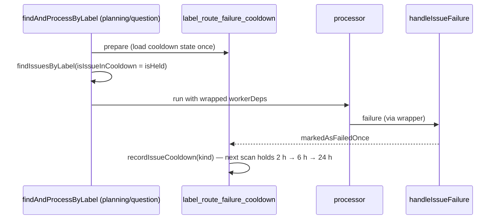

# PR Summary — Issue #5376

## Summary

Planning and question failures now record and honour the escalating re-claim
cooldown (2 h → 6 h → 24 h) that their failure comment already promises.
`findAndProcessByLabel` opts these two routes into a new `failureCooldown`
mode. In that mode `handleIssueFailure` is wrapped so a posted failure record
also records a ladder cooldown entry, and the label scan skips an issue while
that entry holds. Before this change a planning issue that kept failing was
re-run every cycle. The stale `handlePlanningFailure` doc comment ("failed-once/failed
progression") is corrected, and the docs that said "the planning path records
no cooldown" now describe the new behaviour. Closes #5376.

## Spec

### Intent and Rationale

- The triage decision chose the first option: keep the comment text and make
  the routes match it, because each repeated planning run costs a full agent
  run on an unattended host.
- The cooldown is recorded by wrapping `WorkerDeps.github.handleIssueFailure`
  inside the route, not at `!processed`. Processors return `ok: false` for
  declines too (a lost claim race), and those must not cost a 2 h hold.

### Essential Design Decisions

- A cooldown is recorded only when a failure record was posted
  (`markedAsFailedOnce`), when `handleIssueFailure` fails, or when it throws.
  Non-fault outcomes (scheduled release, token scope, host disk, clone
  corruption, repo config) post no record and record nothing. A timeout records
  kind `timeout`, and anything else records `non_transient`, as the coding
  ladder does. The cooldown is therefore recorded for an infrastructure-category
  planning failure too, because that failure posts the same 2 h comment.
- The label-route hold reads only the escalating (kinded) entries
  (`isHeldByCooldown(..., { escalatingOnly: true })`). A flat 600 s entry left
  by a coding-route skip does not delay a fresh planning hand-off, and nor does
  this process's processed-issue registry.
- The hold uses the same `cooldownConfig` (factory `workDir`) the writer uses.
  `isIssueInCooldown` now delegates to the extracted sync `isHeldByCooldown`
  and behaves exactly as before.
- Only planning and question opt in. Refinement, grill-me and quorum never call
  `handleIssueFailure`, and the gated custom route keeps its own hold.

### Undiscoverable Facts

- Finding, outside this issue's scope and not changed here: on the coding path
  the claim scan's `loadRunLocalHolds` holds an issue for as long as any entry
  of it exists. `loadState` keeps kinded entries for the 48 h escalation
  window, so a coding failure is held for up to 48 h, longer than the 2 h the
  comment states.
- The previous run was parked by the host-disk guard after its code commit. This
  run added the sweep-ledger registration that the gate asked for, plus this
  summary.

## Evidence

Backend-only change, with no UI files. These tests verify it:

- `worker/deno/tests/label_route_failure_cooldown_test.ts::a failed planning run posts the 2 h record and holds the issue off the next scan`
  drives the real `processIssuePlanning`, with a Claude failure and the real
  `handleIssueFailure` over a fake `gh`. It asserts that the posted comment
  contains "once its cooldown ends (2 h, rising to 24 h after repeated
  failures)". It also asserts that a fresh prepare (the next scan) holds issue
  100 and not issue 101, and that the issue was not held before the run.
- `…::a failed question run holds the issue off the next scan` covers the same
  path through the real `processIssueQuestion`.
- `…::a second failure steps the ladder` checks for two kinded entries.
- `…::a non-fault result records nothing` covers the `scheduled_release` case.
- `…::a timeout records kind timeout; a throw records non_transient and rethrows`
- `…::a failed cooldown write is logged, not thrown`
- `…::a flat entry does not hold the issue on the label route`
- `worker/deno/tests/cooldown_state_test.ts` gains four `isHeldByCooldown`
  tests:
  - a single failure holds for 2 h and not beyond;
  - a second failure moves to the 6 h window;
  - a flat entry holds by default but not when `escalatingOnly` is set;
  - another issue's entry never holds this one.

Cited issues: #5376 (this issue);
#1949: Ordinary coding-run failures never reach the failed-once/failed ladder:
a non-timeout failure gets a flat 10-minute cooldown and is re-claimed every
cycle for ever;
#4158: Never park an assigned issue: drop the terminal `failed` label and the
repeated-failure needs-human hand-off.

Docs updated: `docs/workflows/label-flows.md` (the `failed-once` row and short
card), `docs/workflows/planning-and-questions.md` (the loud-failure paragraph
and diagram, and question timeout item 2), and `docs/INTERNALS.md` (a module
table row). The doc comments in `find_issues_by_label.ts`,
`planning_processor.ts`, `question_processor.ts` and
`run_core_production_deps.ts` were updated too. The module is registered in
`docs/audits/lib-sweep-coverage/top-up-5376.json`.

## Test Plan

- New: `worker/deno/tests/label_route_failure_cooldown_test.ts`, with 7 tests.
- Extended: `worker/deno/tests/cooldown_state_test.ts`, with 4 tests added and
  no existing assertion changed or removed.
- No existing test was edited.
- `./quality.sh` before the ledger registration failed on exactly one test,
  `worker/deno/tests/lib_sweep_coverage_test.ts` (the new module was
  unclaimed), with 36171 tests passing.
- After the registration, `deno task test:unit tests/lib_sweep_coverage_test.ts`
  passed (39 tests) and `deno task check:manifests` passed (876 tests).
- The final `./quality.sh` result on the head is recorded in the run's final
  message.
- Guards on the new path: the cooldown is recorded after the original
  `handleIssueFailure` runs, so every label, comment and non-fault early return
  in it still applies. Claim release and the run-stats comment in the
  processors are unchanged.
- Limitation: the two-line wiring inside the `createProductionRunCoreDeps`
  closure cannot be driven by a unit test. Its label scan and the processors'
  `ghClient` spawn a real `gh` with no injectable seam. The tests drive the
  same `prepareLabelRouteFailureCooldown` composition the closure calls.
