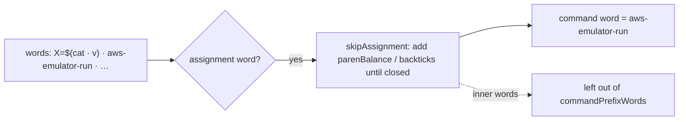

## Summary

`commandIndex` now skips the words that an assignment's unclosed `$( … )`,
`$(( … ))` or backtick value spans. `shellCommands` splits words at the blanks
inside such a value. Before this change, `X=$(cat v) aws-emulator-run -- ./test.sh`
read `v)` as the command word, and the best-practices scan reported missing AWS
Emulator wiring for a repository that was wired correctly. Closes #5378.

## Spec

### Intent and Rationale

- The issue offered two fixes. This one is in `commandIndex`, not in the
  `shellCommands` tokeniser, because many existing fixtures rely on
  `shellCommands` still exposing the commands inside a `$( … )`. Those
  fixtures include the round-11 and round-12 subshell and substitution tests in
  `worker/deno/tests/aws_emulator_in_ci_check_test.ts`.
- The skip reuses the existing quote-aware `parenBalance` and `backtickCount`
  helpers, so a quoted `)` does not close the substitution.

### Essential Design Decisions

- `env` assignment operands get the same skip (`env X=$(cat v) cmd`), because
  they are the same defect on the `env` path.
- The words inside a substitution are no longer prefix words. The new
  `commandPrefixWords` leaves them out, and the prefix checks that look for a
  standalone `!` or `exec` use it: `statusPreservingCommandIndex`,
  `staticStatus`, the `! cmd || exit 1` check in `failureExits`, and `viaExec`
  in `keptCommands`. Without this, `X=$(test ! v) runner` would read the inner
  `!` as inverting the runner's status. The `openAtCommand` parenthesis balance
  in `reachableCommands` still slices every word up to `commandIndex`, because
  it needs the closing word to balance.
- An assignment whose substitution never closes leaves no command word
  (`words.length`). This fails closed.
- Known limit, documented in the `commandIndex` doc comment and in
  `docs/BEST-PRACTICES-SCAN.md`: a substitution holding `;`, `|`, `&` or a line
  break is still split into separate commands by `shellCommands`, so
  `X=$(cat v | tr -d x) aws-emulator-run …` still earns no credit. A test row
  pins that outcome.

### Undiscoverable Facts

- On this milestone branch, `./t.sh` from the issue's example is not
  recognised as a test command, so the fixtures use `./test.sh`. The plain
  `aws-emulator-run -- ./t.sh` is false on the base branch too.

## Evidence

This is a backend change with no UI. Reproduction on the base branch
(`origin/milestone/aws-emulator-validator-hardening`) ran `workflowRunsAwsEmulator`
on a `pull_request` step:

- **False on the base branch:**
  - `X=$(cat v) aws-emulator-run -- ./test.sh`
  - `AWS_REGION=$(aws configure get region) aws-emulator-run -- ./test.sh`
  - ``X=`cat v` …``
  - `env X=$(cat v) …`
  - `X=$((1 + 2)) …`
- **True on the base branch:** `X="$(cat v)" …` and `X=$(date) …`.

Red/green: the new `--filter 5378` tests were run against the base branch's
production files, with the base `shell_command_words.ts` plus only a
`commandPrefixWords` export stub (`words.slice(0, commandIndex(words))`). The
result was 12 failed and 5 passed; the 5 that passed are the controls and the
false rows. At the head, all of them pass.

Issue numbers cited: #5378: shell_command_words: an assignment whose unquoted
`$( ... )` value holds a space hides the command after it, so
`VAR=$(cmd arg) aws-emulator-run -- ...` is not recognised.

## Standards Review

<!-- vibe-standards-review inputs="diff+CODING-STANDARDS.md" -->

- **violation** — Changing what a shared helper returns changes every caller: no test went through another existing caller — evidence: `worker/deno/lib/shell_command_words.ts` — reason: fixed in this diff
- **violation** — Every changed call site needs a test that goes red without it, for the prefix sites in `staticStatus` and `failureExits` — evidence: `worker/deno/lib/shell_command_words.ts` — reason: fixed in this diff
- **violation** — Prose about the PR's own change left out the `;`/`|`/line-break limit — evidence: `docs/BEST-PRACTICES-SCAN.md` — reason: fixed in this diff
- **violation** — The gate-over-text evasion table had no separator row and no nested row — evidence: `worker/deno/tests/aws_emulator_in_ci_check_test.ts` — reason: fixed in this diff
- **clean** — Checked "Check where you insert" (review-enforced), dummy and "how" tests, nothing test-only (`commandPrefixWords` has production callers), negative tests that hold the forbidden input, host-state isolation, no regex added, fail-closed on an unclosed substitution, no twinned copy of the command-word rule, Australian English, commit safety

## Test Plan

- Added the Issue #5378 tests to `worker/deno/tests/aws_emulator_in_ci_check_test.ts`. No existing test was edited.
  - A `workflowRunsAwsEmulator` table:
    - assignment, backtick, `env`, arithmetic, quoted-`)`, inner-`!` and nested-substitution rows that must be true;
    - controls that were already true;
    - false rows: `… echo aws-emulator-run`, a runner inside the substitution, an unclosed substitution, and the pinned `|` limit.
  - Direct `commandIndex` and `commandPrefixWords` tests with literal expected values.
  - A `checkAwsEmulatorInCI` test for a workflow step and a repository script, with an `echo $(cat v)` control.
  - Tests through other callers: the `cargo test` embedded route, the `staticStatus` prefix and the `failureExits` prefix.
- Twinned-rule search: no second copy of the command-word rule was found.
