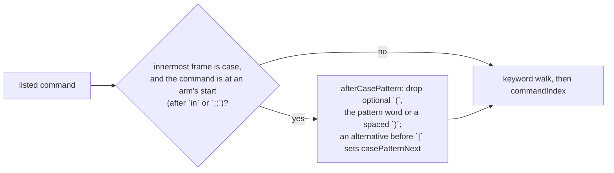

# PR Summary — Issue #5382

## Summary

`reachableCommands` in `worker/deno/lib/shell_command_words.ts` now removes a
`case` arm's pattern before callers read the command word. So
`test) aws-emulator-run -- ./t.sh ;;` on one line inside a `case` is credited
by `checkAwsEmulatorInCI`, just like the runner on its own line under `test)`.
Before this change, `test)` was read as the command word and the best-practices
scan could file `BP-AWS-EMULATOR-MISSING` against correct wiring.
Closes #5382.

## Spec

### Intent and Rationale

- `commandIndex` gets one command's words and has no way to tell that a `case`
  is open. The reachability walk does know, because it keeps a `case` frame, so
  that is where the pattern is removed. This matches how the walk already
  strips keywords such as `then`. Every `checkAwsEmulatorInCI` caller of
  `commandIndex` reads words that came from `reachableCommands`, so all of them
  see the stripped words.
- Recognised pattern forms: a word ending in an unquoted `)` with a negative
  parenthesis balance (`test)`, `*)`), an optional leading `(` (`(test)`), a
  spaced `)` (`test )`), and `|` alternatives. `shellCommands` splits
  `a|b)` at the `|` into the commands `a` and `b) cmd`, so an alternative is
  carried across those listed commands.

### Essential Design Decisions

- A pattern is only read at an arm's start: the first command after
  `case WORD in`, including on the header's own line
  (`case $1 in a) cmd ;; esac`), or a command after `;;`. It is only read when
  the innermost frame is that `case` and no untracked substitution is open. So
  an arm body's `(cd x && run)` or a real first command is never taken for a
  pattern.
- After a `;&` or `;;&` fall-through, the next arm keeps its pattern. Those
  separators reach the walk as `&`, which cannot be told apart from a
  backgrounded command. Such a runner is not credited (it fails closed), and the
  docs say so.
- An alternative's command (`b) cmd` after `a|`) takes `;;` as its separator,
  not `|`, so it is not judged as part of a pipe. `failureExits` takes the
  stripped words (the new `hereWords` parameter), so
  `test) ! runner || exit 1` is still refused for its `!`, and
  `test) if ! runner; then exit 1; fi` is recognised.
- A pattern alone on its line (`test)`) is no longer emitted as a command.
  Before, it was emitted with `test)` as its only word. A leading `(` of
  `(test)` no longer pushes a subshell frame.

### Undiscoverable Facts

- The issue's triage note puts this in the **AWS Emulator validator hardening**
  milestone with #5351 and #5378, which also change `commandIndex`. Their
  fixtures in `worker/deno/tests/aws_emulator_in_ci_check_test.ts` stay green.

## Evidence

This is a backend change with no UI. The new tests drive `reachableCommands`
directly and `checkAwsEmulatorInCI` end to end, through a temporary repository
with a CloudFormation template. A probe of the head code gave these results:

- `case "$1" in\n  test) ! aws-emulator-run -- ./test.sh || exit 1 ;;\nesac`
  emits `["!", "aws-emulator-run", …]` with `failureExits: false`.
- The same body without `!` gives `failureExits: true`.
- `(c) y ;& d) z` still emits `["d)", "z"]`. This is the documented
  fall-through limit.

Docs updated: `docs/BEST-PRACTICES-SCAN.md`. I read the whole command-word
paragraph ("The command word, once shell reserved words…") and added the
`case` pattern to the list of words that are skipped, with the `;&`/`;;&`
limit. The paragraph on `case` pattern parentheses (lines ~380–425) is about
parenthesis balance and stays true. I also updated the doc comments of the
module header, `commandIndex`, `failureExits`, `reachableCommands` and the new
`Frame.casePatternNext` field.

Issue numbers the diff adds: #5382: shell_command_words: `commandIndex` takes
a `case` pattern as the command word, so `pattern) aws-emulator-run -- ...` on
one line is not recognised.

## Test Plan

All new tests are at the end of
`worker/deno/tests/aws_emulator_in_ci_check_test.ts`:

- `reachableCommands - strips a case arm's pattern (Issue #5382)`. Fixtures:
  - a one-line arm;
  - `a|b)` (sep `;;`) and `a|b|c)`;
  - `(test)`, with no subshell pushed;
  - `test )`;
  - a second arm after `;;`;
  - a header on the same line;
  - a pattern alone on its line;
  - controls: a multi-line body whose first word is a real command, and a
    nested `case`.
- `checkAwsEmulatorInCI - a one-line case arm runs the runner in a step and a script (Issue #5382)`
  covers `test)`, `a|test)`, `(test)` and the one-line header, both in a
  workflow step and in a `set -euo pipefail` script. All give
  `official-server`. The control `test) echo aws-emulator-run …` gives
  `missing`.
- `checkAwsEmulatorInCI - failure-exit idioms inside a one-line case arm (Issue #5382)`
  uses a script without errexit:
  - `if ! runner; then exit 1; fi` gives `official-server`;
  - `runner || exit 1` gives `official-server`;
  - `! runner || exit 1` gives `missing`.
- Red run: all three tests failed against the unfixed code. The one-line arm
  emitted `["test)", "aws-emulator-run", …]`, and the step/script and `if !`
  cases gave `missing`. Then I put back only the old `failureExits` words. The
  `if !` assertion went red, so the `hereWords` change is needed.
- The full test file passed: 285 passed, 0 failed. No existing test was edited.
- `./quality.sh < /dev/null` on the head: `Result: PASSED (with skipped checks)`.
  The skipped checks were config integration and checkov. Deno tests, lint,
  type check, fmt, semgrep and markdownlint all passed.

Not done or not checked:

- `aws_emulator_workflow_check.ts`, the validator for this repository's own
  workflow, reads `shellSegments` and not `reachableCommands`, so it is
  unchanged.
- `;&`/`;;&` fall-through arms stay uncredited, as described above.
