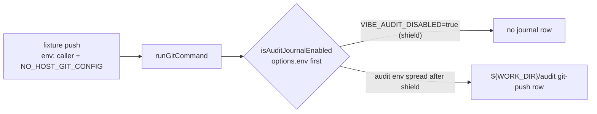

## Summary

Test git calls that carry the shared `NO_HOST_GIT_CONFIG` shield now also carry
`VIBE_AUDIT_DISABLED: "true"`. Before this change, a fixture push through
`runGitCommand` appended a hash-chained `git-push` row to the host's live
`${WORK_DIR}/audit` journal whenever a test ran with `WORK_DIR` in its
environment. Closes #5385.

## Spec

### Intent and Rationale

- `runGitCommand` (`worker/deno/lib/git_timeout.ts`) checks the audit gate
  through `options.env?.[key] ?? Deno.env.get(key)`. A plain `deno test` in a
  container that exports `WORK_DIR` therefore journalled every fixture push
  for a throwaway repository.
- The fix goes in the one shared constant rather than in each local helper.
  `runFixtureGit` and `runShieldedGit` spread `NO_HOST_GIT_CONFIG` last, and
  172 other test files under `worker/deno/tests/` import the shield or one of
  those two helpers. That covers the issue's fixture helpers, including the one
  in `worker/deno/tests/git_branch_sync_test.ts`, plus the production pushes
  those tests drive with `env: NO_HOST_GIT_CONFIG`. The issue named
  `runFixtureGit` as the place for this fix.

### Essential Design Decisions

- The off switch lives in `NO_HOST_GIT_CONFIG` itself, not in a second
  constant. The shield already exists to keep a test's git calls away from host
  state, and every git fixture already passes it.
- A test that asserts on the journal must spread its own audit env
  (`WORK_DIR`/`VIBE_AUDIT_DIR` plus `VIBE_AUDIT_DISABLED: "0"`) **after** the
  shield. The one test that spread it before the shield (the push-provenance
  test in `worker/deno/tests/git_timeout_test.ts`) was reordered.
- Production code is unchanged. `NO_HOST_GIT_CONFIG` is test support, and
  nothing under `worker/deno/lib/` or `worker/deno/commands/` imports it.

### Undiscoverable Facts

- The worker container's own shell exports `VIBE_AUDIT_DISABLED=1`. A test that
  relies on the process env therefore cannot tell the shield from the host
  setting. The new tests set `VIBE_AUDIT_DISABLED: "0"` in the caller env, so
  only the shield can switch the journal off.

## Evidence

Backend/test-support change only; no UI file is touched.

- Red against the base shield: with the base branch's
  `worker/deno/tests/support/no_host_git_config.ts` restored and the new tests
  kept, `deno task test:unit tests/no_host_git_config_test.ts` reported
  `FAILED | 12 passed | 3 failed`. The three tests that expect no journal
  failed, each with `journal written at …/audit/audit-no-host-5385-….jsonl`.
  The control passed.
- Green at head: the same command passes. Run together with
  `tests/git_timeout_test.ts` and `tests/git_branch_sync_test.ts`, the result
  is `ok | 39 passed | 0 failed`.
- Provenance numbers this diff adds: #5385, "Fixture pushes through
  `runGitCommand` write `git-push` rows to the live audit journal when a test
  file is run with `WORK_DIR` set". The other numbers in the touched headers
  were already there.

## Test Plan

- Added to `worker/deno/tests/no_host_git_config_test.ts`:
  - `runFixtureGit: a push with WORK_DIR in the caller env writes no audit journal row (Issue #5385)`
  - `runShieldedGit: a push with WORK_DIR in the caller env writes no audit journal row (Issue #5385)`
  - `runGitCommand with the shield in env: a push with WORK_DIR in the caller env writes no audit journal row (Issue #5385)`
  - Each test pushes to its own remote branch and asserts that the remote ref
    exists, so we know the push happened. It also asserts that no journal file
    exists and that `loadEntries` reports it as not found.
- Control: `control: the audit env after the shield re-enables the journal for one push (Issue #5385)`
  writes exactly one row with verb `git-push` and outcome `success`. This shows
  the fixture reaches the journalling step, so the three tests above are not
  vacuous.
- Edited `worker/deno/tests/git_timeout_test.ts`, test
  `git timeout - push provenance excludes remote owner commits even with a stale tracking ref`.
  - Only the spread order changed: `{ ...env, ...NO_HOST_GIT_CONFIG, ...auditEnv }`.
  - No assertion was removed. The test still asserts one journal entry with the
    expected `deliveredCommits`.
  - It would go red if the shield were spread last, because the journal would
    then be empty.
- Shield users run unchanged after the shield edit: `deno task test:unit`
  over `tests/git_branch_sync_test.ts`, `tests/sync_points_test.ts`,
  `tests/untrusted_gate_spawn_test.ts` and `tests/fleet_pr_babysitter_test.ts`
  gave `ok | 182 passed | 0 failed`. That run also listed
  `tests/shellcheck_publication_test.ts`, but the unit runner skips it as an
  integration suite, so it is not covered there.
- `./quality.sh`: this line is rewritten with the gate's real result once it
  has run on this head.
  <!-- vibe-quality-gate-skipped reason="two earlier attempts were stopped by the host-disk guard before the gate finished; rerun in progress" -->
