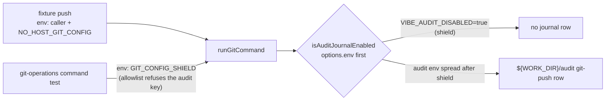

## Summary

Test git calls that carry the shared `NO_HOST_GIT_CONFIG` shield now also carry
`VIBE_AUDIT_DISABLED: "true"`. Before this change, a fixture push through
`runGitCommand` appended a hash-chained `git-push` row to the host's live
`${WORK_DIR}/audit` journal whenever a test ran with `WORK_DIR` in its
environment. A new git-only constant, `GIT_CONFIG_SHIELD`, serves the one
caller whose env allowlist refuses the audit key. Closes #5385.

## Spec

### Intent and Rationale

- `runGitCommand` (`worker/deno/lib/git_timeout.ts`) checks the audit gate
  through `options.env?.[key] ?? Deno.env.get(key)`. A plain `deno test` in a
  container that exports `WORK_DIR` therefore journalled every fixture push
  for a throwaway repository.
- The fix goes in the one shared constant rather than in each local helper.
  `runFixtureGit` and `runShieldedGit` spread `NO_HOST_GIT_CONFIG` last, and
  172 other test files under `worker/deno/tests/` import the shield or one of
  those two helpers. That covers the issue's fixture helpers, including the one
  in `worker/deno/tests/git_branch_sync_test.ts`, plus the production pushes
  those tests drive with `env: NO_HOST_GIT_CONFIG`. The issue named
  `runFixtureGit` as the place for this fix.

### Essential Design Decisions

- The off switch lives in `NO_HOST_GIT_CONFIG` itself, not in a second
  constant. The shield already exists to keep a test's git calls away from host
  state, and every git fixture already passes it.
- A test that asserts on the journal must spread its own audit env
  (`WORK_DIR`/`VIBE_AUDIT_DIR` plus `VIBE_AUDIT_DISABLED: "0"`) **after** the
  shield. The one test that spread it before the shield (the push-provenance
  test in `worker/deno/tests/git_timeout_test.ts`) was reordered.
- The production `git-operations` command was not changed. Its `env` argument
  accepts only the three `GIT_CONFIG_*` keys (`SHIELD_ENV_KEYS` in
  `worker/deno/commands/git_operations.ts`, Issue #5371). Widening that list
  would let a caller switch off the tamper-evident audit journal.
  - The three tests in `worker/deno/tests/milestone_branch_ensure_test.ts` that
    call that command now pass `GIT_CONFIG_SHIELD`.
  - Accepted residual: a push that the command itself performs in those tests
    can still be journalled if the process env carries `WORK_DIR`. It is a
    production push driven by the code under test, not a fixture helper.
    `deno task test:unit` strips `WORK_DIR`, so the gate never reaches it.
- Production code is unchanged. Both constants are test support, and nothing
  under `worker/deno/lib/` or `worker/deno/commands/` imports them.

### Undiscoverable Facts

- The worker container's own shell exports `VIBE_AUDIT_DISABLED=1`. A test that
  relies on the process env therefore cannot tell the shield from the host
  setting. The new tests set `VIBE_AUDIT_DISABLED: "0"` in the caller env, so
  only the shield can switch the journal off.

## Evidence

Backend/test-support change only; no UI file is touched.

- Red against the base shield: with the base branch's
  `worker/deno/tests/support/no_host_git_config.ts` restored and the new tests
  kept, `deno task test:unit tests/no_host_git_config_test.ts` reported
  `FAILED | 12 passed | 3 failed`. The three tests that expect no journal
  failed, each with `journal written at …/audit/audit-no-host-5385-….jsonl`.
  The control passed.
- Green at head: the full `deno task test:unit` passed both passes. The
  parallel pass reported `ok | 36316 passed (4 steps) | 0 failed | 5 ignored`,
  and the serial pass also passed.
- Before the `GIT_CONFIG_SHIELD` split, that same full run caught three
  failures in `worker/deno/tests/milestone_branch_ensure_test.ts`, each
  `Refused env key 'VIBE_AUDIT_DISABLED': only GIT_CONFIG_COUNT, GIT_CONFIG_GLOBAL, GIT_CONFIG_NOSYSTEM may be passed`.
- Provenance numbers this diff adds:
  - #5385: "Fixture pushes through `runGitCommand` write `git-push` rows to the
    live audit journal when a test file is run with `WORK_DIR` set"
  - #5371: "Tests that push through production code still run `git push`
    under the host's git hooks and config"

## Test Plan

- Added to `worker/deno/tests/no_host_git_config_test.ts`:
  - `runFixtureGit: a push with WORK_DIR in the caller env writes no audit journal row (Issue #5385)`
  - `runShieldedGit: a push with WORK_DIR in the caller env writes no audit journal row (Issue #5385)`
  - `runGitCommand with the shield in env: a push with WORK_DIR in the caller env writes no audit journal row (Issue #5385)`
  - Each test pushes to its own remote branch and asserts that the remote ref
    exists, so we know the push happened. It also asserts that no journal file
    exists and that `loadEntries` reports it as not found.
- Control: `control: the audit env after the shield re-enables the journal for one push (Issue #5385)`
  writes exactly one row with verb `git-push` and outcome `success`. This shows
  the fixture reaches the journalling step, so the three tests above are not
  vacuous.
- Edited `worker/deno/tests/git_timeout_test.ts`, test
  `git timeout - push provenance excludes remote owner commits even with a stale tracking ref`.
  - Only the spread order changed: `{ ...env, ...NO_HOST_GIT_CONFIG, ...auditEnv }`.
  - No assertion was removed. The test still asserts one journal entry with the
    expected `deliveredCommits`.
- Edited `worker/deno/tests/milestone_branch_ensure_test.ts`. Three tests change
  only their `env` argument to the command, from `NO_HOST_GIT_CONFIG` to
  `GIT_CONFIG_SHIELD`; no assertion was removed. The tests are:
  - `git operations command - ensure-milestone-branch fails loud instead of falling back`
  - `git operations command - ensure-milestone-branch recreates a missing branch`
  - `git operations command - ensure-milestone-branch refuses an env that widens the git shield (Issue #5371)`.
    This one again reaches the `GIT_SSH_COMMAND` refusal it names. Its input is
    the git-only shield plus `GIT_SSH_COMMAND`, so no earlier key is refused
    first. The same shield alone is accepted by the `recreates a missing
    branch` test.
- `./quality.sh < /dev/null` was run once in the foreground at head and
  reported `Result: PASSED (with skipped checks)`: every stage passed, including
  `deno tests`, `deno lint`, `deno type check`, `deno fmt`, semgrep and
  gitleaks; config integration and checkov were skipped by the gate itself.
- `deno task test:unit` over `tests/milestone_branch_ensure_test.ts`,
  `tests/no_host_git_config_test.ts`, `tests/git_timeout_test.ts`,
  `tests/git_operations_command_test.ts` and `tests/git_branch_sync_test.ts`
  at head gave `ok | 57 passed | 0 failed`.
