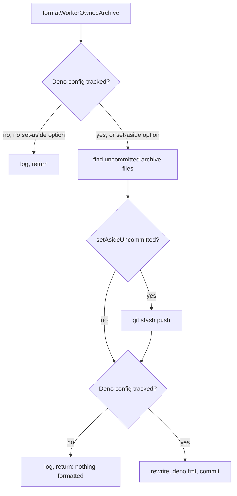

# PR Summary — Issue #5393

## Summary

The completion phase's set-aside of an uncommitted archive edit (the git stash
added for #5328) now runs in a repository that tracks no `deno.json` or
`deno.jsonc`. Before this change, `formatWorkerOwnedArchive` returned at the "no
Deno formatter in this repository" check before it reached the stash. In a
repository with no Deno config, such as a Cargo-only one, an interrupted
recovery turn's summary rewrite was left in the working tree. The pre-push
gate's markdownlint and cspell checked it, and a pre-push recovery commit
(`git add -A`) could commit it. Closes #5393.

## Spec

### Intent and Rationale

- The issue offered two fixes: stash on the summary-rule failure path, or make
  the completion phase's set-aside independent of the Deno-config check. This PR
  does the second. It covers every way the completion gate can meet the edit,
  not only the summary-rule failure path, and it reuses the existing
  `stashUncommittedArchive` step.

### Essential Design Decisions

- With no Deno config, the stash runs only when the caller passes
  `setAsideUncommitted`. Only the completion phase passes it. The other callers
  (the quality-gate loop and the PR-feedback, CI-fix and spelling processors)
  still return at the Deno-config check, so they behave as before.
- With no Deno config, nothing is rewritten, formatted or committed after the
  stash. The archive is still formatted only where a Deno config exists.

### Undiscoverable Facts

- markdownlint-cli2 reads the file on disk (`--no-globs <path>` with the
  repository root as its working directory). The new completion test's positive
  control shows this: the bare gate blocks on the uncommitted MD001 violation.

## Evidence

Backend-only change; no UI files.

- Red run on base: I restored `worker/deno/lib/repo_formatters.ts` from the base
  and kept the new tests. `deno test -A ... --filter 5393` gave 1 passed and 2
  failed. The completion test failed with
  `[PRE_PUSH_BLOCKED] ... markdownlint-cli2' --no-globs 'docs/archive/pr-summaries/pr-summary-10.md'`
  failed with exit code 1. The formatter test failed because the edit was still
  on disk.
- Green run at head:
  `deno test -A tests/repo_formatters_4129_test.ts tests/completion_phase_repo_formatters_test.ts`
  gave 41 passed and 0 failed.
- Issue numbers cited as provenance: #5393 (this issue). #5328 is cited only
  through the existing stash message and docs.

## Test Plan

- `worker/deno/tests/repo_formatters_4129_test.ts`:
  - The helper `formatSeededFiles` accepts `denoConfig: null`, which seeds no
    Deno config. Existing callers are unchanged.
  - Added "formatBeforeGate stashes an uncommitted archive summary when asked in
    a repository with no Deno config (Issue #5393)". It asserts that the file on
    disk equals the committed copy, the stash holds the edit, there is no
    formatter commit, and the clean archive file is not formatted. Red on base.
  - Added the control "…leaves an uncommitted archive summary alone without the
    set-aside option in a repository with no Deno config (Issue #5393)". It
    asserts that the edit stays, the stash list is empty and there is no commit.
    This test pins unchanged behaviour, so it is expected green on base, and it
    was.
- `worker/deno/tests/completion_phase_repo_formatters_test.ts`:
  - Added "completion - in a repository with no Deno config an uncommitted
    archive summary edit is still set aside (Issue #5393)". Its positive
    control: the bare gate blocks on the uncommitted markdownlint violation.
    Through `workOnIssueCompletion`, the push succeeds, HEAD is unchanged, the
    committed copy is on disk, and the stash holds the rewrite. Red on base. CI
    fix: the test returns early (with a `console.warn`) when no runnable
    `markdownlint-cli2` is found, the same way the Rust tests skip without
    `cargo`. The validate-scripts runner has none installed, so the gate
    correctly blocked with "markdownlint-cli2 could not be found".
- No existing test was edited.
- Docs: I corrected the formatter paragraph in `docs/INTERNALS.md` and the
  archive-formatting section in `docs/CONFIGURATION.md`, which said the stashed
  copy is always formatted and committed. I also updated the doc comments on
  `formatWorkerOwnedArchive`, `stashUncommittedArchive` and `formatBeforeGate`.
  In `docs/` (excluding the archive) and `README.md`, grep found no other
  matches for "no Deno formatter" or `setAsideUncommitted`.
- `./quality.sh < /dev/null`: PASSED (with skipped checks).

## Not checked

- I did not separately exercise the summary-rule failure path
  (`recoverFromSummaryRuleBlock` calling `rerunCompletion`). It reaches the same
  completion `formatBeforeGate` call that the new completion test drives.
- A summary that was never committed is untracked, and the branch-changed file
  list does not include it, so it is not set aside. That case is outside this
  issue.

🤖 Generated with [Claude Code](https://claude.com/claude-code)
