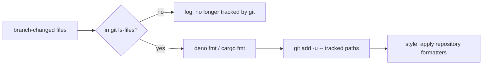

# PR Summary — Issue #5410

## Summary

The repository formatters now leave out any branch-changed path git no longer
tracks (removed from the index with `git rm --cached`, still on disk). Before
this change such a path reached `deno fmt` and then `git add -u -- <paths>`,
whose unmatched literal pathspec failed the whole add, so the
`style: apply repository formatters` commit was abandoned and the files that
were formatted correctly stayed uncommitted. Both `runRepoFormatters` and the
archive step `formatWorkerOwnedArchive` now filter their path lists against the
`git ls-files -z` result they already read, and log the paths they left out.
Closes #5410.

## Spec

### Intent and Rationale

- Filtering against the tracked list both functions already read is the
  smallest fix, and it matches what the push carries: an untracked file is not
  in the pushed commit, so formatting it would only change the working tree.

### Essential Design Decisions

- An untracked path is neither formatted nor staged; its on-disk content is
  left exactly as it was, and an info line names it (`no longer tracked by
  git`) so the skip is never silent.
- The filter runs before `withoutUncommittedArchive` and before
  `planFormatterFixes`, so a planner never sees the untracked path.

### Undiscoverable Facts

- Observed on this host's git: `git add -u -- ':(literal)src/gen.ts'` for an
  index-removed file exits 128 with `error: pathspec ':(literal)src/gen.ts' did
  not match any file(s) known to git`; the new real-git test reproduces it on
  the base code.

## Evidence

Backend-only change (`worker/deno/lib/repo_formatters.ts`); no UI files.

- `worker/deno/tests/repo_formatters_5410_test.ts` — two real-git, real
  `deno fmt` tests: a code file (`src/gen.ts`) and an archive Markdown file
  (`docs/archive/handover/issue-1.md`) untracked by a later commit; in each the
  other formatted file is committed in the formatter commit and the untracked
  file is unchanged on disk and still untracked.
- `worker/deno/tests/repo_formatters_test.ts` — fake-git unit test asserting the
  untracked path is absent from the `deno fmt` argv and the `git add` pathspecs,
  and that the info line names it.
- Docs: `docs/CONFIGURATION.md` (repository formatters section) and the module
  and function doc comments in `repo_formatters.ts` name the new exclusion.

## Test Plan

- Red on base: with `worker/deno/lib/repo_formatters.ts` restored from
  `origin/milestone/repo-formatters-and-summary-recovery`, the three new
  Issue #5410 tests failed (`AssertionError: Values are not equal`) and the
  other 19 tests in those two files passed.
- Green on head: `deno test -A tests/repo_formatters_5410_test.ts
  tests/repo_formatters_test.ts tests/repo_formatters_4129_test.ts` from
  `worker/deno` — 52 passed, 0 failed.
- Edited existing tests (`worker/deno/tests/repo_formatters_test.ts`,
  `worker/deno/tests/repo_formatters_4129_test.ts`): fixture-only changes. Their
  fake `git ls-files` output listed only config files, so the changed paths
  each test formats are now added to that list; with the new filter they would
  otherwise be dropped before reaching the formatter the test asserts on. No
  assertion was removed or changed, and each edited test still passes on the
  base code, so it still guards the behaviour it did before.
- `./quality.sh < /dev/null` — result recorded below after the final run.
