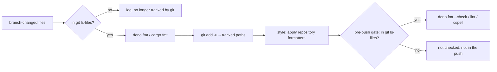

# PR Summary — Issue #5410

## Summary

The repository formatters now leave out any branch-changed path git no longer
tracks (removed from the index with `git rm --cached`, still on disk). Before
this change such a path reached `deno fmt` and then `git add -u -- <paths>`,
whose unmatched literal pathspec failed the whole add, so the
`style: apply repository formatters` commit was abandoned and the files that
were formatted correctly stayed uncommitted. Both `runRepoFormatters` and the
archive step `formatWorkerOwnedArchive` now filter their path lists against the
`git ls-files -z` result they already read, and log the paths they left out. The
pre-push gate (`runPrePushGate`) now filters its formatter, lint and cspell
selection against its own `git ls-files -z` list too, so the gate and the
formatters agree on scope: an untracked file the formatters leave unformatted on
disk no longer blocks the push with `deno fmt --check`.

Closes #5410.

## Spec

### Intent and Rationale

- Filtering against the tracked list both functions already read is the smallest
  fix, and it matches what the push carries: an untracked file is not in the
  pushed commit, so formatting it would only change the working tree.

### Essential Design Decisions

- An untracked path is neither formatted nor staged; its on-disk content is left
  exactly as it was, and an info line names it (`no longer tracked by
  git`) so
  the skip is never silent.
- The filter runs before `withoutUncommittedArchive` and before
  `planFormatterFixes`, so a planner never sees the untracked path.
- The gate applies the same filter to `formatterCandidates` in
  `worker/deno/lib/pre_push_gate.ts`, using the `git ls-files -z` list it
  already read. `listPushedFiles` reads per-commit `git log --name-only`, so a
  path an earlier pushed commit added and a later one untracked is still listed
  while on disk; without the filter the gate ran `deno fmt --check` on a file
  the formatters had left alone. Unit tests, markdownlint triggering and the CI
  cargo paths still read the unfiltered lists, as before.

### Undiscoverable Facts

- Observed on this host's git: `git add -u -- ':(literal)src/gen.ts'` for an
  index-removed file exits 128 with
  `error: pathspec ':(literal)src/gen.ts' did
  not match any file(s) known to git`;
  the new real-git test reproduces it on the base code.

## Evidence

Backend-only change (`worker/deno/lib/repo_formatters.ts`,
`worker/deno/lib/pre_push_gate.ts`); no UI files.

- `worker/deno/tests/repo_formatters_5410_test.ts` — two real-git, real
  `deno fmt` tests: a code file (`src/gen.ts`) and an archive Markdown file
  (`docs/archive/handover/issue-1.md`) untracked by a later commit; in each the
  other formatted file is committed in the formatter commit and the untracked
  file is unchanged on disk and still untracked. A third real-git test runs
  `formatBeforeGate` and then the real `runPrePushGate` on the issue's scenario
  (root `deno.json`, unformatted `src/bad.ts` and `src/gen.ts` committed, then
  `git rm --cached src/gen.ts` committed): the gate passes, its checks name
  `src/bad.ts` and never `src/gen.ts`.
- `worker/deno/tests/repo_formatters_test.ts` — fake-git unit test asserting the
  untracked path is absent from the `deno fmt` argv and the `git add` pathspecs,
  and that the info line names it.
- Docs: `docs/CONFIGURATION.md` (repository formatters section, now naming the
  gate's matching skip) and the module and function doc comments in
  `repo_formatters.ts` name the new exclusion.

## Test Plan

- Red on base: with `worker/deno/lib/repo_formatters.ts` restored from
  `origin/milestone/repo-formatters-and-summary-recovery`, the three new Issue
  #5410 tests failed (`AssertionError: Values are not equal`) and the other 19
  tests in those two files passed.
- Red on base for the gate test: with only the `pre_push_gate.ts` change
  reverted, the new gate test failed with
  `command deno fmt --check --permit-no-files 'src/bad.ts' 'src/gen.ts' failed
  with exit code 1`;
  with it restored the test passed.
- Green on head:
  `deno test -A tests/repo_formatters_5410_test.ts
  tests/repo_formatters_test.ts tests/repo_formatters_4129_test.ts
  tests/completion_phase_repo_formatters_test.ts tests/pre_push_gate_test.ts
  tests/babysitter_tree_gate_test.ts`
  from `worker/deno` — 345 passed, 0 failed.
- All nine `tests/*pre_push*_test.ts` files on head: 331 passed, 1 failed. The
  failure,
  `completion - an uncommitted recovery fix cannot pass the gate and
  advance origin`
  (`completion_phase_pre_push_gate_3689_test.ts`), fails the same way
  (`continue` where `failure` is expected) on
  `origin/milestone/repo-formatters-and-summary-recovery` and on this branch
  without the gate change, so it is not caused by this diff.
- Edited existing tests (`worker/deno/tests/repo_formatters_test.ts`,
  `worker/deno/tests/repo_formatters_4129_test.ts`): fixture-only changes. Their
  fake `git ls-files` output listed only config files, so the changed paths each
  test formats are now added to that list; with the new filter they would
  otherwise be dropped before reaching the formatter the test asserts on. No
  assertion was removed or changed, and each edited test still passes on the
  base code, so it still guards the behaviour it did before.
- `deno fmt --check`, `deno lint` and `deno check` on the touched TypeScript
  files from `worker/deno` — passed; markdownlint on `docs/CONFIGURATION.md` — 0
  issues.
- `./quality.sh < /dev/null` was started on the head under a 900s bound: the
  first 15 checks passed (chokepoints, completeness, mermaid, markdownlint,
  semgrep, gitleaks, release-tag ruleset), then the bound expired in the next
  sequential stage before it reported, so the full gate did not complete here.

<!-- vibe-quality-gate-skipped reason="./quality.sh exceeded the 900s bound this run allowed in sequential container mode after 15 checks passed; the worker re-runs the gate before the PR is raised" -->
