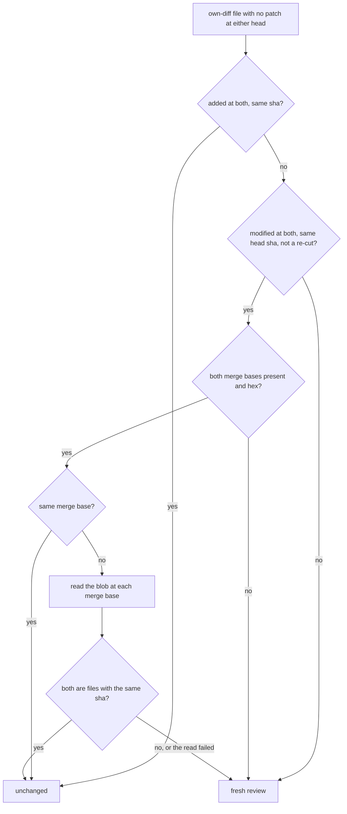

# PR Summary — Issue #5415

## Summary

`ownDiffUnchanged` in `.claude/skills/review-fleet-prs/scripts/gate.ts` now
treats a modified file that GitHub sends with no `patch` as unchanged in one
case: it is `modified` at both heads with the same head blob sha, and its
base-side blob is the same at both merge bases. GitHub omits the patch for a
large text diff as well as for a binary. Before this change, a sent-back PR
that modifies one large file got a full re-review after every base merge,
which is what happened on VibeCoder#5332. Closes #5415.

## Spec

### Intent and Rationale

- A head blob that matches at both heads is not enough on its own: the own diff also depends on the base side. Equal head blobs together with equal base-side blobs mean a byte-identical own diff, which is at least as strict as a matching patch.
- The merge bases come from the `merge_base_commit` of the two `compare/{base}...` responses the function already fetches. The contents API (`repos/{repo}/contents/{path}?ref={mergeBase}`) is read only when those merge bases differ.

### Essential Design Decisions

- The contents reads run after the per-file loop, so they happen only once every other file has already matched.
- The rule fails closed. Each of these still gets a fresh review: a missing merge base, a merge base that is not hex, a contents answer that is not `type: "file"` with a `sha`, a failed read (the existing catch turns it into `false`), a patch on one side only, a differing status, and a differing head sha.
- Assumption: "a Dependabot re-cut keeps its strict path" means a re-cut gets no blob route for a modified file. It is excluded explicitly (`!recut`), so its behaviour is unchanged.
- An added file still takes `sameAddedBlob`. The existing case "A modified file with no patch (a changed binary)…" stays `false`: its compare responses carry no merge base.

### Undiscoverable Facts

- Observed live: `gh api repos/stSoftwareAU/VibeCoder/compare/main...683721e95` and `.../main...2222b108d` both list `docs/BEST-PRACTICES-SCAN.md` as `{"status":"modified","sha":"2e1d1ebd…","previous_filename":null}` with no `patch`. Their `merge_base_commit.sha` values are `a2af0edd9…` and `651abab55…`. `gh api "repos/stSoftwareAU/VibeCoder/contents/docs/BEST-PRACTICES-SCAN.md?ref=<each>"` returns `{"type":"file","sha":"b2b922f869febeb03dc1fb203c41b94760f41d71"}` at both. The test fixtures use these values.

## Evidence

This is a backend/CLI change only.

- The docs say the same thing in rule 8 of `.claude/skills/review-fleet-prs/SKILL.md` and in the "Version-only re-bumps" section of `.claude/skills/review-fleet-prs/references/edge-cases.md`. Both now note that GitHub also omits the patch of a large text diff.
- Fakes: `fakeGh` in the test file stands in for `gh api`. Its compare and contents bodies follow the live output quoted above.

## Acceptance Criteria

<!-- vibe-spec-review inputs="diff+issue-body" -->

- **met** — it is `modified` at both heads, with the same `previous_filename` — evidence: `.claude/skills/review-fleet-prs/scripts/gate.ts` (`sameModifiedBlob`; the existing `previous_filename` check runs first) — reviewer: met
- **met** — its `sha` (the head blob) is a non-empty string and the same at both heads — evidence: `worker/deno/tests/review_fleet_prs_gate_2675_test.ts::A patch-less modified file whose head blob changed is a fresh review (Issue #5415)` — reviewer: met
- **met** — its base-side blob is the same at both merge bases — evidence: `worker/deno/tests/review_fleet_prs_gate_2675_test.ts::A patch-less modified file with the same head and base blobs is awaiting-fix at differing merge bases (Issue #5415)` — reviewer: met
- **met** — a patch on only one side, a missing or differing head sha, a differing status, a missing merge base, a differing base blob or a failed read still gets a fresh review — evidence: the "patch on one side only", "merge base missing on one side", "base blob differs" and "base blob is not a readable file" tests in `worker/deno/tests/review_fleet_prs_gate_2675_test.ts` — reviewer: met
- **met** — an added file keeps `sameAddedBlob` — evidence: `worker/deno/tests/review_fleet_prs_gate_2675_test.ts::skipReason: an added binary with the same blob sha is awaiting-fix (Issue #3063)` — reviewer: met
- **met** — a Dependabot re-cut keeps its strict path — evidence: `worker/deno/tests/review_fleet_prs_gate_2675_test.ts::A Dependabot re-cut does not confirm a patch-less modified file by its blobs (Issue #5415)` — reviewer: met
- **met** — Correct the comment above `sameAddedBlob` … and say the same in rule 8 of `.claude/skills/review-fleet-prs/SKILL.md` and the "Version-only re-bumps" passage of `references/edge-cases.md` — evidence: the diff to those three files — reviewer: met
- **met** — Tests 1–5 in `worker/deno/tests/review_fleet_prs_gate_2675_test.ts` — evidence: the five tests named in the Test Plan — reviewer: met
- **unrequested** — the merge base must be hex, the contents answer must be `type: "file"`, each path segment is URL-encoded, and three extra refusal tests were added — reviewer: unrequested — reason: these guards fail closed and keep the `ref=` query and the path well-formed. The extra tests cover the "keep everything else" list.

## Standards Review

<!-- vibe-standards-review inputs="diff+CODING-STANDARDS.md" -->

- **violation** — the rewritten `SIMPLE-ON-PURPOSE` marker spread over several lines, so `parseSimpleOnPurposeLine` could not read it — evidence: `.claude/skills/review-fleet-prs/scripts/gate.ts:710` — reason: fixed in this diff
- **violation** — the "merge base missing" test stayed green with its guard removed, because the fake threw into the catch — evidence: `worker/deno/tests/review_fleet_prs_gate_2675_test.ts:1682` — reason: fixed in this diff. The fake now answers the contents endpoints for the bad ref, and a malformed-merge-base test was added. With the guard removed, both were observed red.
- **violation** — "how" assertions on the fake's recorded `calls` — evidence: `worker/deno/tests/review_fleet_prs_gate_2675_test.ts:1607` — reason: fixed in this diff. They were removed, and the outcomes now prove the reads.
- **clean** — gate correctness and fail-closed paths; path encoding and hex-checked `ref`; fail-loud handling through the existing catch; the edited #3063 test still fails without its guard; the docs change owed (SKILL.md, edge-cases.md, doc comments); Australian English; no test-only production members; insertion points (a rule enforced by review). Optional note acted on: the `baseBlobAt` comment now says correctly that a symlink to an in-repo file is answered as that file.

## Test Plan

- Added to `worker/deno/tests/review_fleet_prs_gate_2675_test.ts`. The tests matching issue items 1–5 are first:
  - `A patch-less modified file with the same head and base blobs is awaiting-fix at differing merge bases (Issue #5415)`: issue item 1. It runs with findings that name the file, with findings `undefined` and with findings `[]`.
  - `A patch-less modified file with one shared merge base reads no contents (Issue #5415)`: issue item 2. The fake has no contents endpoint, so any read would throw.
  - `A patch-less modified file whose base blob differs between the merge bases is a fresh review (Issue #5415)`: issue item 3.
  - `A patch-less modified file whose head blob changed is a fresh review (Issue #5415)`: issue item 4.
  - `A patch-less modified file whose base blob is not a readable file is a fresh review (Issue #5415)`: issue item 5. It covers a missing endpoint (the read throws), an unresolved symlink, a directory array, and a missing `sha`.
  - `A patch-less modified file with a merge base missing on one side is a fresh review (Issue #5415)`, `A patch-less modified file with a malformed merge base on one side is a fresh review (Issue #5415)`, `A modified file with a patch on one side only is a fresh review (Issue #5415)` and `A Dependabot re-cut does not confirm a patch-less modified file by its blobs (Issue #5415)`. Each refusal test includes an accepted control.
- TDD: run against the unfixed `gate.ts`, the test file gave `FAILED | 72 passed | 6 failed`. The shared-merge-base and differing-merge-base cases expected `"awaiting-fix"` and got `null`. With the merge-base guard removed, the merge-base-missing, malformed-merge-base and #3063 tests were observed red.
- Edited existing tests:
  - The `compareFiles` helper gained an optional `mergeBase` argument. Its output is unchanged when the argument is omitted.
  - The comment on the #3063 case "A modified file with no patch (a changed binary)…" now says the case stays `false` because no merge base is carried. Its fixture and its `false` assertion are unchanged, so no assertion was removed.
- Final head: `deno test --allow-all tests/review_fleet_prs_gate_2675_test.ts` (from `worker/deno`) gave `ok | 79 passed | 0 failed`. `deno fmt --check`, `deno lint` and `deno check` on both files passed.
- The 12 other `review_fleet_prs_*` test files that import `gate.ts` were run after the first commit: `ok | 177 passed | 0 failed`. The second commit changes only comments in `gate.ts`, so they were not re-run.
- The skill-doc tests (`pr_review_brief_shared_3395_test.ts`, `review_fleet_prs_learn_3396_test.ts`, `review_fleet_prs_private_refs_test.ts`, `review_fleet_prs_skill_labels_2882_test.ts` and `review_fleet_prs_skill_links_3300_test.ts`, all in `worker/deno/tests/`) all passed. `markdownlint-cli2` on both docs reported 0 issues.
- Shared helper: `ownDiffUnchanged` has one production caller, the `skipReason` wiring in `gate.ts`. The tests go through `skipReason` with `ownDiffUnchanged` and the real `gh` argument shape.

<!-- vibe-quality-gate-skipped reason="budget: ./quality.sh runs the whole repository suite sequentially in the container and was still running when the 900s timeout killed it (exit 143); the targeted checks above passed" -->

Not done or not checked: the full `./quality.sh` (see the note above). The worker runs it again before the PR is raised.
